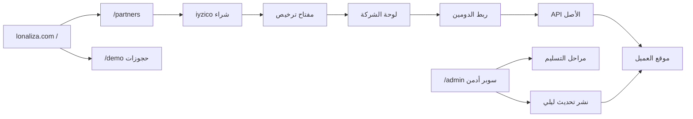

---

name: Reseller License System
overview: تحويل lonaliza.com إلى الأصل (سوبر أدمن + صفحة هبوط + لوحة شركات)، ونقل موقع الحجوزات إلى /demo، وبناء طبعة عميل مرخّصة مربوطة بدومين واحد، مع جولة تعليمية تفاعلية من هيدر الأدمن تشرح كل قسم. تُنسخ خدمات الديمو مع حذف جماعي، وتُنقل تكاملات RapidAPI/الطيران، ويُستثنى كشط الفنادق الداخلي وميزات إعادة البيع من نسخة العميل.
todos:

- id: pb-resale-schema
content: مجموعات PocketBase لإعادة البيع + DEPLOYMENT_ROLE + قسم /admin/resale (إعدادات، شركات، مراحل، تراخيص)
status: pending
- id: demo-routing-landing
content: نقل الموقع السياحي إلى /demo مع 301، وبناء صفحة الهبوط من مكونات 21st.dev حصراً مع i18n
status: pending
- id: partners-portal
content: "لوحة /partners: جوجل، شراء iyzico، المفتاح، المراحل، الدومين، اختبار الربط، الدعم عند الفشل"
status: pending
- id: license-protocol
content: بروتوكول الترخيص المشفر والربط بأول دومين والقفل fail-closed وحالة online/متوقف
status: pending
- id: provision-script
content: سكربت الاستنساخ مع بذرة ديمو (خدمات/مقالات/حجوزات) وحذف جماعي، استثناء الكشط فقط، ونقل تكاملات RapidAPI/الطيران كاملة
status: pending
- id: updates-subscription
content: اشتراك 50$/شهر وسحب التحديثات الليلي للمشتركين وقفل القسم لغير المشتركين
status: pending
- id: admin-interactive-tour
content: جولة تعليمية تفاعلية من هيدر الأدمن (عميل + سوبر أدمن) تشرح كل قسم بسهم ونافذة كبيرة والتالي/السابق
status: pending
isProject: false

---

# نظام إعادة بيع LIOTRIP والترخيص

## الواقع الحالي

المشروع **نسخة واحدة** (Next.js 16 + PocketBase + iyzico) على `lonaliza.com` بدون مستأجرين أو تراخيص أو أدوار. الأدمن الحالي صلاحية واحدة. كشط الفنادق الحصري هو مجلد `[hotel-engine/](hotel-engine/)` + `[src/lib/scraping/](src/lib/scraping/)` + مزود `owned`.

القرارات المتفق عليها:

- صفحة الهبوط ولوحة الشركات على **نفس دومين lonaliza.com**
- موقع الحجوزات الحالي ينتقل إلى `/demo`
- نسخة العميل تعمل على **دومينه الخاص**
- الدفع: **iyzico + واتساب بنكي** — سعر مدى الحياة يُضبط من لوحة السوبر أدمن
- التحديثات: **50 دولار/شهر اختيارية**
- **محتوى الديمو يُنقل** لكل شركة جديدة: حجوزات الريان، المقالات، والخدمات (باقات، جولات، فنادق داخلية، سيارات، ترانسفير، تأشيرات، صفحات) — مع وسم `is_demo_seed` ليحددها العميل جماعياً ويحذفها وينشئ محتواه
- **تكاملات الطيران والفنادق الخارجية تُنقل كاملة** (RapidAPI Travel Advisor، Booking.com15، Sky Scrapper، Travelpayouts، iyzico) وتعمل كما هي
- **يُستثنى فقط** نظام كشط الفنادق الداخلي (`hotel-engine` + مزود `owned`) — لا يُنقل للكود ولا للبيانات ولا للأسرار
- **جولة تعليمية تفاعلية** في لوحة الأدمن (تفعيل من الهيدر في أي وقت) للعميل وللسوبر أدمن: نافذة كبيرة + سهم ينتقل للقسم التالي حتى يتعلم كل الميزات

## مبدأ الترخيص (مهم)

نظام الترخيص سيكون **احترافياً وfail-closed**: المفتاح يُربط بأول دومين يفعَّل بنجاح، ونبضة مشفّرة من سيرفر العميل إلى الأصل، والنسخة غير المرخّصة أو المنسوخة على دومين آخر **لا تعمل** (قفل تشغيل + صفحة ترخيص). التحديثات لا تُدفع إلا للمرخّصين المشتركين.

**لن يُنفَّذ** كود خفي يحذف ملفات المشروع أو يمسّ بيانات حجوزات العملاء عن بُعد. هذا يعرّضك لمسؤولية قانونية، يُصنَّف كبرمجية ضارة، ويكسر النسخ الشرعية عند أي خطأ شبكة. القفل + ربط الدومين + إلغاء الترخيص من لوحتك يحقق نفس الهدف التجاري بطريقة قانونية.

الاتصال «الخفي» يعني: **سيرفر-إلى-سيرفر فقط** (لا يظهر في المتصفح)، حمولة موقّعة ومشفّرة، وفشل التشغيل إن حُذف ملف الترخيص.

---

## 1) تقسيم الأصل عن طبعة العميل

متغير بيئة `DEPLOYMENT_ROLE=origin | client` في `[src/lib/server/env-store.ts](src/lib/server/env-store.ts)`.

**الأصل فقط (**`origin`**):**

- صفحة الهبوط `/`
- لوحة الشركات `/partners`
- قسم إعادة البيع في `[src/components/admin/admin-nav.ts](src/components/admin/admin-nav.ts)`
- `hotel-engine` ومزود `owned`
- API الترخيص واستقبال النبضات ونشر التحديثات

**طبعة العميل (**`client`**):**

- موقع الحجوزات على جذر دومين العميل (بدون `/demo` وبدون `/partners`)
- أدمن السياحة الحالي فقط — بلا أي شاشات سوبر أدمن/إعادة بيع
- عميل ترخيص إلزامي للإقلاع
- مزودات الفنادق: `internal` + RapidAPI (Travel Advisor / Booking.com15) كما في الأصل — **بدون** مزود `owned` وبدون `hotel-engine`
- كتالوج الخدمات والمدونة والحجوزات منبثقة من ديمو الريان (موسمة للحذف الجماعي)

---

## 2) توجيه الموقع: هبوط + ديمو

| المسار        | الوظيفة                                                |
| ------------- | ------------------------------------------------------ |
| `/`           | صفحة تسويق LIOTRIP (21st.dev حصراً)                    |
| `/demo/*`     | الموقع السياحي الحالي كما هو                           |
| `/partners/*` | تسجيل جوجل، شراء، لوحة الشركة                          |
| `/admin/*`    | الأدمن الحالي + قسم إعادة البيع (يُخفى في طبعة العميل) |

التنفيذ: نقل مجموعة `(site)` تحت `src/app/demo/` مع **تحويلات 301** من `/hotels` و`/flights`… إلى `/demo/hotels` إلخ حتى لا ينكسر الأرشيف. مسار `/account` للمسافر يبقى تحت الديمو؛ حساب شركات البيع مسار مختلف `/partners`.

---

## 3) بيانات إعادة البيع في PocketBase الأصل

مجموعات جديدة (لا تُنسخ لسيرفر العميل):

- `reseller_settings` — سعر مدى الحياة، سعر التحديث، نص مواصفات Contabo، مهلة التسليم، واتساب الدعم
- `reseller_companies` — حساب جوجل، اسم الشركة، الشعار، الدومين المطلوب
- `reseller_orders` — طلبات iyzico / واتساب
- `reseller_licenses` — المفتاح، الحالة (`issued` → `bound`)، الدومين المربوط، تاريخ أول تفعيل
- `reseller_subscriptions` — اشتراك التحديث 50$/شهر (نشط/متوقف)
- `reseller_stage_templates` — مراحل يحرّكها السوبر أدمن
- `reseller_progress` — حالة كل مرحلة لكل شركة
- `reseller_servers` — IP السيرفر، ملاحظات aaPanel
- `reseller_heartbeats` — آخر نبضة، الإصدار، online/offline
- `reseller_domain_events` — نجاح/فشل اختبار الربط

مراحل افتراضية (قابلة للتعديل من اللوحة): دفع مكتمل → تجهيز Contabo → تثبيت aaPanel → إصدار شهادة SSL → إنشاء ساب دومين قاعدة البيانات → إنشاء ساب دومين البريد → نشر النسخة → بانتظار ربط الدومين → اختبار الاتصال → إطلاق حي.

---

## 4) لوحة السوبر أدمن (`/admin/resale`)

صفحات جديدة بجانب الأدمن الحالي:

- **الإعدادات:** السعر، ميزات الباقة المعروضة، نص Contabo، تفعيل/إيقاف واتساب البنكي
- **الشركات والطلبات:** كل عميل، رقم الترخيص، الدومين، الاشتراك، حالة الموقع (من النبضة)
- **خط التسليم:** سحب مرحلة، إدخال IP السيرفر، ملاحظات للعميل (تظهر فوراً في لوحته)
- **التراخيص:** إصدار، إلغاء، إعادة ربط يدوي استثنائي
- **التحديثات:** رقم الإصدار، جدولة النشر الليلي، من يستلم (المشتركون فقط)
- **إشعارات:** «تم الربط بنجاح» عبر `[admin_notifications](pocketbase/pb_migrations/1787748578_created_admin_notifications.js)`

هذه الصفحات تُحذف في سكربت الاستنساخ ولا تظهر إن `DEPLOYMENT_ROLE=client`.

---

## 5) لوحة الشركة `/partners` (من صفحة الهبوط فقط)

1. تسجيل/دخول **جوجل** (OAuth مستقل عن مسافري الديمو — redirect جديد في `[src/lib/pocketbase/google.ts](src/lib/pocketbase/google.ts)`)
2. شراء الباقة مدى الحياة عبر نفس بنية iyzico الحالية (`[src/lib/server/iyzico.ts](src/lib/server/iyzico.ts)`) بسعر من `reseller_settings` + خيار واتساب البنكي
3. خيار اشتراك التحديث 50$/شهر (checkout منفصل أو لاحقاً من نفس اللوحة)
4. بعد الدفع يظهر:
  - **مفتاح الترخيص** للنسخ
  - **خط تقدم تفاعلي** مربوط بمراحل السوبر أدمن
  - **نموذج الدومين** + تعليمات Cloudflare (Nameservers ثم A record إلى IP عند توفره)
  - عند إدخال السوبر أدمن لـ IP: تعليمات ربط الدومين مع الـ IP تلقائياً
  - زر **تم الربط** ثم **اختبار الاتصال**
  - زر **تواصل مع الدعم** يظهر **فقط عند فشل الاختبار**

اختبار الربط (من سيرفر الأصل): حل DNS للدومين ومقارنته بـ IP المخزّن + طلب HTTP للتحدي. رسائل فشل دقيقة: لا يوجد A record، IP مختلف، Cloudflare proxy مغلق/مفتوح بالخطأ، انتهاء المهلة، لا شهادة. النجاح يربط الترخيص بذلك الدومين فقط ويُشعر السوبر أدمن.

اشتراك التحديث يُدار من `/partners` فقط. إن توقف: قسم التحديث في أدمن العميل يبقى مقفلاً.

---

## 6) بروتوكول الترخيص بين الأصل ونسخة العميل

على سيرفر العميل (server-only):

- `LICENSE_KEY` + `LICENSE_ORIGIN=https://lonaliza.com`
- عند الإقلاع وكل N دقائق: `POST /api/license/heartbeat` بحمولة موقّعة (دومين، إصدار، وقت)
- `POST /api/license/activate` مرة واحدة: يربط المفتاح بالدومين المسجّل في لوحة الشركة

القواعد:

- أول تفعيل ناجح للدومين المسجّل **يغلق المفتاح** على هذا الدومين
- أي استضافة أخرى أو دومين مختلف → رفض → الموقع يعرض قفل ترخيص ولا يخدم الحجوزات
- حذف/تعطيل وحدة الترخيص → التطبيق لا يقلع (fail-closed)
- السوبر أدمن يرى: يعمل / متوقف / غير مرخّص

قسم في أدمن العميل: إدخال المفتاح (للحالات التي يجهّز فيها موقعه لاحقاً). بعد التفعيل الناجح يتحول إلى عرض حالة الربط فقط.

---

## 7) سكربت الاستنساخ والتهجير

سكربت واحد عميق: `[scripts/provision-client-instance.mjs](scripts/provision-client-instance.mjs)`

**ما يُستثنى من النسخة (حصرياً الأصل):**

- `[hotel-engine/](hotel-engine/)` بالكامل (كشط داخلي + Redis + WireGuard)
- `[src/lib/scraping/](src/lib/scraping/)` و`[scripts/hotel-scraper/](scripts/hotel-scraper/)` و`[src/data/scraping/](src/data/scraping/)`
- مزود `owned` فقط من `[HotelsProviderPanel](src/components/admin/HotelsProviderPanel.tsx)` ومسارات الـ API الخاصة به — لوحة المزودين تبقى لـ RapidAPI وغيرها
- هجرات/بيانات PocketBase: `owned_hotels` و`owned_rate_snapshots`
- أسرار الكشط: `HOTEL_ENGINE_*`، `HOTEL_PROXY_URL`، مفاتيح WireGuard
- صفحات `/` الهبوط و`/partners` وقسم `/admin/resale` ومجموعات `reseller_*`
- حسابات أدمن الأصل وأسرار السوبر أدمن في `.data/server-env.json` (يُصفّى الملف: تبقى مفاتيح التكاملات الخارجية، تُحذف مفاتيح الأصل والكشط)

**ما يُنقل بالكامل ويعمل كما هو:**

- تكامل الفنادق الخارجي: Travel Advisor + Booking.com15 + إعدادات RapidAPI + واجهة المزود (بدون زر المزود الخاص)
- تكامل الطيران: Sky Scrapper + Travelpayouts white-label
- الترانسفير والسيارات من Travelpayouts + الكتالوج الداخلي
- iyzico، جيميني، البريد، الأتمتة، الولاء، العمولة — نفس المسارات والكود
- إن كان مزود الفنادق في الأصل `owned` تُحوَّل النسخة إلى `travel_advisor` تلقائياً حتى يعمل البحث يوم الإطلاق

**بذرة الديمو (تُنسخ لكل شركة جديدة):**

تُنسخ بيانات الريان التشغيلية كـ **محتوى تجريبي** موسوم `is_demo_seed: true` (حقل على سجلات PocketBase ووسم موازٍ في مخازن `.data` و`src/data`):

- الحجوزات: `hotel_bookings` و`enquiry_bookings`
- المقالات: `.data/blog-posts.json`
- الخدمات: باقات، جولات، كتالوج الفنادق الداخلي، سيارات، ترانسفير، تأشيرات، عروض الصفحة الرئيسية، الصفحات المخصصة
- القالب البصري: `.data/homepage-template.json` و`.data/brand-theme.json` كقاعدة يغيّر عليها العميل علامته

لا تُنسخ مجموعات إعادة البيع ولا `owned_*`. اسم التطبيق والنطاقات والشعار تُستبدل ببيانات الشركة من `/partners` عبر `[src/lib/pocketbase/constants.ts](src/lib/pocketbase/constants.ts)` و`.data/branding.json`.

**حذف جماعي في أدمن العميل:**

شريط تنبيه في الحجوزات / المدونة / كل كتالوجات الخدمات: «هذا محتوى تجريبي من الديمو». إجراءات:

- تحديد الكل (الديمو فقط) / تحديد يدوي / حذف المحدد
- بعد الحذف يمكنه إنشاء مقالاته وخدماته وحجوزاته الخاصة كالمعتاد
- السجلات الجديدة التي ينشئها **بدون** `is_demo_seed`

**ما يُنشأ على سيرفر العميل:**

- شجرة مشروع نظيفة + `DEPLOYMENT_ROLE=client`
- PocketBase بنفس الجداول الرسمية + بذرة الديمو الموسومة (أسماء المجموعات تبقى تقنية). «باسم موقع العميل» = `POCKETBASE_APP_NAME` + branding + `NEXT_PUBLIC_SITE_URL`
- قوالب nginx: الدومين، `pocketbase.{domain}`، تعليمات `mail.{domain}` لـ SMTP
- مفتاح الترخيص مضمّن ومربوط مسبقاً إن اكتمل اختبار الدومين

العميل يُطلب منه إنشاء:

- ساب دومين قاعدة البيانات `pocketbase.domain` في Cloudflare → SSL من aaPanel
- ساب دومين البريد `mail.domain` لتفعيل SMTP تلقائياً عبر إعدادات aaPanel/BillionMail (نفس فكرة `[scripts/provision-lonaliza-smtp.mjs](scripts/provision-lonaliza-smtp.mjs)` مع استبدال النطاق)

التسليم التشغيلي في v1 **شبه يدوي 12–24 ساعة**: السوبر أدمن يحدّث المراحل ويلصق IP؛ السكربت يُشغَّل على VPS العميل بعد تجهيز aaPanel. أتمتة Contabo API خارج هذه المرحلة.

---

## 8) التحديثات الليلية

- السوبر أدمن يرفع إصداراً ويحدد نافذة ليلية
- الأصل يعلّم المشتركين النشطين فقط
- نسخة العميل **تسحب** الحزمة الموقّعة من الأصل (أأمن من تخزين SSH لكل عميل)، تتحقق من التوقيع، `npm ci && npm run build` وتعيد تشغيل العملية
- غير المشترك: لا سحب، وقسم التحديث مقفل في لوحته
- كل عميل مرخّص يظهر في لوحة الأصل مع رقم الترخيص والدومين وحالة النبضة

---

## 9) صفحة الهبوط — 21st.dev حصراً

تُبنى من مكوّنات 21st.dev فقط عبر أدوات `user-21st` (`search` / `get_component`) أثناء التنفيذ. مخطط الصفحة:

1. **Hero** تفاعلي — LIOTRIP كنظام تشغيل سياحي كامل + CTA تجربة الديمو / ابدأ الآن
2. **شريط ثقة** — تسليم 12–24 ساعة، سيرفر Contabo سنة، aaPanel، SSL، بريد
3. **شبكة الميزات** مستخرجة من المنتج الفعلي: حجوزات موحّدة، فنادق/طيران/باقات/تours/ترانسفير/سيارات/تأشيرات، CRM، iyzico، فواتير، ولاء، محرر بصري، مدونة، ترجمة AR/EN/TR + أي لغة تُضاف من اللوحة، أتمتة، إيميل ماركتنج، إعلانات، تسويق بالعمولة، واتساب/تلغرام، ذكاء اصطناعي (شات + برامج + تسعير)
4. **كيف يعمل** — تسجيل جوجل → شراء → تجهيز السيرفر → ربط Cloudflare → إطلاق
5. **الديمو الحي** — رابط `/demo`
6. **التسعير** في المنيو — مدى الحياة (سعر من اللوحة) مع قائمة الميزات + إضافة 50$/شهر للتحديثات الأمنية والوظيفية
7. **مواصفات السيرفر** من نص Contabo القابل للتحرير
8. **FAQ + CTA**

اللغات: نفس نظام `[src/lib/i18n](src/lib/i18n)` و`[translations-store.ts](src/lib/server/translations-store.ts)`. أي لغة تُضاف من `/admin/translations` تظهر تلقائياً في الهبوط ولوحة الشركات بعد ترجمة المفاتيح الجديدة (`landing.*` و`partners.*`).

---

## 10) الجولة التعليمية التفاعلية للوحة الأدمن

خريطة جولة (`AdminProductTour`) تعمل عند **العميل والسوبر أدمن** على حد سواء. تُشغَّل وتُوقف من زر في هيدر `[src/app/admin/layout.tsx](src/app/admin/layout.tsx)` بجانب اللغة والإشعارات — متى شاء، وليس مرة واحدة فقط.

**سلوك الواجهة:**

- زر الهيدر: تشغيل / إيقاف الجولة (حالة محفوظة محلياً + يمكن استئناف الخطوة الأخيرة)
- عند التشغيل: تعتيم الصفحة + **نافذة شرح كبيرة** (عنوان، الفائدة، ماذا يقدم، كيف يُعدّ خطوة بخطوة) + شريط تقدم (مثلاً 4 / 28)
- **سهم/سبوتلايت** يبرز عنصر السايدبار أو منطقة الصفحة الحالية من `[admin-nav.ts](src/components/admin/admin-nav.ts)` عبر `data-tour-id`
- **التالي** ينتقل للقسم التالي: يفتح مجموعة السايدبار إن لزم، يوجّه إلى مسار القسم، ثم يحرّك السهم للهدف الجديد
- السابق / تخطي / إنهاء — يظهر الدعم فقط كرابط اختياري في آخر خطوة وليس كشرط

**مسار الخطوات (كل أقسام الأدمن بالترتيب):**

1. نظرة عامة واللوحة
2. الحجوزات ثم الإلغاءات
3. العملاء
4. الخدمات: فنادق (كتالوج + مزود RapidAPI وهامش الربح — بدون خطوة `owned` في طبعة العميل)، طيران، باقات، ترانسفير، سيارات، جولات، تأشيرات
5. المحتوى: المحرر البصري، الصفحات، المدونة، التحكم بالمحتوى — مع شرح حذف بذرة الديمو جماعياً
6. التسويق: أتمتة، إيميل، إعلانات، كوبونات، عمولة، حسابات اجتماعية، تواصل
7. النظام: تكاملات، PocketBase، الذكاء الاصطناعي، الوسائط، الأيقونات
8. الإعدادات: SMTP، دفع iyzico، عملات، فواتير، ترجمة، PWA
9. في طبعة العميل فقط: الترخيص، ربط الدومين، قسم التحديث (مقفول إن لم يشترك)
10. عند السوبر أدمن فقط: خطوات إضافية لقسم `/admin/resale` (الشركات، المراحل، التراخيص، التحديثات الليلية)

النصوص مفاتيح i18n `adminTour.*` فتترجم تلقائياً مع أي لغة تُضاف من اللوحة. السوبر أدمن يرى نفس الجولة التشغيلية + خطوات إعادة البيع؛ نسخة العميل لا تتضمن خطوات الكشط ولا إعادة البيع.

---

## ترتيب التنفيذ

العمل كبير ويُنفَّذ على دفعات مترابطة حتى لا يُكسر الموقع الحي:

1. مجموعات PocketBase + إعدادات السوبر أدمن + `DEPLOYMENT_ROLE`
2. نقل الحجوزات إلى `/demo` مع تحويلات 301 واستبدال `/` بالهبوط (هيكل أولاً ثم مكونات 21st)
3. `/partners`: جوجل، شراء iyzico، المفتاح، المراحل، الدومين، اختبار DNS، الدعم عند الفشل
4. بروتوكول الترخيص + قفل طبعة العميل + حالة online في الأدمن
5. سكربت الاستنساخ/التهجير + بذرة الديمو الموسومة + حذف جماعي + قوالب nginx/SMTP + استثناء الكشط فقط + نقل تكاملات RapidAPI/الطيران
6. اشتراك التحديث + السحب الليلي + قفل قسم التحديث لغير المشترك
7. الجولة التعليمية التفاعلية من هيدر الأدمن لكل الأقسام (عميل + سوبر أدمن)

---

## ما لن يُؤتمت في هذه المرحلة

- شراء Contabo من API
- تثبيت aaPanel عن بُعد بالكامل
- حذف ملفات عن بُعد على سيرفرات العملاء
- Stripe أو بوابات غير iyzico/واتساب

