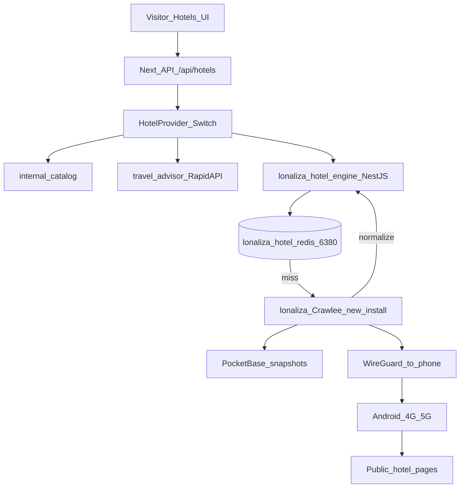

---
PyBjW3DJpd7GXaNk
name: Owned Hotel Provider
overview: "نظام فنادق جديد بالكامل داخل lonaliza فقط: حاويات Docker وأسماء وشبكة ومنافذ خاصة، NestJS وCrawlee يُثبَّتان من الصفر في hotel-engine، بدون أي استخدام أو استيراد من liotrip."
todos:
  - id: provider-switch
    content: توسيع HotelProvider إلى owned وتحديث اللوحة ومسارات /api/hotels لاستدعاء محرك NestJS دون كسر RapidAPI
    status: completed
  - id: nestjs-engine
    content: مشروع NestJS جديد من الصفر في lonaliza.com/hotel-engine (npm مستقل، لا نسخ من liotrip) على 127.0.0.1 فقط
    status: completed
  - id: crawlee-worker
    content: تثبيت Crawlee جديداً داخل hotel-engine فقط (PlaywrightCrawler عبر نفق الهاتف) دون استخدام كود أو node_modules من liotrip
    status: completed
  - id: docker-stack
    content: Compose جديد بأسماء lonaliza-hotel-* وشبكة خاصة وRedis على منفذ غير 6379 — صفر ارتباط بحاويات أو Redis liotrip
    status: completed
  - id: pocketbase-snapshots
    content: هجرات PocketBase لـ owned_hotels و owned_rate_snapshots
    status: completed
  - id: wireguard-phone
    content: نفق WireGuard سيرفر↔هاتف وفحص صحة النفق وIP الخروج من /health
    status: completed
  - id: wire-ui
    content: ربط البحث والتفاصيل والغرف عند provider=owned واختبار فندق واحد من الكتالوج قبل الإعلان
    status: completed
  - id: rewrite-doc
    content: استبدال Hotel_Mobile_Proxy_Scraping_Plan.md بمواصفات التشغيل الفعلية
    status: completed
isProject: false
---

# خطة المزود المستقل لبيانات الفنادق (خدمات جديدة لـ Lonaliza فقط)

## عزل صارم عن liotrip — شرط تنفيذ

نعم مفهوم: **لا نستخدم خدمات liotrip ولا كودها ولا حاوياتها ولا Redis ولا node_modules ولا PM2 الخاص بها.**

ما يوجد على السيرفر من liotrip (Crawlee في tourism_api، NestJS في textbee، Redis على 6379، شبكات Docker) هو دليل أن **البرمجيات يمكن تثبيتها**، وليس مصدر ننسخ منه أو نتصل به.

كل شيء لهذا النظام يُنشأ جديداً داخل `/www/wwwroot/lonaliza.com/` فقط:

| عنصر | جديد خاص بـ lonaliza | ممنوع |
|---|---|---|
| المجلد | `lonaliza.com/hotel-engine/` | أي مسار تحت `liotrip.com` |
| NestJS | `npm` جديد في `hotel-engine/package.json` | استيراد أو نسخ من textbee / erxes |
| Crawlee | اعتماد جديد في نفس `package.json` | استخدام `SmartReviewScraper` أو أي crawler في liotrip |
| Docker | `hotel-engine/docker-compose.yml`، شبكة `lonaliza-hotel-net`، أسماء `lonaliza-hotel-engine` و `lonaliza-hotel-redis` | الانضمام لشبكات/حاويات liotrip أو إعادة استخدام صورها كاعتماد |
| Redis | حاوية جديدة، `127.0.0.1:6380` (أو منفذ حر غير 6379)، volume `lonaliza-hotel-redis-data` | Redis الحالي على 6379، كلمة سر liotrip، أي `REDIS_*` من ecosystem liotrip |
| WireGuard | واجهة باسم مميز مثلاً `wg-lonaliza` | أي نفق أو منفذ يخص مشاريع أخرى |
| PM2 إن لزم | أسماء `lonaliza-hotel-*` فقط في [ecosystem.config.cjs](ecosystem.config.cjs) الخاص بـ lonaliza | [ecosystem.config.js](/www/wwwroot/liotrip.com/ecosystem.config.js) |

قواعد لا تُكسر عند التنفيذ:

- لا `import` ولا `require` من `/www/wwwroot/liotrip.com`
- لا `docker network connect` إلى شبكات liotrip
- لا قراءة `.env` أو أسرار liotrip
- لا تعديل ملفات liotrip
- الموقع الحالي (Next + PocketBase على 3047/8090) يبقى كما هو؛ المحرك يُستدعى من Next عبر localhost فقط عندما `provider === "owned"`

---

## هل NestJS + Crawlee + Docker أفضل وأقوى وأسرع؟

**أقوى وأوضح كنظام مستقل: نعم.**

- Next.js يبقى واجهة الموقع والحجز. المحرك عملية منفصلة: لا يُقتل مع `next build` ولا يشارك ذاكرة `lonaliza-alrayyan`.
- NestJS يعطي وحدات جاهزة: `HotelsModule`, `CrawlModule`, `CacheModule`, `HealthModule`، ومسارات داخلية واضحة.
- Crawlee يُثبَّت جديداً داخل `hotel-engine` وينظّم الطابور وإعادة المحاولة وجلسة المتصفح أفضل من سكربت `scripts/*.mjs` يدوي.
- Docker خاص بهذا المشروع فقط: شبكة وأسماء ومنافذ وvolumes لا تشارك liotrip.

**أسرع للزائر: ليس بسبب NestJS.**

عنق الزجاجة هو الجلب عبر هاتف 4G + المتصفح، لا إطار الـ API. السرعة التي يشعر بها الزائر تأتي من **Redis بعد أول جلب**. أول طلب لفندق/تاريخ جديد يبقى بطيئاً سواء كان المسار Next أو Nest. لذلك الكاش إلزامي، والمحرك لا يُستدعى من المتصفح مباشرة.

**القاعدة:** NestJS + Crawlee = عزل وقوة تشغيل. Redis = سرعة الواجهة. الهاتف = مصدر الخروج.

---

## المعمارية



الموقع لا يتغير للزائر. المفتاح الثالث `"owned"` يستدعي المحرك. RapidAPI و`internal` يبقيان كما هما ويُطفأ `"owned"` متى شئتم.

عقد الاستجابة يبقى أنواع الموقع الحالية (`TravelAdvisorHotelCard`, `TravelAdvisorHotelDetails`, `TravelAdvisorRoom`) حتى تعمل [TravelAdvisorHotels](src/components/hotels/TravelAdvisorHotels.tsx) و[TravelAdvisorHotelDetail](src/components/hotels/TravelAdvisorHotelDetail.tsx) دون إعادة بناء الواجهة.

---

## خدمة NestJS الجديدة (من الصفر، ليست نسخة من liotrip)

المسار: [`/www/wwwroot/lonaliza.com/hotel-engine/`](hotel-engine/) — مشروع npm جديد (`nest new` أو هيكل مكافئ)، مستقل عن `src/` الخاص بـ Next ومستقل تماماً عن liotrip.

- يستمع على **127.0.0.1 فقط** (مثلاً المنفذ `3051`) — لا يُنشر للعامة.
- Next يستدعيه بـ `http://127.0.0.1:3051` من [src/lib/server/owned-hotels/](src/lib/server/owned-hotels/) عندما `provider === "owned"`.
- واجهات داخلية:
  - `GET /v1/hotels/search`
  - `GET /v1/hotels/details`
  - `GET /v1/hotels/rooms`
  - `GET /v1/health` — النفق، Redis، آخر مهمة Crawlee، IP الخروج
- مصادقة بسيطة بين Next والمحرك (توكن مشترك في البيئة، ليس مفتاحاً عاماً).
- التشغيل: **Compose واحد لهذا النظام فقط** (`lonaliza-hotel-engine` + `lonaliza-hotel-redis`) حتى لا يعتمد على PM2/Docker الخاص بـ liotrip ولا على إعادة تشغيل Next.

لا يُفتح Nest على الإنترنت. الزائر يمر دائماً من نطاق lonaliza الحالي.

---

## Crawlee جديد داخل hotel-engine فقط

- يُضاف `crawlee` إلى `hotel-engine/package.json` عبر npm في هذا المجلد، لا من `node_modules` لأي مشروع آخر.
- `PlaywrightCrawler` يخرج عبر نفق هاتف lonaliza.
- تزامن منخفض في المرحلة 1 (متصفح واحد أو اثنان) لأن الهاتف مسار واحد.
- المهام: بحث ضمن الفهرس، تفاصيل فندق، غرف لتواريخ محددة.
- بعد الجلب: تطبيع → Redis → لقطة PocketBase.
- نقطة البداية المعرفية: سكربتات [scripts/scrape-booking-hotels-v2.mjs](scripts/scrape-booking-hotels-v2.mjs) تُنقل منطقها إلى crawler منظم، لا تُترك سكربتات يدوية.

---

## Docker Compose خاص — Redis ومحرك جديدان

ملف واحد: `hotel-engine/docker-compose.yml` (أسماء حاويات `lonaliza-hotel-*` فقط).

- Redis **جديد**: `127.0.0.1:6380` (يُتحقق أن المنفذ حر عند التنفيذ). ليس منفذ 6379 وليس مثيل liotrip.
- بادئة مفاتيح `lonaliza:hotels:` داخل هذا المثيل فقط.
- TTL:
  - بحث: 8–10 دقائق
  - تفاصيل: 10 دقائق
  - غرف: 15 دقيقة
  - ما قبل الحجز: 30–60 ثانية أو بدون كاش

لا اتصال بـ `localhost:6379`. كلمة سر Redis هذه الحاوية تُولَّد لهذا المشروع وتُحفظ في `hotel-engine/.env` (غير مضمّنة في Git).

---

## النفق: WireGuard (الهاتف كما اخترتم)

- سيرفر: واجهة WireGuard، UDP فقط في جدار aaPanel.
- هاتف: تطبيق WireGuard الرسمي.
- Crawlee يوجّه المتصفح عبر النفق حتى يخرج الطلب من IP الشريحة.
- `/v1/health` يعرض: النفق، IP الخروج، Redis، آخر زحف.
- تدوير IP من الهاتف قرار تشغيلي عند صاحب الجهاز. ربط إشارة لاحقاً اختياري بعد ثبات النفق.

---

## ربط الموقع (طبقة رفيعة في Next)

توسيع [src/lib/hotels-config.ts](src/lib/hotels-config.ts):

```ts
export type HotelProvider = "internal" | "travel_advisor" | "owned";
```

- [HotelsProviderPanel](src/components/admin/HotelsProviderPanel.tsx) و[hotels-settings](src/app/api/admin/hotels-settings/route.ts): زر ثالث + حالة `/v1/health`.
- [search](src/app/api/hotels/search/route.ts) / [details](src/app/api/hotels/details/route.ts) / [offers](src/app/api/hotels/offers/route.ts): إن `owned` → Nest؛ وإلا المسار الحالي بلا تغيير.
- PocketBase: `owned_hotels` و `owned_rate_snapshots` بنفس أسلوب [hotel_bookings](pocketbase/pb_migrations/1787739450_created_hotel_bookings.js).
- الحجز يبقى `POST /api/hotel-bookings` مع `provider: "owned"`.

---

## نطاق المرحلة الأولى

- **مرحلة 1:** فنادق [src/data/hotels.ts](src/data/hotels.ts) (~30) عبر المحرك.
- **مرحلة 2:** إضافة فنادق من الإدارة (اسم، مدينة، رابط).
- **مرحلة 3:** بحث أوسع بعد ثبات النفق والكاش والهاتف.

لا يُعلن المزود للزوار حتى ينجح اختبار فندق واحد: Nest يستجيب، Crawlee يجلب عبر النفق، Redis يخزّن، الصفحة تعرض الغرف.

---

## ما يوفّره الطرفان

**أنتم:** هاتف Android 4G/5G، WireGuard، شحن واستثناء من توفير الطاقة، وإبقاء RapidAPI حتى يثبت المحرك.

**على السيرفر بعد الموافقة:** إنشاء `hotel-engine` من الصفر (NestJS + Crawlee + Redis Docker بأسماء lonaliza-hotel-*) + WireGuard باسم `wg-lonaliza` + مفتاح `"owned"` في الموقع + تحديث [Hotel_Mobile_Proxy_Scraping_Plan.md](Hotel_Mobile_Proxy_Scraping_Plan.md).

**لا يُلمَس أبداً:** شجرة `/www/wwwroot/liotrip.com`، Redis `6379`، حاويات وشبكات Docker الخاصة بـ liotrip، `ecosystem.config.js` لـ liotrip، مفاتيح RapidAPI، مسار `internal`.
