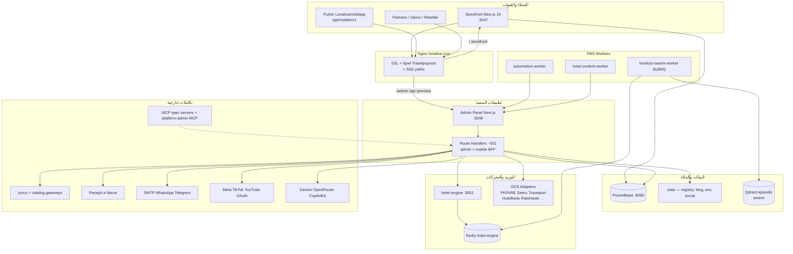

# تقرير مجلس Claude — منصة Lonaliza (تدقيق شامل للمنتج)

**التاريخ:** 2026-09-29  
**النطاق:** المنصة بأكملها — لا استثناء  
**اللغة:** العربية (Mustafa)  
**مسار الكود:** `/www/wwwroot/lonaliza.com`  
**بدون commit**

---

## 1. الملخص التنفيذي

**Lonaliza** ليست موقعاً تعريفياً؛ هي **نظام تشغيل سياحي (Travel OS)** موجه لوكالات وعلامات تجارية تبيع طيراناً، فنادق، ترانسفير، سيارات، باقات، جولات، تأشيرات، وبطاقات هدايا من واجهة واحدة، مع تشغيل موحّد من لوحة `/admin`، تطبيق Flutter، ونسخ white-label عبر `lonaliza-reseller`.

**المنتج التجاري:** منصة B2C/B2B عربية-أولاً (AR/EN/TR/FR) تركز عملياً على **تركيا والخليج** في المحتوى والعروض، مع طموح «فخامة» وUS/Gulf luxury في النسخة التسويقية. الإيرادات تعتمد على: عمولات GDS/مجمّعات، مارك-أب، affiliate (Travelpayouts)، برامج سياحية داخلية، محفظة B2B، وإعادة بيع الترخيص للوكالات.

**الحالة الإنتاجية (29 سبتمبر 2026):** الموقع العام على `https://lonaliza.com` يستجيب **200** للرئيسية، `/flights`، `/hotels`، `/blog`. البنية تعمل عبر **nginx** يفصل **storefront (3047)** عن **admin/API (3048)** مع **PocketBase (8090)**، **hotel-engine + Redis**، وعمال PM2 (automation، hotel-content، swarm-worker).

**الفجوة المركزية:** عمق **الواجهة واللوحة** يفوق عمق **الإنتاج التجاري الموحّد**: مزودون كثيرون في الكatalog، لكن **عدد قليل مفعّل** في `registry.json`؛ الطيران العام ما زال مرتبطاً افتراضياً بـ **Travelpayouts** بينما GDS (PKFARE/Seeru/Travelport) في **sandbox**؛ المدونة تحمل **تكراراً واضحاً** لموضوعات فرنسا 2027 (مخاطرة SEO/ثقة)؛ الدفع **iyzico sandbox**؛ و`typescript.ignoreBuildErrors: true` على storefront يضعف ضمان الجودة.

---

## 2. خريطة المعمارية

**تخطيط المستودع (جذر `lonaliza.com`):**

| المسار | الدور |
|--------|--------|
| `lonaliza-platform/` | Monorepo: `storefront`, `admin-panel`, `backend`, `shared`, `scripts`, `docs`, `.data` |
| `lonaliza-reseller/` | نسخة إعادة البيع white-label (mirror للمنصة + deploy) |
| `hotel-engine/` | NestJS محرك فنادق + Redis + MCP server |
| `Lonalizamobilapp/` | Flutter iOS/Android |
| `lonaliza-driver-app/` | تطبيق سائق/أسطول (ترانسفير) |
| `lonaliza-neural-studio-complete-handoff/` | handoff استوديو neural |
| `ecosystem.config.cjs` | PM2: pocketbase, storefront, admin, redis, hotel-engine, automation, hotel-content |
| `lonaliza-platform/deploy/*.nginx.conf` | قوالب nginx (الحيّ: `/www/server/panel/vhost/nginx/lonaliza.com.conf`) |

**عدّ لوحة الإدارة:** **11 مجموعة تنقل** (`admin-nav.ts`): overview, bookings, inventory, storefront, customers, marketing, ai_center, finance, legal, system, resale — مع **~61 مجلداً** على مستوى `/admin/*` و**82** صفحة `page.tsx`.

---

## 3. جرد الوحدات (Module inventory)

| الوحدة | موجه لـ | الحالة | ملاحظات |
|--------|----------------|--------|---------|
| **Storefront — الرئيسية والبحث** | زائر / عميل | **إنتاج** | `/`, `/search`, تبويبات من `/admin/search-tabs` |
| **Flights** | زائر | **هجين** | افتراض env: `NEXT_PUBLIC_FLIGHTS_PROVIDER=travelpayouts` + `/tpwl`؛ GDS في registry: PKFARE+Seeru **enabled sandbox**؛ Travelport flights **off** |
| **Hotels** | زائر | **هجين** | بحث multi-supplier؛ **Hotelbeds + Travelport hotels** enabled sandbox؛ `hotel_engine` off؛ catalog داخلي + workers محتوى |
| **Transfers** | زائر | **عمولة/داخلي** | env افتراضي Travelpayouts widget؛ Seeru transfers **off**؛ مسار `/intui` same-origin؛ ecosystem سائق `/api/transfers/driver/*` |
| **Cars** | زائر | **عمولة** | Travelpayouts widget افتراضي؛ GDS سيارات mostly coming_soon |
| **Packages / Holidays / VIP tours** | زائر | **إنتاج** | `/package`, `/holidays`, `/vip-tours`, حجز `/package/book` |
| **Tours / Visa** | زائر | **كتalog + استفسار** | `/tours`, `/visa` — إدارة `/admin/tours`, `/admin/visa` |
| **Gift cards / Coupons / Affiliate** | عميل | **إنتاج** | checkout موحّد؛ `/admin/gift-cards`, coupons, affiliate |
| **Account / Bookings** | عميل مسجّل | **إنتاج** | PocketBase auth؛ `/account`, تذاكر وفواتير |
| **Community (Nostr)** | عميل | **متقدم** | `/community/*` + mobile BFF |
| **Blog / SEO** | زائر + Google | **إنتاج مع مخاطر** | `sitemap.ts`, `robots.ts`, `generateMetadata`؛ **تكرار مقالات فرنسا** على `/blog` |
| **i18n** | الجميع | **إنتاج** | AR/EN/TR/FR؛ `/admin/translations` |
| **Partners / B2B landing** | شريك | **إنتاج** | `/partners`, `/admin/b2b-landing-agent`, `b2b-wallet` |
| **Resale white-label** | Origin فقط | **إنتاج (origin)** | 12+ صفحات `/admin/resale/*`; `DEPLOYMENT_ROLE=client` يخفي المجموعة |
| **Payments** | عميل | **sandbox→prod gap** | iyzico مفعّل sandbox؛ `gateways/` catalog عالمي (Stripe, PayPal, MENA…) — تفعيل per-tenant |
| **Invoices / Paraşüt** | عمليات | **جاهز تقنياً** | قوالب `/admin/invoices`; MCP Paraşüt في docs |
| **Admin — Bookings** | Staff | **إنتاج** | `/admin/bookings`, cancellations, reviews |
| **Admin — Inventory verticals** | Staff | **إنتاج** | flights/hotels/packages/transfers/cars/tours/visa |
| **Admin — CMS** | Staff | **إنتاج** | homepage-editor, pages, blog, content, PWA, mobile-app config |
| **Admin — Marketing** | Staff | **إنتاج** | publish suite, ads, email-marketing, social OAuth |
| **Admin — AI center** | Staff | **واسع** | war-room, agent-studio, neural-studio, automation — **~10% من هذا التقرير** |
| **Admin — Finance** | Staff | **إنتاج** | payments, currencies, invoices, b2b-wallet |
| **Admin — Legal/GDPR** | Staff | **إنتاج** | `/admin/legal` unified |
| **Admin — System** | Staff | **إنتاج** | providers hub, integrations, pocketbase, SMTP, media keys |
| **Mobile BFF** | Flutter | **إنتاج** | `/api/mobile/v1/*` على admin-backend (3048) — flights/hotels/auth/community/iyzico |
| **hotel-engine** | Backend | **إنتاج محلي** | PM2 + Redis؛ token `HOTEL_ENGINE_*` |
| **MCP servers** | Agents/Dev | **موثّق** | `travel-providers-spec-mcp`, `etg-spec-docs-mcp`, `hotel-engine/mcp-server`, runtime `.data/mcp/registry.json` |
| **lonaliza-reseller** | Licensee | **Mirror** | نفس stack لعملاء white-label |
| **Driver app** | سائق | **موازٍ** | APIs transfers/driver + admin fleet |

---

## 4. الأدلة (Evidence)

| المصدر | الملاحظة |
|--------|----------|
| `https://lonaliza.com/` | HTTP 200، Next.js، CSP report-only |
| `https://lonaliza.com/flights`, `/hotels`, `/blog` | HTTP 200 |
| `/blog` | مقالات متعددة «فرنسا 2027» بنفس اليوم + محتوى تركيا قديم/جديد |
| `lonaliza-platform/admin-panel/.data/providers/registry.json` | enabled: google_places (production), pkfare, seeru, travelport_hotels, hotelbeds (sandbox); الباقي largely false |
| `ecosystem.config.cjs` + `pm2` | 9 عمليات lonaliza (inc. swarm-worker, vnc-daemon) online |
| `lonaliza.com.conf` nginx | `/api`, `/admin`, `/preview` → 3048؛ `/` → 3047؛ SSE timeouts لـ agent-stream |
| `admin-nav.ts` | 11 مجموعة تنقل |
| `storefront/next.config.ts` | `ignoreBuildErrors: true` |
| `README.md` (root) | وصف Travel OS الرسمي |

**أسماء secrets (بدون قيم):** `GEMINI_API_KEY`, `ADMIN_SESSION_SECRET`, `POCKETBASE_*`, `IYZICO_*`, `PAYMENTS_IYZICO_ENABLED`, `SKY_SCRAPPER_*`, `RAPIDAPI_*`, `META_*`, `TIKTOK_*`, `GOOGLE_YOUTUBE_*`, `WHATSAPP_*`, `TELEGRAM_*`, `HOTEL_ENGINE_*`, `NEXT_PUBLIC_*` tracking pixels, `.data/server-env.json`, provider `fields` in registry.

---

## 5. المجلس — أربع شخصيات

### 5.1 الشكّاك / القاضي

المنصة **عرضية الامتداد**: 40+ معرّف مزود في `catalog.ts`، لكن الإنتاج الفعلي على السيرفر يمر عبر **قناة عمولة (Travelpayouts)** للطيران/سيارات/ترانسفير بينما GDS مفعّل جزئياً في **sandbox** فقط. هذا ليس «GDS live» كما يقرأه المستثمر من الـ README — بل **طبقتان**: marketing truth وruntime truth. nginx يحمي `.data` و`.env` لكن **لوحة Integrations** و`.data/server-env.json` مركزان لأسرار حساسة؛ أي خطأ RBAC في `/api/admin/*` يضرب كل التكديس.

**سلامة المحتوى:** المدونة تعرض **عدة دلائل فرنسا 2027** في يوم واحد — إشارة إلى pipeline نشر بلا بوابة dedup أو تحرير بشري. ذلك يضر **E-E-A-T** وثقة Gulf luxury. **افتراضات تركيا/Travelpayouts** في `.env.example` (markers, TRS, Intui headers) تثبت تجربة «الوكالة التركية» بشكل افتراضي حتى عند positioning الخليج/US.

**مسارات نجاح وهمية:** `ignoreBuildErrors` على storefront يعني أن **production build قد يحمل أخطاء TypeScript**؛ provider tests في admin «checkServer» جيدة لكن **enabled=false** يعني أن UI قد يظهر «متصل» بينما checkout العام لا يستخدم المزود. Qdrant episodic في git status يُظهر **state vector DB داخل repo** — خطر noise وليس مصدر truth للحجوزات.

**الامتثال:** PocketBase يحمل PII؛ community Nostr + AI chat يزيدان surface للتسجيل في السجلات؛ نشر inventory غير مُتحقق من المورد (scraper hotels) قد يخالف شروط OTAs.

### 5.2 قرش النمو / الأعمال

**Product-market fit:** Lonaliza positioned كـ «Travel OS + AI ops» لكن **الإيراد القابل للتحصيل اليوم** = وكالة digital تعمل على **Turkey + affiliate + packages داخلية** أكثر من «global luxury GDS». Gulf/US luxury يحتاج **محتوى destination دقيق، أسعار live موثوقة، ودفع prod** — الثلاثة غير مكتملة معاً.

**Unit economics:** كل vertical AI (Gemini, OpenRouter, crawlers, swarm) **يأكل margin** بينما الطيران العام **عمولة Travelpayouts** لا margin GDS. hotel-engine + RapidAPI scrapers **تكلفة API + Redis + workers** — يجب أن تُقاس مقابل حجوزات hotelbeds/travelport الفعلية (حالياً sandbox).

**SEO ROI:** مقالات تركيا الطويلة + legacy 2017-2022 **أصول**؛ burst فرنسا المكرر **خصم على brand**. Publish/agent + RSS automations **scale content** لكن بدون editorial gate تتحول إلى **spam index**.

**ما يمنع الإيراد:** (1) iyzico sandbox — لا cash flow حقيقي؛ (2) طيران GDS غير promoted في المسار الافتراضي؛ (3) ثقة المحتوى؛ (4) resale pipeline قوي تقنياً لكن **يحتاج case studies** وonboarding واضح للوكالات.

### 5.3 قائد تقني / pragmatist

**معمارية صحيحة:** فصل storefront/admin على portين مع nginx **ناضج** (fallback `_next` → admin، SSE 3600s). PocketBase + `.data` JSON stores **pragmatic** لوكالة واحدة؛ **shared** workspace يقلل drift بين storefront/admin (مع risk duplicate `backend` mobile routes).

**Dependencies:** Next 16 + React 19 + BullMQ + Baileys + CopilotKit + Playwright/Puppeteer = **heavy ops**. hotel-content worker + automation tick على admin **coupling** — أي restart لـ 3048 يؤثر workers.

**Registry vs UI:** `providers-registry-store.ts` + catalog **مصدر truth** للـ enable/mode؛ env keys legacy للطيران/فنادق **parallel path** — يحتاج **single config story** للمهندس الجديد.

**Testing:** vitest على mobile BFF fragments؛ **لا coverage شامل** لbooking E2E across PKFARE→iyzico→PB. Build يتجاهل TS errors على storefront — **P0 engineering debt**.

**شرائح مقترحة (ordered):** (1) إيقاف ignoreBuildErrors + CI typecheck؛ (2) «Production booking path» doc + feature flag: GDS vs affiliate per vertical؛ (3) iyzico production toggle + webhook hardening؛ (4) blog publish dedup + canonical؛ (5) consolidate env → registry migration للطيران؛ (6) observability: booking funnel metrics per provider.

### 5.4 الرؤيوي / المدافع

إذا أُغلقت فجوة **runtime vs story**، Lonaliza **نادرة**: وكالة عربية بـ **admin واحدة** تربط GDS، hotel-engine owned، Flutter، white-label، finance (Paraşüt)، وmarketing omnichannel. **War room + MCP spec servers** ليست لعبة — هي **control plane** مستقبلية لتشغيل 10 وكالات من origin.

**UX:** homepage-editor + builder-agent + mobile bootstrap **تجربة موحّدة** نادراً ما تملكه SMB travel. Flight tracker, community, gift cards **تميز** عن Skyscanner clones.

**Innovation path:** Redis cache لـ Trends crawl، multi-agent مع MCP travel-providers **يختصر** time-to-integration لـ PKFARE/Seeru. Resale + B2B wallet **platform play** أقوى من margin حجز واحد.

**الشرط:** الاستثمار في AI يجب أن **لا يتجاوز** إصلاح **checkout + content trust** — وإلا تبقى «استوديو Sci-Fi» فوق متجر incomplete.

---

## 6. طبقة الوكلاء (~10% — حالة مختصرة)

| العنصر | الحالة |
|--------|--------|
| PM2 `lonaliza-swarm-worker` | online — BullMQ + Redis |
| `official-article-pipeline` / LangGraph | مسارات متوازية في الكود |
| War Room / Agent Studio / Neural Studio | UI غنية؛ MCP `.data/mcp/registry.json` |
| Qdrant `swarm_episodic_deliberations` | ذاكرة episodic — ليس ledger حجوزات |
| nginx SSE | `/api/admin/automation/agent-stream` → 3048 |

**الحكم:** طبقة الوكلاء **متقدمة تشغيلياً** لكن **غير حاسمة** لإيراد الحجز اليوم؛ أولوية المنتج تبقى GDS/checkout/SEO. راجع `workflows/claude-council/SKILL.md` لعدم ادعاء تحكم supervisor دون coverage executable.

---

## 7. توصيات المجلس (Consensus)

| الأولوية | التوصية | المبرر |
|----------|---------|--------|
| **P0** | **مسار حجز إنتاج واحد موثّق** (flights/hotels) + iyzico **production** + إزالة `ignoreBuildErrors` | الإيراد والثقة |
| **P0** | **بوابة نشر مدونة**: dedup slug/title، revision لا duplicate، تحرير بشري للـ destination guides | SEO/brand (فرنسا المكرر) |
| **P1** | **محاذاة registry ↔ env**: promote PKFARE/Seeru/Travelport/hotelbeds إلى production path مع fallback affiliate واضح للزائر | README vs runtime |
| **P1** | **Observability**: funnel حجز، provider latency، 429/5xx alerts؛ cron health | Ops على 7 PM2 processes |
| **P1** | **Resale GTM**: playbook ترخيص + demo tenant + فصل `.data` per client | Revenue platform |
| **P2** | تقليل duplicate `backend` vs `admin-panel` mobile routes | Maintenance |
| **P2** | gitignore/qdrant storage churn | Repo hygiene |
| **P2** | TS strict + E2E smoke (flights search → quote → payment init) | Engineering maturity |

---

## 8. Scorecard (1–5)

| المحور | الدرجة | سطر واحد |
|--------|--------|----------|
| **Product** | **4** | breadth نادر (verticals + mobile + resale)؛ depth checkout/content inconsistent |
| **Engineering** | **3** | فصل nginx/ports ممتاز؛ TS ignore + dual config paths + repo noise |
| **Ops** | **4** | PM2/redis/pocketbase stable؛ يحتاج metrics وrunbooks |
| **Revenue readiness** | **2** | sandbox payments؛ affiliate>GDS على العام؛ B2B/resale under-marketed |
| **Content/SEO** | **3** | sitemap/metadata جيد؛ تكرار AI ومزج legacy يضعف |
| **Agent layer** | **3** | بنية BullMQ/MCP/qdrant؛ product impact secondary today |

---

## 9. Scope (تأكيد)

تم تقييم: **storefront routes**, **booking flows** (flights, hotels, cars, transfers, visa, packages, tours), **blog/SEO**, **payments/i18n/B2B**, **كل major `/admin/*` (11 groups, 82 pages)**, **integrations/registry**, **Redis/queues/env pattern**, **deploy/nginx/pm2**, **packages/MCP/studio/reseller/mobile/driver**, **`.data`**, و**spot-check live** — مع **قسم وكلاء ~10%** فقط.

---

*نهاية التقرير — Claude Council full-platform audit.*
