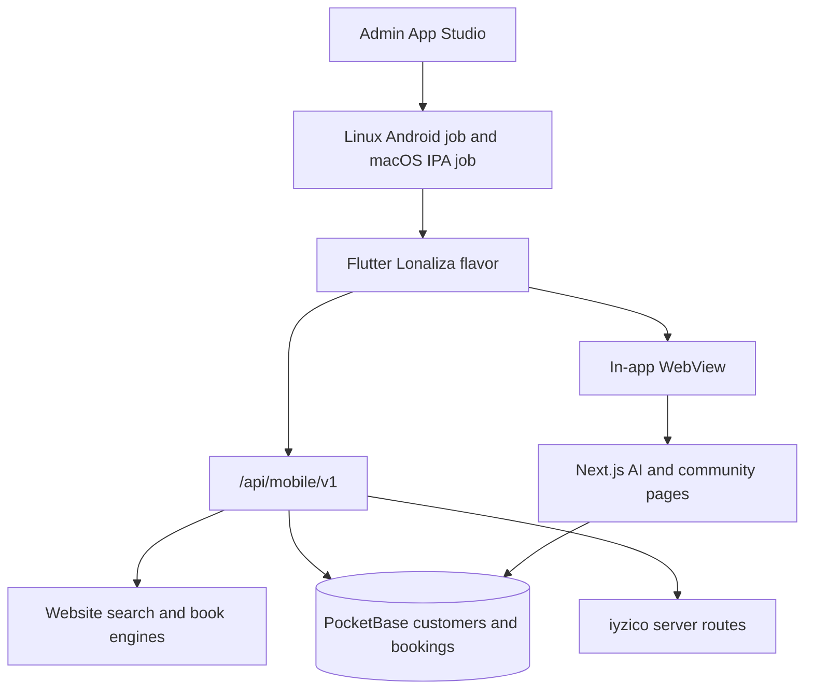
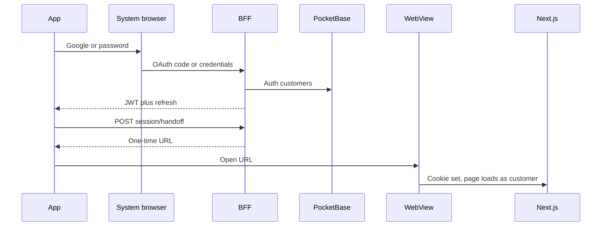
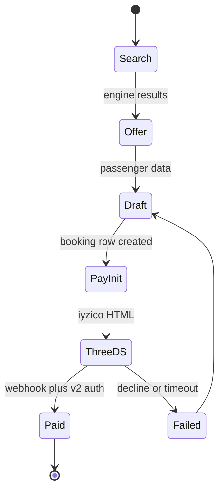
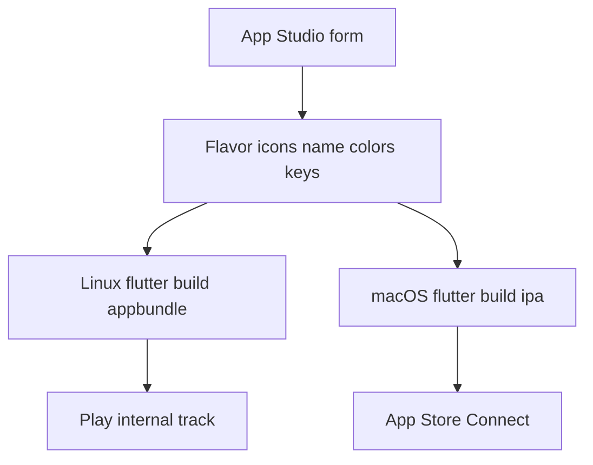

# Lonaliza Mobile Client - Plan

## Goal Capsule

- **Objective:** Turn `Lonalizamobilapp` from the LioTrip UI shell into the Lonaliza customer app: same identity, same PocketBase customers, same live catalog and bookings as the website, dual website/app service switches, lazy mobile APIs, customer-area parity, in-app web for AI and community, and an admin App Studio that rebuilds and publishes white-label binaries.
- **Authority:** Product Contract > Planning Contract KTDs > unit Approach. Website booking, markup, coupon, and payment engines stay the source of truth. Do not invent a second booking stack in Flutter.
- **Stop if:** Native Flutter is asked to call cookie-only Next routes as if they were a mobile API. Stop if iyzico keys or provider secrets are placed in the app. Stop if Google OAuth is run inside an embedded WebView. Stop if iOS IPA is scheduled on this Linux host.
- **Execution profile:** Phased Deep program. Contract-test the mobile API before Flutter rewires. Characterize the existing Flutter flight parser before replacing n8n. Smoke-verify App Studio artifacts, do not unit-test the CI YAML as the primary proof.
- **Tail ownership:** Abandoned flavor, n8n, or mock-checkout branches must be deleted before a unit is done.

---

## Product Contract

### Summary

This plan ships one program: a Lonaliza-branded Flutter client on the live platform, plus admin App Studio for white-label rebuild and store publish. Catalog, booking, payment, and account are native. AI agents and community/reels stay the existing website pages inside the app.

### Problem Frame

LioTrip Flutter screens exist for flights, hotels, cars, packages, and account, but they are not Lonaliza. Live HTTP still targets a LAN n8n host. Hotels, cars, and packages are static. Auth is a demo tap. Checkout is fake. The website already owns suppliers, markups, coupons, PocketBase customers, iyzico, affiliate, loyalty, translations, currencies, AI agents, and community. Admin can hide website search tabs, but there is no app channel and no App Studio. Without a dedicated mobile API and a shared session, the app cannot show the same customer or the same booking.

### Key Decisions

- KD1. Full program in this plan, sequenced in phases. (session-settled: user-directed — chosen over Lonaliza-live-app first then studio later: the user confirmed the complete program after the hybrid-surface revision.) Governs R1–R28.
- KD2. AI agents and community timeline/reels are in-app website surfaces. Booking, catalog, and account stay native Flutter. (session-settled: user-directed — chosen over all-native Flutter for every surface: the user selected hybrid surfaces on the scope gate.) Governs R16–R18.

Product Contract created in this plan (`product_contract_source: ce-plan-bootstrap`).

### Requirements

**Identity and shell**

- R1. The installed customer app presents as Lonaliza: name, icon, splash, and royal-purple / amber / white-daytime theme, not LioTrip or Trip.com blue.
- R2. Home and navigation show only services enabled for the app channel, in admin order.

**Service visibility**

- R3. Each catalog service has independent `websiteEnabled` and `appEnabled` switches in admin.
- R4. Turning a service off for the app hides it from the app immediately after the next config fetch. The website switch does not change.
- R5. The same admin service that is live on the website uses the same supplier adapters, markups, and quotas when enabled for the app.

**Catalog and booking**

- R6. App catalog and booking for flights, hotels, cars, transfers, domestic/holiday trips, and packages show the same priced offers the website would show for the same query.
- R7. The app requests one service at a time. Opening the app does not fetch every catalog.
- R8. A booking created in the app appears in the website customer account and in admin, using the same PocketBase collections as website bookings.
- R9. A booking created on the website appears in the app customer bookings list.
- R10. Flight checkout follows the website’s current bookable path (session + iyzico / provider deep link). The app does not invent a new PNR issuer.

**Auth and accounts**

- R11. Email/password signup and login use the `customers` collection. One account works on website and app.
- R12. Google sign-in uses a system browser or OS account picker, then the same PocketBase customer record as the website.
- R13. A logged-in app session can open AI and community website pages as that same customer.

**Payments and commerce rules**

- R14. App checkout uses the website iyzico integration. Card PAN, CVV, and OTP never enter Flutter widgets or chat.
- R15. Coupons, points redemption, and markups applied in the app are the admin rules already used on the website.

**Customer area**

- R16. App account includes the website customer tabs that apply on mobile: overview, profile, bookings, payments, wallet, affiliate, and tiers/points.
- R17. Affiliate balances, conversions, and loyalty wallet amounts match the website for the same customer.

**Hybrid web surfaces**

- R18. AI search agent, booking concierge, sales chat, community timeline, and reels open as the existing website pages inside the app.
- R19. A community post or reel published in the app WebView appears on the website feed, and the reverse, through the existing community APIs.
- R20. The in-app search agent must not navigate to a service that is disabled for the app channel.

**Localization**

- R21. App UI languages are the admin translation languages (ar, en, tr, fr, plus any admin-added locale).
- R22. App prices use the same currency catalog and FX the website header uses.

**App Studio and publish**

- R23. Admin App Studio can set app display name, launcher icon, logo, colors, and bundle identifiers without a developer laptop. Store and provider secrets stay in GitHub or the server secret store, never in the flavor file or AAB.
- R24. App Studio can start an Android release build on this server and stream build logs. The output is a signed AAB/APK.
- R25. iOS IPA is produced on a macOS builder, not on this Linux host. App Studio triggers that job and receives the artifact.
- R26. A connected GitHub account can run the publish pipeline to Google Play and App Store after a one-time manual store listing bootstrap.
- R27. White-label client builds inherit `DEPLOYMENT_ROLE=client` exclusions (no super-admin resale, no `owned` hotel scrape).
- R28. The existing PWA admin and install path stay available. App Studio does not replace or disable them.

### Actors

- A1. Customer — books, pays, manages account, uses AI and community.
- A2. Admin — toggles services, translations, currencies, App Studio, store secrets.
- A3. Reseller operator — customizes a client flavor from App Studio on a client deployment.
- A4. Existing website search/booking agent — drives search and coaches booking; never collects card data.

### Key Flows

- F1. Cold start
  - **Trigger:** Customer opens the app.
  - **Actors:** A1
  - **Steps:** Splash; fetch bootstrap (branding, enabled app services, locales, currencies); render home for enabled services only.
  - **Covered by:** R2, R3, R7, R21, R22
- F2. Dual toggle
  - **Trigger:** Admin disables flights for app and leaves website on.
  - **Actors:** A2, A1
  - **Steps:** Persist channel flags; website search still shows flights; next app config fetch hides flights; agent intents refuse that service in-app.
  - **Covered by:** R3, R4, R20
- F3. Shared login
  - **Trigger:** Customer signs in with Google or email on the app.
  - **Actors:** A1
  - **Steps:** System-browser or password grant; store PocketBase token; account APIs return the website customer; WebView handoff opens community as that user.
  - **Covered by:** R11, R12, R13
- F4. Native book and pay
  - **Trigger:** Customer books a live offer in Flutter.
  - **Actors:** A1
  - **Steps:** Search the website engine; apply markup/coupon; create the same booking record; open iyzico 3DS WebView; webhook completes payment; booking appears on website and admin.
  - **Covered by:** R5, R6, R8, R10, R14, R15
- F5. Cross-channel booking list
  - **Trigger:** Customer opens app bookings after a website hotel booking.
  - **Actors:** A1
  - **Steps:** App lists PocketBase bookings for that customer, including website-origin rows.
  - **Covered by:** R9, R16
- F6. Agent to native booking
  - **Trigger:** In-app search agent emits `book` for an itinerary.
  - **Actors:** A1, A4
  - **Steps:** JS channel delivers offer id; Flutter opens native booking; concierge may remain in WebView; pay stays human-only on iyzico.
  - **Covered by:** R18, R20, R14
- F7. App Studio rebuild
  - **Trigger:** Admin changes logo and taps rebuild.
  - **Actors:** A2
  - **Steps:** Persist flavor assets; enqueue Android job on this server; stream logs; store signed AAB; optionally enqueue macOS iOS job.
  - **Covered by:** R23, R24, R25
- F8. GitHub publish
  - **Trigger:** Admin connects GitHub and publishes a build.
  - **Actors:** A2
  - **Steps:** OAuth to GitHub; write Play/ASC secrets; trigger Actions; upload to store tracks after the first manual listing exists.
  - **Covered by:** R26

### Acceptance Examples

- AE1. Covers R3, R4. Given flights on for website and off for app, when the customer opens the app, then the flights tile and routes are absent, and the website search widget still shows flights.
- AE2. Covers R11, R8, R9. Given a customer created on the website, when they log into the app with the same email or Google account, then they see website bookings and can create an app booking that appears on `/account` in the browser.
- AE3. Covers R14. Given checkout, when 3DS starts, then the card form is iyzico’s page or HTML, not a Flutter card field, and network traces show no iyzico secret in the app process.
- AE4. Covers R7. Given a cold start, when home renders, then only bootstrap + branding ran; flights search HTTP starts only after the customer opens flights.
- AE5. Covers R18, R19. Given a logged-in app session, when the customer publishes a reel in the in-app community page, then the website community feed shows that reel.
- AE6. Covers R24, R25. Given App Studio rebuild, when Android finishes, then a signed AAB is downloadable; iOS either returns an IPA from the macOS job or a clear “waiting on macOS builder” state, never a local Linux xcode failure.
- AE7. Covers F6 / R18. Given the search agent inside the app, when it books an offer, then Flutter native booking opens for that offer rather than a second web catalog.

### Success Criteria

- Lonaliza identity is the only customer-facing brand in the shipped flavor.
- Enabled app services search and book against production engines with website prices.
- One customer record, two clients, one booking ledger.
- AI and community work in-app as the logged-in customer.
- Admin can toggle app vs website per service, rebuild Android on the server, trigger iOS on macOS, and publish only after store bootstrap (R23–R26).
- All R6 verticals that are `appEnabled` can search and create a website-visible booking.

### Scope Boundaries

**In scope**

- Flutter customer app, mobile API, dual-channel admin, App Studio, GitHub publish wiring, white-label flavor pipeline.

**Deferred for later**

- Native rewrite of AI chat, reels composer, or Nostr clients.
- Consumer MCP or third-party booking agents.
- SMS/email OTP login (website does not have app OTP today).
- Shorebird OTA as a substitute for identity rebuilds.
- Play Billing subscriptions (not the product’s payment path).

**Outside this product's identity**

- Admin War Room, computer-use, or platform-admin MCP inside the customer app.
- Using `/api/v1/b2b/*` as the customer mobile API.
- Compiling iOS on the Linux production host.
- Killing the PWA in favor of Flutter.

**Deferred to Follow-Up Work**

- Persist search-agent session on the server so it survives WebView process death.
- Flutter-owned microphone for the search agent.
- Per-reseller store listings beyond the first Lonaliza listing bootstrap.

### Dependencies

- PocketBase `customers`, `hotel_bookings`, `enquiry_bookings`, affiliate and loyalty collections.
- Website engines under `src/lib/server/` and `src/lib/providers/adapters/`.
- iyzico server routes and IYZWSv2 / webhook v3.
- Flutter 3.47.1 and Android SDK already on this host (`/opt/flutter-latest`, `/opt/android-sdk`).
- A GitHub repo, Play Console service account, and App Store Connect API key for publish.
- A macOS GitHub runner or Codemagic project for IPA.

---

## Planning Contract

### Key Technical Decisions

- KTD1. **One sequenced program.** Implementation units cover identity, mobile API, native commerce, hybrid surfaces, and App Studio in dependency order. (session-settled: user-directed — chosen over a Lonaliza-only first plan: the user confirmed the full program.)
- KTD2. **Thin mobile BFF at `/api/mobile/v1/*` with Bearer PocketBase JWT.** The Bearer token is the same `users` token `src/lib/pocketbase/auth.ts` refreshes. The `customers` row is the profile, not a second login plane. Do not point Dio at cookie-only `src/app/api/*` routes. Do not teach `getRequestCustomer` cookie-OR-Bearer. Do not reuse `/api/v1/b2b/*` (partner key + company wallet). The BFF maps Bearer → existing engines and writers. Cookie routes stay cookie-only. Governs how R6–R9, R11, R16 are served.
- KTD3. **Channel flags on a versioned sibling store, not the current `visibility` boolean.** `search-tabs-store` today rewrites one `{ visibility, order }` map. Folding `appEnabled` into `visibility` would hide website tabs. Persist `{ websiteEnabled, appEnabled }` per service key. Default `appEnabled` from current visibility. Website readers keep the boolean. Reset is per-channel. Move nav-visibility off localStorage onto the same store. Bootstrap is `GET /api/mobile/v1/bootstrap` with no catalog rows. Governs R3, R4, R7.
- KTD4. **Google and password auth mint the website `users` session.** Flutter stores that JWT in secure storage and refreshes it. Google uses Custom Tabs / `ASWebAuthenticationSession` (or `google_sign_in` 7.x plus server-code exchange). Never OAuth inside `InAppWebView`. Never reuse `/api/auth/google` cookie callback as the app session. Governs R11, R12.
- KTD5. **WebView SSO is a one-time server handoff URL.** POST (Bearer) mints a short-TTL, single-path, single-use code bound to that subject. GET on the site origin runs a live `users.authRefresh`, then `Set-Cookie` via `pbAuthCookieHeader`, then redirects with no token in the query. Allowlist: `/ai-chat`, `/community`, `/community/reels`. Flutter never receives the cookie string. CookieManager injection is forbidden. Website logout does not clear Flutter storage; Flutter logout must revoke the JWT. Governs R13, R18.
- KTD6. **Search-agent JS channel.** WebView posts `navigate` / `filter` / `book` to Flutter. Flutter opens native catalog/booking. If the channel is missing, the agent would only drive web hrefs and would break KD2. Suboptimal-but-workable without the channel; the channel is required to keep both settled decisions. Governs R18, R20. (session-settled: user-directed — chosen over all-native AI: hybrid surfaces plus this bridge.)
- KTD7. **iyzico stays server-side on `/api/mobile/v1/payments/*`.** App receives `threeDSHtmlContent` or hosted checkout URL. Cookie-only `/api/payments/iyzico/init` stays cookie-only. Every payable type uses hotel-grade owner check and server amount/currency. Paid state comes from retrieve/webhook + `paymentId` idempotency, not from WebView navigation. Isolate the 3DS WebView from community and OAuth WebViews. Use v2 3DS auth and `X-IYZ-SIGNATURE-V3`. `paymentChannel` is `MOBILE_ANDROID` / `MOBILE_IOS`. Governs R14.
- KTD8. **White-label identity is compile-time flavors** plus `--dart-define-from-file` for endpoints. Remote config is flags and CMS copy only. First flavor is `lonaliza`. Governs R1, R23, R27.
- KTD9. **Android builds on this Linux host in an out-of-process worker.** Not inside a Next route handler. Concurrency 1, timeout, kill tree, no writes into web `.data` used by search-tabs. iOS builds on GitHub `macos-*` or Codemagic. Linux never runs `xcodebuild`. GitHub is CI and secret store, not a store. Flavor dart-define files hold endpoints and branding only. First Play and App Store upload per app id is manual. Store promote waits on a signed U4+ binary. Governs R24–R26.
- KTD10. **Keep website PWA.** Flutter is the native add-on priced on the landing page, not a replacement for `src/app/admin/pwa`. Governs R28.

### High-Level Technical Design

Four shapes matter: component topology, auth/handoff sequence, booking/payment states, and App Studio lifecycle.









### Assumptions

- Website flight bookability stays “session + iyzico / deep link” for this program. A new PNR provider is out of scope.
- Seeru Hotels stays unused until that office is enabled. The app uses whichever hotel path the website currently serves live.
- GitHub org, Play app, and Apple app records will be created during U8. Exact slugs are execution-time.
- Codemagic is the fallback if GitHub macOS minutes are unavailable.

### Implementation Constraints

- Flutter HTTP base URL must leave `Lonalizamobilapp/lib/core/constants/app_constants.dart` n8n LAN host.
- `google_sign_in` 7.x may require a Flutter floor above the app’s current `sdk: ^3.11.5`. Prefer `flutter_web_auth_2` + PocketBase `authWithOAuth2Code` if the plugin floor conflicts.
- Pin CI Flutter to 3.47.1 to match the server SDK.
- Do not put provider JWT, PCC, or iyzico keys in Dart.

### Sequencing

U1 → U2 and U3 in parallel after bootstrap exists. U4 depends on U1–U3. U5 depends on U4. U9 depends on U5. U6 profile/wallet/affiliate can start after U2; bookings and coupon apply wait on U4. U7 depends on U2 and U4. U8 Studio UI can start after U3. Store publish waits on a signed U4+ binary.

### Sources and Research

- Flutter is a UI shell: n8n in `Lonalizamobilapp/lib/core/constants/app_constants.dart`, demo auth in `Lonalizamobilapp/lib/presentation/features/auth/views/auth_page.dart`, mock checkout under `Lonalizamobilapp/lib/presentation/features/checkout_payment/`.
- Website cookie auth: `src/lib/pocketbase/auth.ts` (`alrayyan_pb_auth`). Google web only: `src/app/api/auth/google/route.ts`.
- Service tabs today: `src/data/search-tabs.ts` plus `src/lib/server/search-tabs-store.ts`. Nav placement is still localStorage (`src/data/nav-visibility.ts`).
- Account tabs: `src/components/account/AccountShell.tsx`.
- Branding public API: `src/app/api/public-branding/route.ts`. Default tokens in `src/data/branding.ts` still emerald; live site tokens are purple/gold in `src/app/globals.css`.
- Reseller rules: `src/lib/resale/features-matrix.ts`, `docs/RESELLER-PLAN.MD`.
- External: Google blocks OAuth in WebViews; iyzico has no official Flutter SDK; Play `supply` needs a first manual AAB; IPA needs macOS; flavors own bundle id, remote config does not.

---

## Output Structure

```text
src/app/api/mobile/v1/
  bootstrap/route.ts
  auth/
  session/handoff/route.ts
  services/
  account/
  payments/
src/app/admin/mobile-app/
src/lib/server/mobile/
src/lib/server/channel-services-store.ts
Lonalizamobilapp/lib/core/theme/
Lonalizamobilapp/lib/data/remote/mobile/
Lonalizamobilapp/android/app/src/lonaliza/
```

The tree is the expected shape. Per-unit file lists are authoritative.

---

## Implementation Units

### U1. Mobile BFF and dual-channel config

- **Goal:** Publish a Bearer mobile API and server-backed website/app service flags, plus a bootstrap payload the app can fetch on open.
- **Requirements:** R3, R4, R5, R7
- **Dependencies:** None
- **Files:**
  - create `src/app/api/mobile/v1/bootstrap/route.ts`
  - create `src/lib/server/mobile/require-mobile-customer.ts`
  - create `src/lib/server/channel-services-store.ts`
  - modify `src/lib/server/search-tabs-store.ts`
  - modify `src/data/search-tabs.ts`
  - modify `src/data/nav-visibility.ts`
  - modify `src/app/admin/search-tabs/page.tsx`
  - create `src/app/api/mobile/v1/bootstrap/route.test.ts`
  - create `src/lib/server/channel-services-store.test.ts`
- **Approach:**
  1. Persist `{ websiteEnabled, appEnabled }` per `SearchTabKey` in a sibling store per KTD3. Do not overwrite website `visibility`.
  2. Move nav-visibility off localStorage onto that store.
  3. Bootstrap returns branding tokens, enabled app services, locale list, currency list. It does not return catalog rows.
  4. Add `require-mobile-customer` (Bearer → `users.authRefresh` → `customers` profile). Later mobile routes import it. Do not change `getRequestCustomer`. Reject B2B keys. Persist channel flags through `src/app/api/admin/search-tabs/route.ts` (existing PUT), seeding `appEnabled` from current visibility.
- **Execution note:** Start with failing contract tests for bootstrap and channel flags.
- **Patterns to follow:** `src/lib/server/search-tabs-store.ts`, `src/data/search-tabs.ts`, `src/data/nav-visibility.ts`, `src/app/admin/search-tabs/page.tsx`, `src/app/api/public-branding/route.ts`
- **Test scenarios:**
  - Happy path: bootstrap returns only app-enabled keys and branding colors.
  - Edge: all app flags false → empty services array, app still starts.
  - Error: unauthenticated catalog route returns 401 without leaking offers.
  - Integration: admin PATCH flights `appEnabled=false` then bootstrap omits flights; website search-tabs still show flights.
- **Verification:** `npm test` includes the new tests. Admin UI shows two switches per service.

### U2. Shared customer auth and WebView handoff

- **Goal:** Same PocketBase customer on website and app, including Google, plus a one-time URL that opens AI/community as that user.
- **Requirements:** R11, R12, R13
- **Dependencies:** U1
- **Files:**
  - create `src/app/api/mobile/v1/auth/`
  - create `src/app/api/mobile/v1/session/handoff/route.ts`
  - modify `src/app/api/auth/google/route.ts` only if a mobile redirect must be registered
  - modify `Lonalizamobilapp/lib/presentation/features/auth/`
  - modify `Lonalizamobilapp/lib/presentation/providers/dio_provider.dart`
  - create `src/app/api/mobile/v1/auth/auth.test.ts`
  - create `Lonalizamobilapp/test/auth_session_test.dart`
- **Approach:**
  1. Password login/register mint the same `users` JWT the website cookie stores. `customers` is the profile join.
  2. Google: system browser / Auth Tab; PocketBase `authWithOAuth2Code`; register mobile redirect in Google Cloud and PocketBase.
  3. Store token in secure storage. Attach Bearer on mobile API calls.
  4. Handoff follows KTD5: live `authRefresh` before cookie write; allowlist only.
  5. `POST /api/mobile/v1/auth/logout` rotates the PocketBase `tokenKey` for that subject, then Flutter clears secure storage.
- **Execution note:** Prove the auth contract with API tests before wiring the Flutter screen.
- **Patterns to follow:** `src/lib/pocketbase/auth.ts`, `src/app/api/auth/callback/route.ts`
- **Test scenarios:**
  - Happy path: website-created email logs into mobile; returned `users` id equals cookie `model.id`.
  - Happy path: Google Auth Tab returns the same email as website Google and a live refreshable JWT.
  - Edge: handoff URL works once and 404s on reuse. Off-allowlist path is rejected.
  - Error: revoked JWT cannot set `alrayyan_pb_auth`. OAuth inside a WebView user-agent is rejected.
  - Integration: after handoff, `/community` SSR sees the HttpOnly cookie.
- **Verification:** Manual Google on Android 15+ and iOS AuthSession. Automated tests cover password and handoff single-use.

### U3. Lonaliza flavor, theme, locale, and currency

- **Goal:** Ship a `lonaliza` flavor whose UI is royal purple, amber, and white daytime, with admin languages and currencies from bootstrap.
- **Requirements:** R1, R2, R21, R22
- **Dependencies:** U1
- **Files:**
  - modify `Lonalizamobilapp/pubspec.yaml`
  - modify `Lonalizamobilapp/lib/main.dart`
  - create `Lonalizamobilapp/lib/core/theme/lonaliza_theme.dart`
  - modify `Lonalizamobilapp/android/` flavor + `applicationId`
  - modify `Lonalizamobilapp/ios/` display name and bundle id
  - modify `Lonalizamobilapp/lib/l10n/`
  - modify `Lonalizamobilapp/lib/presentation/features/home/`
  - create `Lonalizamobilapp/test/theme_and_bootstrap_test.dart`
- **Approach:**
  1. Replace LioTrip strings, User-Agent, and blue theme tokens.
  2. Home grid reads enabled services from bootstrap, not a hardcoded tile list. Transfer must be a real route when enabled.
  3. Locale follows admin catalog; fallback `ar`/`en`.
  4. Money formatting uses bootstrap FX, same codes as the website header.
- **Patterns to follow:** Website tokens in `src/app/globals.css`; branding payload from `/api/public-branding`
- **Test scenarios:**
  - Happy path: flavor display name is Lonaliza; no LioTrip copy in default locale files.
  - Edge: unknown locale from bootstrap falls back without crash.
  - Integration: disabling cars in admin removes the home tile after refresh.
- **Verification:** `flutter test` for theme/bootstrap. Visual check of splash and home on a white background.

### U4. Flights live path and iyzico pay

- **Goal:** Rewire flights from n8n to the mobile BFF and complete pay with the website iyzico path.
- **Requirements:** R5, R6, R8, R10, R14, R15
- **Dependencies:** U1, U2, U3
- **Files:**
  - create `src/app/api/mobile/v1/flights/`
  - modify `src/lib/server/flights-engine.ts` (call only, do not fork pricing)
  - create `src/app/api/mobile/v1/payments/`
  - modify `Lonalizamobilapp/lib/data/remote/flight_remote_datasource.dart`
  - modify `Lonalizamobilapp/lib/core/network/n8n_response_normalizer.dart` or replace it
  - modify `Lonalizamobilapp/lib/presentation/features/flights/`
  - modify `Lonalizamobilapp/lib/presentation/features/checkout_payment/`
  - create `src/app/api/mobile/v1/flights/flights.test.ts`
  - create `Lonalizamobilapp/test/flight_search_contract_test.dart`
- **Approach:**
  1. Characterize current Flutter flight models against `runFlightSearch()` output.
  2. Mobile search/book routes wrap the website engine and markup.
  3. Persist `enquiry_bookings` (or the current website flight booking writer).
  4. Replace mock card UI with 3DS WebView from `/api/mobile/v1/payments/iyzico/init`.
- **Execution note:** Add characterization coverage before deleting the n8n normalizer.
- **Patterns to follow:** `src/lib/server/flights-engine.ts`, `src/app/api/flights/search/route.ts`, `src/app/api/flights/book/init/route.ts`, `src/lib/server/flights-bookings.ts`, `src/app/api/payments/iyzico/init/route.ts`, `src/lib/server/iyzico-bookings.ts`
- **Test scenarios:**
  - Happy path: same query yields the same offer id and passenger price as website search (markup included).
  - Edge: coupon code accepted or rejected with the website loyalty rules.
  - Error: iyzico decline returns the customer to draft; booking row is not marked paid. WebView navigation alone does not mark paid.
  - Error: other-user `bookingId` → 403. Client-supplied amount cannot undercut server price.
  - Integration: paid app flight appears in website account bookings and admin. Cookie-only `/api/payments/iyzico/init` stays 401 for Bearer-only clients.
  - Covers AE3. Card data never logged by Flutter.
- **Verification:** `npm test` for mobile flights + iyzico webhook fixtures. Sandbox 3DS on a device.

### U5. Hotels live path

- **Goal:** Replace mock hotel UI with the website’s live hotel engine and the same `hotel_bookings` writer.
- **Requirements:** R5, R6, R7, R8, R9
- **Dependencies:** U4
- **Files:**
  - create `src/app/api/mobile/v1/hotels/`
  - modify `Lonalizamobilapp/lib/presentation/features/hotels/`
  - create `src/app/api/mobile/v1/hotels/hotels.test.ts`
- **Approach:**
  1. One hotel route family. No prefetch of cars or packages.
  2. Use the website’s live hotel path, not Seeru, until that office is enabled.
  3. Wrap hotel search-session, details, and `src/lib/server/hotels/quote-service.ts`. Persist via hotel-booking writer functions, not the cookie HTTP route. Reject a supplier book without a usable `quoteId`.
  4. Pay reuses U4’s `/api/mobile/v1/payments/*` and KTD7 owner/price checks.
- **Patterns to follow:** `src/app/api/hotels/search/route.ts`, `src/lib/server/hotels/quote-service.ts`, `src/app/api/hotel-bookings/route.ts`
- **Test scenarios:**
  - Happy path: hotel search + book + pay appears in `hotel_bookings` and app account.
  - Edge: service `appEnabled=false` → mobile search 404/403 and no home entry.
  - Error: supplier timeout surfaces a retryable error, not empty mock cards. Other-user bookingId → 403.
  - Integration: website-created hotel booking lists in the app (R9).
- **Verification:** Hotel contract tests pass. One sandbox hotel book on a device.

### U6. Customer account, affiliate, points, coupons

- **Goal:** Native account parity for the website customer tabs that are not WebView (social stays WebView per KD2).
- **Requirements:** R15, R16, R17
- **Dependencies:** U2, U3, U4
- **Files:**
  - create `src/app/api/mobile/v1/account/`
  - modify `Lonalizamobilapp/lib/presentation/features/account/`
  - modify `Lonalizamobilapp/lib/presentation/features/my_trips/`
  - create `src/app/api/mobile/v1/account/account.test.ts`
  - create `Lonalizamobilapp/test/account_parity_test.dart`
- **Approach:**
  1. Profile, wallet, affiliate, tiers, overview, and payments can land after U2. Bookings list and coupon apply wait on U4 writers.
  2. Wrap website account and loyalty routes with Bearer auth. There is no `/api/account/me`; use `src/app/api/account/profile/route.ts` and `src/app/api/loyalty/*`.
  3. Replace static balances and membership widgets with those payloads. Coupon apply is a BFF call, not a Flutter formula.
- **Patterns to follow:** `src/components/account/AccountShell.tsx`, `src/app/api/account/profile/route.ts`, `src/app/api/account/bookings/route.ts`, `src/app/api/account/affiliate/route.ts`, `src/app/api/loyalty/wallet/route.ts`, `src/app/api/loyalty/apply/route.ts`, `src/lib/loyalty/pb-wallets.ts`
- **Test scenarios:**
  - Happy path: affiliate totals equal website `/api/account/affiliate` for the same user.
  - Edge: customer with zero bookings sees the empty state, not demo trips.
  - Error: expired coupon rejected with the website error meaning.
  - Integration: points spend on an app hotel booking reduces the website wallet.
- **Verification:** API tests plus one Flutter widget test that bindings are not hardcoded.

### U7. In-app AI and community WebView plus agent bridge

- **Goal:** Load existing AI and community pages in-app as the signed-in customer, and let the search agent open native booking.
- **Requirements:** R18, R19, R20
- **Dependencies:** U2, U4
- **Files:**
  - create `Lonalizamobilapp/lib/presentation/features/webview/`
  - modify `Lonalizamobilapp/lib/presentation/providers/router_providers.dart`
  - modify `src/components/search/SearchAgentMode.tsx` to post JS-channel actions when `mobileBridge=1`
  - create `src/components/search/search-agent-mobile-bridge.test.ts`
  - create `Lonalizamobilapp/test/agent_bridge_test.dart`
- **Approach:**
  1. Routes for AI chat, community, reels use the handoff URL from KTD5.
  2. When `mobileBridge=1`, agent `book` / `navigate` / `filter` post to Flutter instead of assigning `href`. Accept channel messages only while the WebView top URL is on the KTD5 allowlist. Re-quote the offer on the BFF before checkout.
  3. Flutter refuses navigate/book when `appEnabled` is false for that service. Restrict WebView navigation to that allowlist plus same-origin static assets.
  4. Community publish stays on existing `/api/community/*`. No native Nostr stack.
- **Patterns to follow:** `src/components/search/SearchAgentMode.tsx`, `src/app/(site)/community/page.tsx`, `src/app/(site)/ai-chat/page.tsx`
- **Test scenarios:**
  - Happy path: Covers AE5. Reel published in WebView appears on website feed.
  - Happy path: Covers AE7. Agent `book` opens native booking with the offer id.
  - Edge: agent intent for an app-disabled service shows a refusal, does not open website engine.
  - Error: expired handoff sends the user through login, then retries the target path.
  - Never: agent chat does not accept PAN/CVV.
- **Verification:** Device test of community publish and one agent-to-native book. Unit test the bridge message parser.

### U8. App Studio, server Android build, GitHub publish

- **Goal:** Admin can brand, rebuild Android on this server, trigger iOS on macOS CI, and publish via GitHub after store bootstrap.
- **Requirements:** R23, R24, R25, R26, R27, R28
- **Dependencies:** U3
- **Files:**
  - create `src/app/admin/mobile-app/page.tsx`
  - create `src/app/api/admin/mobile-app/`
  - create `src/lib/server/mobile-app-studio.ts`
  - create `scripts/mobile-app-build-worker.mjs`
  - create `.github/workflows/mobile-android.yml`
  - create `.github/workflows/mobile-ios.yml`
  - create `fastlane/` (or document Fastlane paths under `Lonalizamobilapp/`)
  - create `src/app/api/admin/mobile-app/studio.test.ts`
- **Approach:**
  1. Studio form: display name, icons, colors, applicationId, iOS bundle id, dart-define file (endpoints and branding only).
  2. Rebuild: `scripts/mobile-app-build-worker.mjs` as its own process (pm2 or equivalent) per KTD9. Do not reuse `src/lib/server/automation/worker-main.ts`. Every admin route uses `assertAdminApi`. Client role cannot read origin Play/ASC/iyzico secrets or another tenant’s AAB. Validate applicationId/bundle id with a reverse-DNS pattern; reject path separators in asset names; pass argv arrays, not a shell string.
  3. iOS job on `macos-*` or Codemagic REST. UI shows queued / failed-no-macos, never pretends Linux produced an IPA.
  4. GitHub OAuth connects the repo. Play JSON and ASC `.p8` stay in GitHub secrets or the server secret store. Publish uses Fastlane `supply` / `deliver`.
  5. Gate first publish until a manual store binary exists and the artifact is a signed U4+ build.
  6. Client deployments hide origin-only tools per R27. PWA admin remains. AAB must not contain iyzico or signing secrets.
- **Execution note:** This unit is packaging and ops. Prefer install/runtime smoke of a produced AAB over unit-testing YAML.
- **Patterns to follow:** `src/app/admin/pwa/page.tsx`, `scripts/provision-client-instance.mjs`, `docs/RESELLER-PLAN.MD`
- **Test scenarios:**
  - Happy path: Covers AE6. Studio rebuild writes a signed AAB and a log with `✓`.
  - Edge: missing keystore fails with a visible error and no partial “success”.
  - Error: iOS trigger without a macOS builder returns a waiting/error state, not a local xcode crash.
  - Integration: GitHub OAuth denied leaves publish disabled. Unauthenticated studio route returns 401.
  - Error: publish stays disabled until a signed U4+ AAB exists, even if Studio UI shipped after U3.
  - Avoid: PWA page still loads and saves after Studio ships.
- **Verification:** Produce one signed AAB on this host. iOS path proven by a dry-run job or a documented Codemagic ping. Publish stays NO-GO until Play/ASC have a first manual binary and the AAB is U4+.

### U9. Cars, transfers, packages, and tours

- **Goal:** Replace remaining mock verticals and the dead transfer tile with lazy live engines.
- **Requirements:** R5, R6, R7, R8, R9
- **Dependencies:** U5
- **Files:**
  - create `src/app/api/mobile/v1/cars/`
  - create `src/app/api/mobile/v1/transfers/`
  - create `src/app/api/mobile/v1/packages/`
  - create `src/app/api/mobile/v1/tours/`
  - modify `Lonalizamobilapp/lib/presentation/features/cars/`
  - modify `Lonalizamobilapp/lib/presentation/features/packages/`
  - create `Lonalizamobilapp/lib/presentation/features/transfers/`
  - create `src/app/api/mobile/v1/cars/cars.test.ts`
  - create `src/app/api/mobile/v1/transfers/transfers.test.ts`
  - create `src/app/api/mobile/v1/packages/packages.test.ts`
  - create `src/app/api/mobile/v1/tours/tours.test.ts`
- **Approach:**
  1. One mobile route family per service. No prefetch of sibling services.
  2. Holiday tab maps to `src/app/api/tours/route.ts`, not a `/holiday` route.
  3. Cars, packages, and tours persist through the enquiry/booking writer in `src/app/api/bookings` with the Bearer customer id. Do not invent a second stack.
  4. Wrap transfers book to require that customer (no guest email) plus KTD7 owner/price checks.
- **Patterns to follow:** `src/app/api/cars/route.ts`, `src/app/api/transfers/search/route.ts`, `src/app/api/transfers/book/route.ts`, `src/app/api/packages/route.ts`, `src/app/api/tours/route.ts`, `src/app/api/bookings`, `src/lib/server/cars-store.ts`, `src/lib/server/packages-store.ts`
- **Test scenarios:**
  - Happy path: each enabled service returns live offers and can create a website-visible booking.
  - Edge: `appEnabled=false` for transfers hides the tile and 403s mobile search.
  - Error: supplier timeout is retryable, not a hardcoded Toyota/Honda card.
  - Integration: website-created transfer or package appears in app bookings.
- **Verification:** Per-service contract tests. One manual book path for transfer and one for packages or tours.

---

## Verification Contract

| Gate | Command / proof | Applies to | Done signal |
|------|-----------------|------------|-------------|
| Website unit | `npm test` | U1, U2, U4, U5, U6, U7, U8, U9 | New mobile/admin tests pass |
| Website lint | `npm run lint` | All Next files | No new lint errors on touched files |
| Flutter unit | `cd Lonalizamobilapp && flutter test` | U2–U7, U9 | New tests pass; existing widget tests still pass |
| Auth device | Google Auth Tab on Android 15+ and iOS | U2 | Same `users` id as website cookie `model.id` |
| Pay sandbox | iyzico 3DS sandbox card | U4, U5, U9 | Webhook marks booking paid |
| Dual channel | Admin flag flip then app bootstrap | U1, U3 | Tile disappears without website change |
| Android artifact | App Studio rebuild on this host | U8 | Signed AAB installs |
| iOS artifact | macOS CI or Codemagic | U8 | IPA or explicit waiting state |
| PWA intact | `/admin/pwa` save | U8 | Existing PWA JSON still writes |

Do not treat `dart run Lonalizamobilapp/tool/place_search_live.dart` as a success path. It still targets n8n.

---

## Definition of Done

- Every R1–R28 is implemented or explicitly deferred in Scope Boundaries.
- U1–U9 meet their Verification lines.
- n8n LAN base URL and mock checkout are gone from the Lonaliza flavor.
- No iyzico or provider secrets in the Flutter tree.
- Abandoned flavor branches and dead n8n adapters are deleted.
- PWA admin still works.
- First Play/App Store upload constraint is documented in App Studio UI.

---

## System-Wide Impact

- **Auth:** Bearer mobile clients sit beside cookie web/PWA. Identity is the `users` JWT; `customers` is profile. Do not add Bearer to `getRequestCustomer`. Handoff must not weaken HttpOnly. Website logout and app logout are separate planes.
- **Payments:** Mobile 3DS increases webhook volume. Idempotency on `paymentId` stays on the server. A 3DS WebView must not share a cookie jar with community or OAuth.
- **Reseller:** App Studio must honor `DEPLOYMENT_ROLE` and the features matrix. Client builds must not ship origin scrape, super-admin resale, or origin iyzico/Play/ASC keys.
- **Agents:** Search agent drives native screens when `mobileBridge=1`. It must see the same `appEnabled` set as the home grid. Admin swarm stays on the website.
- **Ops:** App Studio builds are out-of-process (KTD9). A starved Next host would drop iyzico webhooks and leave unpaid bookings. iOS minutes are a paid GitHub/Codemagic cost.

---

## Risk Analysis and Mitigation

| Risk | Mitigation |
|------|------------|
| Search agent dead-ends on native booking | KTD6 JS channel is required, not optional polish |
| Google `disallowed_useragent` | KTD4 system browser only |
| Cookie injection or stale-JWT handoff | KTD5 live refresh + single-use allowlist; CookieManager forbidden |
| Flight PNR incomplete on web | R10 match website; do not block the program on a new GDS book |
| Seeru hotels 403 | Use the website’s live hotel path |
| Enquiry/flight pay missing owner/price checks | KTD7 hotel-grade checks on every payable type |
| Play/App Store Fastlane on day one | UI blocks publish until first manual binary exists |
| U8 publishes a U3-only binary | Store promote waits on a signed U4+ artifact |
| Shared ledger “undo” | Do not delete website bookings to roll back the app; use `appEnabled` |
| Linux IPA attempts | Studio never invokes `xcodebuild` locally |
| Sky Scrapper quota | Mobile search shares website cache; do not add a second uncached client |
| Build job starves web | KTD9 out-of-process worker, concurrency 1, timeout, kill tree |

---

## Phased Delivery

1. **Foundation:** U1, U2, U3 — config, auth, identity.
2. **Commerce:** U4, U5, U9 — live book and pay.
3. **Customer + hybrid:** U6, U7 — account parity and WebView agent/community.
4. **Studio:** U8 — rebuild and publish.

Each phase is a shippable increment. Phase 1 already yields a branded app that logs in and hides disabled services.

---

## Documentation and Operational Notes

- Register Google OAuth redirect URLs for the app scheme and PocketBase `/api/oauth2-redirect`.
- Create Play internal track and App Store Connect app records. First binary per store is a human upload.
- Fastlane and `gh` run in CI images or on the worker host, not inside the Next process.
- Traffic rollback: set `appEnabled=false`. Binary rollback: keep the last good signed AAB. Do not revert PocketBase booking rows to “undo” the app.
- STOP production app if secrets appear in the process, OAuth runs in a WebView, webhooks stop marking paid, the agent opens an app-disabled service, or the build queue starves the site.
- After ship, write a learning under `docs/solutions/` for the mobile BFF and handoff pattern. That folder is empty today.
