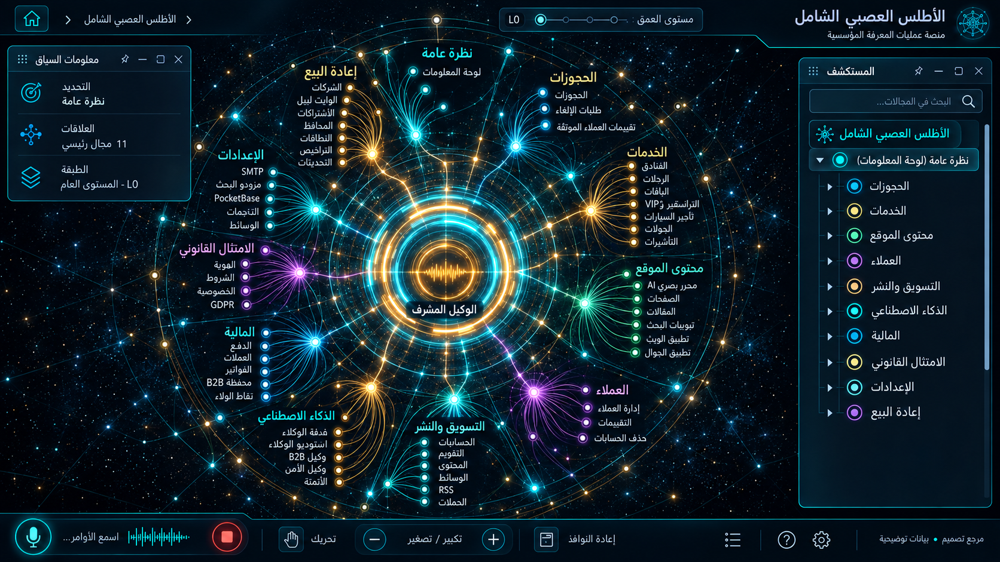

# 01 — الأطلس العصبي الشامل

## الغرض والنطاق
جميع مجموعات السيدبار الظاهرة. المرحلة: P04. المشهد: radial. المقاس:1672×941.
هذه مواصفة تصميم من القائمة المصورة، وليست كشفًا لبنية Backend.
بنود القائمة المغطاة:
- واجهة مشتركة عابرة للمجالات؛ ليست بند قائمة مستقلًا.

## الواجهات الفرعية والبناء البصري
المشاهد المطلوبة: أطلس المجالات / مؤشرات المصدر / قائمة علاقات / أثر قرار.
تكوين شعاعي متدرج، نواة مجردة مشعة، مجالات ثابتة الهوية، علاقات منحنية دلالية، وأبناء يظهرون بالتوسع. الفراغات بين العناقيد تحفظ القراءة. الروابط الزخرفية لا تمثل معاملات فعلية.
قس حدود النوافذ والفراغات والمواضع من الصورة قبل كتابة CSS ، واحفظ regions/01.json. لا تفرض موضع Inspector موحدًا على مراجع مختلفة.
السيدبار العام عربي يمينًا قابل للطي والإخفاء؛ المفتش قابل للنقل. النص DOM واضح، والتوهج على الحدود لا كل الحروف.
تكوين هذه الواجهة يجب أن يعتمد فعليًا على المرجع؛ النموذج HTML المرفق تجربة سلوك وليس أصلًا بصريًا معتمدًا.
لكل مشهد: overview ثم expanded ثم inspector ثم action preview ، وحالات empty/error/loading. اللقطات الإضافية تُعتمد لاحقًا؛ الحزمة لا تتضمن صورة مستقلة لكل حالة فرعية.

## المكونات والعلاقات
1. الحجوزات: معرف ثابت `domain.01.component.1`. عند التوسع تظهر الكيانات والإعدادات والتنفيذ الخاصة بهذا المكون من schema الفعلي؛ لا ثلاثة أبناء عامين في المنتج النهائي.
2. الرحلات: معرف ثابت `domain.01.component.2`. عند التوسع تظهر الكيانات والإعدادات والتنفيذ الخاصة بهذا المكون من schema الفعلي؛ لا ثلاثة أبناء عامين في المنتج النهائي.
3. الفنادق: معرف ثابت `domain.01.component.3`. عند التوسع تظهر الكيانات والإعدادات والتنفيذ الخاصة بهذا المكون من schema الفعلي؛ لا ثلاثة أبناء عامين في المنتج النهائي.
4. الخدمات: معرف ثابت `domain.01.component.4`. عند التوسع تظهر الكيانات والإعدادات والتنفيذ الخاصة بهذا المكون من schema الفعلي؛ لا ثلاثة أبناء عامين في المنتج النهائي.
5. المحتوى: معرف ثابت `domain.01.component.5`. عند التوسع تظهر الكيانات والإعدادات والتنفيذ الخاصة بهذا المكون من schema الفعلي؛ لا ثلاثة أبناء عامين في المنتج النهائي.
6. العملاء: معرف ثابت `domain.01.component.6`. عند التوسع تظهر الكيانات والإعدادات والتنفيذ الخاصة بهذا المكون من schema الفعلي؛ لا ثلاثة أبناء عامين في المنتج النهائي.
7. التسويق: معرف ثابت `domain.01.component.7`. عند التوسع تظهر الكيانات والإعدادات والتنفيذ الخاصة بهذا المكون من schema الفعلي؛ لا ثلاثة أبناء عامين في المنتج النهائي.
8. الوكلاء: معرف ثابت `domain.01.component.8`. عند التوسع تظهر الكيانات والإعدادات والتنفيذ الخاصة بهذا المكون من schema الفعلي؛ لا ثلاثة أبناء عامين في المنتج النهائي.
9. الأتمتة: معرف ثابت `domain.01.component.9`. عند التوسع تظهر الكيانات والإعدادات والتنفيذ الخاصة بهذا المكون من schema الفعلي؛ لا ثلاثة أبناء عامين في المنتج النهائي.
10. المالية: معرف ثابت `domain.01.component.10`. عند التوسع تظهر الكيانات والإعدادات والتنفيذ الخاصة بهذا المكون من schema الفعلي؛ لا ثلاثة أبناء عامين في المنتج النهائي.
11. B2B: معرف ثابت `domain.01.component.11`. عند التوسع تظهر الكيانات والإعدادات والتنفيذ الخاصة بهذا المكون من schema الفعلي؛ لا ثلاثة أبناء عامين في المنتج النهائي.
12. التكاملات: معرف ثابت `domain.01.component.12`. عند التوسع تظهر الكيانات والإعدادات والتنفيذ الخاصة بهذا المكون من schema الفعلي؛ لا ثلاثة أبناء عامين في المنتج النهائي.
روابط المجالات: 03 الحجوزات والإلغاء والتقييمات؛ 04 الرحلات وموزعو GDS ؛ 05 الفنادق وبنوك الأسرّة؛ 06 النقل والجولات والباقات والتأشيرات؛ 07 محتوى الموقع والتطبيقات؛ 08 العملاء وخدمة العملاء؛ 09 النشر متعدد القنوات والمحتوى؛ 10 الحملات والتسويق والعمولات؛ 11 غرفة الوكلاء والمعرفة؛ 12 استوديو الأتمتة والتنفيذ؛ 13 المالية والفوترة والولاء؛ 14 إعادة البيع وشبكة B2B ؛ 15 الامتثال والخصوصية والصلاحيات؛ 16 الإعدادات والتكاملات.
كل علاقة دلالية لديها relationType و evidenceRef ؛ اعرض دعم العميل/المالية/الامتثال عند اختيار العقدة بدل ازدحام الجميع.
الرجوع يحفظ parent selection وعمق التوسع ومواقع المستخدم. إغلاق المفتش لا يلغي مهمة خادم.

## البيانات والعمليات
Capabilities مقترحة: `service.catalog.read`.
حقول للفحص: entityId, parentId, type, title, permissions, status, freshness, source.
لكل capability: اكتشف الخدمة و route/function و schema و auth scope و read/write والأخطاء المتوقعة و trace location و fixture.
كل كيان لديه ID و version و tenant إن انطبق. التواريخ ISO ؛ المال amountMinor+currency ؛ الأسرار secretRef. unknown لا تعني healthy.
القراءة تعيد loading/empty/error. الكتابة تبدأ preview وتحتاجصلاحية؛ نتيجةالخادم مصدرالنجاح، لا مؤقت UI.
قيد المجال: عدم مساواة عدد العلاقات بسلامة النظام؛ الحالة غير المعروفة رمادية.

## سيناريو التشغيل الرئيسي
اختيار مجال ثم فتح أبنائه مع بقاء الأصل والسياق؛ الرجوع إلى الأطلس دون فقد مواضع النوافذ.
1. تحميل fixture معلوم أو snapshot حقيقي مع وسم مصدره.
2. فتح المجال ثم المكون وتثبيت breadcrumb.
3. جلب التفاصيل بحسب permission وإخفاء الحقول الحساسة.
4. عرض preview بالأثر والمدخلات وهويةالمنفذ.
5. اعتماد العملية إذا كانت حجزًا أو دفعًا أو حذفًا أو نشرًا.
6. إرسال command بمعرف منع تكرار ثم تتبع النتيجة.
7. الفشل الجزئي يوضح الجزء الفاشل والمسار المتاح لإصلاحه.
8. انتقال للمجال المرتبط ثم رجوع بالسياق نفسه.

## حالات إلزامية
- loading: مصدر البيانات غير متاح بعد؛ لا online وهمي.
- empty: شرح غياب الكيانات وزر قراءة آمن.
- ready: المصدر وآخر تحديث و trace عند توفره.
- stale/offline: آخر قيمة موسومة؛ منع الكتابة غير الآمنة.
- denied403: إخفاء الإجراء لا يغني عن فحص الخادم.
- validation/conflict409: حقل محدد ورسالة عربية ونسخة محدثة.
- partial/timeout: تحميل catalog فارغ يعرض فراغًا، لا مجالات تجريبية تحت live.
- duplicate/interruption: إضافة مجال لل registry تظهر في الأطلس والبحث دون تعديل عشرين ملفًا.

## اختبارات القبول الخاصة
S01-01: المسار الفعلي يعرض العنوان و 12 مكونات أساسية و sidebar عربيًا.
S01-02: اختيار «الحجوزات» يفتح تفاصيله؛ التوسع لا يزيل الأب.
S01-03: السيناريو الرئيسي بـ fixture ثم contract test لمحوله.
S01-04: تحميل catalog فارغ يعرض فراغًا، لا مجالات تجريبية تحت live.
S01-05: إضافة مجال لل registry تظهر في الأطلس والبحث دون تعديل عشرين ملفًا.
S01-06: reader/operator و tenantA/B إن انطبق؛ تحقق منع الخادم.
S01-07: نقل وتحجيم وتصغير واستعادة المفتش، ثم refresh ؛ بديل keyboard.
S01-08: لقطات overview/expanded/inspector/empty/error عند 1672×941 و DPR1.
S01-09: expected/actual/diff ، بلا صورة المرجع فوق التنفيذ أثناءالتقاطه.
S01-10: صفر أخطاء console أوطلب خارجي غير مأذون أوتسريب listeners.

## أدلة الإتمام
ملفات تنفيذ؛ عقود ومحولات؛ fixtures ؛ tests ؛ لقطات؛ diff ؛ performance sample ؛ مراجعة بصرية موثقة.
اربطالأدلة في tasks. لا accepted لمجرد وجود SVG وصورة. الاختبارات الإنتاجية أعلاه مطلوبة في المشروع؛ اختبارات الحزمة الحالية لا تدّعي تغطيتها.

