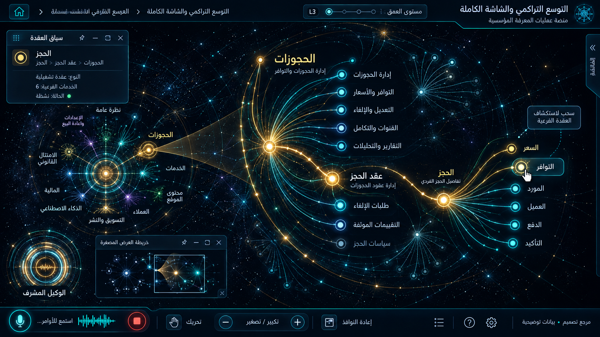

# 02 — التوسع التراكمي والشاشة الكاملة

## الغرض والنطاق
أصول الشبكة والتفرع العميق والتحريك. المرحلة: P04. المشهد: radial. المقاس:1672×941.
هذه مواصفة تصميم من القائمة المصورة، وليست كشفًا لبنية Backend.
بنود القائمة المغطاة:
- واجهة مشتركة عابرة للمجالات؛ ليست بند قائمة مستقلًا.

## الواجهات الفرعية والبناء البصري
المشاهد المطلوبة: شجرة الأعماق / منظور الآباء / تفاصيل الرابط / استعادة جلسة.
تكوين شعاعي متدرج، نواة مجردة مشعة، مجالات ثابتة الهوية، علاقات منحنية دلالية، وأبناء يظهرون بالتوسع. الفراغات بين العناقيد تحفظ القراءة. الروابط الزخرفية لا تمثل معاملات فعلية.
قس حدود النوافذ والفراغات والمواضع من الصورة قبل كتابة CSS ، واحفظ regions/02.json. لا تفرض موضع Inspector موحدًا على مراجع مختلفة.
السيدبار العام عربي يمينًا قابل للطي والإخفاء؛ المفتش قابل للنقل. النص DOM واضح، والتوهج على الحدود لا كل الحروف.
تكوين هذه الواجهة يجب أن يعتمد فعليًا على المرجع؛ النموذج HTML المرفق تجربة سلوك وليس أصلًا بصريًا معتمدًا.
لكل مشهد: overview ثم expanded ثم inspector ثم action preview ، وحالات empty/error/loading. اللقطات الإضافية تُعتمد لاحقًا؛ الحزمة لا تتضمن صورة مستقلة لكل حالة فرعية.

## المكونات والعلاقات
1. المنصة: معرف ثابت `domain.02.component.1`. عند التوسع تظهر الكيانات والإعدادات والتنفيذ الخاصة بهذا المكون من schema الفعلي؛ لا ثلاثة أبناء عامين في المنتج النهائي.
2. المجال: معرف ثابت `domain.02.component.2`. عند التوسع تظهر الكيانات والإعدادات والتنفيذ الخاصة بهذا المكون من schema الفعلي؛ لا ثلاثة أبناء عامين في المنتج النهائي.
3. الخدمة: معرف ثابت `domain.02.component.3`. عند التوسع تظهر الكيانات والإعدادات والتنفيذ الخاصة بهذا المكون من schema الفعلي؛ لا ثلاثة أبناء عامين في المنتج النهائي.
4. الإجراء: معرف ثابت `domain.02.component.4`. عند التوسع تظهر الكيانات والإعدادات والتنفيذ الخاصة بهذا المكون من schema الفعلي؛ لا ثلاثة أبناء عامين في المنتج النهائي.
5. التنفيذ: معرف ثابت `domain.02.component.5`. عند التوسع تظهر الكيانات والإعدادات والتنفيذ الخاصة بهذا المكون من schema الفعلي؛ لا ثلاثة أبناء عامين في المنتج النهائي.
6. الحدث: معرف ثابت `domain.02.component.6`. عند التوسع تظهر الكيانات والإعدادات والتنفيذ الخاصة بهذا المكون من schema الفعلي؛ لا ثلاثة أبناء عامين في المنتج النهائي.
7. المورد: معرف ثابت `domain.02.component.7`. عند التوسع تظهر الكيانات والإعدادات والتنفيذ الخاصة بهذا المكون من schema الفعلي؛ لا ثلاثة أبناء عامين في المنتج النهائي.
8. الأثر: معرف ثابت `domain.02.component.8`. عند التوسع تظهر الكيانات والإعدادات والتنفيذ الخاصة بهذا المكون من schema الفعلي؛ لا ثلاثة أبناء عامين في المنتج النهائي.
روابط المجالات: 01 الأطلس العصبي الشامل؛ 18 حالات النوافذ والسيدبار والتنقل.
كل علاقة دلالية لديها relationType و evidenceRef ؛ اعرض دعم العميل/المالية/الامتثال عند اختيار العقدة بدل ازدحام الجميع.
الرجوع يحفظ parent selection وعمق التوسع ومواقع المستخدم. إغلاق المفتش لا يلغي مهمة خادم.

## البيانات والعمليات
Capabilities مقترحة: `graph.children.read`.
حقول للفحص: nodeId, ancestry, cursor, relationType, childCount, version.
لكل capability: اكتشف الخدمة و route/function و schema و auth scope و read/write والأخطاء المتوقعة و trace location و fixture.
كل كيان لديه ID و version و tenant إن انطبق. التواريخ ISO ؛ المال amountMinor+currency ؛ الأسرار secretRef. unknown لا تعني healthy.
القراءة تعيد loading/empty/error. الكتابة تبدأ preview وتحتاجصلاحية؛ نتيجةالخادم مصدرالنجاح، لا مؤقت UI.
قيد المجال: منع الدورات غير المحدودة؛ كشف cycle وإظهار رابط مرجعي بدل نسخ شجرة.

## سيناريو التشغيل الرئيسي
توسيع ثلاثة مستويات، تحريك عقدة فرعية، طي الأب وإعادة فتحه، ثم استعادة العرض السابق.
1. تحميل fixture معلوم أو snapshot حقيقي مع وسم مصدره.
2. فتح المجال ثم المكون وتثبيت breadcrumb.
3. جلب التفاصيل بحسب permission وإخفاء الحقول الحساسة.
4. عرض preview بالأثر والمدخلات وهويةالمنفذ.
5. اعتماد العملية إذا كانت حجزًا أو دفعًا أو حذفًا أو نشرًا.
6. إرسال command بمعرف منع تكرار ثم تتبع النتيجة.
7. الفشل الجزئي يوضح الجزء الفاشل والمسار المتاح لإصلاحه.
8. انتقال للمجال المرتبط ثم رجوع بالسياق نفسه.

## حالات إلزامية
- loading: مصدر البيانات غير متاح بعد؛ لا online وهمي.
- empty: شرح غياب الكيانات وزر قراءة آمن.
- ready: المصدر وآخر تحديث و trace عند توفره.
- stale/offline: آخر قيمة موسومة؛ منع الكتابة غير الآمنة.
- denied403: إخفاء الإجراء لا يغني عن فحص الخادم.
- validation/conflict409: حقل محدد ورسالة عربية ونسخة محدثة.
- partial/timeout: علاقة تشير لجد تظهر كمرجع cycle ، لا سلسلة أبناء لا تنتهي.
- duplicate/interruption: طي الأب يخفي ذريته فقط وإعادة الفتح تستعيد IDs ومواقع المستخدم.

## اختبارات القبول الخاصة
S02-01: المسار الفعلي يعرض العنوان و 8 مكونات أساسية و sidebar عربيًا.
S02-02: اختيار «المنصة» يفتح تفاصيله؛ التوسع لا يزيل الأب.
S02-03: السيناريو الرئيسي بـ fixture ثم contract test لمحوله.
S02-04: علاقة تشير لجد تظهر كمرجع cycle ، لا سلسلة أبناء لا تنتهي.
S02-05: طي الأب يخفي ذريته فقط وإعادة الفتح تستعيد IDs ومواقع المستخدم.
S02-06: reader/operator و tenantA/B إن انطبق؛ تحقق منع الخادم.
S02-07: نقل وتحجيم وتصغير واستعادة المفتش، ثم refresh ؛ بديل keyboard.
S02-08: لقطات overview/expanded/inspector/empty/error عند 1672×941 و DPR1.
S02-09: expected/actual/diff ، بلا صورة المرجع فوق التنفيذ أثناءالتقاطه.
S02-10: صفر أخطاء console أوطلب خارجي غير مأذون أوتسريب listeners.

## أدلة الإتمام
ملفات تنفيذ؛ عقود ومحولات؛ fixtures ؛ tests ؛ لقطات؛ diff ؛ performance sample ؛ مراجعة بصرية موثقة.
اربطالأدلة في tasks. لا accepted لمجرد وجود SVG وصورة. الاختبارات الإنتاجية أعلاه مطلوبة في المشروع؛ اختبارات الحزمة الحالية لا تدّعي تغطيتها.

