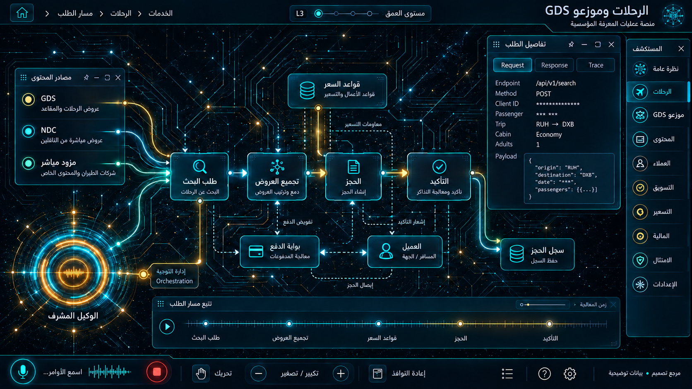

# 04 — الرحلات وموزعو GDS

## الغرض والنطاق
الرحلات، بحث الموردين، الحجز والتذاكر، التكامل. المرحلة: P05. المشهد: dag. المقاس:1672×941.
هذه مواصفة تصميم من القائمة المصورة، وليست كشفًا لبنية Backend.
بنود القائمة المغطاة:
- الخدمات — السفر والتنقل ← الرحلات

## الواجهات الفرعية والبناء البصري
المشاهد المطلوبة: بحث الموردين / مصفوفة عروض / تفصيل سعر / تأكيد وتذكرة.
مسار هندسي بعقد ذات منافذ، مصادر منفصلة، trace ومفتش طلب/استجابة. لا توصل الموردين تسلسليًا حين تكون الحقيقة fan-out/fan-in. البداية والنهاية معلّمتان، واتجاه تدفق البيانات مستقل عن RTL.
قس حدود النوافذ والفراغات والمواضع من الصورة قبل كتابة CSS ، واحفظ regions/04.json. لا تفرض موضع Inspector موحدًا على مراجع مختلفة.
السيدبار العام عربي يمينًا قابل للطي والإخفاء؛ المفتش قابل للنقل. النص DOM واضح، والتوهج على الحدود لا كل الحروف.
تكوين هذه الواجهة يجب أن يعتمد فعليًا على المرجع؛ النموذج HTML المرفق تجربة سلوك وليس أصلًا بصريًا معتمدًا.
لكل مشهد: overview ثم expanded ثم inspector ثم action preview ، وحالات empty/error/loading. اللقطات الإضافية تُعتمد لاحقًا؛ الحزمة لا تتضمن صورة مستقلة لكل حالة فرعية.

## المكونات والعلاقات
1. طلب البحث: معرف ثابت `domain.04.component.1`. عند التوسع تظهر الكيانات والإعدادات والتنفيذ الخاصة بهذا المكون من schema الفعلي؛ لا ثلاثة أبناء عامين في المنتج النهائي.
2. GDS: معرف ثابت `domain.04.component.2`. عند التوسع تظهر الكيانات والإعدادات والتنفيذ الخاصة بهذا المكون من schema الفعلي؛ لا ثلاثة أبناء عامين في المنتج النهائي.
3. NDC: معرف ثابت `domain.04.component.3`. عند التوسع تظهر الكيانات والإعدادات والتنفيذ الخاصة بهذا المكون من schema الفعلي؛ لا ثلاثة أبناء عامين في المنتج النهائي.
4. مزود مباشر: معرف ثابت `domain.04.component.4`. عند التوسع تظهر الكيانات والإعدادات والتنفيذ الخاصة بهذا المكون من schema الفعلي؛ لا ثلاثة أبناء عامين في المنتج النهائي.
5. تجميع العروض: معرف ثابت `domain.04.component.5`. عند التوسع تظهر الكيانات والإعدادات والتنفيذ الخاصة بهذا المكون من schema الفعلي؛ لا ثلاثة أبناء عامين في المنتج النهائي.
6. قواعد السعر: معرف ثابت `domain.04.component.6`. عند التوسع تظهر الكيانات والإعدادات والتنفيذ الخاصة بهذا المكون من schema الفعلي؛ لا ثلاثة أبناء عامين في المنتج النهائي.
7. إنشاء الحجز: معرف ثابت `domain.04.component.7`. عند التوسع تظهر الكيانات والإعدادات والتنفيذ الخاصة بهذا المكون من schema الفعلي؛ لا ثلاثة أبناء عامين في المنتج النهائي.
8. التذاكر: معرف ثابت `domain.04.component.8`. عند التوسع تظهر الكيانات والإعدادات والتنفيذ الخاصة بهذا المكون من schema الفعلي؛ لا ثلاثة أبناء عامين في المنتج النهائي.
روابط المجالات: 03 الحجوزات والإلغاء والتقييمات؛ 13 المالية والفوترة والولاء؛ 16 الإعدادات والتكاملات.
كل علاقة دلالية لديها relationType و evidenceRef ؛ اعرض دعم العميل/المالية/الامتثال عند اختيار العقدة بدل ازدحام الجميع.
الرجوع يحفظ parent selection وعمق التوسع ومواقع المستخدم. إغلاق المفتش لا يلغي مهمة خادم.

## البيانات والعمليات
Capabilities مقترحة: `flight.search`، `offer.revalidate`، `booking.create`، `ticket.issue`.
حقول للفحص: searchId, offerId, supplier, expiresAt, fareRules, bookingRef, ticketStatus.
لكل capability: اكتشف الخدمة و route/function و schema و auth scope و read/write والأخطاء المتوقعة و trace location و fixture.
كل كيان لديه ID و version و tenant إن انطبق. التواريخ ISO ؛ المال amountMinor+currency ؛ الأسرار secretRef. unknown لا تعني healthy.
القراءة تعيد loading/empty/error. الكتابة تبدأ preview وتحتاجصلاحية؛ نتيجةالخادم مصدرالنجاح، لا مؤقت UI.
قيد المجال: انتهاء العرض أو نجاح مورد وفشل الدفع يحتاج حالة reconciliation وليس تأكيدًا وهميًا.

## سيناريو التشغيل الرئيسي
إرسال بحث إلى محولات الموردين؛ دمج العروض؛ إعادة تحقق السعر؛ تفويض الدفع؛ تأكيد الحجز ثم التذاكر؛ عرض timeout منفصل لكل مورد.
1. تحميل fixture معلوم أو snapshot حقيقي مع وسم مصدره.
2. فتح المجال ثم المكون وتثبيت breadcrumb.
3. جلب التفاصيل بحسب permission وإخفاء الحقول الحساسة.
4. عرض preview بالأثر والمدخلات وهويةالمنفذ.
5. اعتماد العملية إذا كانت حجزًا أو دفعًا أو حذفًا أو نشرًا.
6. إرسال command بمعرف منع تكرار ثم تتبع النتيجة.
7. الفشل الجزئي يوضح الجزء الفاشل والمسار المتاح لإصلاحه.
8. انتقال للمجال المرتبط ثم رجوع بالسياق نفسه.

## حالات إلزامية
- loading: مصدر البيانات غير متاح بعد؛ لا online وهمي.
- empty: شرح غياب الكيانات وزر قراءة آمن.
- ready: المصدر وآخر تحديث و trace عند توفره.
- stale/offline: آخر قيمة موسومة؛ منع الكتابة غير الآمنة.
- denied403: إخفاء الإجراء لا يغني عن فحص الخادم.
- validation/conflict409: حقل محدد ورسالة عربية ونسخة محدثة.
- partial/timeout: تعطل مورد ينتج partial مع بقاء عروض المصادر الأخرى.
- duplicate/interruption: expired offer يمنع الحجز ويطلب revalidation ؛ لا تبديل سعر صامت.

## اختبارات القبول الخاصة
S04-01: المسار الفعلي يعرض العنوان و 8 مكونات أساسية و sidebar عربيًا.
S04-02: اختيار «طلب البحث» يفتح تفاصيله؛ التوسع لا يزيل الأب.
S04-03: السيناريو الرئيسي بـ fixture ثم contract test لمحوله.
S04-04: تعطل مورد ينتج partial مع بقاء عروض المصادر الأخرى.
S04-05: expired offer يمنع الحجز ويطلب revalidation ؛ لا تبديل سعر صامت.
S04-06: reader/operator و tenantA/B إن انطبق؛ تحقق منع الخادم.
S04-07: نقل وتحجيم وتصغير واستعادة المفتش، ثم refresh ؛ بديل keyboard.
S04-08: لقطات overview/expanded/inspector/empty/error عند 1672×941 و DPR1.
S04-09: expected/actual/diff ، بلا صورة المرجع فوق التنفيذ أثناءالتقاطه.
S04-10: صفر أخطاء console أوطلب خارجي غير مأذون أوتسريب listeners.

## أدلة الإتمام
ملفات تنفيذ؛ عقود ومحولات؛ fixtures ؛ tests ؛ لقطات؛ diff ؛ performance sample ؛ مراجعة بصرية موثقة.
اربطالأدلة في tasks. لا accepted لمجرد وجود SVG وصورة. الاختبارات الإنتاجية أعلاه مطلوبة في المشروع؛ اختبارات الحزمة الحالية لا تدّعي تغطيتها.

