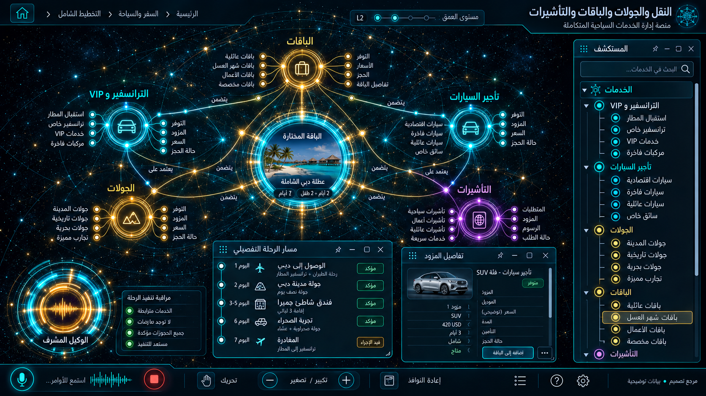

# 06 — النقل والجولات والباقات والتأشيرات

## الغرض والنطاق
الترانسفير و VIP ، تأجير السيارات، الجولات، الباقات، التأشيرات. المرحلة: P05. المشهد: radial. المقاس:1672×941.
هذه مواصفة تصميم من القائمة المصورة، وليست كشفًا لبنية Backend.
بنود القائمة المغطاة:
- الخدمات — السفر والتنقل ← الباقات
- الخدمات — السفر والتنقل ← الترانسفير والـ VIP
- الخدمات — السفر والتنقل ← تأجير السيارات
- الخدمات — السفر والتنقل ← الجولات
- الخدمات — السفر والتنقل ← التأشيرات

## الواجهات الفرعية والبناء البصري
المشاهد المطلوبة: كتالوج خدمات / itinerary باقة / طلب تأشيرة / توفر نقل.
تكوين شعاعي متدرج، نواة مجردة مشعة، مجالات ثابتة الهوية، علاقات منحنية دلالية، وأبناء يظهرون بالتوسع. الفراغات بين العناقيد تحفظ القراءة. الروابط الزخرفية لا تمثل معاملات فعلية.
قس حدود النوافذ والفراغات والمواضع من الصورة قبل كتابة CSS ، واحفظ regions/06.json. لا تفرض موضع Inspector موحدًا على مراجع مختلفة.
السيدبار العام عربي يمينًا قابل للطي والإخفاء؛ المفتش قابل للنقل. النص DOM واضح، والتوهج على الحدود لا كل الحروف.
تكوين هذه الواجهة يجب أن يعتمد فعليًا على المرجع؛ النموذج HTML المرفق تجربة سلوك وليس أصلًا بصريًا معتمدًا.
لكل مشهد: overview ثم expanded ثم inspector ثم action preview ، وحالات empty/error/loading. اللقطات الإضافية تُعتمد لاحقًا؛ الحزمة لا تتضمن صورة مستقلة لكل حالة فرعية.

## المكونات والعلاقات
1. الترانسفير: معرف ثابت `domain.06.component.1`. عند التوسع تظهر الكيانات والإعدادات والتنفيذ الخاصة بهذا المكون من schema الفعلي؛ لا ثلاثة أبناء عامين في المنتج النهائي.
2. VIP: معرف ثابت `domain.06.component.2`. عند التوسع تظهر الكيانات والإعدادات والتنفيذ الخاصة بهذا المكون من schema الفعلي؛ لا ثلاثة أبناء عامين في المنتج النهائي.
3. السيارات: معرف ثابت `domain.06.component.3`. عند التوسع تظهر الكيانات والإعدادات والتنفيذ الخاصة بهذا المكون من schema الفعلي؛ لا ثلاثة أبناء عامين في المنتج النهائي.
4. الجولات: معرف ثابت `domain.06.component.4`. عند التوسع تظهر الكيانات والإعدادات والتنفيذ الخاصة بهذا المكون من schema الفعلي؛ لا ثلاثة أبناء عامين في المنتج النهائي.
5. الباقات: معرف ثابت `domain.06.component.5`. عند التوسع تظهر الكيانات والإعدادات والتنفيذ الخاصة بهذا المكون من schema الفعلي؛ لا ثلاثة أبناء عامين في المنتج النهائي.
6. التأشيرات: معرف ثابت `domain.06.component.6`. عند التوسع تظهر الكيانات والإعدادات والتنفيذ الخاصة بهذا المكون من schema الفعلي؛ لا ثلاثة أبناء عامين في المنتج النهائي.
7. التوفر: معرف ثابت `domain.06.component.7`. عند التوسع تظهر الكيانات والإعدادات والتنفيذ الخاصة بهذا المكون من schema الفعلي؛ لا ثلاثة أبناء عامين في المنتج النهائي.
8. الحجز: معرف ثابت `domain.06.component.8`. عند التوسع تظهر الكيانات والإعدادات والتنفيذ الخاصة بهذا المكون من schema الفعلي؛ لا ثلاثة أبناء عامين في المنتج النهائي.
روابط المجالات: 03 الحجوزات والإلغاء والتقييمات؛ 04 الرحلات وموزعو GDS ؛ 05 الفنادق وبنوك الأسرّة؛ 13 المالية والفوترة والولاء.
كل علاقة دلالية لديها relationType و evidenceRef ؛ اعرض دعم العميل/المالية/الامتثال عند اختيار العقدة بدل ازدحام الجميع.
الرجوع يحفظ parent selection وعمق التوسع ومواقع المستخدم. إغلاق المفتش لا يلغي مهمة خادم.

## البيانات والعمليات
Capabilities مقترحة: `service.availability`، `package.quote`، `application.read`.
حقول للفحص: serviceType, itinerary, participants, pickup, vehicleClass, componentQuotes, requirements.
لكل capability: اكتشف الخدمة و route/function و schema و auth scope و read/write والأخطاء المتوقعة و trace location و fixture.
كل كيان لديه ID و version و tenant إن انطبق. التواريخ ISO ؛ المال amountMinor+currency ؛ الأسرار secretRef. unknown لا تعني healthy.
القراءة تعيد loading/empty/error. الكتابة تبدأ preview وتحتاجصلاحية؛ نتيجةالخادم مصدرالنجاح، لا مؤقت UI.
قيد المجال: حجز مركب يحتاج saga وتعويضات محددة؛ الوثائق الشخصية مقيدة الصلاحيات.

## سيناريو التشغيل الرئيسي
اختيار خدمة بنموذج متخصص؛ بناء باقة من مكونات؛ فحص توفر كل جزء؛ عرض فشل جزئي وتعويضه؛ التأشيرة طلب معالجة وليست ضمان قبول.
1. تحميل fixture معلوم أو snapshot حقيقي مع وسم مصدره.
2. فتح المجال ثم المكون وتثبيت breadcrumb.
3. جلب التفاصيل بحسب permission وإخفاء الحقول الحساسة.
4. عرض preview بالأثر والمدخلات وهويةالمنفذ.
5. اعتماد العملية إذا كانت حجزًا أو دفعًا أو حذفًا أو نشرًا.
6. إرسال command بمعرف منع تكرار ثم تتبع النتيجة.
7. الفشل الجزئي يوضح الجزء الفاشل والمسار المتاح لإصلاحه.
8. انتقال للمجال المرتبط ثم رجوع بالسياق نفسه.

## حالات إلزامية
- loading: مصدر البيانات غير متاح بعد؛ لا online وهمي.
- empty: شرح غياب الكيانات وزر قراءة آمن.
- ready: المصدر وآخر تحديث و trace عند توفره.
- stale/offline: آخر قيمة موسومة؛ منع الكتابة غير الآمنة.
- denied403: إخفاء الإجراء لا يغني عن فحص الخادم.
- validation/conflict409: حقل محدد ورسالة عربية ونسخة محدثة.
- partial/timeout: فشل جزء من الباقة يعرض حالات الأجزاء والتعويض المطلوب.
- duplicate/interruption: طلب التأشيرة يحمي الوثائق ولا يَعِد بنتيجة قبول مضمونة.

## اختبارات القبول الخاصة
S06-01: المسار الفعلي يعرض العنوان و 8 مكونات أساسية و sidebar عربيًا.
S06-02: اختيار «الترانسفير» يفتح تفاصيله؛ التوسع لا يزيل الأب.
S06-03: السيناريو الرئيسي بـ fixture ثم contract test لمحوله.
S06-04: فشل جزء من الباقة يعرض حالات الأجزاء والتعويض المطلوب.
S06-05: طلب التأشيرة يحمي الوثائق ولا يَعِد بنتيجة قبول مضمونة.
S06-06: reader/operator و tenantA/B إن انطبق؛ تحقق منع الخادم.
S06-07: نقل وتحجيم وتصغير واستعادة المفتش، ثم refresh ؛ بديل keyboard.
S06-08: لقطات overview/expanded/inspector/empty/error عند 1672×941 و DPR1.
S06-09: expected/actual/diff ، بلا صورة المرجع فوق التنفيذ أثناءالتقاطه.
S06-10: صفر أخطاء console أوطلب خارجي غير مأذون أوتسريب listeners.

## أدلة الإتمام
ملفات تنفيذ؛ عقود ومحولات؛ fixtures ؛ tests ؛ لقطات؛ diff ؛ performance sample ؛ مراجعة بصرية موثقة.
اربطالأدلة في tasks. لا accepted لمجرد وجود SVG وصورة. الاختبارات الإنتاجية أعلاه مطلوبة في المشروع؛ اختبارات الحزمة الحالية لا تدّعي تغطيتها.

