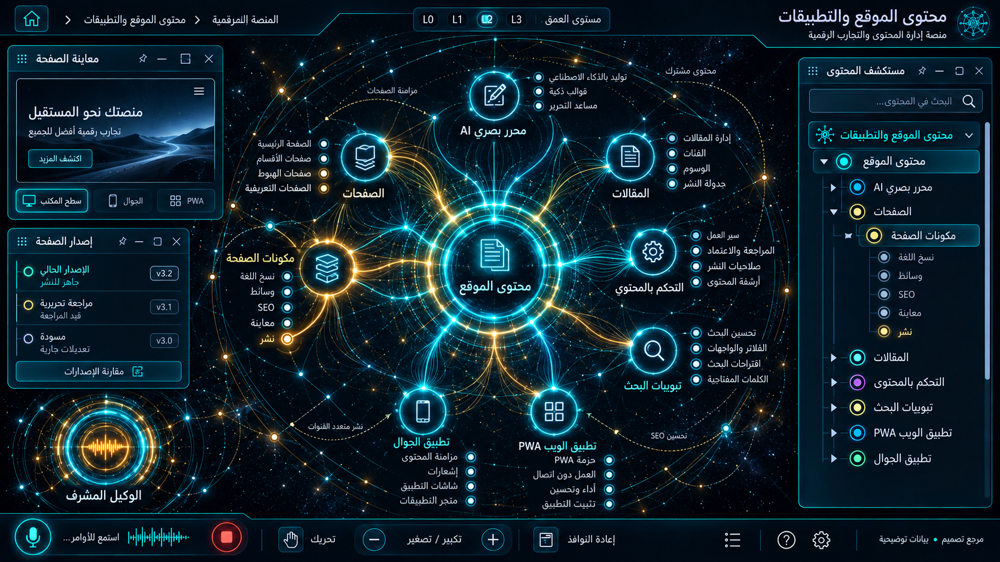

# 07 — محتوى الموقع والتطبيقات

## الغرض والنطاق
محرر بصري AI ، الصفحات، المقالات، التحكم بالمحتوى، تبويبات البحث، PWA والجوال. المرحلة: P06. المشهد: dag. المقاس:1672×941.
هذه مواصفة تصميم من القائمة المصورة، وليست كشفًا لبنية Backend.
بنود القائمة المغطاة:
- محتوى الموقع ← محرر بصري AI
- محتوى الموقع ← الصفحات
- محتوى الموقع ← المقالات
- محتوى الموقع ← التحكم بالمحتوى
- محتوى الموقع ← تبويبات البحث
- محتوى الموقع ← تطبيق الويب (PWA)
- محتوى الموقع ← تطبيق الجوال لوناليزا

## الواجهات الفرعية والبناء البصري
المشاهد المطلوبة: شجرة محتوى / محرر مسودة / معاينة قنوات / إصدارات نشر.
مسار هندسي بعقد ذات منافذ، مصادر منفصلة، trace ومفتش طلب/استجابة. لا توصل الموردين تسلسليًا حين تكون الحقيقة fan-out/fan-in. البداية والنهاية معلّمتان، واتجاه تدفق البيانات مستقل عن RTL.
قس حدود النوافذ والفراغات والمواضع من الصورة قبل كتابة CSS ، واحفظ regions/07.json. لا تفرض موضع Inspector موحدًا على مراجع مختلفة.
السيدبار العام عربي يمينًا قابل للطي والإخفاء؛ المفتش قابل للنقل. النص DOM واضح، والتوهج على الحدود لا كل الحروف.
تكوين هذه الواجهة يجب أن يعتمد فعليًا على المرجع؛ النموذج HTML المرفق تجربة سلوك وليس أصلًا بصريًا معتمدًا.
لكل مشهد: overview ثم expanded ثم inspector ثم action preview ، وحالات empty/error/loading. اللقطات الإضافية تُعتمد لاحقًا؛ الحزمة لا تتضمن صورة مستقلة لكل حالة فرعية.

## المكونات والعلاقات
1. المحرر: معرف ثابت `domain.07.component.1`. عند التوسع تظهر الكيانات والإعدادات والتنفيذ الخاصة بهذا المكون من schema الفعلي؛ لا ثلاثة أبناء عامين في المنتج النهائي.
2. الصفحات: معرف ثابت `domain.07.component.2`. عند التوسع تظهر الكيانات والإعدادات والتنفيذ الخاصة بهذا المكون من schema الفعلي؛ لا ثلاثة أبناء عامين في المنتج النهائي.
3. المقالات: معرف ثابت `domain.07.component.3`. عند التوسع تظهر الكيانات والإعدادات والتنفيذ الخاصة بهذا المكون من schema الفعلي؛ لا ثلاثة أبناء عامين في المنتج النهائي.
4. الترجمة: معرف ثابت `domain.07.component.4`. عند التوسع تظهر الكيانات والإعدادات والتنفيذ الخاصة بهذا المكون من schema الفعلي؛ لا ثلاثة أبناء عامين في المنتج النهائي.
5. الوسائط: معرف ثابت `domain.07.component.5`. عند التوسع تظهر الكيانات والإعدادات والتنفيذ الخاصة بهذا المكون من schema الفعلي؛ لا ثلاثة أبناء عامين في المنتج النهائي.
6. معاينة الويب: معرف ثابت `domain.07.component.6`. عند التوسع تظهر الكيانات والإعدادات والتنفيذ الخاصة بهذا المكون من schema الفعلي؛ لا ثلاثة أبناء عامين في المنتج النهائي.
7. PWA: معرف ثابت `domain.07.component.7`. عند التوسع تظهر الكيانات والإعدادات والتنفيذ الخاصة بهذا المكون من schema الفعلي؛ لا ثلاثة أبناء عامين في المنتج النهائي.
8. الجوال: معرف ثابت `domain.07.component.8`. عند التوسع تظهر الكيانات والإعدادات والتنفيذ الخاصة بهذا المكون من schema الفعلي؛ لا ثلاثة أبناء عامين في المنتج النهائي.
روابط المجالات: 09 النشر متعدد القنوات والمحتوى؛ 10 الحملات والتسويق والعمولات؛ 15 الامتثال والخصوصية والصلاحيات؛ 16 الإعدادات والتكاملات.
كل علاقة دلالية لديها relationType و evidenceRef ؛ اعرض دعم العميل/المالية/الامتثال عند اختيار العقدة بدل ازدحام الجميع.
الرجوع يحفظ parent selection وعمق التوسع ومواقع المستخدم. إغلاق المفتش لا يلغي مهمة خادم.

## البيانات والعمليات
Capabilities مقترحة: `content.read`، `draft.save`، `publish.preview`، `publish.commit`.
حقول للفحص: documentId, locale, revision, schemaVersion, draft, publishedAt, channel.
لكل capability: اكتشف الخدمة و route/function و schema و auth scope و read/write والأخطاء المتوقعة و trace location و fixture.
كل كيان لديه ID و version و tenant إن انطبق. التواريخ ISO ؛ المال amountMinor+currency ؛ الأسرار secretRef. unknown لا تعني healthy.
القراءة تعيد loading/empty/error. الكتابة تبدأ preview وتحتاجصلاحية؛ نتيجةالخادم مصدرالنجاح، لا مؤقت UI.
قيد المجال: لا نشر تلقائي من مخرجات نموذج غير معتمدة؛ تنظيف HTML وفحص روابط وحقوق الوسائط.

## سيناريو التشغيل الرئيسي
فتح صفحة بإصدارها؛ تعديل مسودة؛ معاينة عربية وجوال؛ مراجعة الفرق؛ نشر بإذن؛ الرجوع لإصدار سابق دون إتلاف سجل المحتوى.
1. تحميل fixture معلوم أو snapshot حقيقي مع وسم مصدره.
2. فتح المجال ثم المكون وتثبيت breadcrumb.
3. جلب التفاصيل بحسب permission وإخفاء الحقول الحساسة.
4. عرض preview بالأثر والمدخلات وهويةالمنفذ.
5. اعتماد العملية إذا كانت حجزًا أو دفعًا أو حذفًا أو نشرًا.
6. إرسال command بمعرف منع تكرار ثم تتبع النتيجة.
7. الفشل الجزئي يوضح الجزء الفاشل والمسار المتاح لإصلاحه.
8. انتقال للمجال المرتبط ثم رجوع بالسياق نفسه.

## حالات إلزامية
- loading: مصدر البيانات غير متاح بعد؛ لا online وهمي.
- empty: شرح غياب الكيانات وزر قراءة آمن.
- ready: المصدر وآخر تحديث و trace عند توفره.
- stale/offline: آخر قيمة موسومة؛ منع الكتابة غير الآمنة.
- denied403: إخفاء الإجراء لا يغني عن فحص الخادم.
- validation/conflict409: حقل محدد ورسالة عربية ونسخة محدثة.
- partial/timeout: تعديل draft لا ينشر؛ reader لا يستطيع publish.
- duplicate/interruption: rollback يحفظ الإصدارات وسجل الناشر، و fallback locale ظاهر.

## اختبارات القبول الخاصة
S07-01: المسار الفعلي يعرض العنوان و 8 مكونات أساسية و sidebar عربيًا.
S07-02: اختيار «المحرر» يفتح تفاصيله؛ التوسع لا يزيل الأب.
S07-03: السيناريو الرئيسي بـ fixture ثم contract test لمحوله.
S07-04: تعديل draft لا ينشر؛ reader لا يستطيع publish.
S07-05: rollback يحفظ الإصدارات وسجل الناشر، و fallback locale ظاهر.
S07-06: reader/operator و tenantA/B إن انطبق؛ تحقق منع الخادم.
S07-07: نقل وتحجيم وتصغير واستعادة المفتش، ثم refresh ؛ بديل keyboard.
S07-08: لقطات overview/expanded/inspector/empty/error عند 1672×941 و DPR1.
S07-09: expected/actual/diff ، بلا صورة المرجع فوق التنفيذ أثناءالتقاطه.
S07-10: صفر أخطاء console أوطلب خارجي غير مأذون أوتسريب listeners.

## أدلة الإتمام
ملفات تنفيذ؛ عقود ومحولات؛ fixtures ؛ tests ؛ لقطات؛ diff ؛ performance sample ؛ مراجعة بصرية موثقة.
اربطالأدلة في tasks. لا accepted لمجرد وجود SVG وصورة. الاختبارات الإنتاجية أعلاه مطلوبة في المشروع؛ اختبارات الحزمة الحالية لا تدّعي تغطيتها.

