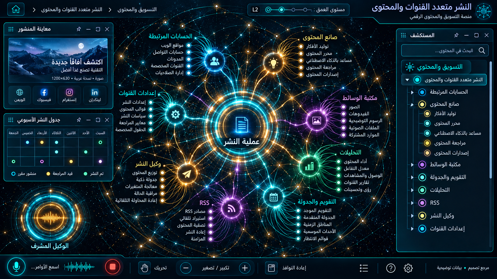

# 09 — النشر متعدد القنوات والمحتوى

## الغرض والنطاق
الحسابات، التقويم والجدولة، الصانع، الوسائط، التحليلات، RSS ، وكيل النشر، إعدادات القنوات. المرحلة: P06. المشهد: dag. المقاس:1672×941.
هذه مواصفة تصميم من القائمة المصورة، وليست كشفًا لبنية Backend.
بنود القائمة المغطاة:
- التسويق والنشر والتواصل — النشر ← حسابات الربط الرسمي
- التسويق والنشر والتواصل — النشر ← التقويم وجدولة المنشورات
- التسويق والنشر والتواصل — النشر ← صانع المحتوى والمقالات
- التسويق والنشر والتواصل — النشر ← مكتبة الوسائط والتصاميم
- التسويق والنشر والتواصل — النشر ← التحليلات والأداء الشامل
- التسويق والنشر والتواصل — النشر ← أتمتة النشر وخلاصات RSS
- التسويق والنشر والتواصل — النشر ← وكيل النشر الذكي
- التسويق والنشر والتواصل — النشر ← إعدادات قنوات النشر والتكامل

## الواجهات الفرعية والبناء البصري
المشاهد المطلوبة: مكتبة أصول / تقويم / معاينات قنوات / نتائج نشر.
مسار هندسي بعقد ذات منافذ، مصادر منفصلة، trace ومفتش طلب/استجابة. لا توصل الموردين تسلسليًا حين تكون الحقيقة fan-out/fan-in. البداية والنهاية معلّمتان، واتجاه تدفق البيانات مستقل عن RTL.
قس حدود النوافذ والفراغات والمواضع من الصورة قبل كتابة CSS ، واحفظ regions/09.json. لا تفرض موضع Inspector موحدًا على مراجع مختلفة.
السيدبار العام عربي يمينًا قابل للطي والإخفاء؛ المفتش قابل للنقل. النص DOM واضح، والتوهج على الحدود لا كل الحروف.
تكوين هذه الواجهة يجب أن يعتمد فعليًا على المرجع؛ النموذج HTML المرفق تجربة سلوك وليس أصلًا بصريًا معتمدًا.
لكل مشهد: overview ثم expanded ثم inspector ثم action preview ، وحالات empty/error/loading. اللقطات الإضافية تُعتمد لاحقًا؛ الحزمة لا تتضمن صورة مستقلة لكل حالة فرعية.

## المكونات والعلاقات
1. القنوات: معرف ثابت `domain.09.component.1`. عند التوسع تظهر الكيانات والإعدادات والتنفيذ الخاصة بهذا المكون من schema الفعلي؛ لا ثلاثة أبناء عامين في المنتج النهائي.
2. صناعة المحتوى: معرف ثابت `domain.09.component.2`. عند التوسع تظهر الكيانات والإعدادات والتنفيذ الخاصة بهذا المكون من schema الفعلي؛ لا ثلاثة أبناء عامين في المنتج النهائي.
3. المكتبة: معرف ثابت `domain.09.component.3`. عند التوسع تظهر الكيانات والإعدادات والتنفيذ الخاصة بهذا المكون من schema الفعلي؛ لا ثلاثة أبناء عامين في المنتج النهائي.
4. المراجعة: معرف ثابت `domain.09.component.4`. عند التوسع تظهر الكيانات والإعدادات والتنفيذ الخاصة بهذا المكون من schema الفعلي؛ لا ثلاثة أبناء عامين في المنتج النهائي.
5. التقويم: معرف ثابت `domain.09.component.5`. عند التوسع تظهر الكيانات والإعدادات والتنفيذ الخاصة بهذا المكون من schema الفعلي؛ لا ثلاثة أبناء عامين في المنتج النهائي.
6. الجدولة: معرف ثابت `domain.09.component.6`. عند التوسع تظهر الكيانات والإعدادات والتنفيذ الخاصة بهذا المكون من schema الفعلي؛ لا ثلاثة أبناء عامين في المنتج النهائي.
7. النشر: معرف ثابت `domain.09.component.7`. عند التوسع تظهر الكيانات والإعدادات والتنفيذ الخاصة بهذا المكون من schema الفعلي؛ لا ثلاثة أبناء عامين في المنتج النهائي.
8. التحليلات: معرف ثابت `domain.09.component.8`. عند التوسع تظهر الكيانات والإعدادات والتنفيذ الخاصة بهذا المكون من schema الفعلي؛ لا ثلاثة أبناء عامين في المنتج النهائي.
روابط المجالات: 07 محتوى الموقع والتطبيقات؛ 10 الحملات والتسويق والعمولات؛ 11 غرفة الوكلاء والمعرفة؛ 12 استوديو الأتمتة والتنفيذ.
كل علاقة دلالية لديها relationType و evidenceRef ؛ اعرض دعم العميل/المالية/الامتثال عند اختيار العقدة بدل ازدحام الجميع.
الرجوع يحفظ parent selection وعمق التوسع ومواقع المستخدم. إغلاق المفتش لا يلغي مهمة خادم.

## البيانات والعمليات
Capabilities مقترحة: `channel.read`، `media.read`، `post.preview`، `publish.schedule`.
حقول للفحص: postId, channelIds, mediaRights, scheduledAt, timezone, approvalId, externalPostId.
لكل capability: اكتشف الخدمة و route/function و schema و auth scope و read/write والأخطاء المتوقعة و trace location و fixture.
كل كيان لديه ID و version و tenant إن انطبق. التواريخ ISO ؛ المال amountMinor+currency ؛ الأسرار secretRef. unknown لا تعني healthy.
القراءة تعيد loading/empty/error. الكتابة تبدأ preview وتحتاجصلاحية؛ نتيجةالخادم مصدرالنجاح، لا مؤقت UI.
قيد المجال: انتهاء token أو rate limit لا يعني نشرًا ناجحًا؛ الإلغاء قبل إرسال المهمة.

## سيناريو التشغيل الرئيسي
إنشاء مسودة؛ اختيار قنوات؛ معاينة لكل قناة؛ اعتماد؛ جدولة مع المنطقة الزمنية؛ نشر؛ إظهار نتيجة كل قناة وإعادة محاولة المحدد فقط.
1. تحميل fixture معلوم أو snapshot حقيقي مع وسم مصدره.
2. فتح المجال ثم المكون وتثبيت breadcrumb.
3. جلب التفاصيل بحسب permission وإخفاء الحقول الحساسة.
4. عرض preview بالأثر والمدخلات وهويةالمنفذ.
5. اعتماد العملية إذا كانت حجزًا أو دفعًا أو حذفًا أو نشرًا.
6. إرسال command بمعرف منع تكرار ثم تتبع النتيجة.
7. الفشل الجزئي يوضح الجزء الفاشل والمسار المتاح لإصلاحه.
8. انتقال للمجال المرتبط ثم رجوع بالسياق نفسه.

## حالات إلزامية
- loading: مصدر البيانات غير متاح بعد؛ لا online وهمي.
- empty: شرح غياب الكيانات وزر قراءة آمن.
- ready: المصدر وآخر تحديث و trace عند توفره.
- stale/offline: آخر قيمة موسومة؛ منع الكتابة غير الآمنة.
- denied403: إخفاء الإجراء لا يغني عن فحص الخادم.
- validation/conflict409: حقل محدد ورسالة عربية ونسخة محدثة.
- partial/timeout: retry قناة فاشلة لا يكرر نشر القنوات الناجحة.
- duplicate/interruption: تغيير timezone لا يغيّر موعد الإرسال الفعلي دون اعتماد.

## اختبارات القبول الخاصة
S09-01: المسار الفعلي يعرض العنوان و 8 مكونات أساسية و sidebar عربيًا.
S09-02: اختيار «القنوات» يفتح تفاصيله؛ التوسع لا يزيل الأب.
S09-03: السيناريو الرئيسي بـ fixture ثم contract test لمحوله.
S09-04: retry قناة فاشلة لا يكرر نشر القنوات الناجحة.
S09-05: تغيير timezone لا يغيّر موعد الإرسال الفعلي دون اعتماد.
S09-06: reader/operator و tenantA/B إن انطبق؛ تحقق منع الخادم.
S09-07: نقل وتحجيم وتصغير واستعادة المفتش، ثم refresh ؛ بديل keyboard.
S09-08: لقطات overview/expanded/inspector/empty/error عند 1672×941 و DPR1.
S09-09: expected/actual/diff ، بلا صورة المرجع فوق التنفيذ أثناءالتقاطه.
S09-10: صفر أخطاء console أوطلب خارجي غير مأذون أوتسريب listeners.

## أدلة الإتمام
ملفات تنفيذ؛ عقود ومحولات؛ fixtures ؛ tests ؛ لقطات؛ diff ؛ performance sample ؛ مراجعة بصرية موثقة.
اربطالأدلة في tasks. لا accepted لمجرد وجود SVG وصورة. الاختبارات الإنتاجية أعلاه مطلوبة في المشروع؛ اختبارات الحزمة الحالية لا تدّعي تغطيتها.

