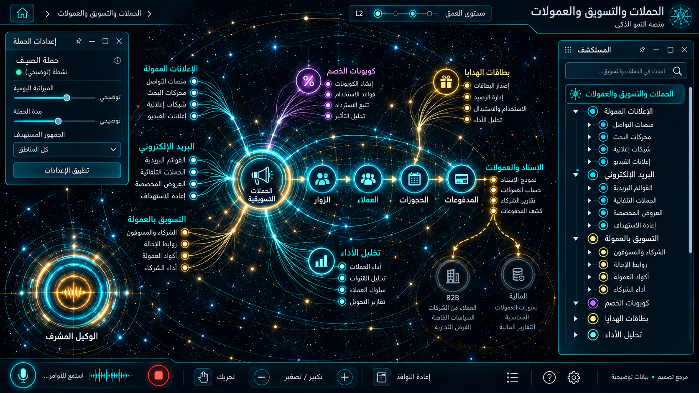

# 10 — الحملات والتسويق والعمولات

## الغرض والنطاق
الإعلانات، البريد، الخصومات، Affiliates ، بطاقات الهدايا، تحليلات الأداء. المرحلة: P06. المشهد: dag. المقاس:1672×941.
هذه مواصفة تصميم من القائمة المصورة، وليست كشفًا لبنية Backend.
بنود القائمة المغطاة:
- التسويق والنشر والتواصل — الحملات ← الإعلانات الممولة
- التسويق والنشر والتواصل — الحملات ← التسويق عبر البريد الإلكتروني
- التسويق والنشر والتواصل — الحملات ← كوبونات الخصم وقسائم الشراء
- التسويق والنشر والتواصل — الحملات ← برنامج التسويق بالعمولة
- التسويق والنشر والتواصل — الحملات ← بطاقات الهدايا السياحية

## الواجهات الفرعية والبناء البصري
المشاهد المطلوبة: شبكة حملة / جمهور / سقف إنفاق / إسناد وعمولات.
مسار هندسي بعقد ذات منافذ، مصادر منفصلة، trace ومفتش طلب/استجابة. لا توصل الموردين تسلسليًا حين تكون الحقيقة fan-out/fan-in. البداية والنهاية معلّمتان، واتجاه تدفق البيانات مستقل عن RTL.
قس حدود النوافذ والفراغات والمواضع من الصورة قبل كتابة CSS ، واحفظ regions/10.json. لا تفرض موضع Inspector موحدًا على مراجع مختلفة.
السيدبار العام عربي يمينًا قابل للطي والإخفاء؛ المفتش قابل للنقل. النص DOM واضح، والتوهج على الحدود لا كل الحروف.
تكوين هذه الواجهة يجب أن يعتمد فعليًا على المرجع؛ النموذج HTML المرفق تجربة سلوك وليس أصلًا بصريًا معتمدًا.
لكل مشهد: overview ثم expanded ثم inspector ثم action preview ، وحالات empty/error/loading. اللقطات الإضافية تُعتمد لاحقًا؛ الحزمة لا تتضمن صورة مستقلة لكل حالة فرعية.

## المكونات والعلاقات
1. الجمهور: معرف ثابت `domain.10.component.1`. عند التوسع تظهر الكيانات والإعدادات والتنفيذ الخاصة بهذا المكون من schema الفعلي؛ لا ثلاثة أبناء عامين في المنتج النهائي.
2. الإبداع: معرف ثابت `domain.10.component.2`. عند التوسع تظهر الكيانات والإعدادات والتنفيذ الخاصة بهذا المكون من schema الفعلي؛ لا ثلاثة أبناء عامين في المنتج النهائي.
3. الميزانية: معرف ثابت `domain.10.component.3`. عند التوسع تظهر الكيانات والإعدادات والتنفيذ الخاصة بهذا المكون من schema الفعلي؛ لا ثلاثة أبناء عامين في المنتج النهائي.
4. المراجعة: معرف ثابت `domain.10.component.4`. عند التوسع تظهر الكيانات والإعدادات والتنفيذ الخاصة بهذا المكون من schema الفعلي؛ لا ثلاثة أبناء عامين في المنتج النهائي.
5. الإعلانات: معرف ثابت `domain.10.component.5`. عند التوسع تظهر الكيانات والإعدادات والتنفيذ الخاصة بهذا المكون من schema الفعلي؛ لا ثلاثة أبناء عامين في المنتج النهائي.
6. البريد: معرف ثابت `domain.10.component.6`. عند التوسع تظهر الكيانات والإعدادات والتنفيذ الخاصة بهذا المكون من schema الفعلي؛ لا ثلاثة أبناء عامين في المنتج النهائي.
7. العمولات: معرف ثابت `domain.10.component.7`. عند التوسع تظهر الكيانات والإعدادات والتنفيذ الخاصة بهذا المكون من schema الفعلي؛ لا ثلاثة أبناء عامين في المنتج النهائي.
8. العائد: معرف ثابت `domain.10.component.8`. عند التوسع تظهر الكيانات والإعدادات والتنفيذ الخاصة بهذا المكون من schema الفعلي؛ لا ثلاثة أبناء عامين في المنتج النهائي.
روابط المجالات: 07 محتوى الموقع والتطبيقات؛ 09 النشر متعدد القنوات والمحتوى؛ 13 المالية والفوترة والولاء؛ 14 إعادة البيع وشبكة B2B.
كل علاقة دلالية لديها relationType و evidenceRef ؛ اعرض دعم العميل/المالية/الامتثال عند اختيار العقدة بدل ازدحام الجميع.
الرجوع يحفظ parent selection وعمق التوسع ومواقع المستخدم. إغلاق المفتش لا يلغي مهمة خادم.

## البيانات والعمليات
Capabilities مقترحة: `campaign.read`، `campaign.preview`، `budget.approve`، `campaign.pause`.
حقول للفحص: campaignId, budgetCap, currency, audienceRef, consentBasis, attributionWindow.
لكل capability: اكتشف الخدمة و route/function و schema و auth scope و read/write والأخطاء المتوقعة و trace location و fixture.
كل كيان لديه ID و version و tenant إن انطبق. التواريخ ISO ؛ المال amountMinor+currency ؛ الأسرار secretRef. unknown لا تعني healthy.
القراءة تعيد loading/empty/error. الكتابة تبدأ preview وتحتاجصلاحية؛ نتيجةالخادم مصدرالنجاح، لا مؤقت UI.
قيد المجال: لا إطلاق إعلان أو إرسال بريد حقيقي من النموذج؛ حدود الإنفاق enforced بالباك إند.

## سيناريو التشغيل الرئيسي
تجهيز حملة وميزانية؛ معاينة التكلفة والجمهور؛ اعتماد مالي؛ تشغيل محدود؛ قياس التحويلات ومصدرها؛ إيقاف الإنفاق.
1. تحميل fixture معلوم أو snapshot حقيقي مع وسم مصدره.
2. فتح المجال ثم المكون وتثبيت breadcrumb.
3. جلب التفاصيل بحسب permission وإخفاء الحقول الحساسة.
4. عرض preview بالأثر والمدخلات وهويةالمنفذ.
5. اعتماد العملية إذا كانت حجزًا أو دفعًا أو حذفًا أو نشرًا.
6. إرسال command بمعرف منع تكرار ثم تتبع النتيجة.
7. الفشل الجزئي يوضح الجزء الفاشل والمسار المتاح لإصلاحه.
8. انتقال للمجال المرتبط ثم رجوع بالسياق نفسه.

## حالات إلزامية
- loading: مصدر البيانات غير متاح بعد؛ لا online وهمي.
- empty: شرح غياب الكيانات وزر قراءة آمن.
- ready: المصدر وآخر تحديث و trace عند توفره.
- stale/offline: آخر قيمة موسومة؛ منع الكتابة غير الآمنة.
- denied403: إخفاء الإجراء لا يغني عن فحص الخادم.
- validation/conflict409: حقل محدد ورسالة عربية ونسخة محدثة.
- partial/timeout: تجاوز الميزانية يمنع command حتى مع تلاعب بالقيمة في المتصفح.
- duplicate/interruption: التحويل غير المنسوب يظهر unknown وليس عائدًا مختلقًا.

## اختبارات القبول الخاصة
S10-01: المسار الفعلي يعرض العنوان و 8 مكونات أساسية و sidebar عربيًا.
S10-02: اختيار «الجمهور» يفتح تفاصيله؛ التوسع لا يزيل الأب.
S10-03: السيناريو الرئيسي بـ fixture ثم contract test لمحوله.
S10-04: تجاوز الميزانية يمنع command حتى مع تلاعب بالقيمة في المتصفح.
S10-05: التحويل غير المنسوب يظهر unknown وليس عائدًا مختلقًا.
S10-06: reader/operator و tenantA/B إن انطبق؛ تحقق منع الخادم.
S10-07: نقل وتحجيم وتصغير واستعادة المفتش، ثم refresh ؛ بديل keyboard.
S10-08: لقطات overview/expanded/inspector/empty/error عند 1672×941 و DPR1.
S10-09: expected/actual/diff ، بلا صورة المرجع فوق التنفيذ أثناءالتقاطه.
S10-10: صفر أخطاء console أوطلب خارجي غير مأذون أوتسريب listeners.

## أدلة الإتمام
ملفات تنفيذ؛ عقود ومحولات؛ fixtures ؛ tests ؛ لقطات؛ diff ؛ performance sample ؛ مراجعة بصرية موثقة.
اربطالأدلة في tasks. لا accepted لمجرد وجود SVG وصورة. الاختبارات الإنتاجية أعلاه مطلوبة في المشروع؛ اختبارات الحزمة الحالية لا تدّعي تغطيتها.

