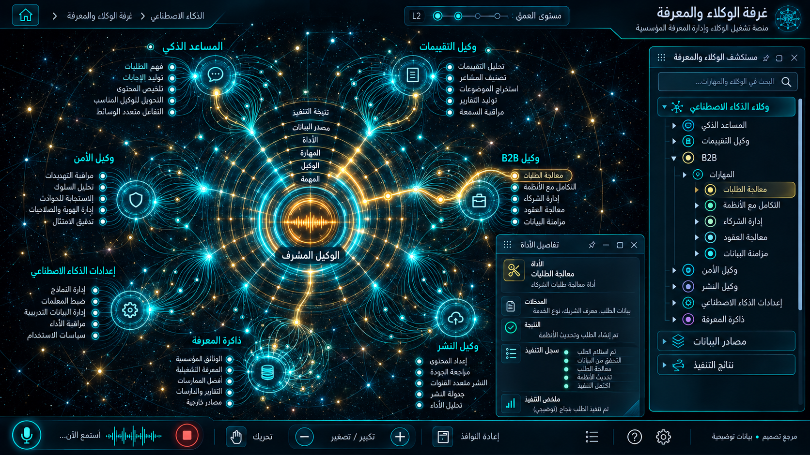

# 11 — غرفة الوكلاء والمعرفة

## الغرض والنطاق
War Room ، استوديو الوكلاء، وكيل التقييمات، وكيل B2B ، وكيل الأمن، الإعدادات والمساعد. المرحلة: P07. المشهد: radial. المقاس:1672×941.
هذه مواصفة تصميم من القائمة المصورة، وليست كشفًا لبنية Backend.
بنود القائمة المغطاة:
- الذكاء الاصطناعي والوكلاء ← وكيل تقييمات TripAdvisor والزوار
- الذكاء الاصطناعي والوكلاء ← تقييمات برامج الذكاء الاصطناعي
- الذكاء الاصطناعي والوكلاء ← غرفة عمليات الوكلاء (War Room)
- الذكاء الاصطناعي والوكلاء ← استوديو خلية الوكلاء (Sci-Fi HUD)
- الذكاء الاصطناعي والوكلاء ← وكيل B2B لصفحة الهبوط
- الذكاء الاصطناعي والوكلاء ← وكيل الأمن
- الذكاء الاصطناعي والوكلاء ← إعدادات الذكاء الاصطناعي
- الذكاء الاصطناعي والوكلاء ← برامج المساعد الذكي

## الواجهات الفرعية والبناء البصري
المشاهد المطلوبة: كتالوج وكلاء / run inspector / معرفة / موافقات أدوات.
تكوين شعاعي متدرج، نواة مجردة مشعة، مجالات ثابتة الهوية، علاقات منحنية دلالية، وأبناء يظهرون بالتوسع. الفراغات بين العناقيد تحفظ القراءة. الروابط الزخرفية لا تمثل معاملات فعلية.
قس حدود النوافذ والفراغات والمواضع من الصورة قبل كتابة CSS ، واحفظ regions/11.json. لا تفرض موضع Inspector موحدًا على مراجع مختلفة.
السيدبار العام عربي يمينًا قابل للطي والإخفاء؛ المفتش قابل للنقل. النص DOM واضح، والتوهج على الحدود لا كل الحروف.
تكوين هذه الواجهة يجب أن يعتمد فعليًا على المرجع؛ النموذج HTML المرفق تجربة سلوك وليس أصلًا بصريًا معتمدًا.
لكل مشهد: overview ثم expanded ثم inspector ثم action preview ، وحالات empty/error/loading. اللقطات الإضافية تُعتمد لاحقًا؛ الحزمة لا تتضمن صورة مستقلة لكل حالة فرعية.

## المكونات والعلاقات
1. المشرف: معرف ثابت `domain.11.component.1`. عند التوسع تظهر الكيانات والإعدادات والتنفيذ الخاصة بهذا المكون من schema الفعلي؛ لا ثلاثة أبناء عامين في المنتج النهائي.
2. وكيل الحجز: معرف ثابت `domain.11.component.2`. عند التوسع تظهر الكيانات والإعدادات والتنفيذ الخاصة بهذا المكون من schema الفعلي؛ لا ثلاثة أبناء عامين في المنتج النهائي.
3. وكيل التقييم: معرف ثابت `domain.11.component.3`. عند التوسع تظهر الكيانات والإعدادات والتنفيذ الخاصة بهذا المكون من schema الفعلي؛ لا ثلاثة أبناء عامين في المنتج النهائي.
4. وكيل B2B: معرف ثابت `domain.11.component.4`. عند التوسع تظهر الكيانات والإعدادات والتنفيذ الخاصة بهذا المكون من schema الفعلي؛ لا ثلاثة أبناء عامين في المنتج النهائي.
5. وكيل الأمن: معرف ثابت `domain.11.component.5`. عند التوسع تظهر الكيانات والإعدادات والتنفيذ الخاصة بهذا المكون من schema الفعلي؛ لا ثلاثة أبناء عامين في المنتج النهائي.
6. المعرفة: معرف ثابت `domain.11.component.6`. عند التوسع تظهر الكيانات والإعدادات والتنفيذ الخاصة بهذا المكون من schema الفعلي؛ لا ثلاثة أبناء عامين في المنتج النهائي.
7. الأدوات: معرف ثابت `domain.11.component.7`. عند التوسع تظهر الكيانات والإعدادات والتنفيذ الخاصة بهذا المكون من schema الفعلي؛ لا ثلاثة أبناء عامين في المنتج النهائي.
8. الموافقات: معرف ثابت `domain.11.component.8`. عند التوسع تظهر الكيانات والإعدادات والتنفيذ الخاصة بهذا المكون من schema الفعلي؛ لا ثلاثة أبناء عامين في المنتج النهائي.
روابط المجالات: 01 الأطلس العصبي الشامل؛ 03 الحجوزات والإلغاء والتقييمات؛ 08 العملاء وخدمة العملاء؛ 12 استوديو الأتمتة والتنفيذ؛ 14 إعادة البيع وشبكة B2B ؛ 15 الامتثال والخصوصية والصلاحيات.
كل علاقة دلالية لديها relationType و evidenceRef ؛ اعرض دعم العميل/المالية/الامتثال عند اختيار العقدة بدل ازدحام الجميع.
الرجوع يحفظ parent selection وعمق التوسع ومواقع المستخدم. إغلاق المفتش لا يلغي مهمة خادم.

## البيانات والعمليات
Capabilities مقترحة: `agent.catalog`، `run.start`، `run.events`، `approval.resolve`.
حقول للفحص: agentId, runId, toolName, inputSchema, evidenceRefs, approval, runStatus.
لكل capability: اكتشف الخدمة و route/function و schema و auth scope و read/write والأخطاء المتوقعة و trace location و fixture.
كل كيان لديه ID و version و tenant إن انطبق. التواريخ ISO ؛ المال amountMinor+currency ؛ الأسرار secretRef. unknown لا تعني healthy.
القراءة تعيد loading/empty/error. الكتابة تبدأ preview وتحتاجصلاحية؛ نتيجةالخادم مصدرالنجاح، لا مؤقت UI.
قيد المجال: لا كشف chain-of-thought ؛ النشاط من أحداث حقيقية، لا استنتاج تفكير داخلي من الزخرفة.

## سيناريو التشغيل الرئيسي
إسناد مهمة؛ عرض التخطيط المعلن والأدوات المستدعاة؛ نتيجة استرجاع بمصدر؛ انتظار موافقة؛ استئناف أو إيقاف؛ سجل مدقق.
1. تحميل fixture معلوم أو snapshot حقيقي مع وسم مصدره.
2. فتح المجال ثم المكون وتثبيت breadcrumb.
3. جلب التفاصيل بحسب permission وإخفاء الحقول الحساسة.
4. عرض preview بالأثر والمدخلات وهويةالمنفذ.
5. اعتماد العملية إذا كانت حجزًا أو دفعًا أو حذفًا أو نشرًا.
6. إرسال command بمعرف منع تكرار ثم تتبع النتيجة.
7. الفشل الجزئي يوضح الجزء الفاشل والمسار المتاح لإصلاحه.
8. انتقال للمجال المرتبط ثم رجوع بالسياق نفسه.

## حالات إلزامية
- loading: مصدر البيانات غير متاح بعد؛ لا online وهمي.
- empty: شرح غياب الكيانات وزر قراءة آمن.
- ready: المصدر وآخر تحديث و trace عند توفره.
- stale/offline: آخر قيمة موسومة؛ منع الكتابة غير الآمنة.
- denied403: إخفاء الإجراء لا يغني عن فحص الخادم.
- validation/conflict409: حقل محدد ورسالة عربية ونسخة محدثة.
- partial/timeout: tool call خارج allowlist يرفض مع سجل مدقق.
- duplicate/interruption: عرض خطوات معلنة ومراجع فقط؛ لا ادعاء قراءة التفكير الداخلي.

## اختبارات القبول الخاصة
S11-01: المسار الفعلي يعرض العنوان و 8 مكونات أساسية و sidebar عربيًا.
S11-02: اختيار «المشرف» يفتح تفاصيله؛ التوسع لا يزيل الأب.
S11-03: السيناريو الرئيسي بـ fixture ثم contract test لمحوله.
S11-04: tool call خارج allowlist يرفض مع سجل مدقق.
S11-05: عرض خطوات معلنة ومراجع فقط؛ لا ادعاء قراءة التفكير الداخلي.
S11-06: reader/operator و tenantA/B إن انطبق؛ تحقق منع الخادم.
S11-07: نقل وتحجيم وتصغير واستعادة المفتش، ثم refresh ؛ بديل keyboard.
S11-08: لقطات overview/expanded/inspector/empty/error عند 1672×941 و DPR1.
S11-09: expected/actual/diff ، بلا صورة المرجع فوق التنفيذ أثناءالتقاطه.
S11-10: صفر أخطاء console أوطلب خارجي غير مأذون أوتسريب listeners.

## أدلة الإتمام
ملفات تنفيذ؛ عقود ومحولات؛ fixtures ؛ tests ؛ لقطات؛ diff ؛ performance sample ؛ مراجعة بصرية موثقة.
اربطالأدلة في tasks. لا accepted لمجرد وجود SVG وصورة. الاختبارات الإنتاجية أعلاه مطلوبة في المشروع؛ اختبارات الحزمة الحالية لا تدّعي تغطيتها.

