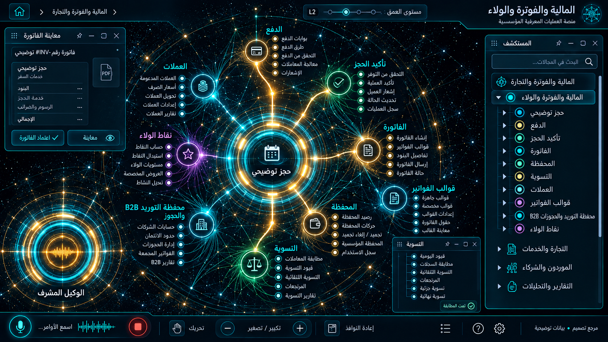

# 13 — المالية والفوترة والولاء

## الغرض والنطاق
الدفع، العملات، قوالب الفواتير، محفظة التوريد B2B ، الولاء، التسوية. المرحلة: P08. المشهد: dag. المقاس:1672×941.
هذه مواصفة تصميم من القائمة المصورة، وليست كشفًا لبنية Backend.
بنود القائمة المغطاة:
- المالية والفوترة والتجارة ← الدفع
- المالية والفوترة والتجارة ← العملات
- المالية والفوترة والتجارة ← قوالب الفواتير
- المالية والفوترة والتجارة ← محفظة التوريد والحجوزات B2B
- المالية والفوترة والتجارة ← نقاط الولاء

## الواجهات الفرعية والبناء البصري
المشاهد المطلوبة: دفتر / تفاصيل دفعة / reconciliation / استرداد وولاء.
مسار هندسي بعقد ذات منافذ، مصادر منفصلة، trace ومفتش طلب/استجابة. لا توصل الموردين تسلسليًا حين تكون الحقيقة fan-out/fan-in. البداية والنهاية معلّمتان، واتجاه تدفق البيانات مستقل عن RTL.
قس حدود النوافذ والفراغات والمواضع من الصورة قبل كتابة CSS ، واحفظ regions/13.json. لا تفرض موضع Inspector موحدًا على مراجع مختلفة.
السيدبار العام عربي يمينًا قابل للطي والإخفاء؛ المفتش قابل للنقل. النص DOM واضح، والتوهج على الحدود لا كل الحروف.
تكوين هذه الواجهة يجب أن يعتمد فعليًا على المرجع؛ النموذج HTML المرفق تجربة سلوك وليس أصلًا بصريًا معتمدًا.
لكل مشهد: overview ثم expanded ثم inspector ثم action preview ، وحالات empty/error/loading. اللقطات الإضافية تُعتمد لاحقًا؛ الحزمة لا تتضمن صورة مستقلة لكل حالة فرعية.

## المكونات والعلاقات
1. الدفع: معرف ثابت `domain.13.component.1`. عند التوسع تظهر الكيانات والإعدادات والتنفيذ الخاصة بهذا المكون من schema الفعلي؛ لا ثلاثة أبناء عامين في المنتج النهائي.
2. التفويض: معرف ثابت `domain.13.component.2`. عند التوسع تظهر الكيانات والإعدادات والتنفيذ الخاصة بهذا المكون من schema الفعلي؛ لا ثلاثة أبناء عامين في المنتج النهائي.
3. التحصيل: معرف ثابت `domain.13.component.3`. عند التوسع تظهر الكيانات والإعدادات والتنفيذ الخاصة بهذا المكون من schema الفعلي؛ لا ثلاثة أبناء عامين في المنتج النهائي.
4. الفاتورة: معرف ثابت `domain.13.component.4`. عند التوسع تظهر الكيانات والإعدادات والتنفيذ الخاصة بهذا المكون من schema الفعلي؛ لا ثلاثة أبناء عامين في المنتج النهائي.
5. المحفظة: معرف ثابت `domain.13.component.5`. عند التوسع تظهر الكيانات والإعدادات والتنفيذ الخاصة بهذا المكون من schema الفعلي؛ لا ثلاثة أبناء عامين في المنتج النهائي.
6. التسوية: معرف ثابت `domain.13.component.6`. عند التوسع تظهر الكيانات والإعدادات والتنفيذ الخاصة بهذا المكون من schema الفعلي؛ لا ثلاثة أبناء عامين في المنتج النهائي.
7. الاسترداد: معرف ثابت `domain.13.component.7`. عند التوسع تظهر الكيانات والإعدادات والتنفيذ الخاصة بهذا المكون من schema الفعلي؛ لا ثلاثة أبناء عامين في المنتج النهائي.
8. الولاء: معرف ثابت `domain.13.component.8`. عند التوسع تظهر الكيانات والإعدادات والتنفيذ الخاصة بهذا المكون من schema الفعلي؛ لا ثلاثة أبناء عامين في المنتج النهائي.
روابط المجالات: 03 الحجوزات والإلغاء والتقييمات؛ 04 الرحلات وموزعو GDS ؛ 05 الفنادق وبنوك الأسرّة؛ 10 الحملات والتسويق والعمولات؛ 14 إعادة البيع وشبكة B2B.
كل علاقة دلالية لديها relationType و evidenceRef ؛ اعرض دعم العميل/المالية/الامتثال عند اختيار العقدة بدل ازدحام الجميع.
الرجوع يحفظ parent selection وعمق التوسع ومواقع المستخدم. إغلاق المفتش لا يلغي مهمة خادم.

## البيانات والعمليات
Capabilities مقترحة: `payment.read`، `ledger.read`، `settlement.read`، `refund.preview`.
حقول للفحص: paymentId, bookingId, amountMinor, currency, ledgerEntryIds, providerEventId.
لكل capability: اكتشف الخدمة و route/function و schema و auth scope و read/write والأخطاء المتوقعة و trace location و fixture.
كل كيان لديه ID و version و tenant إن انطبق. التواريخ ISO ؛ المال amountMinor+currency ؛ الأسرار secretRef. unknown لا تعني healthy.
القراءة تعيد loading/empty/error. الكتابة تبدأ preview وتحتاجصلاحية؛ نتيجةالخادم مصدرالنجاح، لا مؤقت UI.
قيد المجال: حساب النقود بوحدات صغرى صحيحة؛ منع ازدواج webhook ؛ لا حذف قيود دفتر.

## سيناريو التشغيل الرئيسي
ربط الدفع بالحجز؛ تتبع webhook موثق؛ قيد دفتر؛ مطابقة التسوية؛ معاينة الاسترداد؛ موافقة ثنائية للعمليات المحددة.
1. تحميل fixture معلوم أو snapshot حقيقي مع وسم مصدره.
2. فتح المجال ثم المكون وتثبيت breadcrumb.
3. جلب التفاصيل بحسب permission وإخفاء الحقول الحساسة.
4. عرض preview بالأثر والمدخلات وهويةالمنفذ.
5. اعتماد العملية إذا كانت حجزًا أو دفعًا أو حذفًا أو نشرًا.
6. إرسال command بمعرف منع تكرار ثم تتبع النتيجة.
7. الفشل الجزئي يوضح الجزء الفاشل والمسار المتاح لإصلاحه.
8. انتقال للمجال المرتبط ثم رجوع بالسياق نفسه.

## حالات إلزامية
- loading: مصدر البيانات غير متاح بعد؛ لا online وهمي.
- empty: شرح غياب الكيانات وزر قراءة آمن.
- ready: المصدر وآخر تحديث و trace عند توفره.
- stale/offline: آخر قيمة موسومة؛ منع الكتابة غير الآمنة.
- denied403: إخفاء الإجراء لا يغني عن فحص الخادم.
- validation/conflict409: حقل محدد ورسالة عربية ونسخة محدثة.
- partial/timeout: webhook مكرر لا ينتج قيدًا ثانيًا؛ توازن debit/credit لكل عملة.
- duplicate/interruption: الاسترداد لا يتجاوز المبلغ المتاح، والنقود لا تحسب float.

## اختبارات القبول الخاصة
S13-01: المسار الفعلي يعرض العنوان و 8 مكونات أساسية و sidebar عربيًا.
S13-02: اختيار «الدفع» يفتح تفاصيله؛ التوسع لا يزيل الأب.
S13-03: السيناريو الرئيسي بـ fixture ثم contract test لمحوله.
S13-04: webhook مكرر لا ينتج قيدًا ثانيًا؛ توازن debit/credit لكل عملة.
S13-05: الاسترداد لا يتجاوز المبلغ المتاح، والنقود لا تحسب float.
S13-06: reader/operator و tenantA/B إن انطبق؛ تحقق منع الخادم.
S13-07: نقل وتحجيم وتصغير واستعادة المفتش، ثم refresh ؛ بديل keyboard.
S13-08: لقطات overview/expanded/inspector/empty/error عند 1672×941 و DPR1.
S13-09: expected/actual/diff ، بلا صورة المرجع فوق التنفيذ أثناءالتقاطه.
S13-10: صفر أخطاء console أوطلب خارجي غير مأذون أوتسريب listeners.

## أدلة الإتمام
ملفات تنفيذ؛ عقود ومحولات؛ fixtures ؛ tests ؛ لقطات؛ diff ؛ performance sample ؛ مراجعة بصرية موثقة.
اربطالأدلة في tasks. لا accepted لمجرد وجود SVG وصورة. الاختبارات الإنتاجية أعلاه مطلوبة في المشروع؛ اختبارات الحزمة الحالية لا تدّعي تغطيتها.

