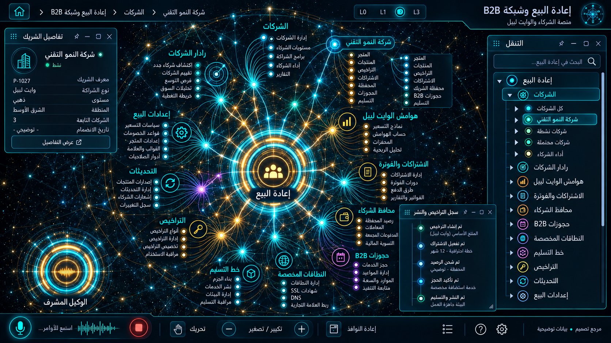

# 14 — إعادة البيع وشبكة B2B

## الغرض والنطاق
الشركات، الرادار، الوايت ليبل، اشتراكات الشركاء، المحافظ والحجوزات، النطاقات، التسليم، التراخيص والتحديثات. المرحلة: P08. المشهد: radial. المقاس:1672×941.
هذه مواصفة تصميم من القائمة المصورة، وليست كشفًا لبنية Backend.
بنود القائمة المغطاة:
- إعادة البيع ← إعادة البيع
- إعادة البيع ← رادار الشركات واستخبارات الخرائط
- إعادة البيع ← إعدادات وهوامش الوايت ليبل
- إعادة البيع ← اشتراكات الشركاء والفوترة
- إعادة البيع ← محافظ الشركاء B2B
- إعادة البيع ← سجل حجوزات B2B
- إعادة البيع ← طلبات النطاقات المخصصة
- إعادة البيع ← الشركات
- إعادة البيع ← خط التسليم
- إعادة البيع ← التراخيص
- إعادة البيع ← التحديثات
- إعادة البيع ← إعدادات البيع

## الواجهات الفرعية والبناء البصري
المشاهد المطلوبة: شبكة شركاء / white-label / نطاق وتسليم / اشتراك.
تكوين شعاعي متدرج، نواة مجردة مشعة، مجالات ثابتة الهوية، علاقات منحنية دلالية، وأبناء يظهرون بالتوسع. الفراغات بين العناقيد تحفظ القراءة. الروابط الزخرفية لا تمثل معاملات فعلية.
قس حدود النوافذ والفراغات والمواضع من الصورة قبل كتابة CSS ، واحفظ regions/14.json. لا تفرض موضع Inspector موحدًا على مراجع مختلفة.
السيدبار العام عربي يمينًا قابل للطي والإخفاء؛ المفتش قابل للنقل. النص DOM واضح، والتوهج على الحدود لا كل الحروف.
تكوين هذه الواجهة يجب أن يعتمد فعليًا على المرجع؛ النموذج HTML المرفق تجربة سلوك وليس أصلًا بصريًا معتمدًا.
لكل مشهد: overview ثم expanded ثم inspector ثم action preview ، وحالات empty/error/loading. اللقطات الإضافية تُعتمد لاحقًا؛ الحزمة لا تتضمن صورة مستقلة لكل حالة فرعية.

## المكونات والعلاقات
1. الشركات: معرف ثابت `domain.14.component.1`. عند التوسع تظهر الكيانات والإعدادات والتنفيذ الخاصة بهذا المكون من schema الفعلي؛ لا ثلاثة أبناء عامين في المنتج النهائي.
2. رادار الشركاء: معرف ثابت `domain.14.component.2`. عند التوسع تظهر الكيانات والإعدادات والتنفيذ الخاصة بهذا المكون من schema الفعلي؛ لا ثلاثة أبناء عامين في المنتج النهائي.
3. الوايت ليبل: معرف ثابت `domain.14.component.3`. عند التوسع تظهر الكيانات والإعدادات والتنفيذ الخاصة بهذا المكون من schema الفعلي؛ لا ثلاثة أبناء عامين في المنتج النهائي.
4. النطاقات: معرف ثابت `domain.14.component.4`. عند التوسع تظهر الكيانات والإعدادات والتنفيذ الخاصة بهذا المكون من schema الفعلي؛ لا ثلاثة أبناء عامين في المنتج النهائي.
5. الاشتراكات: معرف ثابت `domain.14.component.5`. عند التوسع تظهر الكيانات والإعدادات والتنفيذ الخاصة بهذا المكون من schema الفعلي؛ لا ثلاثة أبناء عامين في المنتج النهائي.
6. المحافظ: معرف ثابت `domain.14.component.6`. عند التوسع تظهر الكيانات والإعدادات والتنفيذ الخاصة بهذا المكون من schema الفعلي؛ لا ثلاثة أبناء عامين في المنتج النهائي.
7. الحجوزات: معرف ثابت `domain.14.component.7`. عند التوسع تظهر الكيانات والإعدادات والتنفيذ الخاصة بهذا المكون من schema الفعلي؛ لا ثلاثة أبناء عامين في المنتج النهائي.
8. التراخيص: معرف ثابت `domain.14.component.8`. عند التوسع تظهر الكيانات والإعدادات والتنفيذ الخاصة بهذا المكون من schema الفعلي؛ لا ثلاثة أبناء عامين في المنتج النهائي.
روابط المجالات: 03 الحجوزات والإلغاء والتقييمات؛ 10 الحملات والتسويق والعمولات؛ 13 المالية والفوترة والولاء؛ 15 الامتثال والخصوصية والصلاحيات؛ 16 الإعدادات والتكاملات.
كل علاقة دلالية لديها relationType و evidenceRef ؛ اعرض دعم العميل/المالية/الامتثال عند اختيار العقدة بدل ازدحام الجميع.
الرجوع يحفظ parent selection وعمق التوسع ومواقع المستخدم. إغلاق المفتش لا يلغي مهمة خادم.

## البيانات والعمليات
Capabilities مقترحة: `partner.read`، `tenant.settings`، `domain.verify`، `license.read`.
حقول للفحص: tenantId, partnerId, domainStatus, plan, markupRule, walletId, licenseStatus.
لكل capability: اكتشف الخدمة و route/function و schema و auth scope و read/write والأخطاء المتوقعة و trace location و fixture.
كل كيان لديه ID و version و tenant إن انطبق. التواريخ ISO ؛ المال amountMinor+currency ؛ الأسرار secretRef. unknown لا تعني healthy.
القراءة تعيد loading/empty/error. الكتابة تبدأ preview وتحتاجصلاحية؛ نتيجةالخادم مصدرالنجاح، لا مؤقت UI.
قيد المجال: اختبارات عزل شريكين إلزامية؛ فحص ملكية النطاق؛ هوامش لا تتجاوز صلاحية المستخدم.

## سيناريو التشغيل الرئيسي
فتح شريك مع tenant ؛ إعداد هوامش ومعاينة؛ تحقق نطاق؛ اشتراك وترخيص؛ مراقبة التسليم والتحديث؛ تتبع محفظة وحجز.
1. تحميل fixture معلوم أو snapshot حقيقي مع وسم مصدره.
2. فتح المجال ثم المكون وتثبيت breadcrumb.
3. جلب التفاصيل بحسب permission وإخفاء الحقول الحساسة.
4. عرض preview بالأثر والمدخلات وهويةالمنفذ.
5. اعتماد العملية إذا كانت حجزًا أو دفعًا أو حذفًا أو نشرًا.
6. إرسال command بمعرف منع تكرار ثم تتبع النتيجة.
7. الفشل الجزئي يوضح الجزء الفاشل والمسار المتاح لإصلاحه.
8. انتقال للمجال المرتبط ثم رجوع بالسياق نفسه.

## حالات إلزامية
- loading: مصدر البيانات غير متاح بعد؛ لا online وهمي.
- empty: شرح غياب الكيانات وزر قراءة آمن.
- ready: المصدر وآخر تحديث و trace عند توفره.
- stale/offline: آخر قيمة موسومة؛ منع الكتابة غير الآمنة.
- denied403: إخفاء الإجراء لا يغني عن فحص الخادم.
- validation/conflict409: حقل محدد ورسالة عربية ونسخة محدثة.
- partial/timeout: اختبار tenant isolation عبر UI و API لشركتين.
- duplicate/interruption: نطاق دون تحقق ملكية لا يتفعل ولا يستقبل زوارًا.

## اختبارات القبول الخاصة
S14-01: المسار الفعلي يعرض العنوان و 8 مكونات أساسية و sidebar عربيًا.
S14-02: اختيار «الشركات» يفتح تفاصيله؛ التوسع لا يزيل الأب.
S14-03: السيناريو الرئيسي بـ fixture ثم contract test لمحوله.
S14-04: اختبار tenant isolation عبر UI و API لشركتين.
S14-05: نطاق دون تحقق ملكية لا يتفعل ولا يستقبل زوارًا.
S14-06: reader/operator و tenantA/B إن انطبق؛ تحقق منع الخادم.
S14-07: نقل وتحجيم وتصغير واستعادة المفتش، ثم refresh ؛ بديل keyboard.
S14-08: لقطات overview/expanded/inspector/empty/error عند 1672×941 و DPR1.
S14-09: expected/actual/diff ، بلا صورة المرجع فوق التنفيذ أثناءالتقاطه.
S14-10: صفر أخطاء console أوطلب خارجي غير مأذون أوتسريب listeners.

## أدلة الإتمام
ملفات تنفيذ؛ عقود ومحولات؛ fixtures ؛ tests ؛ لقطات؛ diff ؛ performance sample ؛ مراجعة بصرية موثقة.
اربطالأدلة في tasks. لا accepted لمجرد وجود SVG وصورة. الاختبارات الإنتاجية أعلاه مطلوبة في المشروع؛ اختبارات الحزمة الحالية لا تدّعي تغطيتها.

