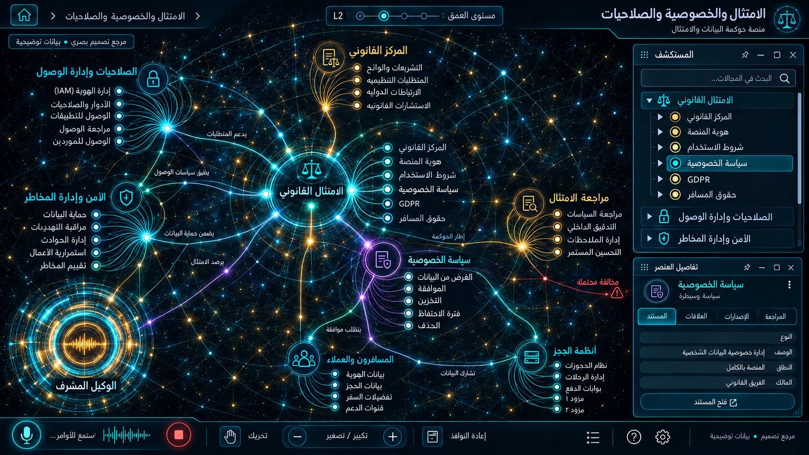

# 15 — الامتثال والخصوصية والصلاحيات

## الغرض والنطاق
المركز القانوني، الهوية، الشروط، الخصوصية، GDPR وحقوق المسافر، الأمن. المرحلة: P08. المشهد: radial. المقاس:1672×941.
هذه مواصفة تصميم من القائمة المصورة، وليست كشفًا لبنية Backend.
بنود القائمة المغطاة:
- الامتثال القانوني والـ GDPR ← المركز القانوني الموحد
- الامتثال القانوني والـ GDPR ← هوية المنصة والاسم القانوني
- الامتثال القانوني والـ GDPR ← شروط الاستخدام وقواعد الطيران
- الامتثال القانوني والـ GDPR ← سياسة الخصوصية ومعالجة البيانات
- الامتثال القانوني والـ GDPR ← لوائح الـ GDPR وحقوق المسافر

## الواجهات الفرعية والبناء البصري
المشاهد المطلوبة: سجل سياسات / موافقات / حقوق بيانات / صلاحيات.
تكوين شعاعي متدرج، نواة مجردة مشعة، مجالات ثابتة الهوية، علاقات منحنية دلالية، وأبناء يظهرون بالتوسع. الفراغات بين العناقيد تحفظ القراءة. الروابط الزخرفية لا تمثل معاملات فعلية.
قس حدود النوافذ والفراغات والمواضع من الصورة قبل كتابة CSS ، واحفظ regions/15.json. لا تفرض موضع Inspector موحدًا على مراجع مختلفة.
السيدبار العام عربي يمينًا قابل للطي والإخفاء؛ المفتش قابل للنقل. النص DOM واضح، والتوهج على الحدود لا كل الحروف.
تكوين هذه الواجهة يجب أن يعتمد فعليًا على المرجع؛ النموذج HTML المرفق تجربة سلوك وليس أصلًا بصريًا معتمدًا.
لكل مشهد: overview ثم expanded ثم inspector ثم action preview ، وحالات empty/error/loading. اللقطات الإضافية تُعتمد لاحقًا؛ الحزمة لا تتضمن صورة مستقلة لكل حالة فرعية.

## المكونات والعلاقات
1. الهوية القانونية: معرف ثابت `domain.15.component.1`. عند التوسع تظهر الكيانات والإعدادات والتنفيذ الخاصة بهذا المكون من schema الفعلي؛ لا ثلاثة أبناء عامين في المنتج النهائي.
2. الشروط: معرف ثابت `domain.15.component.2`. عند التوسع تظهر الكيانات والإعدادات والتنفيذ الخاصة بهذا المكون من schema الفعلي؛ لا ثلاثة أبناء عامين في المنتج النهائي.
3. الخصوصية: معرف ثابت `domain.15.component.3`. عند التوسع تظهر الكيانات والإعدادات والتنفيذ الخاصة بهذا المكون من schema الفعلي؛ لا ثلاثة أبناء عامين في المنتج النهائي.
4. الموافقة: معرف ثابت `domain.15.component.4`. عند التوسع تظهر الكيانات والإعدادات والتنفيذ الخاصة بهذا المكون من schema الفعلي؛ لا ثلاثة أبناء عامين في المنتج النهائي.
5. حقوق المسافر: معرف ثابت `domain.15.component.5`. عند التوسع تظهر الكيانات والإعدادات والتنفيذ الخاصة بهذا المكون من schema الفعلي؛ لا ثلاثة أبناء عامين في المنتج النهائي.
6. طلبات البيانات: معرف ثابت `domain.15.component.6`. عند التوسع تظهر الكيانات والإعدادات والتنفيذ الخاصة بهذا المكون من schema الفعلي؛ لا ثلاثة أبناء عامين في المنتج النهائي.
7. الصلاحيات: معرف ثابت `domain.15.component.7`. عند التوسع تظهر الكيانات والإعدادات والتنفيذ الخاصة بهذا المكون من schema الفعلي؛ لا ثلاثة أبناء عامين في المنتج النهائي.
8. التدقيق: معرف ثابت `domain.15.component.8`. عند التوسع تظهر الكيانات والإعدادات والتنفيذ الخاصة بهذا المكون من schema الفعلي؛ لا ثلاثة أبناء عامين في المنتج النهائي.
روابط المجالات: 08 العملاء وخدمة العملاء؛ 11 غرفة الوكلاء والمعرفة؛ 13 المالية والفوترة والولاء؛ 14 إعادة البيع وشبكة B2B ؛ 16 الإعدادات والتكاملات.
كل علاقة دلالية لديها relationType و evidenceRef ؛ اعرض دعم العميل/المالية/الامتثال عند اختيار العقدة بدل ازدحام الجميع.
الرجوع يحفظ parent selection وعمق التوسع ومواقع المستخدم. إغلاق المفتش لا يلغي مهمة خادم.

## البيانات والعمليات
Capabilities مقترحة: `policy.read`، `consent.read`، `access.evaluate`، `audit.read`.
حقول للفحص: policyId, version, consentId, subjectId, requestType, retention, actor, auditId.
لكل capability: اكتشف الخدمة و route/function و schema و auth scope و read/write والأخطاء المتوقعة و trace location و fixture.
كل كيان لديه ID و version و tenant إن انطبق. التواريخ ISO ؛ المال amountMinor+currency ؛ الأسرار secretRef. unknown لا تعني healthy.
القراءة تعيد loading/empty/error. الكتابة تبدأ preview وتحتاجصلاحية؛ نتيجةالخادم مصدرالنجاح، لا مؤقت UI.
قيد المجال: لا تفسير قانوني آلي ملزم؛ اختلاف التشريع يحتاج اعتماد مختص؛ لا تسريب أسرار في trace.

## سيناريو التشغيل الرئيسي
فتح وثيقة وإصدارها؛ تتبع قبول؛ طلب وصول أو حذف؛ مراجعة قيد احتفاظ؛ فحص دور؛ تدقيق إجراء؛ إخفاء الحقول الحساسة.
1. تحميل fixture معلوم أو snapshot حقيقي مع وسم مصدره.
2. فتح المجال ثم المكون وتثبيت breadcrumb.
3. جلب التفاصيل بحسب permission وإخفاء الحقول الحساسة.
4. عرض preview بالأثر والمدخلات وهويةالمنفذ.
5. اعتماد العملية إذا كانت حجزًا أو دفعًا أو حذفًا أو نشرًا.
6. إرسال command بمعرف منع تكرار ثم تتبع النتيجة.
7. الفشل الجزئي يوضح الجزء الفاشل والمسار المتاح لإصلاحه.
8. انتقال للمجال المرتبط ثم رجوع بالسياق نفسه.

## حالات إلزامية
- loading: مصدر البيانات غير متاح بعد؛ لا online وهمي.
- empty: شرح غياب الكيانات وزر قراءة آمن.
- ready: المصدر وآخر تحديث و trace عند توفره.
- stale/offline: آخر قيمة موسومة؛ منع الكتابة غير الآمنة.
- denied403: إخفاء الإجراء لا يغني عن فحص الخادم.
- validation/conflict409: حقل محدد ورسالة عربية ونسخة محدثة.
- partial/timeout: reader ممنوع من admin حتى باستدعاء API يدويًا.
- duplicate/interruption: redaction في traces والتصدير لا يكشف PII أو يكسر التدقيق.

## اختبارات القبول الخاصة
S15-01: المسار الفعلي يعرض العنوان و 8 مكونات أساسية و sidebar عربيًا.
S15-02: اختيار «الهوية القانونية» يفتح تفاصيله؛ التوسع لا يزيل الأب.
S15-03: السيناريو الرئيسي بـ fixture ثم contract test لمحوله.
S15-04: reader ممنوع من admin حتى باستدعاء API يدويًا.
S15-05: redaction في traces والتصدير لا يكشف PII أو يكسر التدقيق.
S15-06: reader/operator و tenantA/B إن انطبق؛ تحقق منع الخادم.
S15-07: نقل وتحجيم وتصغير واستعادة المفتش، ثم refresh ؛ بديل keyboard.
S15-08: لقطات overview/expanded/inspector/empty/error عند 1672×941 و DPR1.
S15-09: expected/actual/diff ، بلا صورة المرجع فوق التنفيذ أثناءالتقاطه.
S15-10: صفر أخطاء console أوطلب خارجي غير مأذون أوتسريب listeners.

## أدلة الإتمام
ملفات تنفيذ؛ عقود ومحولات؛ fixtures ؛ tests ؛ لقطات؛ diff ؛ performance sample ؛ مراجعة بصرية موثقة.
اربطالأدلة في tasks. لا accepted لمجرد وجود SVG وصورة. الاختبارات الإنتاجية أعلاه مطلوبة في المشروع؛ اختبارات الحزمة الحالية لا تدّعي تغطيتها.

