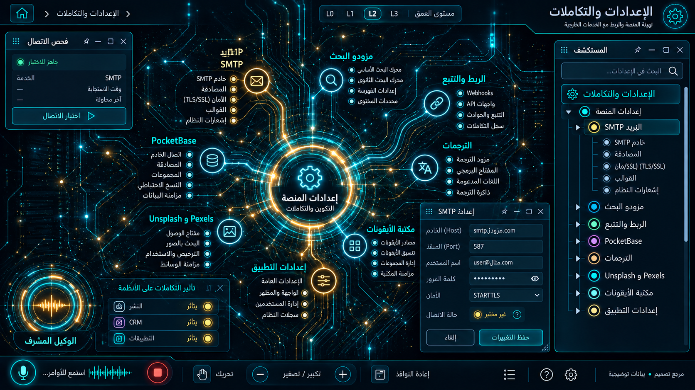

# 16 — الإعدادات والتكاملات

## الغرض والنطاق
الإعدادات، SMTP ، مزودو البحث، الربط والتتبع، PocketBase ، الترجمات، الوسائط والأيقونات. المرحلة: P08. المشهد: dag. المقاس:1672×941.
هذه مواصفة تصميم من القائمة المصورة، وليست كشفًا لبنية Backend.
بنود القائمة المغطاة:
- الإعدادات ← كل الإعدادات
- الإعدادات ← البريد SMTP
- الإعدادات ← مزودو البحث
- الإعدادات ← الربط والتتبع
- الإعدادات ← إعدادات PocketBase
- الإعدادات ← الترجمات
- الإعدادات ← Unsplash و Pexels
- الإعدادات ← مكتبة الأيقونات

## الواجهات الفرعية والبناء البصري
المشاهد المطلوبة: registry تكامل / محرر masked / فحص اتصال / إصدارات.
مسار هندسي بعقد ذات منافذ، مصادر منفصلة، trace ومفتش طلب/استجابة. لا توصل الموردين تسلسليًا حين تكون الحقيقة fan-out/fan-in. البداية والنهاية معلّمتان، واتجاه تدفق البيانات مستقل عن RTL.
قس حدود النوافذ والفراغات والمواضع من الصورة قبل كتابة CSS ، واحفظ regions/16.json. لا تفرض موضع Inspector موحدًا على مراجع مختلفة.
السيدبار العام عربي يمينًا قابل للطي والإخفاء؛ المفتش قابل للنقل. النص DOM واضح، والتوهج على الحدود لا كل الحروف.
تكوين هذه الواجهة يجب أن يعتمد فعليًا على المرجع؛ النموذج HTML المرفق تجربة سلوك وليس أصلًا بصريًا معتمدًا.
لكل مشهد: overview ثم expanded ثم inspector ثم action preview ، وحالات empty/error/loading. اللقطات الإضافية تُعتمد لاحقًا؛ الحزمة لا تتضمن صورة مستقلة لكل حالة فرعية.

## المكونات والعلاقات
1. الإعدادات: معرف ثابت `domain.16.component.1`. عند التوسع تظهر الكيانات والإعدادات والتنفيذ الخاصة بهذا المكون من schema الفعلي؛ لا ثلاثة أبناء عامين في المنتج النهائي.
2. SMTP: معرف ثابت `domain.16.component.2`. عند التوسع تظهر الكيانات والإعدادات والتنفيذ الخاصة بهذا المكون من schema الفعلي؛ لا ثلاثة أبناء عامين في المنتج النهائي.
3. مزودو البحث: معرف ثابت `domain.16.component.3`. عند التوسع تظهر الكيانات والإعدادات والتنفيذ الخاصة بهذا المكون من schema الفعلي؛ لا ثلاثة أبناء عامين في المنتج النهائي.
4. PocketBase: معرف ثابت `domain.16.component.4`. عند التوسع تظهر الكيانات والإعدادات والتنفيذ الخاصة بهذا المكون من schema الفعلي؛ لا ثلاثة أبناء عامين في المنتج النهائي.
5. الترجمات: معرف ثابت `domain.16.component.5`. عند التوسع تظهر الكيانات والإعدادات والتنفيذ الخاصة بهذا المكون من schema الفعلي؛ لا ثلاثة أبناء عامين في المنتج النهائي.
6. التتبع: معرف ثابت `domain.16.component.6`. عند التوسع تظهر الكيانات والإعدادات والتنفيذ الخاصة بهذا المكون من schema الفعلي؛ لا ثلاثة أبناء عامين في المنتج النهائي.
7. مكتبة الوسائط: معرف ثابت `domain.16.component.7`. عند التوسع تظهر الكيانات والإعدادات والتنفيذ الخاصة بهذا المكون من schema الفعلي؛ لا ثلاثة أبناء عامين في المنتج النهائي.
8. حالة الاتصال: معرف ثابت `domain.16.component.8`. عند التوسع تظهر الكيانات والإعدادات والتنفيذ الخاصة بهذا المكون من schema الفعلي؛ لا ثلاثة أبناء عامين في المنتج النهائي.
روابط المجالات: 04 الرحلات وموزعو GDS ؛ 05 الفنادق وبنوك الأسرّة؛ 07 محتوى الموقع والتطبيقات؛ 09 النشر متعدد القنوات والمحتوى؛ 14 إعادة البيع وشبكة B2B ؛ 15 الامتثال والخصوصية والصلاحيات.
كل علاقة دلالية لديها relationType و evidenceRef ؛ اعرض دعم العميل/المالية/الامتثال عند اختيار العقدة بدل ازدحام الجميع.
الرجوع يحفظ parent selection وعمق التوسع ومواقع المستخدم. إغلاق المفتش لا يلغي مهمة خادم.

## البيانات والعمليات
Capabilities مقترحة: `integration.read`، `connection.test`، `settings.preview`، `settings.commit`.
حقول للفحص: integrationId, configVersion, secretRef, health, lastCheckedAt, locale.
لكل capability: اكتشف الخدمة و route/function و schema و auth scope و read/write والأخطاء المتوقعة و trace location و fixture.
كل كيان لديه ID و version و tenant إن انطبق. التواريخ ISO ؛ المال amountMinor+currency ؛ الأسرار secretRef. unknown لا تعني healthy.
القراءة تعيد loading/empty/error. الكتابة تبدأ preview وتحتاجصلاحية؛ نتيجةالخادم مصدرالنجاح، لا مؤقت UI.
قيد المجال: الأسرار تبقى في خادم vault ؛ الاختبار لا يرسل حملات أو يعدل مخزونًا.

## سيناريو التشغيل الرئيسي
اختيار تكامل؛ عرض حقول masked ؛ تعديل نسخة؛ اختبار اتصال محدود؛ موافقة؛ تطبيق؛ تدقيق؛ rollback للإعداد السابق.
1. تحميل fixture معلوم أو snapshot حقيقي مع وسم مصدره.
2. فتح المجال ثم المكون وتثبيت breadcrumb.
3. جلب التفاصيل بحسب permission وإخفاء الحقول الحساسة.
4. عرض preview بالأثر والمدخلات وهويةالمنفذ.
5. اعتماد العملية إذا كانت حجزًا أو دفعًا أو حذفًا أو نشرًا.
6. إرسال command بمعرف منع تكرار ثم تتبع النتيجة.
7. الفشل الجزئي يوضح الجزء الفاشل والمسار المتاح لإصلاحه.
8. انتقال للمجال المرتبط ثم رجوع بالسياق نفسه.

## حالات إلزامية
- loading: مصدر البيانات غير متاح بعد؛ لا online وهمي.
- empty: شرح غياب الكيانات وزر قراءة آمن.
- ready: المصدر وآخر تحديث و trace عند توفره.
- stale/offline: آخر قيمة موسومة؛ منع الكتابة غير الآمنة.
- denied403: إخفاء الإجراء لا يغني عن فحص الخادم.
- validation/conflict409: حقل محدد ورسالة عربية ونسخة محدثة.
- partial/timeout: secret لا يظهر في HTML أو bundle أولقطة؛ secretRef فقط.
- duplicate/interruption: فشل اختبار الاتصال لا يمحو الإعداد السابق أو يرسل حملة.

## اختبارات القبول الخاصة
S16-01: المسار الفعلي يعرض العنوان و 8 مكونات أساسية و sidebar عربيًا.
S16-02: اختيار «الإعدادات» يفتح تفاصيله؛ التوسع لا يزيل الأب.
S16-03: السيناريو الرئيسي بـ fixture ثم contract test لمحوله.
S16-04: secret لا يظهر في HTML أو bundle أولقطة؛ secretRef فقط.
S16-05: فشل اختبار الاتصال لا يمحو الإعداد السابق أو يرسل حملة.
S16-06: reader/operator و tenantA/B إن انطبق؛ تحقق منع الخادم.
S16-07: نقل وتحجيم وتصغير واستعادة المفتش، ثم refresh ؛ بديل keyboard.
S16-08: لقطات overview/expanded/inspector/empty/error عند 1672×941 و DPR1.
S16-09: expected/actual/diff ، بلا صورة المرجع فوق التنفيذ أثناءالتقاطه.
S16-10: صفر أخطاء console أوطلب خارجي غير مأذون أوتسريب listeners.

## أدلة الإتمام
ملفات تنفيذ؛ عقود ومحولات؛ fixtures ؛ tests ؛ لقطات؛ diff ؛ performance sample ؛ مراجعة بصرية موثقة.
اربطالأدلة في tasks. لا accepted لمجرد وجود SVG وصورة. الاختبارات الإنتاجية أعلاه مطلوبة في المشروع؛ اختبارات الحزمة الحالية لا تدّعي تغطيتها.

