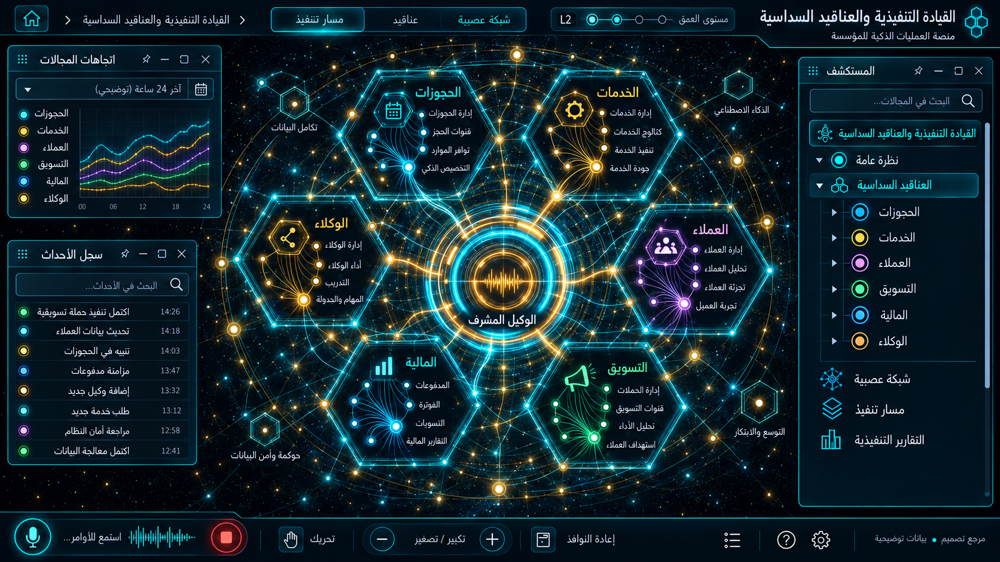

# 19 — القيادة التنفيذية والعناقيد السداسية

## الغرض والنطاق
المؤشرات، القطاعات، التنبيهات والروتين والمهارات. المرحلة: P04. المشهد: hex. المقاس:1672×941.
هذه مواصفة تصميم من القائمة المصورة، وليست كشفًا لبنية Backend.
بنود القائمة المغطاة:
- نظرة عامة ← لوحة المعلومات

## الواجهات الفرعية والبناء البصري
المشاهد المطلوبة: قيادة قطاعات / تفاصيل مؤشر / إنذارات / روتين.
نواة محاطة بعناقيد سداسية وظيفية؛ داخل كل عنقود تفاصيل مجال لا مجرة مكررة. مؤشرات ومهارات وروتين وتنبيهات بمصادر، مع drill-down إلى المجال.
قس حدود النوافذ والفراغات والمواضع من الصورة قبل كتابة CSS ، واحفظ regions/19.json. لا تفرض موضع Inspector موحدًا على مراجع مختلفة.
السيدبار العام عربي يمينًا قابل للطي والإخفاء؛ المفتش قابل للنقل. النص DOM واضح، والتوهج على الحدود لا كل الحروف.
تكوين هذه الواجهة يجب أن يعتمد فعليًا على المرجع؛ النموذج HTML المرفق تجربة سلوك وليس أصلًا بصريًا معتمدًا.
لكل مشهد: overview ثم expanded ثم inspector ثم action preview ، وحالات empty/error/loading. اللقطات الإضافية تُعتمد لاحقًا؛ الحزمة لا تتضمن صورة مستقلة لكل حالة فرعية.

## المكونات والعلاقات
1. الحجوزات: معرف ثابت `domain.19.component.1`. عند التوسع تظهر الكيانات والإعدادات والتنفيذ الخاصة بهذا المكون من schema الفعلي؛ لا ثلاثة أبناء عامين في المنتج النهائي.
2. الرحلات: معرف ثابت `domain.19.component.2`. عند التوسع تظهر الكيانات والإعدادات والتنفيذ الخاصة بهذا المكون من schema الفعلي؛ لا ثلاثة أبناء عامين في المنتج النهائي.
3. الفنادق: معرف ثابت `domain.19.component.3`. عند التوسع تظهر الكيانات والإعدادات والتنفيذ الخاصة بهذا المكون من schema الفعلي؛ لا ثلاثة أبناء عامين في المنتج النهائي.
4. المالية: معرف ثابت `domain.19.component.4`. عند التوسع تظهر الكيانات والإعدادات والتنفيذ الخاصة بهذا المكون من schema الفعلي؛ لا ثلاثة أبناء عامين في المنتج النهائي.
5. الوكلاء: معرف ثابت `domain.19.component.5`. عند التوسع تظهر الكيانات والإعدادات والتنفيذ الخاصة بهذا المكون من schema الفعلي؛ لا ثلاثة أبناء عامين في المنتج النهائي.
6. الأتمتة: معرف ثابت `domain.19.component.6`. عند التوسع تظهر الكيانات والإعدادات والتنفيذ الخاصة بهذا المكون من schema الفعلي؛ لا ثلاثة أبناء عامين في المنتج النهائي.
7. التسويق: معرف ثابت `domain.19.component.7`. عند التوسع تظهر الكيانات والإعدادات والتنفيذ الخاصة بهذا المكون من schema الفعلي؛ لا ثلاثة أبناء عامين في المنتج النهائي.
8. الأمن: معرف ثابت `domain.19.component.8`. عند التوسع تظهر الكيانات والإعدادات والتنفيذ الخاصة بهذا المكون من schema الفعلي؛ لا ثلاثة أبناء عامين في المنتج النهائي.
روابط المجالات: 01 الأطلس العصبي الشامل؛ 03 الحجوزات والإلغاء والتقييمات؛ 11 غرفة الوكلاء والمعرفة؛ 12 استوديو الأتمتة والتنفيذ؛ 13 المالية والفوترة والولاء؛ 15 الامتثال والخصوصية والصلاحيات.
كل علاقة دلالية لديها relationType و evidenceRef ؛ اعرض دعم العميل/المالية/الامتثال عند اختيار العقدة بدل ازدحام الجميع.
الرجوع يحفظ parent selection وعمق التوسع ومواقع المستخدم. إغلاق المفتش لا يلغي مهمة خادم.

## البيانات والعمليات
Capabilities مقترحة: `metrics.read`، `alerts.read`، `routine.preview`.
حقول للفحص: metricId, definition, timeWindow, sampledAt, source, severity, alertId.
لكل capability: اكتشف الخدمة و route/function و schema و auth scope و read/write والأخطاء المتوقعة و trace location و fixture.
كل كيان لديه ID و version و tenant إن انطبق. التواريخ ISO ؛ المال amountMinor+currency ؛ الأسرار secretRef. unknown لا تعني healthy.
القراءة تعيد loading/empty/error. الكتابة تبدأ preview وتحتاجصلاحية؛ نتيجةالخادم مصدرالنجاح، لا مؤقت UI.
قيد المجال: القيمة المفقودة ليست صفرًا؛ الرسم لا يخترع إيرادات أو أعطال؛ المقاييس التجريبية موسومة.

## سيناريو التشغيل الرئيسي
فتح مؤشر؛ بيان تعريفه ونطاقه الزمني ومصدره؛ تكبير القطاع؛ فحص تنبيه؛ الانتقال إلى trace ؛ اعتماد روتين من صلاحية مناسبة.
1. تحميل fixture معلوم أو snapshot حقيقي مع وسم مصدره.
2. فتح المجال ثم المكون وتثبيت breadcrumb.
3. جلب التفاصيل بحسب permission وإخفاء الحقول الحساسة.
4. عرض preview بالأثر والمدخلات وهويةالمنفذ.
5. اعتماد العملية إذا كانت حجزًا أو دفعًا أو حذفًا أو نشرًا.
6. إرسال command بمعرف منع تكرار ثم تتبع النتيجة.
7. الفشل الجزئي يوضح الجزء الفاشل والمسار المتاح لإصلاحه.
8. انتقال للمجال المرتبط ثم رجوع بالسياق نفسه.

## حالات إلزامية
- loading: مصدر البيانات غير متاح بعد؛ لا online وهمي.
- empty: شرح غياب الكيانات وزر قراءة آمن.
- ready: المصدر وآخر تحديث و trace عند توفره.
- stale/offline: آخر قيمة موسومة؛ منع الكتابة غير الآمنة.
- denied403: إخفاء الإجراء لا يغني عن فحص الخادم.
- validation/conflict409: حقل محدد ورسالة عربية ونسخة محدثة.
- partial/timeout: metric دون source أو sampledAt لا يظهر حيًا مؤكدًا.
- duplicate/interruption: الإنذار يقود للمصدر والمجال وليس أيقونة زخرفية بلا عمل.

## اختبارات القبول الخاصة
S19-01: المسار الفعلي يعرض العنوان و 8 مكونات أساسية و sidebar عربيًا.
S19-02: اختيار «الحجوزات» يفتح تفاصيله؛ التوسع لا يزيل الأب.
S19-03: السيناريو الرئيسي بـ fixture ثم contract test لمحوله.
S19-04: metric دون source أو sampledAt لا يظهر حيًا مؤكدًا.
S19-05: الإنذار يقود للمصدر والمجال وليس أيقونة زخرفية بلا عمل.
S19-06: reader/operator و tenantA/B إن انطبق؛ تحقق منع الخادم.
S19-07: نقل وتحجيم وتصغير واستعادة المفتش، ثم refresh ؛ بديل keyboard.
S19-08: لقطات overview/expanded/inspector/empty/error عند 1672×941 و DPR1.
S19-09: expected/actual/diff ، بلا صورة المرجع فوق التنفيذ أثناءالتقاطه.
S19-10: صفر أخطاء console أوطلب خارجي غير مأذون أوتسريب listeners.

## أدلة الإتمام
ملفات تنفيذ؛ عقود ومحولات؛ fixtures ؛ tests ؛ لقطات؛ diff ؛ performance sample ؛ مراجعة بصرية موثقة.
اربطالأدلة في tasks. لا accepted لمجرد وجود SVG وصورة. الاختبارات الإنتاجية أعلاه مطلوبة في المشروع؛ اختبارات الحزمة الحالية لا تدّعي تغطيتها.

