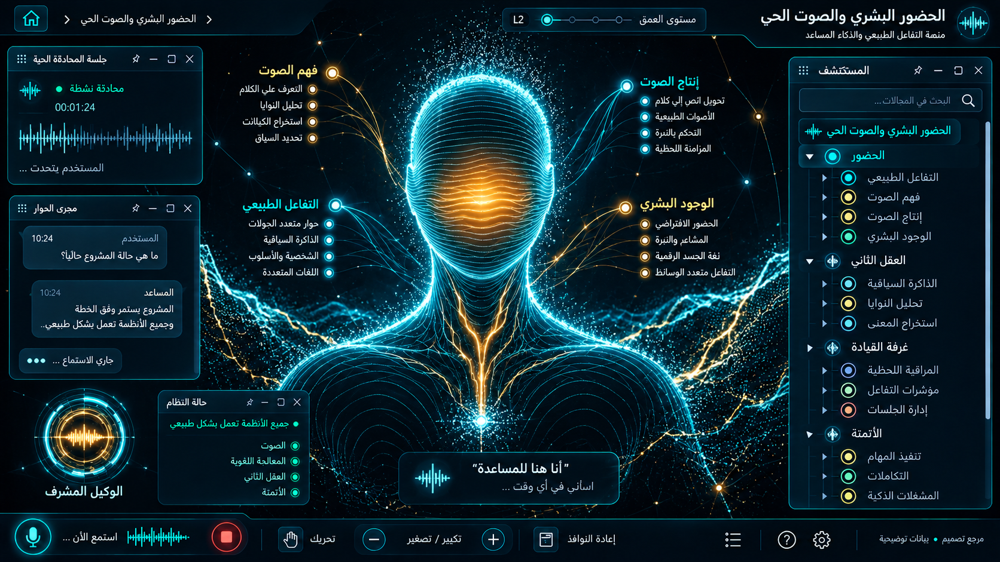

# 20 — الحضور البشري والصوت الحي

## الغرض والنطاق
الحضور ثلاثي الأبعاد، الرأس الجسيمي، القلب، الوريد، طاقة الصوت. المرحلة: P09. المشهد: avatar. المقاس:1672×941.
هذه مواصفة تصميم من القائمة المصورة، وليست كشفًا لبنية Backend.
بنود القائمة المغطاة:
- واجهة مشتركة عابرة للمجالات؛ ليست بند قائمة مستقلًا.

## الواجهات الفرعية والبناء البصري
المشاهد المطلوبة: front hero / profile / voice pulse / activity storm.
جذع ورأس متصلان، سواد داخلي، خطوط سطحية منحنية، حد سماوي، نواة كهرمانية بلا مربع sprite ، وريد وقلب ورذاذ رأس. اعتمد silhouette قبل الجسيمات. الإنتاج يحتاج أصلًا فنيًا و shaders ، لا تمديد كرة وأسطوانة.
قس حدود النوافذ والفراغات والمواضع من الصورة قبل كتابة CSS ، واحفظ regions/20.json. لا تفرض موضع Inspector موحدًا على مراجع مختلفة.
السيدبار العام عربي يمينًا قابل للطي والإخفاء؛ المفتش قابل للنقل. النص DOM واضح، والتوهج على الحدود لا كل الحروف.
تكوين هذه الواجهة يجب أن يعتمد فعليًا على المرجع؛ النموذج HTML المرفق تجربة سلوك وليس أصلًا بصريًا معتمدًا.
لكل مشهد: overview ثم expanded ثم inspector ثم action preview ، وحالات empty/error/loading. اللقطات الإضافية تُعتمد لاحقًا؛ الحزمة لا تتضمن صورة مستقلة لكل حالة فرعية.

## المكونات والعلاقات
1. الرأس الجسيمي: معرف ثابت `domain.20.component.1`. عند التوسع تظهر الكيانات والإعدادات والتنفيذ الخاصة بهذا المكون من schema الفعلي؛ لا ثلاثة أبناء عامين في المنتج النهائي.
2. الهالة: معرف ثابت `domain.20.component.2`. عند التوسع تظهر الكيانات والإعدادات والتنفيذ الخاصة بهذا المكون من schema الفعلي؛ لا ثلاثة أبناء عامين في المنتج النهائي.
3. النواة الكهرمانية: معرف ثابت `domain.20.component.3`. عند التوسع تظهر الكيانات والإعدادات والتنفيذ الخاصة بهذا المكون من schema الفعلي؛ لا ثلاثة أبناء عامين في المنتج النهائي.
4. الوريد: معرف ثابت `domain.20.component.4`. عند التوسع تظهر الكيانات والإعدادات والتنفيذ الخاصة بهذا المكون من schema الفعلي؛ لا ثلاثة أبناء عامين في المنتج النهائي.
5. القلب: معرف ثابت `domain.20.component.5`. عند التوسع تظهر الكيانات والإعدادات والتنفيذ الخاصة بهذا المكون من schema الفعلي؛ لا ثلاثة أبناء عامين في المنتج النهائي.
6. موجة الصوت: معرف ثابت `domain.20.component.6`. عند التوسع تظهر الكيانات والإعدادات والتنفيذ الخاصة بهذا المكون من schema الفعلي؛ لا ثلاثة أبناء عامين في المنتج النهائي.
7. المجسات: معرف ثابت `domain.20.component.7`. عند التوسع تظهر الكيانات والإعدادات والتنفيذ الخاصة بهذا المكون من schema الفعلي؛ لا ثلاثة أبناء عامين في المنتج النهائي.
8. الوعي بالحالة: معرف ثابت `domain.20.component.8`. عند التوسع تظهر الكيانات والإعدادات والتنفيذ الخاصة بهذا المكون من schema الفعلي؛ لا ثلاثة أبناء عامين في المنتج النهائي.
روابط المجالات: 11 غرفة الوكلاء والمعرفة؛ 17 القرص الصوتي وحالات الوكيل؛ 18 حالات النوافذ والسيدبار والتنقل.
كل علاقة دلالية لديها relationType و evidenceRef ؛ اعرض دعم العميل/المالية/الامتثال عند اختيار العقدة بدل ازدحام الجميع.
الرجوع يحفظ parent selection وعمق التوسع ومواقع المستخدم. إغلاق المفتش لا يلغي مهمة خادم.

## البيانات والعمليات
Capabilities مقترحة: `voice.output.analysis`، `voice.input.analysis`، `agent.public-state`.
حقول للفحص: time, outputRms, inputRms, frequencyBands, speaking, listening, toolActivity.
لكل capability: اكتشف الخدمة و route/function و schema و auth scope و read/write والأخطاء المتوقعة و trace location و fixture.
كل كيان لديه ID و version و tenant إن انطبق. التواريخ ISO ؛ المال amountMinor+currency ؛ الأسرار secretRef. unknown لا تعني healthy.
القراءة تعيد loading/empty/error. الكتابة تبدأ preview وتحتاجصلاحية؛ نتيجةالخادم مصدرالنجاح، لا مؤقت UI.
قيد المجال: المظهر لا يثبت وجود تفكير أو قلب فعلي؛ نسخة الويب تحتاج أصول فنية و shaders مخصصة.

## سيناريو التشغيل الرئيسي
بدء حضور؛ مزامنة صوت الخرج مع النواة؛ ذرات عند الاستماع؛ نبض نشاط أدوات عند التنفيذ؛ مقاطعة توقف الكلام والحركة التابعة له.
1. تحميل fixture معلوم أو snapshot حقيقي مع وسم مصدره.
2. فتح المجال ثم المكون وتثبيت breadcrumb.
3. جلب التفاصيل بحسب permission وإخفاء الحقول الحساسة.
4. عرض preview بالأثر والمدخلات وهويةالمنفذ.
5. اعتماد العملية إذا كانت حجزًا أو دفعًا أو حذفًا أو نشرًا.
6. إرسال command بمعرف منع تكرار ثم تتبع النتيجة.
7. الفشل الجزئي يوضح الجزء الفاشل والمسار المتاح لإصلاحه.
8. انتقال للمجال المرتبط ثم رجوع بالسياق نفسه.

## حالات إلزامية
- loading: مصدر البيانات غير متاح بعد؛ لا online وهمي.
- empty: شرح غياب الكيانات وزر قراءة آمن.
- ready: المصدر وآخر تحديث و trace عند توفره.
- stale/offline: آخر قيمة موسومة؛ منع الكتابة غير الآمنة.
- denied403: إخفاء الإجراء لا يغني عن فحص الخادم.
- validation/conflict409: حقل محدد ورسالة عربية ونسخة محدثة.
- partial/timeout: فقد WebGL يعطي fallback واضحًا ولا يكرر canvases/listeners.
- duplicate/interruption: خرج الصوت يحرك النواة، والمدخل يحرك هالة الاستماع بقناتين منفصلتين.

## اختبارات القبول الخاصة
S20-01: المسار الفعلي يعرض العنوان و 8 مكونات أساسية و sidebar عربيًا.
S20-02: اختيار «الرأس الجسيمي» يفتح تفاصيله؛ التوسع لا يزيل الأب.
S20-03: السيناريو الرئيسي بـ fixture ثم contract test لمحوله.
S20-04: فقد WebGL يعطي fallback واضحًا ولا يكرر canvases/listeners.
S20-05: خرج الصوت يحرك النواة، والمدخل يحرك هالة الاستماع بقناتين منفصلتين.
S20-06: reader/operator و tenantA/B إن انطبق؛ تحقق منع الخادم.
S20-07: نقل وتحجيم وتصغير واستعادة المفتش، ثم refresh ؛ بديل keyboard.
S20-08: لقطات overview/expanded/inspector/empty/error عند 1672×941 و DPR1.
S20-09: expected/actual/diff ، بلا صورة المرجع فوق التنفيذ أثناءالتقاطه.
S20-10: صفر أخطاء console أوطلب خارجي غير مأذون أوتسريب listeners.

## أدلة الإتمام
ملفات تنفيذ؛ عقود ومحولات؛ fixtures ؛ tests ؛ لقطات؛ diff ؛ performance sample ؛ مراجعة بصرية موثقة.
اربطالأدلة في tasks. لا accepted لمجرد وجود SVG وصورة. الاختبارات الإنتاجية أعلاه مطلوبة في المشروع؛ اختبارات الحزمة الحالية لا تدّعي تغطيتها.

