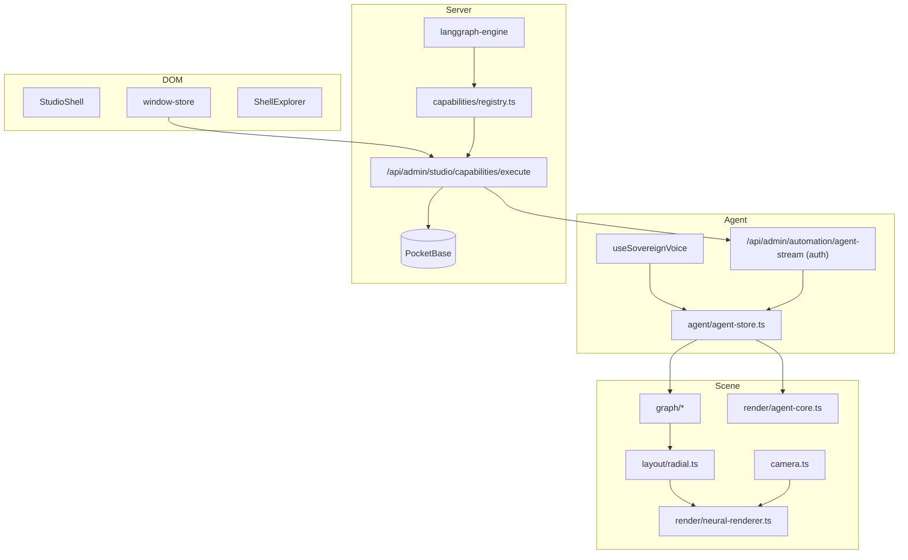
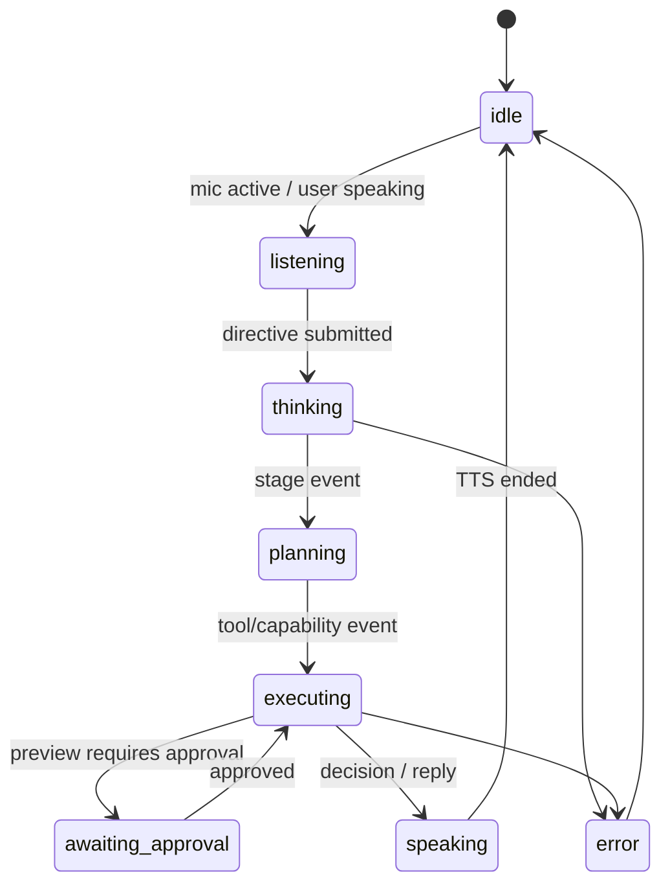
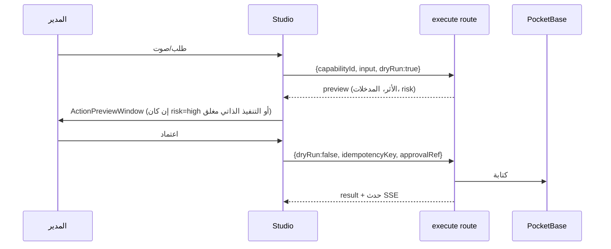

# Cyber Console — البنية المعتمدة

الاستوديو السيبراني لوحة إدارة بديلة: خرائط عصبية حية بكامل الشاشة، نوافذ موحدة، والقرص الأوسط هو الوكيل المشرف العام.
المرجع البصري: `lonaliza-neural-studio-complete-handoff/images/NN-*.png` (1672×941 وحدات تصميم، لا إطار ثابت).

## الطبقات



## خريطة الملفات (admin-panel/src)

| المسؤولية | الملف |
|---|---|
| رموز الهوية (ألوان، خطوط، حواف، توهج) | `lib/studio/tokens.ts` |
| كاميرا world→screen، fit، flyTo | `lib/studio/camera.ts` |
| أنواع العقد والعلاقات والخرائط | `lib/studio/graph/types.ts` |
| خريطة L0 (الأطلس) من admin-nav | `lib/studio/graph/atlas-map.ts` |
| خرائط L1/L2 من domain-systems | `lib/studio/graph/domain-map.ts` |
| تخطيط شعاعي بلا تصادم | `lib/studio/layout/radial.ts` |
| رسم الأعصاب الثابت + الطبقة الحية | `lib/studio/render/neural-renderer.ts` |
| القرص الأوسط حسب حالة الوكيل | `lib/studio/render/agent-core.ts` |
| حالة الوكيل (آلة حالات) | `lib/studio/agent/agent-store.ts` |
| حالة النوافذ | `lib/studio/windows/window-store.ts` |
| سجل القدرات (مشترك) | `lib/studio/capabilities/registry.ts` |
| منفذ القدرات (خادم فقط) | `lib/studio/capabilities/executor.server.ts` |
| الغلاف | `components/admin/automation/hud/studio/shell/StudioShell.tsx` |
| النوافذ | `components/admin/automation/hud/studio/shell/windows/*.tsx` |

## العقود

```ts
type NodeKind = "agent" | "domain" | "system" | "entity" | "setting" | "action";
interface GraphNode { id: string; kind: NodeKind; label: string; parentId?: string; domainId: string;
  tone: Tone; icon?: IconKey; href?: string; collection?: string; route?: string;
  capabilityRefs: string[]; childMapId?: string; }
interface GraphEdge { id: string; source: string; target: string;
  relationType: "contains" | "depends_on" | "calls" | "produces" | "observed_flow"; evidenceRef: string; }
interface GraphMap { id: string; level: 0 | 1 | 2; title: string; parentMapId?: string; rootId: string;
  nodes: GraphNode[]; edges: GraphEdge[]; screenId: string; }
```

- العقدة لا تُنسخ بين خريطتين؛ الخريطة الفرعية تُعرّف بـ `childMapId`.
- الحالة الحية (عدد سجلات، freshness) تأتي من الخادم وتُخزن خارج الخريطة: `liveCounts[collection]`.

## آلة حالات الوكيل



المصادر: `useSovereignVoice` (isUserSpeaking, isAgentSpeaking, isProcessing, audioFrequencies) + SSE `agent-stream` (type: stage/tool/decision/log) + منفذ القدرات (preview/result).

## تدفق تنفيذ القدرة



## التنقل بين الخرائط
L0 الأطلس → L1 مجال → L2 نظام → L3 نافذة. `flyTo` 700ms ثم تبديل الخريطة وتلاشي. الرجوع يعيد الكاميرا والتحديد المحفوظين في `mapHistory`.

## كامل الشاشة
- `StudioShell` = `position: fixed; inset: 0`. لا letterbox.
- الكاميرا تحوّل وحدات التصميم إلى الشاشة: `k = min((W - reservedX) / worldW, (H - reservedY) / worldH)`، والخلفية تُرسم على كامل W×H.
- النوافذ مرتكزة على الحواف بوحدات CSS، وتنكمش مع `clamp()` على الشاشات الصغيرة.
