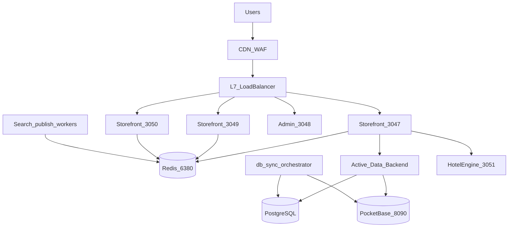

# Multi-server topology

Deploy artifacts:

- [`deploy/lonaliza-storefront-upstream.conf`](../../../deploy/lonaliza-storefront-upstream.conf)
- [`ecosystem.config.cjs`](../../../ecosystem.config.cjs)
- Second node: [`deploy/scale-out-second-node.md`](../../../deploy/scale-out-second-node.md)
