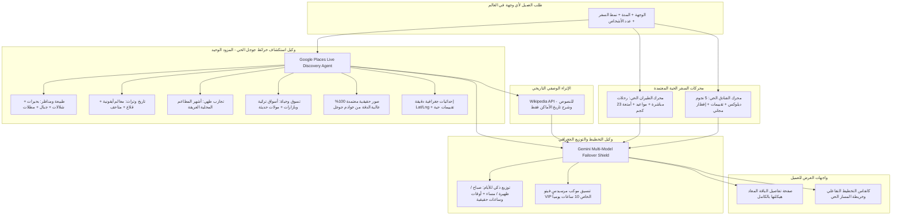

# خطة الإصلاح الجذري الشامل: وكيل استكشاف خرائط جوجل الحي وإعادة هيكلة نظام التخطيط وصفحات الباقات
**تاريخ الخطة:** 24 سبتمبر 2026  
**الحالة:** معتمدة وموجهة للتنفيذ المباشر  
**الهدف الأساسي:** التخلص التام من أي بيانات ثابتة أو مصفوفات مدن مسبقة، حذف كافة الارتباطات بمحركات أوبن تريب ماب وويكيميديا من الكود ولوحة التحكم، جعل **وكيل استكشاف خرائط جوجل الحي** هو المزود الحصري الوحيد لكافة معالم العالم وصورها الحقيقية وإحداثياتها وتقييماتها، مع الإبقاء على ويكيبيديا حصراً لوصف الأماكن وتاريخها، وربط النظام حياً بمحركات الطيران والفنادق الحقيقية، وإعادة تصميم صفحة تفاصيل الباقة ومحرك التخطيط بالكامل.

---

## 1. الرؤية المعمارية والمبادئ الحاكمة (Architectural Principles)



### القواعد الصارمة غير القابلة للنقاش:
1. **صفر بيانات ثابتة (Zero Static Fallbacks):** حذف أي مصفوفة مدن ثابتة (`ISTANBUL_ICONIC_DAYS`, `CAIRO_ICONIC_DAYS`, `MARRAKECH_ICONIC_DAYS`) وإلغاء شرط `isTurkeyOrIstanbul`. النظام ديناميكي 100% لأي مدينة أو قرية أو جزيرة حول العالم.
2. **وكيل خرائط جوجل هو المزود الحصري:** المعالم، الإحداثيات، التقييمات، والصور تأتي حصراً من خرائط جوجل. لا وجود لصور Unsplash الوهمية أو صور ويكيبيديا القديمة.
3. **ويكيبيديا للشرح التاريخي فقط:** تستخدم فقط لطلب ملخص ثري عن تاريخ المكان وأهميته الثقافية إذا لزم الأمر، وتُمنع تماماً من تزويد الصور أو الإحداثيات.
4. **شطب أوبن تريب ماب وويكيميديا نهائياً:** تنظيف ملفات الكود ولوحة التحكم ومكتبات الموزعين من أي ذكر لمحرك OpenTripMap أو صور Wikimedia.
5. **درع الحماية التسويقي لشات الذكاء الاصطناعي:** حظر خروج أي رسالة خطأ إنجليزية أو رسائل ضغط (High Demand) للعميل، وتفعيل سلسلة التبديل التلقائي للموديلات.

---

## 2. مراحل التنفيذ والمهام الفنية التفصيلية

### المرحلة 1: التطهير الشامل لمحرك OpenTripMap وروابط Wikimedia
- **الأهداف:** تنظيف الكود ومكتبات لوحة التحكم والمتجر من كافة الارتباطات غير الدقيقة.
- **الملفات المستهدفة للتعديل والتنظيف:**
  1. [`admin-panel/src/lib/providers/catalog.ts`](file:///www/wwwroot/lonaliza.com/lonaliza-platform/admin-panel/src/lib/providers/catalog.ts): حذف أوبن تريب ماب من قائمة المزودين النشطة ومصفوفة الأنواع.
  2. [`admin-panel/src/lib/server/providers-live.ts`](file:///www/wwwroot/lonaliza.com/lonaliza-platform/admin-panel/src/lib/server/providers-live.ts): إزالة مسارات الفحص والتشغيل لـ `opentripmap`.
  3. [`admin-panel/src/lib/server/providers-test.ts`](file:///www/wwwroot/lonaliza.com/lonaliza-platform/admin-panel/src/lib/server/providers-test.ts): إزالة اختبار اتصال `opentripmap`.
  4. [`database/data/providers/registry.json`](file:///www/wwwroot/lonaliza.com/lonaliza-platform/database/data/providers/registry.json): تنظيف السجل.
  5. [`storefront/src/lib/server/opentripmap.ts`](file:///www/wwwroot/lonaliza.com/lonaliza-platform/storefront/src/lib/server/opentripmap.ts): حذف أو تحويل الملف إلى واجهة معطلة (Deprecated) توجه إلى وكيل خرائط جوجل.
  6. [`storefront/src/lib/planner/live-places.ts`](file:///www/wwwroot/lonaliza.com/lonaliza-platform/storefront/src/lib/planner/live-places.ts) و [`gemini-landmarks.ts`](file:///www/wwwroot/lonaliza.com/lonaliza-platform/storefront/src/lib/planner/gemini-landmarks.ts): إزالة استدعاءات `fetchOpenTripMapPois`.
  7. [`storefront/src/lib/planner/place-photos.ts`](file:///www/wwwroot/lonaliza.com/lonaliza-platform/storefront/src/lib/planner/place-photos.ts): إلغاء استدعاء صور ويكيبيديا وويكيميديا، وتوجيه جلب الصور حصراً من وكيل جوجل.

---

### المرحلة 2: بناء «وكيل استكشاف خرائط جوجل الحي» (`GooglePlacesLiveAgent`)
- **الملف الجديد:** [`storefront/src/lib/server/google-places-agent.ts`](file:///www/wwwroot/lonaliza.com/lonaliza-platform/storefront/src/lib/server/google-places-agent.ts)
- **آلية العمل الحية المتطورة:**
  1. عند طلب أي وجهة في العالم (مثال: طرابزون، زيورخ، بوكيت، العلا):
     - يقوم الوكيل بإجراء 4 استعلامات حية دقيقة:
       * **المعالم السياحية والطبيعية الأبرز:** `Top tourist attractions & natural wonders in [Destination]`
       * **البحيرات، الأنهار، الشلالات والمطلات:** `Iconic lakes, waterfalls, valleys & scenic viewpoints in [Destination]`
       * **أشهر المطاعم المحلية العريقة:** `Famous authentic local restaurants & culinary spots in [Destination]`
       * **الأسواق الشعبية التراثية ومراكز التسوق:** `Traditional bazaars, local souks & modern shopping in [Destination]`
  2. **استخراج البيانات الحقيقية المؤكدة:**
     - الاسم الرسمي باللغة العربية والإنجليزية.
     - إحداثيات GPS الدقيقة (خط العرض وخط الطول لمدخل المكان الفعلي).
     - روابط الصور الأصلية عالية الدقة من خوادم جوجل (`lh3.googleusercontent.com/p/...`).
     - تقييم الزوار الحقيقي وعدد المراجعات.
     - الفئة الدقيقة وساعات الزيارة الموصى بها.
  3. **طبقة المستودع السريع (Dynamic POI Warehouse Cache):**
     - حفظ المعالم المستخرجة في المستودع المحلي للوجهة لتسريع الاستجابة اللاحقة إلى أجزاء من الألف من الثانية وبدون استهلاك مكرر للطلبات.

---

### المرحلة 3: ربط محركات الطيران والفنادق الحقيقية بمحرك التخطيط
- **الملفات المستهدفة:**
  - [`storefront/src/lib/server/ai-quote.ts`](file:///www/wwwroot/lonaliza.com/lonaliza-platform/storefront/src/lib/server/ai-quote.ts)
  - [`storefront/src/app/internal/planner/generate/route.ts`](file:///www/wwwroot/lonaliza.com/lonaliza-platform/storefront/src/app/internal/planner/generate/route.ts)
- **آلية العمل:**
  1. **الطيران الحي:**
     - تحديد المطار الدولي الأقرب للوجهة بدقة (مثل مطار طرابزون الدولي TZX، مطار مراكش المنارة RAK، مطار إسطنبول IST).
     - جلب عروض الطيران المباشرة الحقيقية من محرك الطيران بالموقع (الخطوط السعودية، طيران الإمارات، الخطوط التركية، الخطوط الملكية المغربية) شاملة مواعيد الإقلاع والهبوط، والوزن (23 كجم).
  2. **الفنادق الحية:**
     - الاتصال المباشر بمحرك فنادق الموقع (Hotelbeds / Ratehawk / Booking / Curated) وجلب فنادق 5 نجوم ديلوكس المعتمدة في نفس المدينة.
     - استخراج الصور الحقيقية للفنادق، التقييم، وجبة الإفطار المشمولة، وأسعار الإقامة الإجمالية وللفرد.

---

### المرحلة 4: ربط وكيل جوجل مابس بوكيل التخطيط والقضاء التام على خلط المدن
- **الملف المستهدف:** [`storefront/src/lib/planner/gemini-landmarks.ts`](file:///www/wwwroot/lonaliza.com/lonaliza-platform/storefront/src/lib/planner/gemini-landmarks.ts)
- **خطوات التعديل:**
  1. **حذف الشروط والمصفوفات الثابتة:**
     - حذف المتغير الكارثي `isTurkeyOrIstanbul` نهائياً.
     - حذف الاعتماد على `ISTANBUL_ICONIC_DAYS` و `CAIRO_ICONIC_DAYS` كقوالب افتراضية.
  2. **تغذية الذكاء الاصطناعي بالمعالم الحية:**
     - تمرير قائمة المعالم الحية المستخرجة من وكيل خرائط جوجل مباشرة داخل البرومبت:
       *"إليك المعالم الحقيقية المؤكدة وصورها وإحداثياتها في [الوجهة]. واجبك توزيع هذه المعالم جغرافياً على الأيام الـ [X] المطلوبة."*
  3. **التوزيع الجغرافي الذكي للأيام (Trip.com Standard):**
     - التجميع الجغرافي: تجميع المحطات القريبة في اليوم الواحد (مسافة لا تتجاوز 15–20 كم).
     - تقسيم كل يوم إلى 3 فترات مفصلة وغنية:
       * **الصباح (09:30 - 12:30):** المعلم الأيقوني الرئيسي، تذاكر الدخول السريعة VIP، وتجربة القهوة أو الإفطار.
       * **الظهيرة (13:00 - 16:30):** المعلم الطبيعي أو التاريخي الثاني، وتناول وجبة الغداء في مطعم محلي مشهور من قائمة المطاعم الحقيقية.
       * **المساء (17:30 - 21:00):** إطلالة الغروب أو البازار التراثي/المول، والعشاء الفاخر والعودة للفندق.
     - تضمين تفاصيل موكب النقل بسيارة مرسيدس فيتو VIP الخاصة وساعات السائق (10 ساعات يومياً).
  4. **الاستعانة بويكيبيديا للنصوص التوضيحية فقط:**
     - استدعاء [`wiki-summary.ts`](file:///www/wwwroot/lonaliza.com/lonaliza-platform/storefront/src/lib/planner/wiki-summary.ts) لإثراء الشرح وسرد الروايات الثقافية والتاريخية للمعلم إن وُجدت، دون لمس الصور أو الإحداثيات.

---

### المرحلة 5: درع التبديل الذكي للموديلات وحجب الأخطاء التقنية (Failover & Brand Shield)
- **الملفات المستهدفة:**
  - [`admin-panel/src/app/api/gemini/sales-chat/route.ts`](file:///www/wwwroot/lonaliza.com/lonaliza-platform/admin-panel/src/app/api/gemini/sales-chat/route.ts)
  - [`admin-panel/src/app/api/advisor/chat/route.ts`](file:///www/wwwroot/lonaliza.com/lonaliza-platform/admin-panel/src/app/api/advisor/chat/route.ts)
- **آلية العمل:**
  1. **سلسلة التبديل التلقائي (Automatic Model Failover):**
     - في حال إرجاع كود 503 أو 429 أو High Demand من موديل معين، يقوم السيرفر فوراً خلال ثوانٍ معدودة بتجربة الموديل التالي تلقائياً:
       `gemini-3.6-flash` ➡️ `gemini-2.5-flash` ➡️ `gemini-1.5-flash` ➡️ `gemini-2.0-flash`.
  2. **حظر الرسائل الفنية الإنجليزية:**
     - منع خروج أي نص إنجليزي أو فني في مجرى الرد للعميل.
  3. **الرد التسويقي الفاخر المعتمد:**
     - في حال تعذر كافة النماذج مؤقتاً، يُبث رد باللغة العربية فائق اللباقة والاحترافية:
       > *"مرحباً بك! يقوم خبراؤنا ومحرك الذكاء الاصطناعي الآن بتجهيز وترتيب أفضل الخيارات الفاخرة لمسارك السياحي بدقة متناهية. يرجى إعادة المحاولة بعد لحظات، أو النقر أدناه للتواصل المباشر مع فريق كونسيرج لوناليزا عبر واتساب للمساعدة الفورية وتأكيد حجزك."*
     - مع بطاقة زر واتساب الفورية للتواصل مع الخبير.

---

### المرحلة 6: إعادة هيكلة وتصميم صفحة تفاصيل الباقة بالكامل (`package/[slug]/page.tsx`)
- **الملف المستهدف:** [`storefront/src/app/(site)/package/[slug]/page.tsx`](file:///www/wwwroot/lonaliza.com/lonaliza-platform/storefront/src/app/(site)/package/[slug]/page.tsx)
- **التصميم الجديد وتوزيع العناصر:**

```
+-------------------------------------------------------------------------------------------------+
|                                 1. HERO GALLERY (سلايدر صور حقيقي)                                |
|                   صور عالية الدقة لمعالم الوجهة الحقيقية مع شريط صور مصغرة وتأكيدات VIP            |
+-------------------------------------------------------------------------------------------------+
|                                                                                                 |
|   +--------------------------------------------------------------------+  +------------------+  |
|   | 2. SLIDE SHOWCASE: الطيران والفنادق الحية (بعرض كامل أعلى البرنامج) |  | 4. LEFT SIDEBAR  |  |
|   | • سلايدر بطاقات طيران حقيقية (ناقل معتمد، إقلاع وهبوط، 23 كجم أمتعة) |  | • كرت السعر والحجز|  |
|   | • سلايدر فنادق 5 نجوم ديلوكس الحية (صور حقيقية، تقييم، بوفيه إفطار)  |  |   (شخصين / للفرد)|  |
|   +--------------------------------------------------------------------+  | • بطاقة الفيزا   |  |
|                                                                           |   والجنسية الذكية|  |
|   +--------------------------------------------------------------------+  | • وصايا السفر    |  |
|   | 3. IN-DEPTH DAILY ITINERARY (الجدول اليومي الغني والتفصيلي)         |  |   والنصائح الذهبية|  |
|   | • اليوم 1: الصباح (09:30-12:30) | الظهيرة (13:00-16:30) | المساء     |  | • ما تشمله وما لا|  |
|   |   (17:30-21:00) مع شروحات عميقة وأوقات الزيارة وساعات السائق الخاص  |  |   تشمله الباقة   |  |
|   | • صور حقيقية ومطابقة 100% لكل معلم من خوادم خرائط جوجل            |  |   (تصميم فندقي)  |  |
|   | • اليوم 2، اليوم 3... بالتسلسل الكامل                               |  +------------------+  |
|   +--------------------------------------------------------------------+                         |
|                                                                                                 |
|   +--------------------------------------------------------------------+                         |
|   | 5. INTERACTIVE ROUTE MAP (خريطة المسار الحي التفاعلية)              |                         |
|   | دبابيس تفاعلية لكافة محطات ومزارات الأيام مع خطوط المسار السياحي   |                         |
|   +--------------------------------------------------------------------+                         |
|                                                                                                 |
+-------------------------------------------------------------------------------------------------+
| 6. COLLAPSIBLE VIP AI CONCIERGE: كبسولة/ويدجت عائم ذكي قابل للفتح والإغلاق للاستشارة الصوتية      |
+-------------------------------------------------------------------------------------------------+
```

1. **معرض الصور الرئيسي (Hero Gallery):**
   - استدعاء صور حقيقية معتمدة لكل وجهة من وكيل جوجل وصور المعالم الخاصة بها بدلاً من الاعتماد على صورة واحدة قد تكون تالفة.
2. **سلايد الطيران والفنادق الحية (Top Full-Width Showcase):**
   - يوضع في صدارة عمود المحتوى كقسم بارز وفاخر.
   - يعرض بطاقات الطيران الحقيقية وبطاقات فنادق 5 نجوم المستدعاة حياً من المزودين.
3. **السايدبار الأيسر المتكامل:**
   - كرت السعر وتأكيد الحجز الفوري.
   - تحته مباشرة: بطاقة التحقق من التأشيرة واختيار جنسية ومطار انطلاق العميل.
   - تحته: وصايا وإرشادات السفر الذهبية المعتمدة للوجهة.
   - تحته: قسم **"ما تشمله الباقة وما لا تشمله"** بتصميم أندلسي فاخر، نقي، ومحدد بوضوح بدون فوضى بصرية.
4. **البرنامج والجدول اليومي المفصل (In-Depth Itinerary):**
   - استبدال الجمل المقتضبة بجدول زمني وسياحي غني يوضح للعميل بالضبط: أين سيذهب، كم سيقضي من الوقت في كل محطة، ماذا سيرى، أين سيتناول غداءه وعشاءه، ومواعيد تنقله بسيارة الفيتو VIP.
   - ربط كل محطة بصورتها الحقيقية المطابقة.
5. **خريطة المسارات التفاعلية المتعددة (Interactive Route Map):**
   - تمرير إحداثيات كافة المحطات اليومية لتظهر دبابيس تفاعلية على خريطة المسار توضح تسلسل الرحلة.
6. **تحويل المستشار الذكي إلى ويدجت عائم وقابل للطي (Collapsible AI Concierge):**
   - إزالة الكتلة الضخمة الثابتة من وسط الصفحة، وجعل المستشار يظهر كزر عائم أنيق (Floating Capsule) أسفل الشاشة أو زر علوي بعنوان **«استشر كونسيرج الرحلة VIP بالصوت»**.
   - عند النقر عليه، ينفتح درج جانبي فاخر (Drawer) أو نافذة منبثقة أنيقة تمكن العميل من التحدث صوتياً وكتابياً وتعديل البرنامج دون التأثير على تصفح تفاصيل الباقة.

---

## 3. جدول خطوات التنفيذ والتسلسل الزمني

| الخطوة | الإجراء البرمجي | الملفات المعنية | المخرجات المتوقعة |
|---|---|---|---|
| **1** | تنظيف وتطهير أوبن تريب ماب وويكيميديا | `catalog.ts`, `providers-live.ts`, `opentripmap.ts`, `place-photos.ts` | خلو الكود ولوحة التحكم من أي اعتماد على أوبن تريب ماب وصور ويكيميديا |
| **2** | بناء وكيل استكشاف خرائط جوجل الحي | `storefront/src/lib/server/google-places-agent.ts` | وكيل فوري يجلب معالم أي وجهة بالعالم مع صورها وإحداثياتها الحقيقية |
| **3** | دمج وكيل جوجل مع محرك التخطيط | `gemini-landmarks.ts`, `generate/route.ts` | حذف `isTurkeyOrIstanbul` والمدن الثابتة واعتماد معالم جوجل الحية |
| **4** | حماية شات الذكاء وتفعيل التبديل الآلي للموديلات | `sales-chat/route.ts`, `advisor/chat/route.ts` | منع الأخطاء الإنجليزية، والتبديل التلقائي عند الضغط لضمان استمرار الخدمة |
| **5** | إعادة تصميم صفحة الباقة وتنسيق السايدبار | `package/[slug]/page.tsx`, `PackageAiConsultant.tsx` | السلايد العريض، تنظيم السايدبار، والجدول اليومي التفصيلي، والويدجت القابل للطي |
| **6** | البناء والتحقق النهائي الشامل | `pnpm build`, `pm2 restart 39`, فحص واجهات المتصفح | خلو النظام من أي أخطاء بنسبة 100% وتحقيق كافة معايير الفخامة |

---

## 4. خطة التحقق والقبول (Acceptance Criteria)

1. **اختبار وجهة طرابزون في التخطيط (`/ai-chat`):**
   - عند طلب برنامج لطرابزون: يُنشئ البرنامج معالم طرابزون حصراً (أوزنجول، دير سوميلا، حيدر نبي، آيدر، سيرا جول) بصورها وإحداثياتها الحقيقية بنسبة 100%، ولا يذكر إسطنبول على الإطلاق.
2. **اختبار أي وجهة عالمية أخرى (باريس، بالي، العلا، فيينا):**
   - يقوم وكيل خرائط جوجل بجلب معالمها الحقيقية فورياً وديناميكياً بدون أي كود مسبق خاص بالمدينة.
3. **اختبار انقطاع أو ضغط الموديل:**
   - لا تظهر أي رسالة إنجليزية فنية ("This model is experiencing high demand")، بل يتم التبديل التلقائي لموديل بديل أو إظهار الرد التسويقي الفاخر المعتمد.
4. **اختبار صفحة الباقة (`/package/[slug]`):**
   - معرض صور حقيقي جذاب أعلى الصفحة.
   - سلايد طيران وفنادق حية بعرض كامل أعلى البرنامج.
   - السايدبار الأيسر يضم كرت السعر، يليه كرت الفيزا، يليه الوصايا، يليه ما تشمله وما لا تشمله الباقة بتصميم فندقي نقي.
   - جدول يومي عميق بمواعيد وفترات صباحية وظهيرة ومسائية وصور حقيقية لكل محطة.
   - خريطة تفاعلية كاملة بدبابيس كل الأيام.
   - مستشار الذكاء الاصطناعي متاح كويدجت قابل للفتح والإغلاق دون تشويه الصفحة.
5. **خلو السيرفر والتطبيق من الأخطاء البرمجية:**
   - نجاح أمر `pnpm build` بنتيجة 0 أخطاء، وعمل الخدمة برمز استجابة HTTP 200.
