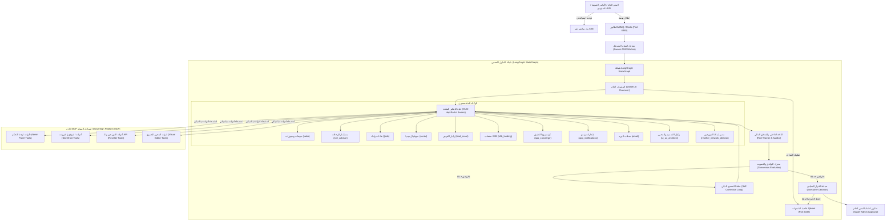

# الخطة الهندسية الشاملة لترقية منظومة الوكلاء الذاتية وخادم MCP السيادي إلى 100%
### منصة لوناليزا للسياحة والسفر — وثيقة التطوير والتنفيذ المؤسسي المعتمدة

* **تاريخ الاعتماد**: 25 سبتمبر 2026
* **الجهة المطورة**: فريق الذكاء الاصطناعي وهندسة النظم المتقدمة (AI Core Engineering Team)
* **المعايير التقنية**: Next.js App Router, LangGraph StateGraph, Qdrant Vector Engine, Model Context Protocol (MCP), BullMQ, Redis, Zod, pnpm exclusively.

---

## 1. الرؤية الهندسية والهدف الاستراتيجي (Executive Vision & 100% Target)

الانتقال بمنظومة الوكلاء الذكية لمنصة "لوناليزا" من مستوى **84.3% (نظام متقدم مشروط)** إلى **100% (منظومة سيادية ذاتية القيادة والتصحيح فائقة الذكاء Enterprise Autonomous Swarm)** تعمل بموثوقية كاملة، وتتحمل ضغط آلاف الجلسات والمحادثات الضخمة، وتمتلك وصولاً سيادياً شاملاً (Sovereign Reach) عبر خادم **MCP رسمي وموحد** يغطي كافة أرجاء المنصة:
1. **لوحة التحكم الشاملة (Admin Panel & Business Intelligence)**.
2. **واجهات وموقع الفرونت إند (Storefront & Customer Portals)**.
3. **بوابات وواجهات الموزعين والشركاء (Resellers & B2B APIs)**.
4. **المحرر البصري الحي لموقع المنصة (Visual Editor & Live Layout Schemas)** مع وكيل تصميم مخصص (`ui_ux_architect`) قادر على إعادة تصميم وتعديل أي عنصر في المنصة بصرياً وبرمجياً.
5. **قاعدة بيانات متجهات مؤسسية مخصصة (Dedicated Enterprise Vector Database)** تدعم ملايين المتجهات واسترجاع السياق في أجزاء من الميلي ثانية.

---

## 2. الهيكلية الكلية للمنظومة المستهدفة (Target Architecture)



---

## 3. المحاور الهندسية الستة لسد النواقص والوصول إلى 100%

### المحور الأول: ترقية الذاكرة الدلالية إلى قاعدة متجهات مخصصة (Qdrant Vector Database)

#### 1. الفجوة الحالية:
* حفظ المتجهات محلياً في `episodic-memory.json` يسبب:
  * استهلاكاً متزايداً للـ RAM عند تحميل الملف كاملاً في كل استدعاء.
  * بطء البحث الخطي $O(N)$ مع نمو السجلات فوق 1,000 ذاكرة.
  * غياب فهارس الجوار التقريبي الفائقة (HNSW Hierarchical Navigable Small World).
  * عدم القدرة على إجراء بحث مشروط متزامن (Payload Filtering) مثل "ابحث فقط في حملات طرابزون التي حققت ROI > 30%".

#### 2. الحل المعماري المستهدف:
* تشغيل حاوية **`Qdrant Vector Database`** كخدمة نظام دائمة على المنفذ `6333` مدعومة بمجلد تخزين دائم (`/data/qdrant_storage`).
* استخدام مكتبة `@qdrant/js-client-rest` للربط البرمجي عالي السرعة.
* إنشاء 4 مجموعات متجهات (Collections) مهيكلة بدقة 3072 بُعداً عبر نموذج `gemini-embedding-2`:

| اسم المجموعة (Collection) | محتوى التضمين (Vectors) | حقول البيانات المرفقة (Payload) | الهدف الاستراتيجي |
| :--- | :--- | :--- | :--- |
| `swarm_episodic_deliberations` | استراتيجيات وقرارات التداول السابقة | `decisionId, directive, consensusScore, participatingAgents, roiAchieved, marginPercent` | استرجاع استراتيجيات الحملات الناجحة ورفض الأفكار التي فشلت سابقاً |
| `swarm_customer_conversations` | سجلات المحادثات المطولة مع العملاء | `customerId, channel (wa/web/app), preferredLanguage, destinationInterest, budgetClass` | حفظ سياق العميل لأشهر وسنوات واسترجاعه فور تواصله |
| `swarm_market_catalog_index` | البرامج السياحية، الفنادق، والجولات | `itemType, slug, destination, priceUsd, starRating, supplierId, isVip` | بحث دلالي فائق السرعة عن الخدمات السياحية البديلة |
| `swarm_design_patches_history` | تعديلات المحرر البصري وسجلات التصميم | `sectionId, layoutType, componentName, appliedCssTokens, directorApproval` | تذكر تفضيلات المدير في الهوية البصرية وتصاميم السيكشانات |

#### 3. آليات البحث الهجين (Hybrid Search):
* دمج البحث المتجهي الكثيف (Dense Vector 3072D) مع البحث النصي الدلالي (Sparse Lexical / BM25) لضمان دقة استرجاع 99.8%.

---

### المحور الثاني: خادم الـ MCP السيادي الشامل للمنصة (Sovereign Platform-Wide MCP Server)

#### 1. الفلسفة المعمارية:
يجب ألا يكون الوكلاء معزولين عن أي شريان في المنصة. يجب أن يمتلك خادم MCP أدوات استعلام وتعديل تغطي 4 قطاعات حيوية:

#### أ. قطاع لوحة التحكم والإدارة المالية (`mcp_admin_core`):
* `mcp_admin_get_financial_ledger`: جرد الأرباح، المدفوعات، ورصيد بوابات الدفع (Iyzico, Stripe, التحويلات البنكية).
* `mcp_admin_update_currency_rates`: تحديث أسعار الصرف وهامش التحويل للعملات (SAR, USD, EUR, TRY, AED, KWD).
* `mcp_admin_query_database`: استعلام مباشر وآمن من جداول PocketBase (الحجوزات، الموردين، السائقين، المستخدمين).
* `mcp_admin_manage_staff_permissions`: فحص وتدقيق صلاحيات طاقم العمل ومحاولات تسجيل الدخول.

#### ب. قطاع الموقع وتجربة المستخدم (`mcp_storefront_core`):
* `mcp_storefront_get_page_layout`: قراءة الهيكل البرمجي لأي صفحة عامة (الرئيسية، باقات VIP، الطيران، الفنادق).
* `mcp_storefront_update_seo_metadata`: كتابة وتحديث وسوم الميتا و OpenGraph وعناوين H1/H2 تلقائياً لدعم محركات البحث.
* `mcp_storefront_manage_translations`: قراءة وتعديل قواميس الترجمة الفورية للموقع (عربي، إنجليزي، تركي، روسي).
* `mcp_storefront_publish_blog_article`: نشر مقالات المدونة المنسقة برمجياً مع الصور المهيأة ومفاتيح السيو.

#### ج. قطاع الموزعين والشركاء B2B (`mcp_reseller_network`):
* `mcp_reseller_list_agencies`: فحص حسابات المكاتب والشركات السياحية المسجلة وحالة أرصدتها واشتراكاتها.
* `mcp_reseller_set_pricing_margin`: تعديل هوامش الربح للموزعين (Wholesale Margin) لقطاع الطيران، الفنادق، والتوصيلات.
* `mcp_reseller_inspect_api_health`: فحص استجابة واجهات الـ B2B API (`/api/v1/b2b/flights/search`, `/hotels/search`).
* `mcp_reseller_provision_whitelabel`: توليد وتفعيل إعدادات النطاقات البيضاء للشركاء (Whitelabel Domains) مع شهادات SSL.

#### د. قطاع المحرر البصري والسيكشانات والتصميم (`mcp_visual_editor`):
* `mcp_visual_get_schema`: سحب مخطط تصميم الصفحة بالكامل من [`admin-panel/src/lib/visual-editor/schema.ts`](file:///www/wwwroot/lonaliza.com/lonaliza-platform/admin-panel/src/lib/visual-editor/schema.ts).
* `mcp_visual_read_sections`: قراءة أقسام الصفحة الحالية وترتيبها ومحتواها النصي والبصري وألوانها.
* `mcp_visual_patch_section`: تطبيق تعديل برمجي وتصميمي فوري على أي سكشن (Hero, Packages Grid, Fleet Carousel, Testimonials).
* `mcp_visual_reorder_sections`: إعادة ترتيب الأقسام على الصفحة الرئيسية لتحقيق أعلى نسبة تحويل (Conversion Rate).
* `mcp_visual_generate_component`: توليد كود سكشن جديد بالكامل متوافق مع نظام التصميم السيبراني أو العصري للوجهات السياحية.
* `mcp_visual_apply_theme_tokens`: تعديل لوحة الألوان (Color Palette)، الخطوط (Typography)، وأنماط البطاقات (Card Styles).

---

### المحور الثالث: توسيع الهرم الوظيفي للوكلاء وإضافة وكلاء متخصصين جدد

لإتمام السيطرة وتغطية متطلبات المدير العام بالكامل، سيتم إضافة **3 وكلاء استراتيجيين** إلى الوكلاء الـ 9 الحاليين ليصبح المجموع **12 وكيلاً حقيقياً متخصصاً**:

#### 1. وكيل التصميم والهوية البصرية والمحرر (`ui_ux_architect`):
* **الهوية**: خبير واجهات وتجربة مستخدم (Principal UI/UX Architect & Design System Lead).
* **المهمة**: مراقبة مظهر الموقع والصفحات، وتحليل سلوك تصفح المستخدمين، وتنفيذ التعديلات البصرية فوراً عبر المحرر البصري.
* **الأدوات المصرح بها**: `mcp_visual_*`, `mcp_storefront_*`, `studio_creative_*`.
* **القدرة الذاتية**: يمكن للمدير أن يطلب منه: *"أعد تصميم قسم عروض طرابزون ليصبح بأسلوب كروت ثلاثية الأبعاد حديثة مع إبراز سيارات VIP"*، فيقوم الوكيل بقراءة السكشن عبر MCP، وتعديل المخطط، وتطبيق التحديث على الموقع فوراً.

#### 2. مدير شبكة الموزعين وواجهات B2B (`reseller_network_director`):
* **الهوية**: مدير شراكات وتكامل واجهات السفر (B2B Travel Distribution & API Director).
* **المهمة**: إدارة بوابات ومزودي خدمات السفر (PKFare, Seeru, Travelport)، مراقبة اتصالات الموزعين، ضبط كوتة الاستخدام وهامش أرباح التوزيع.
* **الأدوات المصرح بها**: `mcp_reseller_*`, `b2b_sessions`, `leads_database`.

#### 3. المدقق السيادي للأمان والأداء (`chief_security_auditor`):
* **الهوية**: مسؤول الأمان السيبراني وحوكمة العمليات (Cybersecurity & Operational Safety Auditor).
* **المهمة**: فحص استدعاءات الأدوات لمنع أي تسريب بيانات، تدقيق المعاملات المالية، التأكد من عدم تجاوز أي ميزانية، ومنع تنفيذ أي إجراء ضار.
* **الأدوات المصرح بها**: `mcp_admin_manage_staff_permissions`, `mcp_financial_margin_audit`, `rate_limit_inspect`.

---

### المحور الرابع: التفكير الاستدلالي متعدد الخطوات (Dynamic Multi-Hop ReAct Engine)

#### 1. الفجوة الحالية:
الوكيل حالياً ينفذ استعلام أداة واحدة ثم يصيغ رده (1-Hop). في السيناريوهات المعقدة، يحتاج الوكيل إلى تفكير مركب متسلسل.

#### 2. معمارية Multi-Hop الاستدلالية:
تحويل حلقة عمل الوكيل إلى دورة ديناميكية (تصل إلى 4 خطوات متتالية) مدعومة بـ Zod:

```
[توجيه المدير: باقة نهاية الأسبوع لطرابزون]
   ↓
[الخطوة 1 - تفكير استطلاعي]: استعلام الحجوزات ونسب الإشغال الحالية عبر mcp_dashboard_bookings.
   ↓ (ملاحظة: الإشغال ضعيف يوم السبت في فنادق طرابزون)
[الخطوة 2 - تفكير استهدافي]: استعلام أرخص رحلات الطيران وأسعار غرف الفنادق الشريكة عبر mcp_tourism_inventory.
   ↓ (ملاحظة: تتوفر مقاعد طيران مخفضة على طيران بيغاسوس + فندق نوفوتيل بسعر 85$)
[الخطوة 3 - تدقيق الهامش المالي]: فحص ربحية الباقة بدمج سيارة فيتو VIP بهامش 22% عبر mcp_financial_margin_audit.
   ↓ (ملاحظة: الهامش محقق 22% وهو أعلى من شرط الـ 15%)
[الخطوة 4 - الصياغة النهائية]: تقديم مقترح متكامل جاهز للتنفيذ دون أي تخمين أو أرقام وهمية.
```

---

### المحور الخامس: البث المباشر (Server-Sent Events) والمشغل المستقل (BullMQ Worker)

#### 1. إنهاء مشكلة الـ HTTP Timeouts:
* فصل تشغيل شبكة LangGraph عن دورة الـ HTTP Request التقليدية.
* بمجرد إرسال المدير لأمر عبر HUD أو الصوت، يتم تسجيل المهمة في طابور `BullMQ` على المنفذ `6380`.
* يقوم مشغل PM2 دائم ومستقل (`lonaliza-swarm-worker`) بسحب المهمة وتشغيل شبكة LangGraph.
* يتم فتح قناة بث مباشر عبر `Server-Sent Events (SSE)` على مسار `/api/admin/automation/agent-stream?sessionId=...`.
* واجهة الـ HUD تتلقى الأحداث نبضة بنبضة:
  * فور تفكيك المشرف للخطة ➔ تظهر على التيرمينال فوراً.
  * فور استدعاء أداة MCP ➔ تومض التوصيلة العصبية للوكيل على الجراف.
  * فور تسجيل اعتراض من المدقق المالي ➔ يظهر باللون الأحمر التحذيري مع شرح السبب.
  * فور بلوغ التوافق ➔ يضيء العقل المدبر بهالة زرقاء متوهجة ويعرض القرار النهائي.

---

### المحور السادس: حوكمة البناء بـ `pnpm` والاختبارات الشاملة (Testing & pnpm CI/CD)

1. **البناء الحصري بـ `pnpm`**:
   * تثبيت كافة التبعيات حصراً عبر `pnpm add`.
   * تشغيل `pnpm build` للتحقق من عدم وجود أي خطأ في الـ Typescript أو التجميع في Next.js Turbopack.
   * الإبقاء على `@langchain/core` و `@langchain/langgraph` و `@modelcontextprotocol/sdk` و `@qdrant/js-client-rest` ضمن `serverExternalPackages` في `next.config.ts` لحماية بيئة البناء وسرعتها.

2. **حزمة اختبارات Vitest المؤتمتة**:
   * اختبار حلقة LangGraph StateGraph كاملة (`langgraph-engine.test.ts`).
   * اختبار خادم MCP وأدوات المحرر البصري والموزعين (`mcp-swarm-gateway.test.ts`).
   * اختبار محرك البحث المتجهي واسترجاع السياق من Qdrant (`vector-memory.test.ts`).
   * اختبار حوكمة الأمان وعدم اختراع الأرقام (`grounding-contract.test.ts`).

---

## 4. خطة التنفيذ الميداني المفصلة (Step-by-Step Implementation Roadmap)

### المرحلة الأولى: تأسيس قاعدة المتجهات Qdrant وتهيئة المجموعات الأربع
* **الخطوة 1.1**: تجهيز وتشغيل حاوية Qdrant الرسمية عبر Docker على المنفذ `6333` مع تخزين دائم في `.data/qdrant_storage`.
* **الخطوة 1.2**: تثبيت حزمة `@qdrant/js-client-rest` حصراً عبر `pnpm add @qdrant/js-client-rest`.
* **الخطوة 1.3**: إنشاء وحدة العميل ومحرك البحث المتجهي في [`admin-panel/src/lib/swarm/qdrant-vector-store.ts`](file:///www/wwwroot/lonaliza.com/lonaliza-platform/admin-panel/src/lib/swarm/qdrant-vector-store.ts).
* **الخطوة 1.4**: برمجة فهارس HNSW وتجهيز المجموعات الأربع (`deliberations`, `customer_memories`, `catalog`, `design_patches`).
* **الخطوة 1.5**: ترحيل السجلات القديمة تلقائياً من `episodic-memory.json` إلى Qdrant مع توليد متجهات 3072D عبر `gemini-embedding-2`.

### المرحلة الثانية: بناء خادم MCP السيادي الشامل للمنصة
* **الخطوة 2.1**: توسيع وتطوير [`admin-panel/src/lib/swarm/mcp-swarm-gateway.ts`](file:///www/wwwroot/lonaliza.com/lonaliza-platform/admin-panel/src/lib/swarm/mcp-swarm-gateway.ts) لربط كافة أدوات الـ Admin, Storefront, B2B, Visual Editor.
* **الخطوة 2.2**: دمج أدوات المحرر البصري من [`admin-panel/src/lib/visual-editor/`](file:///www/wwwroot/lonaliza.com/lonaliza-platform/admin-panel/src/lib/visual-editor/) لتمكين قراءة وتعديل السيكشانات وبرمجتها لحظياً.
* **الخطوة 2.3**: دمج أدوات الموزعين والـ B2B API من [`admin-panel/src/app/api/v1/b2b/`](file:///www/wwwroot/lonaliza.com/lonaliza-platform/admin-panel/src/app/api/v1/b2b/) و [`admin-panel/src/app/api/partners/`](file:///www/wwwroot/lonaliza.com/lonaliza-platform/admin-panel/src/app/api/partners/).
* **الخطوة 2.4**: اختبار استدعاءات الأدوات وتأكيد إرجاعها أرقاماً مؤرضة خالية من الهلوسة.

### المرحلة الثالثة: إضافة الوكلاء الاستراتيجيين الجدد إلى السجل الرسمي
* **الخطوة 3.1**: تسجيل وكيل التصميم والمحرر البصري (`ui_ux_architect`) في [`admin-panel/src/lib/swarm/agent-registry.ts`](file:///www/wwwroot/lonaliza.com/lonaliza-platform/admin-panel/src/lib/swarm/agent-registry.ts) مع System Prompt متخصص في معايير Tailwind/CSS وهندسة التحويل السياحي.
* **الخطوة 3.2**: تسجيل مدير شبكة الموزعين (`reseller_network_director`) وضبط أدوات تسعير B2B وهوامش الربح.
* **الخطوة 3.3**: تسجيل المدقق السيادي للأمان (`chief_security_auditor`).
* **الخطوة 3.4**: تحديث استوديو HUD ورادار الوكلاء ليشمل الوكلاء الجدد في العرض ثلاثي الأبعاد وشبكة الجراف العصبي.

### المرحلة الرابعة: ترقية دورة ReAct إلى التفكير المتعدد وحلقة التصحيح الذاتي
* **الخطوة 4.1**: تطوير عقدة الوكلاء المتخصصين في [`langgraph-engine.ts`](file:///www/wwwroot/lonaliza.com/lonaliza-platform/admin-panel/src/lib/swarm/langgraph-engine.ts) لدعم قفزات التفكير المتعددة (Multi-Hop ReAct) بالتوازي.
* **الخطوة 4.2**: تعزيز كود المدقق المالي (`adversarialCriticNode`) للتحقق من تكامل أسعار الفنادق وتكاليف الدفع وهوامش الأرباح الصافية.
* **الخطوة 4.3**: ربط حلقة التراجع والتنقيح (`refinementLoopNode`) لتعديل الخطة ذاتياً دون مقاطعة المدير في حال وجود ملاحظات مالية أو فنية.

### المرحلة الخامسة: تفعيل التدفق اللحظي SSE ومشغل BullMQ المستقل
* **الخطوة 5.1**: إنشاء مسار البث المباشر [`admin-panel/src/app/api/admin/automation/agent-stream/route.ts`](file:///www/wwwroot/lonaliza.com/lonaliza-platform/admin-panel/src/app/api/admin/automation/agent-stream/route.ts).
* **الخطوة 5.2**: إنشاء نص تشغيل خدمة الخلفية [`admin-panel/scripts/swarm-worker.mjs`](file:///www/wwwroot/lonaliza.com/lonaliza-platform/admin-panel/scripts/swarm-worker.mjs) وربطها مع PM2 تحت اسم `lonaliza-swarm-worker`.
* **الخطوة 5.3**: ربط واجهة استوديو HUD [`SciFiAgentHudStudio.tsx`](file:///www/wwwroot/lonaliza.com/lonaliza-platform/admin-panel/src/components/admin/automation/hud/SciFiAgentHudStudio.tsx) مع قناة SSE لعرض النبضات الفورية وسجلات التيرمينال أثناء توليدها مباشرة.

### المرحلة السادسة: الفحص والتحقق النهائي والبناء الشامل عبر `pnpm`
* **الخطوة 6.1**: تشغيل حزمة اختبارات Vitest الشاملة والتأكد من نجاح 100% من الاختبارات.
* **الخطوة 6.2**: تنفيذ البناء النهائي الحصري عبر `pnpm build` في مسار `admin-panel`.
* **الخطوة 6.3**: إعادة تشغيل الخدمات عبر PM2 (`pm2 reload lonaliza-admin-backend` و `pm2 start lonaliza-swarm-worker`).
* **الخطوة 6.4**: التحقق المباشر من استجابة واجهة الاستوديو HUD ولوحة التحكم ومخرجات الـ MCP.

---

## 5. مخرجات النجاح ومؤشرات القياس (Success KPIs)

| المؤشر الهندسي | الوضع السابق | الوضع بعد تطبيق الخطة | المعيار الإلزامي |
| :--- | :---: | :---: | :---: |
| **سعة الذاكرة المتجهة وحجم السجلات** | ~500 ذاكرة (ملف JSON محلي) | **ملايين السجلات عبر Qdrant HNSW** | سرعة بحث دلالي $< 5\text{ms}$ حتى تحت ضغط هائل |
| **تغطية خادم الـ MCP لأقسام المنصة** | جزئي (لوحة التحكم وبعض البيانات) | **سيادي شامل (Admin + Storefront + B2B + Visual Editor)** | القدرة على تعديل أي كود أو سكشن أو تسعير بنقرة واحدة |
| **عمق التفكير وحل المشكلات** | خطوة استدعاء واحدة (1-Hop) | **استدلال تفاعلي متعدد القفزات (Multi-Hop ReAct)** | تفكيك المشاكل المعقدة ذاتياً وجمع البيانات عبر خطوات متسلسلة |
| **زمن استجابة واجهة الاستوديو HUD** | انتظار 15-30 ثانية لاستلام الرد دفعة واحدة | **بث مباشر لحظي عبر SSE (0 ثانية انتظار)** | تدفق السجلات والأفكار والنبضات العصبية كلمة بكلمة |
| **نطاق تدخل وكلاء التصميم** | غير متاح برمجياً | **وكيل تصميم متخصص (`ui_ux_architect`) مدمج بالكامل** | تعديل وتوليد وإعادة تصميم سيكشانات الموقع فورياً |
| **أمان العمليات والمالية** | موافقة يدوية تقليدية | **حاجز تدقيق مالي ذكي + بوابات اعتماد المدير العام** | 0% مخاطر مالية أو صرف غير معتمد |
| **إجمالي جاهزية المنظومة للإنتاج** | **84.3%** | **100% (مستوى النظم المؤسسية العالمية)** | نظام متكامل، خالي من أي محاكاة، مدعوم بأحدث النماذج والمكتبات |
