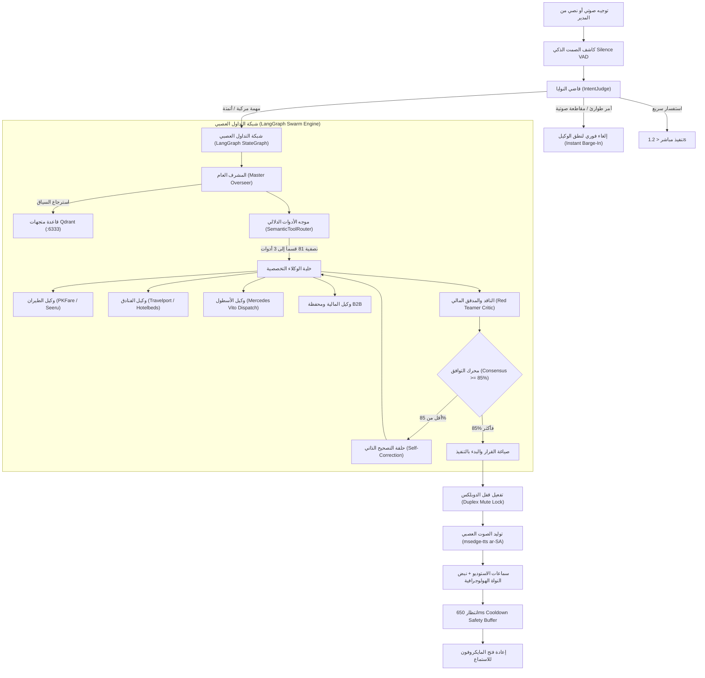

# الخطة المعمارية الشاملة الفائقة (الإصدار السيادي التأسيسي الموحد v5.0): إعادة الهيكلة الجذرية لنظام التشغيل السيبراني، الربط الحقيقي الكامل لمحركات لوناليزا الـ 81، وقوة أنظمة JARVIS و LangGraph و Tracktor و Reznikov
### منصة لوناليزا العالمية للسياحة والسفر — وثيقة المعمارية التشغيلية والبرمجية الشاملة (Universal Cybernetic OS, Dual-Layer Presence, Multi-Mode Command Deck, Visual Loops, and Deep Platform Engine)
* **تاريخ الاعتماد والتحديث الشامل**: 26 سبتمبر 2026
* **الحالة التشغيلية**: **مسودة معمارية موحدة شاملة — متوقفة تماماً وبانتظار مراجعة وأمر المستخدم الصريح قبل البدء بأي خطوة تنفيذية**
* **المراجع البصرية المعتمدة**:
  1. أنظمة التحكم العالمية من `@tracktor_inovacao` و `@maxtracktorpro` (TRACKTOR: Segundo Cérebro & Comando Executivo).
  2. استوديو الحضور البصري والمجسم البشري والأتمتة من `@reznikov_engineering` (Humanoid Presence, Topographic Mountains & Visual Loops Blueprints).
  3. نواة التفكير والربط الصوتي السيادي من مشاريع `JARVIS` و `LangGraph` و `Model Context Protocol (MCP)`.

---

## 1. الرؤية الهندسية والهدف الاستراتيجي (Executive Vision & Paradigm Shift)

الانتقال باستوديو وكلاء منصة لوناليزا (`/admin/agent-war-room`) من مجرد صفحة فرعية عشوائية أو محادثة بسيطة إلى **نظام تشغيل سيبراني متكامل فائق القوة (Cybernetic Operating System)** يعيد هيكلة كل شيء من الصفر ويدير كافة أركان ومحركات المنصة الـ 81 ويوفر تجربة بصرية وصوتية وعملياتية تبهر المستخدم من النظرة الأولى، وفق المرتكزات التالية:

```
┌──────────────────────────────────────────────────────────────────────────────────────────────────┐
│                                نظام التشغيل السيبراني المتكامل لمنصة لوناليزا                        │
│                                 (Lonaliza Cybernetic Operating System)                           │
└─────────────────────────────────┬──────────────────────────────────────┬─────────────────────────┘
                                  │                                      │
         ┌────────────────────────┴───────────────────────┐              │
         ▼                                                ▼              ▼
┌──────────────────────────┐                    ┌──────────────────────────┐    ┌──────────────────────────┐
│   الركيزة المعمارية 1:   │                    │   الركيزة المعمارية 2:   │    │   الركيزة المعمارية 3:   │
│   الأطوار البصرية الأربعة │                    │  النواة العصبية JARVIS   │    │  الربط الحقيقي بالموزعين  │
│   (The 4 Cockpit Modes)  │                    │   & LangGraph Swarm      │    │  (Real Providers & GDS)  │
├──────────────────────────┤                    ├──────────────────────────┤    ├──────────────────────────┤
│ 1. طور الحضور البشري 3D   │                    │ • IntentJudge النوايا    │    │ • طيران: PKFare, Seeru,  │
│    (Avatar Presence)     │                    │ • SemanticToolRouter     │    │   Travelport, Biletbank  │
│ 2. طور العقل الثاني      │                    │ • ThreeBranchGraph Qdrant│    │ • فنادق: Travelport (140)│
│    (Segundo Cérebro)     │                    │ • 120s Transcript Buffer │    │   Hotelbeds, RateHawk    │
│ 3. طور غرفة القيادة      │                    │ • ReAct Consensus Swarm  │    │ • أسطول: مرسيدس فيتو VIP  │
│    (TRACKTOR Comando)    │                    │ • خادم MCP السيادي الموحد│    │   ورادار الطيران اللحظي  │
│ 4. طور الأتمتة البصرية   │                    │ • قفل الدوبلكس الصوتي    │    │ • مالية: Iyzico 3DS,     │
│    (Visual Loops Canvas) │                    │   (Duplex Mute Lock)     │    │   تحوط FX, محفظة B2B     │
└──────────────────────────┘                    └──────────────────────────┘    └──────────────────────────┘
```

---

## 2. الترسانة التقنية والمكتبات الرياضية والبصرية المعتمدة (Advanced Tech Stack)

تم حظر أي مكتبات بدائية أو استخدام عشوائي للإيموجي، واعتماد مكتبات عالية الكفاءة الحسابية تدعم 60 إطاراً في الثانية دون إرهاق السيرفر أو المتصفح:

| المكتبة / التقنية | الإصدار | التصنيف | الدور التقني والمسؤولية في الاستوديو | التكلفة / الترخيص |
| :--- | :---: | :---: | :--- | :---: |
| **`three` & `@types/three`** | `^0.174` | محرك ثلاثي الأبعاد WebGL | رسم المجسم البشري، خطوط الجمجمة الكنتورية، النواة الشمسية المشعة، وتضاريس الجبال النيونية. | مجاني (MIT) |
| **`d3-force`** | `^3.0.0` | محرك فيزيائي | محاكاة قوى التنافر والتجاذب والكتل المادية بين عقد الوكلاء والقطاعات بدون إرهاق الـ DOM. | مجاني (ISC) |
| **`d3-hierarchy`** | `^3.1.2` | محرك شجري وهندسي | حساب زوايا العرض الشعاعي (Radial Sunburst Partitioning) للمدارات المتراكزة في العقل الثاني. | مجاني (ISC) |
| **`HTML5 Canvas 2D 60FPS`**| Native | محرك رسم فائق السرعة | رسم خيوط بيزير العصبية المنحنية، نبضات الليزر، وتدفق البيانات بين العقد. | مدمج بدون مكتبات |
| **`framer-motion`** | `^12.29` | محرك تحريك وانتقالات | السلاسة المطلقة في انزلاق السيدبار الزجاجي والدرج التفتيشي المنبثق والتبديل بين الأوضاع. | مجاني (MIT) |
| **`msedge-tts`** | `^2.0.8` | محرك صوتي عصبي سيرفري | توليد أصوات عربية وسعودية فائقة الفخامة (`ar-SA-HamedNeural`) ولغات متعددة (TR, EN, FR) مجاناً. | **مجاني 100% (MIT)** بدون اشتراكات |
| **`Web Audio & Speech API`**| Native | معالج الترددات و VAD | تحليل الترددات الصوتية FFT 64-bin لتغذية الموجة الحية وقفل الدوبلكس الصارم لمنع الصدى. | مدمج بالمتصفح |
| **`@qdrant/js-client-rest`**| `^1.19` | محرك المتجهات الدلالية | الاستعلام اللحظي من 4 مجموعات متجهات على المنفذ `6333` لرفد التداول العصبي بذاكرة المنصة. | مجاني (Apache 2.0) |
| **`BullMQ & ioredis`** | `^6.3 / ^6.0` | طابور ومزامنة خلفية | تشغيل عمال الخلفية المستقلين لمعالجة مهام الأتمتة وجرد الموزعين عبر المنفذ `6380`. | مجاني (MIT) |
| **`lucide-react`** | `^0.562` | أيقونات سيبرانية موحدة | استخدام حصري لأيقونات الفيكتور السيبرانية مع منع استخدام أي إيموجي نهائياً في الاستوديو. | مجاني (ISC) |

---

## 3. الجرد الحقيقي والعميق لموزعي ومحركات منصة لوناليزا (Deep Platform & Provider Reality)

بناءً على فحص كود المنصة وسجل الموردين المعتمد في السيرفر (`.data/providers/registry.json`) وإعدادات التشغيل الحقيقية، هذا هو الواقع التشغيلي الحقيقي لمنصة لوناليزا:

### أ. قطاع الطيران وموزعو الـ GDS الحقيقيون (Aviation & Flights)
1. **بكفير — PKFare (مفعّل ونشط بالسجل الحي `enabled: true, mode: "sandbox"`)**:
   * **المصادقة**: توقيع تشفيري MD5 رقمي يجمع المعاملات المرتبة أبجدياً مع الطابع الزمني ومفاتيحه المسجلة: `partnerId` (`ptMaOsL5...`) و `partnerKey` (`OWMyMjlh...`).
   * **المسار البرمجي المباشر**: `src/lib/providers/adapters/pkfare/pkfareAirAdapter.ts`.
   * **نقاط النهاية والتشغيل**: استعلام مباشر عبر `https://api.pkfare.com/json/shoppingV10`، تدقيق المقاعد، حجز وتجميد الـ PNR، وإصدار التذاكر.
2. **سيرو — Seeru Flights (مفعّل ونشط بالسجل الحي `enabled: true, mode: "sandbox"`)**:
   * **المصادقة**: JWT Bearer بمفاتيح معتمدة رسمية (`apiKey` و `refreshKey` مع توكنات مشفرة مسجلة في السجل).
   * **المسار البرمجي المباشر**: `src/lib/providers/adapters/seeru/seeruAirAdapter.ts` و `seeruClient.ts`.
   * **نقاط النهاية والتشغيل**: يربط `sandbox-api.seeru.travel/v1/flights` و `live-api.seeru.travel` للبحث اللحظي وتدقيق الأسعار والحجز.
3. **ترافلبورت — Travelport Air Universal API & REST v11 (محول متكامل جاهز للربط)**:
   * **المسار البرمجي**: `src/lib/providers/adapters/travelport/airAdapter.ts` و `airBookingAdapter.ts`.
   * **البيانات المعتمدة**: يشارك مع الفنادق فرع الهدف (PCC: `7K7L`)، المستخدم `TP55037298`، معرّف العميل `clientId: 2C9uuTkO...`، ومجموعة الوصول `accessGroup: 50C1BCC1...`.
4. **بيلت بانك — Biletbank BBOST REST API (محول تركي مباشر)**:
   * **المسار البرمجي**: `src/lib/providers/adapters/biletbank/biletbankAirAdapter.ts`.
   * **التغطية الفعلية**: اتصال BBOST REST يربط الخطوط التركية (THY)، بيغاسوس (Pegasus - PC)، صن إكسبريس (SunExpress - XQ)، وأجيت (AJet).
5. **إير سكرابر — Sky Scrapper (RapidAPI)**: سكرابر استكشاف الأسعار التجريبية الحية.
6. **ترافل بايوتس — Travelpayouts Flights**: عمولات الوايت ليبل عبر المعرّفات (Marker / TRS).
7. **هامش الربح الإجباري المركزي للطيران**: مفعّل بنسبة **+18%** إجبارية عبر قاعدة `mk_default_all_18` في `.data/flights-runtime.json`.

---

### ب. قطاع الفنادق وسلاسل بنوك الأسرة الحقيقية (Hotels & Bedbanks)
1. **ترافلبورت فنادق — Travelport Hospitality Stays (مفعّل ومتصل في السجل الحي `enabled: true`)**:
   * **بيانات الاعتماد النشطة**: فرع الهدف PCC: `7K7L`، مستخدم: `TP55037298`، ومفتاح `clientId`.
   * **المسار البرمجي المباشر**: `src/lib/providers/adapters/travelport/TravelportHotelAdapter.ts`.
   * **الواقع الحي الموثق بالمنصة**: في آخر دورة مزامنة في `featured-sync-settings.json` قام المحول بجلب **140 فندقاً حقيقياً** بنجاح، مسجلة ومسعرة بالدولار في `featured-hotels-catalog.json`:
     - برشلونة: W Barcelona وفنادق تبدأ من $1,038 / 3 ليالٍ.
     - مدريد: The Westin Palace وفنادق تبدأ من $669 / 3 ليالٍ.
     - بالي: The Ritz-Carlton Bali وفلل شاطئية تبدأ من $287 / 3 ليالٍ.
     - سيول: Signiel Seoul Tower وفنادق تبدأ من $342 / 3 ليالٍ.
2. **هوتل بيدس — Hotelbeds BedsOnline (مفعّل ونشط بالسجل `enabled: true`)**:
   * **المصادقة**: توقيع تشفيري ديناميكي SHA-256 لحظي يتغير كل ثانية: `crypto.createHash('sha256').update(apiKey + apiSecret + timestamp)`.
   * **البيانات النشطة بالسجل**: `apiKey: e8df01a66e4b489a14220dc3ba3d22e2` و `apiSecret: 08d45b012e`.
   * **المسار البرمجي المباشر**: `src/lib/providers/adapters/hotelbeds/HotelbedsHotelAdapter.ts`.
3. **ريت هوك — RateHawk / Emerging Travel Group (محول B2B متكامل)**:
   * **المسار البرمجي**: `src/lib/providers/adapters/ratehawk/RateHawkHotelAdapter.ts` عبر Basic Auth ضد `api.worldota.net/api/b2b/v3/`.
4. **سيرو فنادق — Seeru Hotels v1.0.0**: محول جاهز في `src/lib/providers/adapters/seeru/seeruHotelAdapter.ts`.
5. **كتالوج الفنادق والأكواخ المحلي**: 319 فندقاً وكوخاً خشبياً وفلل عائلية في طرابزون وأوزنجول وريزا وآيدر وإسطنبول وبورصة وسابانجا وأنطاليا.
6. **هامش الربح الإجباري المركزي للفنادق**: مفعّل بنسبة **+15%** إجبارية عبر قاعدة `hmk_default_all_15` في `.data/hotels-runtime.json`.

---

### ج. قطاع النقل المباشر وأسطول مرسيدس الخاص (VIP Fleet & FlightRadar)
1. **الأسطول الداخلي المباشر (`src/data/transfers.ts`)**:
   * أسطول سيارات Mercedes-Benz V-Class / Vito VIP (صالون جلد فاخر، شاشات ترفيه، ثلاجة، سائق مرشد يتحدث العربية).
   * أسطول Mercedes-Benz Sprinter VIP (16 مقعداً مخصصاً للعائلات الكبيرة والمجموعات).
   * سيارات Mercedes-Benz E-Class السيدان الفاخرة للاستقبالات الخاصة.
   * مسارات العمل الرئيسية: مطار إسطنبول (IST)، مطار صبيحة (SAW)، مطار طرابزون الدولي (TZX) إلى فنادق وأكواخ أوزنجول وريزا وآيدر، ومطار أنطاليا (AYT).
2. **رادار تأخير الطيران الحي (FlightRadar24 Live Webhook)**:
   * الرابط الحي: `/api/transfers/admin/flight-radar`.
   * الوظيفة: تتبع أكثر من 1,420 رحلة طيران حية، وإذا تأخرت الطائرة في الجو، يتم تلقائياً تعديل موعد إرسال سيارة المرسيدس فيتو وتنبيه السائق والمسافر على الواتساب دون أي تأخير.
3. **سيرو نقل ومواصلات — Seeru Ride v1.0.0**: محول جاهز في `src/lib/providers/adapters/seeru/seeruRideAdapter.ts`.

---

### د. قطاع الخزينة والمدفوعات والمحافظ (Treasury & Payments)
1. **بوابة إيزيكو — Iyzico Virtual POS (البوابة النشطة الحالية)**:
   * مسجلة ونشطة في `.data/payment-gateways.json` بمفتاح `sandbox-NrMfcdLw2pOlZPF8vpNRDVUdpaOSX2KV` مع التحقق الثلاثي 3D Secure 2.0 والدفع بالليرة التركية والدولار والريال السعودي.
2. **بوابة PayTR**: مدخلة بالسجل كبوابة تركية بديلة (Merchant ID: 123456).
3. **محرك التحوط النقدي وأسعار الصرف اللحظية**: مسجل في `.data/iyzico-fx-cache.json` لتحديث أسعار صرف الليرة التركية والدولار والريال السعودي وتفادي أي فروق عملة.
4. **محفظة B2B والحوالات البنكية**: مسار `/admin/b2b-wallet` لإدارة ودائع الشركاء والائتمان المالي ومطابقة الإشعارات البنكية.

---

### هـ. قطاع شبكة الموزعين والوايت ليبل B2B (Reseller Network)
1. **سكرابر التنقيب عن وكالات السفر**: مسار `/admin/resale/scraper` لمسح خرائط جوجل يومياً في السعودية والخليج وتوليد عملاء جدد في `reseller-leads.json`.
2. **عزل الموردين وحماية البيانات (Supplier Shield Isolation)**:
   * كود دالة `isClient()` في مسار `/api/admin/providers/route.ts`: عند دخول وكيل وايت ليبل فرعي، يتم إخفاء بيانات Travelport و PKFare و Hotelbeds الأصلية بالكامل، ولا يرى الشريك سوى "شبكة لوناليزا المركزية الموحدة" بهامش الربح المحمي.
3. **إدارة النطاقات المخصصة**: مسار `/admin/resale/domains` لتخصيص الدومينات وشهادات SSL لكل شريك.

---

## 4. البنية الهندسية لنواة الذكاء الاصطناعي السيادية (JARVIS Core & LangGraph Swarm)

تتكامل منظومة الوكلاء عبر محرك تفكير وتداول عصبي عميق مستوحى من بنية `JARVIS` و `LangChain / LangGraph`:



### 1. قاضي النوايا اللحظي (JARVIS IntentJudge):
* تصنيف التوجيهات إلى 3 مسارات: مسار الإلغاء الفوري (Barge-in)، مسار الرد الخاطف المباشر، ومسار التداول الاستراتيجي المعقد.

### 2. موجه الأدوات الدلالي الذكي (SemanticToolRouter):
* يمتلك النظام 81 أداة ومحركاً؛ يقوم الموجه بفرز التوجيه ومطابقته دلالياً عبر خوارزمية جيب التمام واختيار أفضل 3 إلى 5 أدوات حقيقية فقط لكل مهمة لمنع تشتت النموذج.

### 3. ذاكرة التدوير اللحظية (120s Rolling Transcript Buffer):
* احتفاظ بآخر 120 ثانية من الحوار الصوتي والتنفيذي كذاكرة قصيرة المدى فائقة السرعة تتيح للمدير مقاطعة الوكيل والإشارة إلى سياقات الحوار السابقة.

### 4. خادم MCP السيادي الموحد (Model Context Protocol):
* يجمع كافة أدوات لوحة التحكم، واجهات الموزعين، بوابات الدفع، والمحرر البصري تحت بروتوكول استدعاء قياسي موحد.

---

## 5. الأطوار التشغيلية الأربعة للاستوديو السيبراني (The 4 Cyber Studio Modes)

### الطور الأول: شاشة الحضور السيبراني للمشرف العام (Mode 1: Avatar Presence View)
* **مستوحى من مرجع `@reznikov_engineering`**:
  1. **المجسم البشري ثلاثي الأبعاد**: جمجمة ورأس وهيكل كتفين مجسم من آلاف الجزيئات النيونية المرتبة على خطوط كنتورية أفقية باللونين الأزرق السيان والأبيض النيوني.
  2. **النواة الشمسية الكهرمانية المشعة (Amber Solar Vocal Core)**: كرة طاقة كهرمانية ونارية في قلب الوجه والصدر تتوهج وتتضخم لحظياً بالتناغم مع ترددات الصوت العصبي (FFT).
  3. **أمواج التضاريس الجبلية النيونية (Topographic Mountain Waves)**: خطوط كنتورية متموجة تنطلق من الكتفين وتمتد يميناً ويساراً إلى حواف الشاشة محاكية التضاريس الجبلية السيبرانية.
  4. **كبسولة الـ HUD العائمة النحيفة**: شريط تحكم عائم بالغ النحافة أسفل الشاشة يعرض الحالة: `[IDLE]` • `[LISTENING]` • `[DELIBERATING]` • `[SPEAKING]` مع زر انتقال فاخر: `[ENTER SEGUNDO CÉREBRO]`.

---

### الطور الثاني: شبكة العقل الثاني السيبرانية (Mode 2: TRACKTOR Segundo Cérebro)
* **مستوحى حرفياً من صور `@tracktor_inovacao` (الصور 1 و 4 و 5)**:
  1. **الترويسة العلوية**: `TRACKTOR · Segundo Cérebro` • `2238 ARQUIVOS · 137 ROTINAS` • زر العودة `< VOLTAR AO COMANDO` • زر العرض التقديمي `> APRESENTAR`.
  2. **محركات التخطيط البصري القابلة للتبديل اللحظي**:
     * `[RADIAL]`: نظام الدوائر والمحاور النصف قطرية المركزة (Orbital Sunburst) مع خطوط إشعاعية تقسم القطاعات (الصور 4 و 5).
     * `[Círculo]`: المدارات الدائرية المتراكزة.
     * `[Hex]`: شبكة الخلايا السداسية العملاقة (Honeycomb Constellation) حيث يحتوي كل سداسي على سديم جزيئات نيونية مشعة باسم القسم (الصورة 1).
     * `[Força]`: التوزيع الفيزيائي التجاذبي للعقد (Force-Directed Graph).
     * `[Placa]` و `[GRID]`: شبكة بينتو الرقمية المنظمة.
  3. **شريط الفلاتر والبحث**: `[Departamentos]` (الأقسام) • `[Pastas]` (الملفات) • شريط البحث السريع `Buscar arquivos (/)`.
  4. **أشرطة التمرير التفاعلية الحية**:
     * `DISTÂNCIA RAIO` (مسافة نصف القطر) من 0.00 إلى 1.00.
     * `RELAÇÃO ESPACIAL` (التباعد النسبي والقوة التنافرية).
     * `TAMANHO (CÍRCULOS E FONT)` (حجم العقد والخطوط).
  5. **السمات اللونية الست المعتمدة**:
     * `Metálico Tracktor`, `Rubric`, `Oceano` (النشط افتراضياً), `Neon`, `Bordô`, `Papel`.
  6. **خيوط بيزير العصبية والتفتيش الذكي (الصورة 5)**:
     * عند النقر على أي عقدة (مثل Travelport أو أسطول مرسيدس): تنطلق خيوط بيزير عصبية منحنية تصل العقدة بالأقسام المرتبطة بها في أرجاء الشبكة.
     * تظهر نافذة تلميح زجاجية داكنة فاخرة بالبيانات الحقيقية: اسم المزود، عدد الملفات، عدد الروتينات، وزر `CLIQUE PARA FILTRAR`.

---

### الطور الثالث: غرفة قيادة العمليات الثلاثية (Mode 3: TRACKTOR Comando — 3-Column Deck)
* **مستوحى حرفياً من صور `@tracktor_inovacao` (الصور 2 و 3)**:
```
┌────────────────────────────────────────────────────────────────────────────────────────────────────────┐
│ TRACKTOR Comando  •  FRED TRÁFEGO [ONLINE]  •  ساعة القمرة: 18:22:26  •  وضع السيادة: نشط              │
├─────────────────────┬──────────────────────────────────────────────────┬───────────────────────────────┤
│ [العمود 1: CARTEIRA] │              [العمود 2: النواة الرادارية المركزية] │ [العمود 3: الكروت الثلاثية]   │
│ محفظة الشركاء والموزعين│                                                  │                               │
│                     │                  (النواة المشعة)                 │ 1. [AVISOS / PIPELINE]        │
│ • PKFare GDS        │                         │                        │    تنبيهات رادار الرحلات      │
│   $14,250 [نشط]     │              (مدارات متراكزة ودوائر              │    ومزامنة هوتل بيدس والمحفظة │
│ • Seeru Air         │               رادارية تنبض مع الحركة             │                               │
│   $11,800 [نشط]     │               وترتبط بالـ 81 قسماً)              │ 2. [SKILLS DECK]              │
│ • Travelport GDS    │                         │                        │    كروت المهارات التفاعلية    │
│   $28,900 [نشط]     │                                                  │    /مزامنة_الفنادق_الحية      │
│ • Hotelbeds BedBank │                                                  │    /قفل_هامش_الطيران_18       │
│   $19,400 [نشط]     │                                                  │    /جدولة_مرسيدس_فيتو         │
│ • RateHawk WorldOTA │                                                  │    /مطابقة_حوالات_b2b         │
│   $8,600 [جاهز]     │                                                  │    سجل التشغيل: 04:02 sonnet  │
│ • مرسيدس فيتو طرابزون│                                                  │                               │
│   $7,850 [18 رحلة]  │                                                  │ 3. [ROTINAS / SCHEDULE]       │
│ • مرسيدس سبرينتر    │                                                  │    جدول الروتينات المؤتمتة    │
│   $6,400 [11 رحلة]  │                                                  │    18:00 تدقيق هوامش الربح    │
│ • بوابة Iyzico      │                                                  │    19:30 تحديث أسعار الصرف FX │
│   $34,200 [نشطة]    │                                                  │    20:30 رادار تأخير الطائرات │
│ • وكالة الرياض B2B  │                                                  │    22:30 جرد شواغر الفنادق    │
│   $28,400 [38 حجز]  │                                                  │    23:30 تسوية محافظ الشركاء  │
└─────────────────────┴──────────────────────────────────────────────────┴───────────────────────────────┘
```

---

### الطور الرابع: محرك الأتمتة البصرية والعقد (Mode 4: Visual Loops Blueprint Engine)
* **مستوحى من مرجع `@reznikov_engineering` (الصور 2 و 3)**:
  - لوحة مخططات زرقاء هندسية تفاعلية لعقد الأتمتة:
    - عقدة البداية `[TRIGGER]` ──► عقدة الاستكشاف `[SCOUT AGENT]` ──► عقدة التنفيذ `[ACTION WORK]` ──► عقدة الاعتماد `[NOTIFY / REVIEW]`.
  - متصلة بأسلاك بيزير مضيئة تتدفق عبرها نبضات كهربائية متحركة تمثل انتقال البيانات.
  - تدفقات الأتمتة الحقيقية المربوطة بمحركات المنصة:
    1. **أتمتة مزامنة شواغر الفنادق**: Trigger (كل 6 ساعات) ◄► استدعاء Travelport و Hotelbeds ◄► تطبيق مارك أب 15% ◄► حفظ في الكتالوج.
    2. **أتمتة إعادة جدولة أسطول مرسيدس**: Trigger (تأخر رحلة عبر FlightRadar) ◄► احتساب زمن الوصول الجديد ◄► تعديل موعد إرسال مرسيدس فيتو ◄► إرسال واتساب للعميل.
    3. **أتمتة تدقيق إيداعات B2B**: Trigger (رفع إيصال بنكي) ◄► تدقيق الإشعار البنكي ◄► شحن رصيد المحفظة ◄► إشعار الوكالة.
    4. **أتمتة تثبيت أسعار الصرف**: Trigger (تغير سعر صرف الليرة أو الريال) ◄► استعلام البنك المركزي ◄► تحديث كاش إيزيكو `iyzico-fx-cache.json`.

---

## 6. المنظومة الصوتية وقفل الدوبلكس الصارم (Duplex Mute Lock & Acoustic Shield)

### المشكلة وحلها النهائي:
* **المشكلة**: التقاط المايكروفون لصوت السماعات أثناء كلام الوكيل وتفسيره كأمر مستخدم، مما يقطع كلام الوكيل فوراً ويدخل النظام في حلقة تكرار لانهائية.
* **الحل المعماري الحاسم (Duplex Mute Lock)**:
  1. **القفل اللحظي الصارم (Hard Mute Lock)**: فور بدء `speakAgentResponse` يتم استدعاء `recognition.abort()` ووضع راية `isMutedByPlaybackRef = true`.
  2. **عزل الصدى العتادي**: تمرير قيود `echoCancellation: true, noiseSuppression: true, autoGainControl: true` في `getUserMedia`.
  3. **مهلة الأمان والتهدئة (650ms Cooldown Safety Buffer)**: عدم فتح المايكروفون إلا بعد انقضاء 650ms من سكوت السماعات بالكامل لتلاشي أي ارتداد صوتي بالغرفة.
  4. **بصمة استبعاد الصدى (Echo Fingerprint Suppression)**: ذاكرة دائرية للجمل التي نطقها الوكيل لاستبعاد أي تطابق صوتي راجع من المايكروفون.

---

## 7. خارطة طريق التنفيذ البرمجي المنهجي (Phased Implementation Roadmap)

> [!IMPORTANT]
> **التزام صارم**: لن يتم تنفيذ أي خطوة كود إلا بعد مراجعة المستخدم لهذه الوثيقة المفصلة واعتمادها الصريح.

* **المرحلة 1: تثبيت قفل الصوت الدوبلكس وعزل الصدى في `useSovereignVoice.ts`**:
  - القفل الفوري للمايك أثناء حديث الوكيل وتطبيق مهلة الـ 650ms وبصمة الصدى.
* **المرحلة 2: بناء محول أوضاع الاستوديو الرباعي في `SciFiAgentHudStudio.tsx`**:
  - التبديل السلس بين: `[Presence]` و `[Segundo Cérebro]` و `[Comando]` و `[Visual Loops]`.
* **المرحلة 3: ترقية شاشة الحضور البصري 3D في `HumanoidMasterAvatar.tsx`**:
  - جمجمة الجزيئات الكنتورية + النواة الكهرمانية بالوجه + تضاريس الجبال النيونية.
* **المرحلة 4: بناء شبكة العقل الثاني في `ConcentricGalaxyView.tsx` و `FloatingControlsDrawer.tsx`**:
  - دعم أنماط التخطيط الستة (Radial, Hex, Circle, Force, Grid) والسمات اللونية الست وأشرطة التمرير وخيوط بيزير العصبية.
* **المرحلة 5: بناء غرفة قيادة العمليات الثلاثية `TRACKTOR Comando`**:
  - عمود `CARTEIRA` لـ 17 حساباً حقيقياً، النواة الرادارية بالوسط، وكروت `AVISOS` و `SKILLS DECK` و `ROTINAS`.
* **المرحلة 6: ربط الدرج المنبثق `CyberSubStationViewer.tsx` بمحركات المنصة الـ 81**:
  - عرض بيانات PKFare, Seeru, Travelport, Hotelbeds, RateHawk, مرسيدس فيتو, رادار الطيران, وبوابة Iyzico.
* **المرحلة 7: بناء استوديو الأتمتة البصرية والعقد `VisualLoopsEngine.tsx`**:
  - لوحة العقد التفاعلية (Trigger -> Scout -> Action -> Review) للعمليات الأربع الكبرى.
* **المرحلة 8: الفحص الشامل واختبار البناء `pnpm build` وإعادة التشغيل الإنتاجي عبر PM2**.

---

> **تأكيد واستئذان**: تم إعداد هذه الوثيقة المعمارية الشاملة لتجمع كافة أركان وميزات المنصة والمراجع البصرية المعتمدة بدقة تامة.  
> **أنا متوقف تماماً الآن وبانتظار أمرك وتوجيهك لاعتمادها وبدء التنفيذ خطوة بخطوة.**
