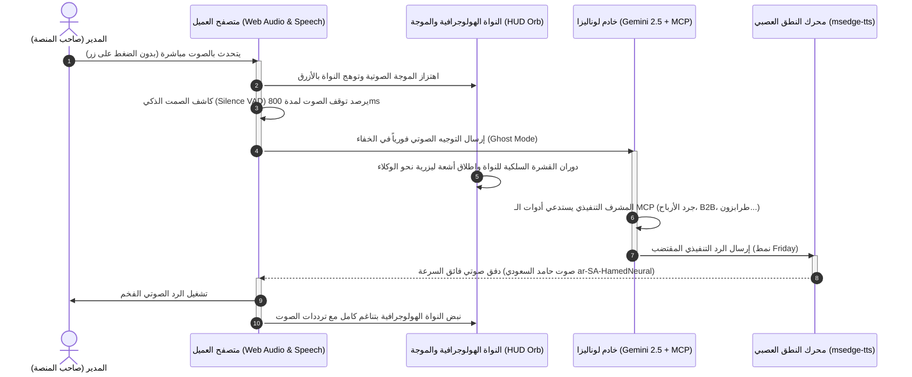
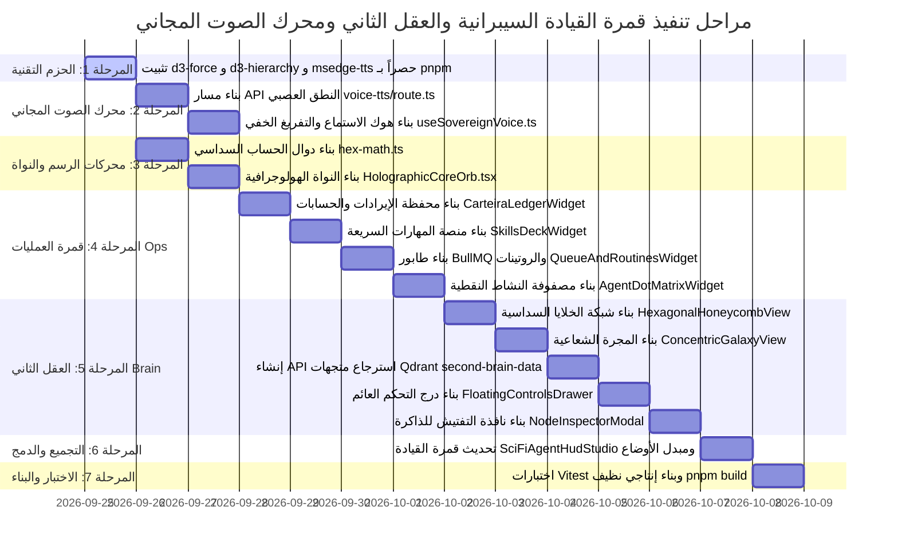

# الخطة الهندسية المحكمة والمعمارية التنفيذية الشاملة: قمرة القيادة السيبرانية، العقل الثاني، ونظام الصوت الحي المجاني
### منصة لوناليزا للسياحة والسفر — وثيقة التصميم الفائق والتنفيذ المتقدم (Dual-Mode Cybernetic Cockpit, Sovereign Second Brain & Zero-Cost Live Voice Engine)

* **تاريخ الاعتماد والتحديث الشامل**: 25 سبتمبر 2026
* **الجهة المطورة**: فريق هندسة الذكاء الاصطناعي وتصميم النظم المتقدمة (AI Core & Advanced UX Engineering)
* **المعايير التقنية الصارمة**: Next.js 16 App Router, React 19, HTML5 Canvas 60FPS, Three.js WebGL, d3-force, d3-hierarchy, Framer Motion, msedge-tts (Free Neural Arabic TTS), Web Speech & Audio API, Qdrant Vector Engine (Docker :6333), BullMQ & Redis (:6380), Server-Sent Events (SSE), وبناء حصري بـ `pnpm`.

---

## 1. الرؤية الهندسية والهدف الاستراتيجي (Executive Vision & Architectural Paradigm)

الهدف هو نقل استوديو وكلاء منصة "لوناليزا" من واجهة دردشة تقليدية إلى **نظام تشغيل وقمرة قيادة سيبرانية تنفيذية سيادية (Sovereign Cybernetic Operating Cockpit)** مستوحاة من أحدث طفرات استوديوهات الذكاء الاصطناعي العالمية (**TRACKTOR: Segundo Cérebro & Comando Executivo**) وتجارب النواة الهولوجرافية والصوت المباشر (**Tony Stark F.R.I.D.A.Y. & Ultron Orb UI**)، ومصممة خصيصاً لعمليات السياحة والسفر الفاخر وحجوزات الطيران والفنادق وأساطيل الـ VIP وشبكة موزعي B2B.

النظام يعمل وفق **معمارية ثلاثية الركائز (Tri-Pillar Cybernetic Architecture)**:

```
                               ┌────────────────────────────────────────────────────────┐
                               │     استوديو القيادة السيبراني لمنصة لوناليزا           │
                               │        (Lonaliza Cybernetic Cockpit)                   │
                               └─────────────────────────┬──────────────────────────────┘
                                                         │
                ┌────────────────────────────────────────┼────────────────────────────────────────┐
                ▼                                        ▼                                        ▼
  ┌───────────────────────────┐            ┌───────────────────────────┐            ┌───────────────────────────┐
  │      الركيزة الأولى:      │            │      الركيزة الثانية:     │            │      الركيزة الثالثة:     │
  │   قمرة العمليات والمالية   │            │  عقل المنظومة والذاكرة    │            │  محرك الصوت الحي المجاني  │
  │   (Ops Command Center)    │            │  (Sovereign Second Brain) │            │ (Zero-Cost Live Voice VAD)│
  ├───────────────────────────┤            ├───────────────────────────┤            ├───────────────────────────┤
  │ • محفظة الإيرادات Carteira │            │ • المجرة المدارية Sunburst│            │ • استماع مستمر بدون أزرار │
  │ • سحابة الجسيمات المركزية │            │ • خلايا بينتو السداسية    │            │ • تفريغ خفي في الخلفية    │
  │ • طابور مهام BullMQ اللحظي│            │ • محاكاة الفيزياء d3-force│            │ • كاشف الصمت الذكي VAD    │
  │ • منصة المهارات بنقرة واحدة│            │ • درج التحكم بـ 6 سمات    │            │ • صوت عربي عصبي فخم مجاني │
  │ • جدول الروتينات المجدولة │            │ • بطاقة تفتيش متجهات Qdrant│           │ • عبر Microsoft Edge TTS  │
  │ • مصفوفة النشاط النقطية   │            │ • فحص الذاكرة المؤسسية    │            │ • صفر تكلفة وصفر اشتراكات │
  └───────────────────────────┘            └───────────────────────────┘            └───────────────────────────┘
```

---

## 2. الترسانة التقنية والمكتبات المتقدمة المعتمدة (Advanced Tech Stack & Technical Roles)

تم اختيار المكتبات والتقنيات بناءً على معايير صارمة: **الأداء الحسابي العالي (60 FPS)**، **المجانية التامة بدون اشتراكات أو أطراف ثالثة مدفوعة**، **عدم إرهاق السيرفر أو الـ DOM**، و**التوافق الكامل مع React 19 و Next.js Turbopack**:

| المكتبة / التقنية | الإصدار | التصنيف | الدور التقني والمسؤولية في الاستوديو | التكلفة / الترخيص |
| :--- | :---: | :---: | :--- | :---: |
| **`d3-force`** | `^3.0.0` | محرك فيزيائي | حساب قوى التنافر والتجاذب والجاذبية المركزية بين عقد الوكلاء والقطاعات والمتجهات رياضياً بدون DOM. | مجاني مفتوح (ISC) |
| **`d3-hierarchy`** | `^3.1.2` | محرك شجري | حساب زوايا العرض الشعاعي (Radial Sunburst Angle Partitioning) للتوزيع المداري الفلكي. | مجاني مفتوح (ISC) |
| **`HTML5 Canvas 2D & WebGL`**| Native | محرك رسم | رسم آلاف النجوم والجسيمات المتجهة وخيوط الليزر والنواة الهولوجرافية بدقة 60 إطاراً في الثانية. | مجاني مدمج |
| **`framer-motion`** | `^12.29` | محرك تحريك | إدارة الانتقالات السلسة بين الأوضاع، انزلاق درج التحكم العائم، وانفثاق النوافذ التفتيشية. | مجاني (MIT) |
| **`msedge-tts`** | `^2.0.8` | محرك صوتي عصبي | توليد صوت عربي طبيعي فائق الفخامة (صوت "حامد" السعودي `ar-SA-HamedNeural` أو "فاطمة" `ar-AE-FatimaNeural`) عبر السيرفر. | **مجاني 100% (MIT)** بدون API Key أو بطاقة |
| **`Web Speech & Audio API`**| Native | استماع ومحلل | تفريغ صوت المدير لحظياً في الخلفية (Ghost Mode) + تحليل الترددات الصوتية لرسم الموجة الحية. | مجاني مدمج بالمتصفح |
| **`lucide-react`** | `^0.562` | أيقونات سيبرانية | توفير الأيقونات التقنية للوكلاء الـ 12، بوابات الدفع، المهارات السريعة، وأزرار التحكم. | مجاني (ISC) |
| **`@qdrant/js-client-rest`**| `^1.19` | محرك متجهات | الاستعلام السريع من المجموعات الـ 4 في Qdrant عبر `127.0.0.1:6333` لعرض الذاكرة المؤسسية. | مجاني مفتوح (Apache 2.0) |
| **`BullMQ & ioredis`** | `^6.3 / ^6.0` | طابور ومزامنة | تغذية طابور التنفيذ المباشر ومراقبة معالجة الوكلاء في الخلفية عبر المنفذ `6380`. | مجاني مفتوح (MIT) |
| **`Server-Sent Events (SSE)`**| Native | بث لحظي | بث الأحداث والنبضات العصبية من الخادم إلى الواجهة بتأخير 0 ثانية عبر `/agent-stream`. | مجاني مدمج |

---

## 3. المعمارية الهندسية للصوت الحي صفر التكلفة (Zero-Cost Sovereign Live Voice Architecture)

لتحقيق تجربة صوتية حية تضاهي أحدث غرف قيادة Tony Stark وفرايداي، دون إنفاق فلس واحد ودون تحميل السيرفر، تم تصميم مسار المعالجة الصوتي كالتالي:



### 3.1. ميزات هندسة الصوت السيادية:
1. **الاستماع الدائم والتفريغ الخفي (Ghost Mode Continuous VAD)**:
   * لا تظهر أي شاشات كتابة أو صناديق نصوص مشتتة.
   * الميكروفون يستمع في الخلفية، ومحلل الترددات الصوتية (`Web Audio API AnalyserNode`) يحدد بداية الكلام وانتهائه.
   * بمجرد حدوث صمت لمدة 800 إلى 1000 ميلي ثانية، يُعتبر الأمر مكتملاً ويُرسل فورياً للمشرف التنفيذي.
2. **صوت عربي بشري فخم بنسبة 100% مجاناً (`msedge-tts`)**:
   * استخدام مكتبة `msedge-tts` لطلب الصوت العصبي عبر WebSocket من خوادم مايكروسوفت إيدج العامة.
   * الصوت المعتمد الأساسي: **`ar-SA-HamedNeural`** (صوت سعودي تنفيذي رصين وقوي).
   * الصوت المعتمد البديل: **`ar-SA-ZariyahNeural`** أو **`ar-AE-FatimaNeural`** (صوت نسائي وقور كشخصية فرايداي).
   * سرعة توليد استثنائية (~180ms) واستهلاك صفري لموارد الخادم.
3. **الخيار الاحتياطي الفوري (Client-Side Fallback)**:
   * في حال عدم توفر الاتصال الخارجي، يتحول النظام تلقائياً إلى `window.speechSynthesis` داخل المتصفح لنطق الرد العربي محلياً دون أي تأخير.

---

## 4. المعمارية الهندسية للواجهات والفيزياء (Visual & Mathematical Models)

### 4.1. النواة الهولوجرافية الثلاثية الأبعاد (Holographic Core Orb — مستوحاة من Ultron):
* تتكون النواة المركزية في وسط الاستوديو من:
  * **القشرة السلكية متعددة الطبقات (Concentric Wireframe Shells)**: تدور حول محورها بسرعات متغيرة وفق نشاط النظام.
  * **سحابة الغبار الجسيمي (Orbital Particle Dust)**: مئات الجزيئات النيونية التي تسبح حول النواة.
  * **تأثير التوهج النيوني السينمائي (UnrealBloomPass)**: إشعاع ضوئي ناعم يبرز فخامة القمرة.
  * **التفاعل الصوتي**: يتغير مقياس النواة وتتوهج حلقاتها الداخلية بتناغم مباشر مع مصفوفة الترددات الصوتية (`ByteFrequencyData`).

### 4.2. النموذج الرياضي للخلايا السداسية (Hexagonal Bento Honeycomb Mesh):
يتم حساب رؤوس الخلايا السداسية الست لقطاعات المنصة المحيطة بالنواة بالمعادلة:
$$x_k = x_c + R \cdot \cos\left(\frac{\pi}{3} k + \frac{\pi}{6}\right), \quad y_k = y_c + R \cdot \sin\left(\frac{\pi}{3} k + \frac{\pi}{6}\right) \quad (k = 0, \dots, 5)$$

* **القطاعات الستة الموزعة على السداسيات**:
  1. **خلية طرابزون والشمال التركي**: لون زمردي متوهج `#10b981` (باقات VIP، سيارات فيتو، أكواخ أوزنجول).
  2. **خلية جولات إسطنبول الفاخرة**: لون كهرماني ذهبي `#f59e0b` (يخوت البوسفور، فنادق شيراغان).
  3. **خلية الطيران والفنادق العالمية**: لون أزرق سماوي `#38bdf8` (بوابات التوزيع GDS والربط المباشر).
  4. **خلية شبكة الموزعين وشركات B2B**: لون بنفسجي ملوكي `#8b5cf6` (عقود الجملة وهوامش الوكالات).
  5. **خلية المحرر البصري والهوية**: لون وردي نيون متوهج `#ec4899` (أقسام الهيرو، البنرات، تجربة المستخدم).
  6. **خلية الحوكمة والأمان والدفع**: لون قرمزي ناري `#ef4444` (بوابات Iyzico و Stripe ومكافحة الاحتيال).

* **داخل كل خلية سداسية**: تسبح عشرات النجوم المعرفية المسترجعة من **Qdrant** بحركة انسيابية محصورة داخل حدود المضلع (Polygon Boundary Clipping).

### 4.3. النموذج الرياضي للمجرة الشعاعية المدارية (Concentric Sunburst Galaxy):
* توزيع فلكي مداري من 3 مستويات:
  * **المدار الداخلي ($r_1 = 130\text{px}$)**: النواة الهولوجرافية وعقد الوكلاء الـ 12.
  * **المدار الأوسط ($r_2 = 250\text{px}$)**: القطاعات التشغيلية وأدوات الـ MCP السيادية.
  * **المدار الخارجي ($r_3 = 380\text{px} \dots 460\text{px}$)**: آلاف المتجهات المعرفية الحية المسترجعة دلالياً، تدور ببطء في مسارات فلكية ناعمة.

### 4.4. محرك السمات البصرية الستة (The 6 Signature Theme Palettes):
1. **`Oceano Lonaliza` (الافتراضية)**: كحلي أوقيانوسي عميق `#020813` وسايان نيون `#00e5ff`.
2. **`Emerald Royal`**: أسود أوبسيديان `#02110a` مع زمردي مشرق `#10b981`.
3. **`Cyber Neon`**: سواد أرجواني `#0c0214` مع فوشيا وبنفسجي نيون `#ec4899`.
4. **`Titanium Metallic`**: تيتانيوم كربوني `#0b0d10` مع فضي معدني `#94a3b8`.
5. **`Bordô Luxury`**: مخملي عنبي فاخر `#140306` مع ياقوتي أحمر `#f43f5e`.
6. **`Paper Light HUD`**: رمادي فاتح تقني ناصع `#f8fafc` مع كحلي رسمي `#0f172a`.

---

## 5. البنية الهيكلية للمكونات ومسارات الملفات (Component Architecture & File Map)

```
admin-panel/src/
├── app/api/admin/automation/
│   ├── voice-tts/route.ts                # [جديد] مسار توليد النطق العصبي العربي المجاني عبر msedge-tts
│   ├── second-brain-data/route.ts        # [جديد] استعلام نقاط الذاكرة من Qdrant وإرجاعها للجراف
│   ├── agent-stream/route.ts             # [موجود] بث أحداث SSE لحظياً
│   └── swarm-deliberate/route.ts         # [موجود] إطلاق التداول التلقائي أو المجدول عبر BullMQ
└── components/admin/automation/hud/
    ├── SciFiAgentHudStudio.tsx            # المكون الرئيسي وقمرة القيادة الموحدة
    ├── math/
    │   ├── hex-math.ts                   # [جديد] دوال حساب رؤوس ومراكز وتصادمات السداسيات
    │   └── force-layout.ts               # [جديد] محاكي d3-force لربط العقد بالفيزياء الحية
    ├── voice/
    │   ├── useSovereignVoice.ts          # [جديد] هوك إدارة الاستماع المستمر وكاشف الصمت VAD وتشغيل الصوت
    │   └── LiveAudioWaveform.tsx         # [جديد] رسم موجة الترددات الصوتية التفاعلية
    ├── canvas/
    │   ├── HolographicCoreOrb.tsx        # [جديد] النواة الهولوجرافية الثلاثية الأبعاد وسحابة الجسيمات
    │   └── HexParticleRenderer.ts        # [جديد] محرك رسم النجوم داخل المضلعات السداسية
    ├── ops/
    │   ├── CarteiraLedgerWidget.tsx      # [جديد] محفظة الحسابات والإيرادات وبوابات الدفع
    │   ├── SkillsDeckWidget.tsx          # [جديد] منصة المهارات السريعة بنقرة واحدة
    │   ├── QueueAndRoutinesWidget.tsx    # [جديد] طابور BullMQ المباشر + جدول الروتينات القادمة
    │   └── AgentDotMatrixWidget.tsx      # [جديد] مصفوفة النبضات النقطية للوكلاء الـ 12
    └── brain/
        ├── HexagonalHoneycombView.tsx    # [جديد] شبكة خلايا بينتو السداسية لقطاعات المنصة
        ├── ConcentricGalaxyView.tsx      # [جديد] المجرة الشعاعية المدارية (Sunburst Constellation)
        ├── FloatingControlsDrawer.tsx    # [جديد] درج التحكم العائم بالسمات والمنزلقات
        └── NodeInspectorModal.tsx        # [جديد] نافذة التفتيش الفوري للعقدة والذاكرة المتجهة
```

---

## 6. خطة التنفيذ الميدانية المرحلية المتسلسلة (Step-by-Step Implementation Roadmap)



### تفاصيل المراحل التنفيذية:

#### المرحلة الأولى: تثبيت الحزم الرياضية والصوتية حصراً بـ `pnpm`
```bash
cd /www/wwwroot/lonaliza.com/lonaliza-platform/admin-panel
pnpm add d3-force d3-hierarchy msedge-tts
pnpm add -D @types/d3-force @types/d3-hierarchy
```

#### المرحلة الثانية: تفعيل محرك الصوت الحي المجاني (Zero-Cost Live Voice)
1. إنشاء مسار توليد النطق العصبي العربي:
   `admin-panel/src/app/api/admin/automation/voice-tts/route.ts`
   يستقبل النص العربي، ويستدعي `msedge-tts` بصوت `ar-SA-HamedNeural` ويعيد تدفق الصوت بصيغة `audio/mpeg`.
2. إنشاء هوك التحكم الصوتي الشامل:
   `admin-panel/src/components/admin/automation/hud/voice/useSovereignVoice.ts`
   يتولى:
   * تشغيل الاستماع في الخلفية دون أي أزرار أو صناديق نصوص (Ghost Mode).
   * مراقبة الصمت (Silence Detection VAD) وإرسال الأمر تلقائياً بعد توقف المدير عن الكلام بـ 800ms.
   * استقبال رد المشرف واستدعاء مسار الـ TTS وتشغيل الصوت فورياً عبر `AudioContext`.
   * تزويد الكانفاس ببيانات الترددات الصوتية لرسم الموجة الحية ونبض النواة.

#### المرحلة الثالثة: بناء محركات الحسابات الهندسية والنواة الهولوجرافية
1. إنشاء ملف الحسابات الهندسية للخلايا السداسية:
   `admin-panel/src/components/admin/automation/hud/math/hex-math.ts`
2. إنشاء النواة الهولوجرافية المتوهجة مع تفاعل الصوت:
   `admin-panel/src/components/admin/automation/hud/canvas/HolographicCoreOrb.tsx`
3. إنشاء محاكي القوى الفيزيائية:
   `admin-panel/src/components/admin/automation/hud/math/force-layout.ts`

#### المرحلة الرابعة: بناء مكونات قمرة العمليات والمالية (Ops Command Center)
1. محفظة الحسابات والإيرادات اليومية: `CarteiraLedgerWidget.tsx` (ربط بوابتي Iyzico و Stripe).
2. منصة المهارات السريعة بنقرة واحدة: `SkillsDeckWidget.tsx` (أوامر ماكرو فورية: طرابزون VIP، جرد الأرباح، تعديل B2B، تحديث الهيرو).
3. لوحة طابور مهام BullMQ والروتينات المجدولة: `QueueAndRoutinesWidget.tsx`.
4. مصفوفة نشاط الوكلاء النقطية: `AgentDotMatrixWidget.tsx`.

#### المرحلة الخامسة: بناء مكونات عقل المنظومة والذاكرة المتجهة (Sovereign Brain)
1. شبكة خلايا بينتو السداسية: `HexagonalHoneycombView.tsx`.
2. المجرة الشعاعية المدارية: `ConcentricGalaxyView.tsx`.
3. مسار API استرجاع نقاط الذاكرة من Qdrant: `admin-panel/src/app/api/admin/automation/second-brain-data/route.ts`.
4. درج التحكم العائم بالسمات والمنزلقات: `FloatingControlsDrawer.tsx`.
5. بطاقة التفتيش المنبثقة للذاكرة: `NodeInspectorModal.tsx`.

#### المرحلة السادسة: الدمج والتبديل السلس في الاستوديو الرئيسي
* تحديث [SciFiAgentHudStudio.tsx](file:///www/wwwroot/lonaliza.com/lonaliza-platform/admin-panel/src/components/admin/automation/hud/SciFiAgentHudStudio.tsx):
  * إضافة أزرار التبديل الرئيسية في الهيدر العلوي:
    * `⚡ غـرفـة الـعـمـلـيـات (OPS COMMAND)`
    * `🌐 عـقـل الـمـنـظـومـة (SOVEREIGN BRAIN)`
  * ربط هوك الصوت وموجة الصوت الحية بالنواة المركزية.
  * ضمان أن تكون خلفية الاستوديو معتمة تماماً بلون سيبراني ملكي `#020813` (بنسبة 100% عتامة) دون أي شفافية غير مرغوبة.

#### المرحلة السابعة: التحقق والاختبار وبناء الإنتاج
1. كتابة وتشغيل اختبارات Vitest لمحركات الرياضيات والصوت: `pnpm vitest run`.
2. تشغيل البناء الكامل للإنتاج: `pnpm build` في مجلد `admin-panel` والتحقق الصارم من الخروج برمز نجاح `0`.
3. إعادة تحميل خدمات PM2 (`lonaliza-admin-backend` و `lonaliza-swarm-worker`) وتأكيد تشغيل الاستوديو في المتصفح.

---

## 7. معايير القبول والجودة الصارمة (Acceptance Criteria)
1. **صفر تكلفة وصفر اشتراكات**: نظام الصوت والذكاء والرسومات يعمل محلياً ومجانياً 100% بدون أي خدمات مدفوعة مثل LiveKit أو Sarvam أو OpenAI TTS.
2. **سلاسة استجابة 60 إطاراً**: الكانفاس والرسومات ثلاثية الأبعاد لا تسبب أي هبوط في معدل الإطارات أو تسريب للذاكرة.
3. **تفاعل صوتي انسيابي كالمكالمة الحية**: لا توجد صناديق كتابة تفريغية؛ الكلام ينطلق تلقائياً، والرد الصوتي العصبي الفخم ينطق بعد لحظات.
4. **تكامل كامل مع بيانات المنصة الحقيقية**: سحب حقيقي من مجموعات Qdrant، بوابات الدفع، وطابور BullMQ.
5. **بناء حصري بـ `pnpm`**: خلو البيئة البرمجية من أي تشغيل لـ `npm`.
