# وثيقة الخطة المؤسساتية المحكمة الشاملة v6.0
## هندسة نظام التشغيل والتحكم السيبراني السيادي لمنصة لوناليزا (Lonaliza Cybernetic OS)
**تاريخ التوثيق:** 26 سبتمبر 2026  
**الحالة:** وثيقة تخطيط ومراجعة تدقيقية عليا (Master Architectural Blueprint)  
**الموقع بالمنظومة:** `/www/wwwroot/lonaliza.com/lonaliza-platform/docs/plans/2026-09-26-institutional-cyber-os-watertight-master-plan.md`  

---

## الفهرس العام للوثيقة
1. **التشخيص الجذري لأسباب الانهيار والعيوب الحالية (Forensic Root Cause Analysis)**
2. **المحور الأول: إعادة بناء مجسم الوكيل المشرف ثلاثي الأبعاد (High-End Shader Hologram Avatar)**
3. **المحور الثاني: هندسة محرك الأتمتة والعقد الحقيقي (Visual Loops Engine & Execution Runtime)**
   - معمارية الكانفاس اللانهائي (Pan & Zoom Infinite Canvas)
   - محرك التنفيذ الخلفي (BullMQ & LangGraph Backend Execution)
   - منظومة فحص الجاهزية والنقص في المفاتيح (Pre-flight Key Validator & Credentials Vault)
   - نافذة الدردشة السيبرانية لإدخال المفاتيح وربطها بقاعدة البيانات
4. **المحور الثالث: شجرة أقسام المنصة الحقيقية الكاملة (Authentic Platform Navigation - 11 Groups / 60+ Routes)**
5. **المحور الرابع: النوافذ التشغيلية الحقيقية ولوحة الإحصائيات الشاملة (Real Operational Modals & Live Dashboard)**
6. **المحور الخامس: الذكاء الصوتي الديناميكي وإلغاء الردود المعلبة (Context-Aware Multimodal Jarvis Agent)**
7. **المحور السادس: هندسة الواجهة وحل مشكلات التداخل والألوان (UI Ergonomics & Contrast Engineering)**
   - فك تداخل حوض الصوت الذكي وجعله قابلاً للتصغير/الإخفاء الذاتي
   - إصلاح تباين ألوان التبويبات (Tabs Contrast) وإلغاء النصوص الداكنة
   - استبدال أشرطة التمرير المشوهة (Scrollbars) بأسهم ملاحة انسيابية
8. **المحور السابع: معالجة أخطاء السيرفر ومحرك تحويل النص لصوت (Server Errors & TTS Stream Remediation)**
9. **جدول مراحل التنفيذ الصارم ومعايير القبول والتحقق (Milestones & Acceptance Criteria)**

---

## 1. التشخيص الجذري لأسباب الانهيار والعيوب الحالية

```
┌────────────────────────────────────────────────────────────────────────────────────────┐
│                        تشريح الوضع الراهن مقابل الهدف المنشود                           │
├───────────────────────────────┬────────────────────────────────────────────────────────┤
│ العنصر                        │ الوضع المرفوض حالياً         │ المستهدف المؤسساتي      │
├───────────────────────────────┼──────────────────────────────┼────────────────────────┤
│ مجسم الوكيل ثلاثي الأبعاد     │ قفص سلكي بدائي مع كرتين       │ مجسم هولوجرامي بـ 150K  │
│                               │ مشوهتين في الوجه والصدر      │ جسيم وشيدرز وبلازما حقيقية│
├───────────────────────────────┼──────────────────────────────┼────────────────────────┤
│ كانفاس الأتمتة والعقد         │ كروت DOM ثابتة، تتجمد        │ كانفاس لانهائي بفيزياء │
│                               │ عند السحب، لا تنفيذ خلفي     │ كاملة وربط خلفي بالمهام│
├───────────────────────────────┼──────────────────────────────┼────────────────────────┤
│ أقسام المنصة بالسيدبار        │ 10 كروت صورية سطحية          │ 11 مجموعة كاملة تضم     │
│                               │ لا تفتح الصفحات الحقيقية     │ كافة فروع المنصة (60+)  │
├───────────────────────────────┼──────────────────────────────┼────────────────────────┤
│ حوض الصوت السفلي              │ يغطي ويدفن شريط الأتمتة      │ تصميم ذكي عائم لا يحجب │
│                               │ السفلي بدون إمكانية إخفاء    │ أي أداة أو زر تشغيلي   │
├───────────────────────────────┼──────────────────────────────┼────────────────────────┤
│ التبويبات العلوية             │ نصوص سوداء غير مقروءة،       │ تباين ناصع، هايلايت     │
│                               │ سكرول بار مشوه يقطع المشهد   │ نيون، أسهم تنقل أنيقة  │
├───────────────────────────────┼──────────────────────────────┼────────────────────────┤
│ الذكاء الصوتي للوكيل          │ ردود معلبة مكررة لا ترى      │ استجابة ديناميكية واعية │
│                               │ الشاشة وتنهار عند الـ TTS   │ بسياق الشاشة وبلا كليشيهات│
└───────────────────────────────┴──────────────────────────────┴────────────────────────┘
```

### أسباب العطل الحالي الذي أشار إليه المستخدم:
1. **خطأ محرك تحويل النص لصوت (TTS):** الدالة السيرفرية في Edge TTS انهارت مع الخطأ:
   `[VoiceTTS] Edge TTS synthesis failed: s is not async iterable`
   مما جمد الردود الصوتية وعطل حلقة الاستماع.
2. **تضارب أحداث الفأرة في الكانفاس:** قيد `e.target === canvasRef.current` يعطل السحب بمجرد ملامسة أي عقدة أو خط شبكة، مما يجعل المستخدم يشعر أن الكانفاس متجمد كلياً.
3. **دفن أدوات الأتمتة تحت حوض الصوت:** التموضع `fixed bottom-3` دون حساب حاوية الأتمتة جعل شريط التحكم السفلي (`[ تشغيل كامل التدفق الآن ]` ومفتش العقد) تحت شريط الصوت مباشرة وغير قابل للضغط.

---

## 2. المحور الأول: إعادة بناء مجسم الوكيل المشرف ثلاثي الأبعاد
*(High-End Shader Hologram Master Avatar)*

### الرؤية الهندسية:
إلغاء المجسم السلكي البدائي الحالي نهائياً، واستبداله بمنظومة هولوجرامية متطورة مستوحاة من الصور المرجعية لمشروع `@reznikov_engineering` وكتاب JARVIS:

### 1. تكوين سحابة الجسيمات الكونتورية (150,000+ Particles):
- **الهيكل الانسيابي الهجين (Aerodynamic Cybernetic Bust):**
  - لا يحتوي على آذان بشرية نافرة أو بروز أنفي لحمي غليظ، بل خطوط كونتورية ناعمة تمثل درعاً هولوجرامياً انسيابياً.
  - استخدام **Custom GLSL Shader** (`vertexShader` & `fragmentShader`) لمعالجة النقاط على كرت الشاشة (GPU) بدلاً من معالجة كل نقطة في حلقة JavaScript، مما يضمن ثبات معدل الإطارات عند 60 إطاراً في الثانية دون أي بطء.
- **نواة البلازما الصوتية الشمسية (Solar Plasma Vocal Core):**
  - تقع في المركز الحركي للرأس/الفم، وتتكون من كرة بلازما حجمية تتفاعل فيزيائياً مع ترددات الصوت الحقيقية (Real-time Audio FFT) عبر `AnalyserNode`.
  - تتوسع وتتوهج بدرجات اللون الكهرماني الناري والذهبي عند حديث الوكيل، وتهدأ بتنفس بيولوجي سيبراني عند الصمت.
- **نواة القلب السيبراني الحجمية (Cyber Heart Core):**
  - تقع في منتصف قاعدة الصدر، وتنبض بإيقاع حيوي ثنائي النبضة (Biological Lub-Dub Rhythm) بسرعة 72 نبضة في الدقيقة، باعثةً ضوءاً موضعياً أحمر ياقوتي وياقوتي متوهج.
- **الشرايين العصبية الصاعدة والهابطة (Neural Particle Conduits):**
  - 12 شرياناً لولبياً من الجسيمات المشعة تصل القلب بقشرة الدماغ العليا.
  - عند التفكير والتداول (`deliberating`)، تتسارع الجسيمات صعوداً من القلب نحو الدماغ مع ومضات نيون بنفسجية وزرقاء.
- **تضاريس الأفق المتموجة (Undulating Horizon Waves):**
  - شبكة جسيمات تموجية أسفل المجسم تمتد نحو الأفق، تنبض بموجات جيبية هادئة تعطي إحساساً بعمق الفضاء السيبراني.

---

## 3. المحور الثاني: هندسة محرك الأتمتة والعقد الحقيقي
*(Visual Loops Engine & Real-World Execution Runtime)*

### 1. معمارية الكانفاس اللانهائي الاحترافي (Pan & Zoom Infinite Canvas):
- **الاعتماد على محرك معتمد عالمياً:**
  - دمج معمارية `@xyflow/react` (React Flow v12) أو بناء كانفاس مخصص بأحداث الماوس العالمية (`window.addEventListener('mousemove')` و `window.addEventListener('mouseup')`) بحيث:
    * لا يفقد الماوس الاتصال بالكانفاس أبداً مهما كانت سرعة الحركة.
    * السحب الحر يتم بالنقر على أي فراغ أو باستخدام الزر الأوسط للماوس أو زر الفضاء (Spacebar + Click Drag).
    * التكبير والتصغير يتم بسلاسة تامة بعجلة الماوس بمجال من 20% إلى 250% مع تركيز بؤرة التكبير على مكان مؤشر الماوس بالضبط.
    * إمكانية تحريك العقد بالسحب مع التموضع المغناطيسي (Snap to Grid).
    * أسلاك ربط بيزيه منحنية ديناميكية (Dynamic Bezier Curves) يتدفق داخلها تيار من الجسيمات الضوئية المتحركة لتمثيل تدفق البيانات الحية.

### 2. محرك التنفيذ الخلفي الحقيقي (Real Execution Runtime):
- تحويل العقد من مجرد رسومات وهمية إلى **مهام تنفيذية حقيقية** متصلة بـ:
  - **BullMQ Workers** في السيرفر لمعالجة المهام المجدولة في الخلفية.
  - **LangGraph Multi-Agent Engine** لتداول القرارات بين الوكلاء.
  - **PocketBase System Collections** لقراءة وتحديث حالات المهام لحظة بلحظة.
- كل عقدة تمتلك 4 حالات تشغيلية حقيقية:
  1. `UNCONFIGURED`: ينقصها مفاتيح أو إعدادات.
  2. `READY`: المفاتيح مكتملة وبانتظار أمر الإطلاق.
  3. `RUNNING`: تنفذ عملياً في الخلفية مع شريط تقدم حقيقي وسجلات تدفق.
  4. `COMPLETED / ERROR`: توثيق دقيق لمخرجات التنفيذ ورموز الاستجابة.

### 3. منظومة فحص الجاهزية والتحقق من المفاتيح (Pre-Flight Key Validator):
- عند محاولة تشغيل أي روتين أتمتة (مثل: "حملات Meta Ads"، أو "نشر ريلز تيك توك"، أو "أرشفة مقالات SEO"):
  - يقوم النظام بإجراء فحص استباقي للتحقق من وجود المفاتيح المطلوبة في جدول الـ API Keys وإعدادات النظام.
  - **المفاتيح الحساسة المفحوصة:**
    * Meta Graph API (Access Token & Pixel ID)
    * Google Ads Developer Token & Customer ID
    * TikTok Business API Token
    * OpenAI / Anthropic / Google Gemini API Keys
    * SMTP Mail Server Credentials & Iyzico / Stripe Gateways

### 4. التفاعل الصوتي والشات المدمج لإدخال المفاتيح (Credential Vault Assistant):
- إذا اكتشف الوكيل نقصاً في أي مفتاح، **لا يكتفي بالصمت**، بل:
  1. ينطق صوتياً فوراً:  
     *"يا سيدي، روتين حملات الإعلانات الممولة غير جاهز للإطلاق الآن؛ ينقصه مفتاح ربط Meta Graph API ومعرف الحساب الإعلاني. هل تود تزويدي بالمفاتيح لربطها وتفعيل الروتين فوراً؟"*
  2. يفتح تلقائياً **درج دردشة سيبراني مدمج (Cyber Credentials Chat Vault)** على يمين الشاشة.
  3. يقوم المستخدم بنسخ المفاتيح ولصقها في الشات أو كتابتها.
  4. يستلمها الوكيل، ويقوم باختبار اتصالها مع المزود فورياً (`test-connection`)؛ وإذا نجح الاختبار، يحفظها في قاعدة البيانات (`system_credentials`)، وتتحول العقدة فوراً إلى اللون الأخضر (`READY`)!

---

## 4. المحور الثالث: شجرة أقسام المنصة الحقيقية الكاملة
*(Authentic Platform Navigation - 11 Groups / 60+ Real Operational Routes)*

بدلاً من الـ 10 بطاقات السطحية الحالية، يتم استيراد وقراءة شجرة `buildAdminNav()` الحقيقية من ملف `src/components/admin/admin-nav.ts` كاملةً غير منقوصة:

```mermaid
graph TD
    Root["لوحة تحكم منصة لوناليزا (Lonaliza Master Nav)"] --> G1["1. الرئيسية والمؤشرات (Overview & Stats)"]
    Root --> G2["2. الحجوزات والعمليات (Bookings & Ops)"]
    Root --> G3["3. الفنادق والإقامة (Hotels & Bedbanks)"]
    Root --> G4["4. الطيران وتذاكر GDS (Flights Radar)"]
    Root --> G5["5. النقل البري والأسطول VIP (Transfers & Fleet)"]
    Root --> G6["6. البرامج والباقات السياحية (Tour Packages)"]
    Root --> G7["7. شبكة وكالات السفر B2B (Agencies & Deposits)"]
    Root --> G8["8. التسويق والإعلانات الممولة (Ads & ROAS)"]
    Root --> G9["9. مصنع المحتوى والسوشيال ميديا (Social & Studio)"]
    Root --> G10["10. المالية والفوترة وبوابات الدفع (Finance & Gateways)"]
    Root --> G11["11. إعدادات النظام والأمان والربط (Settings & Security)"]

    G1 --> G1_1["لوحة الإحصائيات العامة (/admin)"]
    G1 --> G1_2["تحليلات الأداء المالي والنمو (/admin/analytics)"]
    
    G2 --> G2_1["سجل الحجوزات النشطة (/admin/bookings)"]
    G2 --> G2_2["طلبات التعديل والإلغاء (/admin/cancellations)"]
    G2 --> G2_3["إصدار وتأكيد التذاكر (/admin/ticketing)"]

    G3 --> G3_1["محرك البحث On-Demand العالمي (Travelport/Seeru/PKFare)"]
    G3 --> G3_2["سلايدر عروض الـ 140 فندق بالمتجر (/admin/hotels)"]
    G3 --> G3_3["إدارة هوامش الربح والأسعار (/admin/hotel-markups)"]

    G4 --> G4_1["رادار رحلات الطيران وموزعو GDS (/admin/flights)"]
    G4 --> G4_2["هوامش ربح تذاكر الطيران للوكالات والأفراد"]

    G5 --> G5_1["أسطول مرسيدس فيتو وتتبع GPS (/admin/transfers)"]
    G5 --> G5_2["تسعير المسارات واستقبال المطارات (/admin/routes)"]

    G6 --> G6_1["باقات طرابزون وإسطنبول المتكاملة (/admin/packages)"]
    G6 --> G6_2["تثبيت الصرف والحجز الفوري بالريال والدولار"]

    G7 --> G7_1["محفظة الديبوزيت المركزية (/admin/b2b-wallet)"]
    G7 --> G7_2["إدارة خطوط الائتمان وحسابات الشركات"]

    G8 --> G8_1["حملات Meta Ads و Google PMax (/admin/ads)"]
    G8 --> G8_2["مراقبة الـ ROAS وضبط الميزانيات الذكية"]

    G9 --> G9_1["استوديو الفيديو وتوليد ريلز 4K (/admin/studio)"]
    G9 --> G9_2["حسابات الربط الرسمي وجدولة النشر (/admin/social)"]

    G10 --> G10_1["بوابات الدفع Iyzico و Stripe (/admin/payments)"]
    G10 --> G10_2["الفواتير الضريبية وتسويات العملات (/admin/invoices)"]

    G11 --> G11_1["إعدادات النظام والويب هوكس (/admin/settings)"]
    G11 --> G11_2["مفاتيح الـ API وجدار الحماية السيبراني"]
```



- **آلية العرض في السايدبار السيبراني (`FloatingCyberSidebar`):**
  - قوائم شجرية قابلة للطي والفتح (Accordion) مقسمة بحسب القطاعات الـ 11 الرسمية.
  - إمكانية البحث الفوري والفلترة السريعة لأي قسم من الأقسام الستين.
  - إظهار حالة كل قسم ومساره التشغيلي الفعلي.

---

## 5. المحور الرابع: النوافذ التشغيلية الحقيقية ولوحة الإحصائيات الشاملة
*(Real Operational Modals & Live Dashboard Integration)*

### 1. إلغاء النوافذ الصورية التافهة:
- النافذة الحالية التي تعرض 3 أزرار وهمية تُحذف تماماً.
- عند النقر على أي قسم من السايدبار (أو طلبه صوتياً):
  - تفتح نافذة هولوجرامية فسيحة تضم **المكون البرمجي التشغيلي الحقيقي للقسم نفسه**، أو تقوم بتحميل الصفحة المباشرة داخل إطار سيبراني عالي الأمان ومزود بحقن الثيم النيوني (`Cyber Theme Injection`).
  - المستخدم يستطيع إجراء الحجوزات الفعلية، تعديل الأسعار، مراجعة السائقين، والاطلاع على سجلات قاعدة البيانات الحقيقية من داخل الاستوديو دون مغادرته.

### 2. لوحة الإحصائيات الشاملة (Live Master Stats Dashboard):
- ربط نافذة الإحصائيات بمكون `AdminStatsDashboard.tsx` الأصلي الغني بعشرات المؤشرات:
  - حجم التداول المالي الحقيقي، صافي الأرباح، نسبة نمو الحجوزات.
  - تفصيل الحجوزات بين الطيران، الفنادق، النقل، والباقات.
  - رسوم بيانية تفاعلية لحركة المبيعات خلال الـ 30 يوماً الماضية.
  - مؤشرات أداء الحملات الإعلانية ومعدلات التحويل (Conversion Rates).
  - حالة اتصال الموردين العالميين (Travelport, Seeru, PKFare, HotelBeds, Iyzico, Stripe) بنسبة لحظية.
  - إعادة تكسية لوحة الإحصائيات بالكامل بالستايل السيبراني النيوني الفسفوري عالي التباين لتبدو كشاشة قيادة في مركز عمليات حربي متطور.

---

## 6. المحور الخامس: الذكاء الصوتي الديناميكي وإلغاء الردود المعلبة
*(Context-Aware Multimodal Jarvis Agent)*

### 1. استئصال الردود النصية المسبقة والمكررة (Eliminating Hardcoded Canned Responses):
- إزالة قائمة الشروط الثابتة (مثل: `if (lower.includes("فندق")) spokenResponse = "تم استيعاب التوجيه..."`) نهائياً من ملف `agent-war-room/route.ts`.
- ربط مدخلات المستخدم بمحرك الذكاء الاصطناعي السيادي (Gemini 2.0 Flash / Claude 3.5 Sonnet) مع زمن استجابة مستهدف **أقل من 350 ميلي ثانية**.

### 2. الوعي بالسياق اللحظي للشاشة (Real-time Screen Context Awareness):
- عند تحدث المستخدم، يُرسل مع الطلب **سياق الشاشة اللحظي الكامل (Screen Context Payload)** متضمناً:
  ```json
  {
    "activeCockpitMode": "loops",
    "activeSection": "ads_automation_pipeline",
    "selectedNode": "meta_graph_api_executor",
    "screenState": {
      "visibleMetrics": { "dailyBudget": 1450, "currentRoas": 4.8 },
      "missingPrerequisites": ["META_GRAPH_ACCESS_TOKEN"],
      "lastLogs": "Waiting for developer credentials verification..."
    }
  }
  ```
- **النتيجة العملية:**
  - عندما يسأل المستخدم: *"ماذا تقرأ هنا؟"* أو *"ما المشكلة في هذه العقدة؟"*  
  - لا يجيب الوكيل بكلام عام أو محفوظ، بل يقرأ بدقة:  
    *"أقرأ في هذه الشاشة روتين إعلانات Meta PMax؛ العقدة الثالثة تواجه تعطلاً بسبب انتهاء صلاحية الـ Access Token لحسابك الإعلاني، بينما العقدتان الأولى والثانية جاهزتان تماماً."*

---

## 7. المحور السادس: هندسة الواجهة وحل مشكلات التداخل والألوان
*(UI Ergonomics, Contrast & Viewport Engineering)*

### 1. فك تداخل حوض الصوت الذكي (`SmartAudioVesselDock`):
- المشكلة: حوض الصوت يغطي على أدوات الأتمتة السفلية.
- **الحل الهندسي:**
  - إضافة خيار **التصغير التلقائي (Auto-Collapse Mode)** لحوض الصوت ليتحول إلى شارة عائمة مصغرة في أقصى الزاوية السفلية عند العمل داخل مسرح الأتمتة أو الكانفاس.
  - أو ضبط حشوة الكانفاس السفلية (`padding-bottom: 96px`) مع حساب مساحة حرة تمنع نهائياً تداخل أي شريط أدوات مع حوض الصوت.

### 2. ضبط تباين ألوان التبويبات العلوية (Tabs Contrast):
- المشكلة: التابات تظهر بنصوص سوداء وداكنة غير واضحة.
- **الحل الهندسي:**
  - تصحيح كلاسات الـ Tailwind في التبويبات بالكامل:
    * التاب النشط: خلفية متدرجة سيان نيون مشعة (`bg-gradient-to-r from-cyan-500 to-blue-600`) مع نص **أبيض ناصع عريض فائق الوضوح** (`text-white font-extrabold text-shadow-[0_0_12px_#ffffff]`).
    * التابات غير النشطة: خلفيات شبه شفافة بلورية مع نصوص فضية عالية المقروئية (`text-slate-200 hover:text-white`).

### 3. إزالة السكرول المشوه واستبداله بأسهم تنقل انسيابية:
- المشكلة: أشرطة التمرير (Scrollbars) تظهر وتكسر المشهد الهولوجرافي.
- **الحل الهندسي:**
  - تفعيل كلاس إخفاء شريط التمرير التام: `scrollbar-none [&::-webkit-scrollbar]:hidden`.
  - إضافة أزرار تنقل جانبية دائرية أنيقة (أسهم يمين ويسار بلمسات نيون) تظهر تلقائياً عند تجاوز عرض الشاشة للتمرير السلس بالنقرات دون أي شريط تمرير عشوائي.

---

## 8. المحور السابع: معالجة أخطاء السيرفر ومحرك الصوت (TTS)
*(Server Errors & Robust Audio Stream Remediation)*

### 1. معالجة خطأ Edge TTS:
- المشكلة في السجل: `[VoiceTTS] Edge TTS synthesis failed: s is not async iterable`.
- **الحل البرمجي:**
  - ضبط استدعاء مكتبة `edge-tts` للتعامل السليم مع الدفق الصوتي (Buffer/Stream handling) وتفادي تحويل الكائنات غير التكرارية.
  - بناء مسار احتياطي فوري متسلسل (Fallback Cascade):
    1. محرك Edge TTS العصبي (صوت عربي فائق الطبيعية مثل `ar-SA-HamedNeural` أو `ar-EG-ShakirNeural`).
    2. في حال حدوث أي خطأ في الاتصال، يتم التحويل تلقائياً وبأقل من 50ms إلى واجهة Web Speech API المحلية في المتصفح، مما يضمن استمرار الصوت دون أي انقطاع أو تجميد للنظام.

---

## 9. جدول مراحل التنفيذ الصارم ومعايير القبول والتحقق
*(Milestones & Acceptance Criteria)*

```mermaid
gantt
    title مراحل تنفيذ نظام التشغيل السيبراني المتكامل
    dateFormat  X
    axisFormat  المرحلة %d

    section المرحلة 1: البنية التحتية وإصلاح أخطاء السيرفر والواجهة
    إصلاح خطأ Edge TTS والـ Fallback الصوتي            :active, m1_1, 0, 1
    إصلاح تباين ألوان التبويبات وإزالة السكرول بار      :active, m1_2, 1, 2
    فك تداخل حوض الصوت مع شريط الأتمتة السفلي         :active, m1_3, 2, 3

    section المرحلة 2: محرك الأتمتة والكانفاس اللانهائي
    بناء الكانفاس اللانهائي (Pan & Zoom مع Snap to Grid) :m2_1, 3, 5
    فحص الجاهزية للمفاتيح (Pre-Flight Key Validator)    :m2_2, 5, 7
    درج الشات لإدخال المفاتيح وربطها بقاعدة البيانات     :m2_3, 7, 9

    section المرحلة 3: شجرة أقسام المنصة والنوافذ الحقيقية
    استيراد شجرة admin-nav.ts الكاملة (11 مجموعة / 60+ فرع):m3_1, 9, 11
    بناء النوافذ التشغيلية الحقيقية ولوحة الإحصائيات الكاملة :m3_2, 11, 13

    section المرحلة 4: الوكيل ثلاثي الأبعاد والذكاء السياقي
    إعادة بناء المجسم ثلاثي الأبعاد بـ 150K جسيم وبلازما  :m4_1, 13, 16
    حقن سياق الشاشة اللحظي وإلغاء الردود المحفوظة كلياً  :m4_2, 16, 18
    البناء الإنتاجي الشامل والتحقق النهائي عبر PM2       :m4_3, 18, 20
```



### معايير القبول الصارمة للتحقق (Quality Gates):
1. **معيار مجسم الوكيل:** أن يختفي تماماً القفص السلكي والكرات المشوهة، ويظهر مجسم جسيمات كونتوري ناعم فائق الدقة مع قلب متوهج وبلازما شمسية حقيقية تتفاعل مع ترددات الصوت.
2. **معيار الكانفاس:** أن يتحرك الكانفاس بالسحب والتكبير والتصغير بنعومة فائقة مهما كانت سرعة الماوس، مع قدرة سحب العقد دون أي تجمد.
3. **معيار الأتمتة والمفاتيح:** أن يتحقق النظام من مفاتيح العقد، وينبه صوتياً عند النقص، ويفتح الشات لاستلام المفتاح واختباره وتخزينه.
4. **معيار أقسام المنصة:** أن يحتوي السايدبار على كافة الفروع الحقيقية للوحة التحكم (11 مجموعة و60+ فرع)، وتفتح النوافذ الصفحات التشغيلية الحقيقية.
5. **معيار الصوت والذكاء:** انعدام تام لأي ردود معلبة مكررة، والقدرة الكاملة للوكيل على قراءة وتحليل ما يُعرض أمامه على الشاشة مباشرة.
6. **معيار الواجهة:** نصوص التبويبات واضحة ناصعة التباين، انعدام السكرول المشوه، وحوض الصوت لا يغطي على أي أداة تشغيلية إطلاقاً.

---
**تم اعتماد هذه الوثيقة كمرجع تنفيذي صارم وملزم للتطبيق خطوة بخطوة دون أي تساهل أو ترقيع سطحي.**
