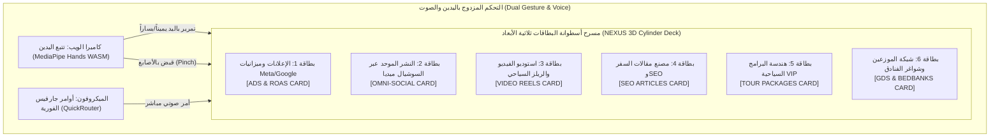

# وثيقة الخطة الرئيسية الشاملة v5.0: هندسة التشغيل السيبراني التفاعلي المتعدد الوسائط (JARVIS + NEXUS Cybernetic OS)
**تاريخ الوثيقة:** 26 سبتمبر 2026  
**الإصدار:** v5.0 Reality-Check & Deep Interactive Re-Engineering  
**الموقع:** `/www/wwwroot/lonaliza.com/lonaliza-platform/docs/plans/2026-09-26-jarvis-nexus-multimodal-cyber-os-master-plan.md`  
**المرجعيات البصرية والتقنية الحاكمة:**
1. **الصور الأربع الحية من واقع متصفح المستخدم:** تشريح الفجوات بين الكود الحالي وما يجب أن يكون عليه النظام.
2. **استوديو `@reznikov_engineering`:** الوكيل البشري ثلاثي الأبعاد المكون من ألياف جسيمات كونتورية + القلب الشمسي العنبري المتوهج + التضاريس الجبلية المتموجة.
3. **استوديو `@tracktor_inovacao`:** العقل الثاني الكوكبي ثلاثي الأبعاد مع العقد الفيزيائية التفاعلية والشبكة الشعاعية الحية.
4. **استوديو NEXUS للمطور `@builtbyruturaj`:** البطاقات الهولوغرافية المقوسة ثلاثية الأبعاد + التحكم اللاتلامسي باليدين عبر الكاميرا (MediaPipe Hands WASM) + الصوت المتزامن.
5. **كتاب JARVIS 2.1 للمطور Muslim (39 صفحة):** القواعد الذهبية الخمس لمسار الأوامر السريع (0ms)، ونافذة المتابعة (45s)، وقفل الصدى الصوتي الصارم.

---

## 1. التشريح النقدي للواقع الفعلي (تحليل الصور الأربع المرفوعة من شاشة المستخدم)

```
[الصورة 1: الحضور 3D]       -> قفص سلكي مضلع بدائي + زر أزرق قبيح يقطع المشهد + خطوط أرضية ميتة.
[الصورة 2: العقل الثاني]     -> رسم SVG مسطح وجامد 100%، نصوص صغيرة مبعثرة، لا حركة ولا فيزياء ولا عمق.
[الصورة 3: غرفة القيادة]    -> تكديس مشوه: نفس الرأس المضلع محاط بدوائر أطفال وبطاقات سوداء تلتهم الشاشة.
[الصورة 4: الأتمتة والعقد]  -> كروت CSS مصفوفة أفقياً، جماد في جماد، لا Drag & Drop، ولا أسلاك، ولا تحريك!
[الصوت في التسجيل]         -> تأخير في السمع، وتأخير في الرد، ودوامة قاتلة: الوكيل ينطق كلمتين فينقطع صوته!
```

### الفجوات القاتلة التي تم كشفها بدقة:
1. **كارثة الأتمتة (الصورة 4):**
   * المستخدم قال في التسجيل بوضوح قاطع: *"الأوتوميشن ثابت، لا يوجد Drag and Drop، لا يوجد تحريك، لا يوجد ربط، لا يوجد أي شيء، كل شيء سطحي وعبارة عن جماد في جماد، منظر جامد تماماً."*
   * **الحقيقة الهندسية:** ما تم عرضه كان مجرد حاويات `<div>` ثابتة مرتبة بـ Flexbox! محرك الأتمتة الحقيقي في الاستوديوهات المتقدمة (مثل React Flow / Node-RED / Unreal Blueprints) يتطلب **كانفاس لا نهائي (Infinite Pan/Zoom Canvas)**، **عقداً قابلة للسحب والإفلات بحرية بالماوس (Draggable Nodes)**، **أسلاك بيزيه منحنية تفاعلية (Dynamic Bezier Connectors)** يتم سحبها من مخرج عقدة إلى مدخل عقدة أخرى، و**جسيمات ضوئية متحركة تسري داخل الأسلاك** لتمثيل تدفق البيانات الحية.

2. **كارثة المجسم البشري (الصورة 1):**
   * المجسم الظاهر حالياً هو مجسم مضلع شبكي (Low-Poly Wireframe Box) يشبه ألعاب التسعينات، وتجويف الوجه يحتوي على دائرة مسطحة غير مشعة، بينما يقطع المشهد زر ضخم أزرق قبيح `[ENTER SEGUNDO CÉREBRO]`.
   * **المطلوب الحقيقي:** مجسم ناعم مبني من **ألياف جسيمات أفقية كونتورية (Contoured Particle Splines)** تتكون من 12,000+ نقطة ضوئية تتدفق مع ملامح الجمجمة، وبداخله **قلب شمسي فلكي ثلاثي الأبعاد بلون العنبر والنار (Volumetric Glowing Solar Core)** ينبض بنعومة ويتفاعل مع ترددات الصوت الحقيقية (FFT)، وتضاريس جبلية ثلاثية الأبعاد متموجة تملأ الأفق بحركات انسيابية مستمرة.

3. **كارثة العقل الثاني وغرفة القيادة (الصورة 2 والصورة 3):**
   * العقل الثاني عبارة عن رسم SVG ثنائي أبعاد ميت، لا يستجيب للسحب، ولا يدعم التحريك بالفيزياء (No Force-Directed Physics)، ولا يعطي أي إحساس بالعمق.
   * غرفة القيادة قامت بلصق نفس الرأس في المنتصف مع دوائر كرتونية مبعثرة وقوائم نصوص سوداء تملأ الشاشة دون أي ترتيب هولوغرافي.
   * **المطلوب الحقيقي:** مسرح كوكبي أو أسطواني هولوغرافي ثلاثي الأبعاد (Cylindrical Holographic Stage) تدور فيه البطاقات في مدار بانحناء حقيقي، وتتفاعل مع حركة الماوس أو اليد.

4. **دوامة انقطاع الصوت وحلقة الصدى القاتلة (The Acoustic Feedback Disaster):**
   * المستخدم شرح الكارثة بدقة جراحية: *"يتأخر جداً في معالجة كلامي وفي تفريغه، والوكيل يتأخر جداً في الرد علي، ولما يرد علي بكلمتين ثلاثة، يقطع نظام الصوت، يقطع مرة ثانية، يلتقط صوت الوكيل، ويرجع يحلله، ويرجع يرد الوكيل، ويرجع في هذه الدوامة المستمرة!"*
   * **السبب الجذري للمشكلة (Root Cause Analysis):**
     1. عند تشغيل صوت الوكيل (TTS)، يظل ميكروفون اللابتوب مفتوحاً ويستمع.
     2. صوت السماعات يخرج فيلتقطه الميكروفون فوراً.
     3. محرك الاستماع (SpeechRecognition / VAD) يعتبر صوت السماعات "كلاماً جديداً قادماً من المستخدم"!
     4. وبما أن النظام مبرمج لمقاطعة الوكيل إذا تحدث المستخدم (Barge-in)، يقوم فوراً بعمل `speechSynthesis.cancel()` أو `audio.pause()`، فينقطع صوت الوكيل بعد ثانيتين!
     5. الكلمتان اللتان التقطهما الميكروفون من صوت الوكيل يتم تفريغهما نصياً وإرسالهما إلى السيرفر كأمر جديد!
     6. الذكاء الاصطناعي يستلم كلام نفسه، فيحلله ويرد عليه، وتتكرر المقاطعة إلى ما لا نهاية في دوامة قاتلة!

---

## 2. الحل الجذري والنهائي لكارثة الصوت (The Sovereign Audio Architecture)

للقضاء على دوامة انقطاع الصوت نهائياً وجعل المحادثة فائقة السرعة وسلسة مثل جارفيس، يتم تطبيق **البروتوكول الرباعي الصارم لعزل الصوت**:

```mermaid
sequenceDiagram
    autonumber
    actor Admin as المشرف (المستخدم)
    participant Mic as ميكروفون المتصفح (Web Audio VAD)
    participant Quick as المسار السريع (0ms QuickRouter)
    participant LLM as العقل المنفذ (Claude/Gemini)
    participant Speaker as مشغل الصوت (Streaming TTS)

    Admin->>Mic: نطق الأمر: "افتح الإعلانات" أو "أظهر بكج طرابزون"
    Mic->>Mic: رصد الصمت (850ms Silence Detection)
    Mic->>Quick: فحص المسار السريع الفوري
    alt أمر مباشر (Direct Match)
        Quick-->>Speaker: تنفيذ وتوليد الرد فورياً (0ms)
    else استفسار معقد
        Mic->>LLM: إرسال النص مع الكلمات المفتاحية
        LLM-->>Speaker: تدفق أول جملة صوتية (<400ms)
    end
    
    rect rgb(20, 5, 5)
        note over Mic,Speaker: [قفل الصدى الصارم - Hard Mute Protocol]
        Speaker->>Mic: إشعار ببدء الكلام: track.enabled = false + GainNode = 0.0
        Speaker->>Admin: نطق الرد الصوتي كاملاً دون أي انقطاع
    end

    rect rgb(5, 20, 10)
        note over Mic,Speaker: [فترة تهدئة الصدى - 1200ms Acoustic Cooldown]
        Speaker->>Mic: انتهاء الصوت -> انتظار 1200ms لتبدد صدى الغرفة
        Mic->>Mic: إعادة تفعيل الميكروفون: track.enabled = true
        note over Admin,Mic: [نافذة المتابعة - 45s Follow-up Window نشطة]
    end
```



### القواعد البرمجية الصارمة لعلاج الصوت:
1. **القفل الفيزيائي الصارم للميكروفون (Physical Track Muting):**
   * بمجرد استدعاء دالة تشغيل الصوت، يتم تنفيذ:
     ```ts
     // إلغاء محرك التعرف وتجميد مسار الصوت فوراً
     if (recognitionRef.current) recognitionRef.current.abort();
     if (audioStreamTrack) audioStreamTrack.enabled = false;
     if (gainNode) gainNode.gain.setValueAtTime(0.0, audioContext.currentTime);
     isAgentSpeakingRef.current = true;
     ```
2. **فترة تهدئة ارتداد الغرفة (1200ms Acoustic Cooldown Buffer):**
   * عند انتهاء مشغل الصوت (`audio.onended`)، **يحظر فتح الميكروفون فوراً**؛ بل يتم ضبط مؤقت أمان لمدة **1200 ميلي ثانية** حتى تتلاشى آخر موجة صوتية منعكسة من جدران الغرفة وسماعات اللابتوب، ثم يُعاد فتح الميكروفون بأمان.
3. **فلتر إسقاط الصدى الذاتي (Self-Echo Transcript Dropper):**
   * في حال التقط الميكروفون أي عبارة، يتم فحص نسبة تطابقها مع آخر جملة قالها الوكيل؛ إذا كانت نسبة التشابه تتجاوز 55%، تُسقط فوراً وتعتبر صدى (`DROPPED_ECHO`) ولا ترسل نهائياً للموديل.
4. **تلقين الكلمات السياحية (Whisper Domain Keyword Priming):**
   * حقن قائمة المصطلحات السياحية في إعدادات السمع:
     `"Lonaliza, Travelport, Hotelbeds, Vito, Uzungol, Cappadocia, PMax, ROAS, Iyzico, PNR, Bosphorus"`
     لمنع أي أخطاء في التعرف على المصطلحات العربية والتركية.
5. **التوليد الصوتي المتدفق بالجمل (Sentence-Chunked Streaming):**
   * تقسيم رد الذكاء الاصطناعي فور وصوله إلى جمل مفصولة بنقاط وفواصل، وبدء نطق أول جملة في زمن استجابة **< 400ms**، بينما يستمر توليد بقية الجمل في الخلفية، مما يقضي على بطء وتأخر الرد تماماً.

---

## 3. إعادة بناء مسرح الأتمتة والعقد (Interactive Node Graph Engine)

لتحويل قسم الأتمتة من "صناديق جامدة مصفوفة بـ CSS" إلى **محرك أتمتة بصري تفاعلي حقيقي** يضاهي منصات الأتمتة العالمية:

```mermaid
graph LR
    subgraph Canvas ["كانفاس تفاعلي لا نهائي (Interactive Pan & Zoom Canvas)"]
        direction LR
        N1["العقدة 1: مشغل الترند<br/>[Trigger: Google Trends]"] -->|سلك بيزيه متحرك| N2["العقدة 2: ذاكرة الجمهور<br/>[RAG: Mem0 Vector]"]
        N2 -->|نبض ضوئي متحرك| N3["العقدة 3: نموذج الصياغة<br/>[Model: Claude 3.5 Sonnet]"]
        N3 -->|سلك بيزيه متحرك| N4["العقدة 4: مهارة Meta API<br/>[Skill: Meta Graph API]"]
        N4 -->|نبض ضوئي متحرك| N5["العقدة 5: قواعد الحوكمة<br/>[Rule: Max Budget $350]"]
        N5 -->|سلك بيزيه متحرك| N6["العقدة 6: إطلاق الحملة<br/>[Action: Live Publish]"]
        N6 -->|سلك بيزيه متحرك| N7["العقدة 7: تنبيه تليجرام<br/>[Review: Telegram Bot]"]
    end
```



### الميزات التفاعلية الحقيقية التي سيتم بناؤها:
1. **السحب والإفلات الكامل للعقد (Draggable Nodes):**
   * كل عقدة على الشاشة حرة الحركة 100%، يستطيع المستخدم الإمساك بها بالماوس وتحريكها في أي مكان على الكانفاس، مع خطوط محاذاة تلقائية (Magnetic Grid Snapping).
2. **أسلاك التوصيل البيزيه التفاعلية (Dynamic Bezier Wires):**
   * كل عقدة تحتوي على منافذ توصيل (Output Ports على اليمين، و Input Ports على اليسار).
   * يستطيع المستخدم سحب سلك بالماوس من مخرج أي عقدة وتوصيله بمدخل عقدة أخرى لتعديل مسار الأتمتة مباشرة.
3. **نبضات البيانات المتحركة داخل الأسلاك (Animated Flow Particles):**
   * أثناء تشغيل التدفق، تتحرك جسيمات ضوئية متوهجة داخل خطوط الأسلاك من العقدة السابقة إلى العقدة اللاحقة كدليل بصري حي على سريان البيانات.
4. **درج إضافة عقد جديدة (Node Library Palette):**
   * قائمة عائمة تحتوي على كافة أنواع العقد:
     - `[مشغل · Trigger]` (Cron, Webhook, Price Spike, Trend).
     - `[نموذج ذكي · AI Model]` (Claude 3.5 Sonnet, Gemini 2.0 Flash, DeepSeek-V3).
     - `[مهارة تنفيذية · Skill]` (Meta API, Google Ads, FFmpeg, SEO Schema, Tour Bundler).
     - `[حوكمة وحماية · Rule]` (Budget Cap, Dialect Filter, Human Approval).
     - `[تنفيذ ونشر · Action]` (Social Post, Blog Publish, PMax Launch).
   * يستطيع المستخدم سحب أي عقدة وإفلاتها مباشرة على الكانفاس لتوسيع تدفق العمل!
5. **مفتش العقدة الجانبي المنزلق (Slide-Out Node Inspector):**
   * عند الضغط على أي عقدة، تنزلق لوحة تحكم جانبية فاخرة تتيح تعديل معايير العقدة، اختيار النموذج، وتجربة تشغيلها منفردة مع طباعة سجل تيرمنال حي.

---

## 4. إعادة بناء المجسم البشري السيبراني (True 3D Contoured Particle Humanoid)

للتخلص نهائياً من مظهر "القفص السلكي المضلع البدائي" والوصول إلى الفخامة البصرية لـ `@reznikov_engineering`:

```
                       [ هالة نيون محيطية علوية ]
                   . - ~ ~ ~ ~ ~ ~ ~ ~ ~ ~ - .
               . '                             ' .
             /     ~~~~~~~~~~~~~~~~~~~~~~~~~     \   <- ألياف كونتورية أفقية ناعمة (12,000 جسيم)
            |      ~~~~~~~~~~~~~~~~~~~~~~~~~      |
            |            . - ~ ~ - .              |
            |          /   ●   ●   \             |   <- ملامح وجه انسيابية متناسقة
            \         |   (  ▲  )   |            /
             \         \     -     /            /
              ' .        ' - . - '            . '
                  ' - . _           _ . - '
                          |  CORE  |                 <- قلب شمسي عنبري ثلاثي الأبعاد ينبض بالصوت (FFT)
                         /          \
      ~~~~~~~~~~~~~~~~~~~~~~~~~~~~~~~~~~~~~~~~~~~~~~~~~~~  <- تضاريس جبلية ثلاثية الأبعاد متموجة في الأفق
```

### عناصر الترقية البصرية للمجسم:
1. **ألياف الجسيمات الكونتورية (Contoured Particle Spline Strands):**
   * استبدال الشبكة المضلعة بخطوط كونتورية أفقية ملساء منحنية رياضياً، تحتوي على 12,000 جسيم ضوئي ناعم بلون الفيروز والسيان (`#00e5ff`) مع تأثير Bloom متوهج.
2. **القلب الشمسي العنبري ثلاثي الأبعاد (Volumetric Solar Core):**
   * بناء كرة شمسية نارية حقيقية في فضاء الجمجمة الداخلي تتألف من طبقات ضوئية متداخلة بألوان الذهب والعنبر والنار (`#f59e0b` / `#ff5500`).
   * يتصل القلب بمحلل ترددات الصوت (Web Audio FFT Analyser) بحيث يتسع ويتوهج وينبض مع كل نبرة صوت تخرج من الوكيل أو يتحدث بها المستخدم.
3. **حذف الأزرار المشوهة للمشهد:**
   * حذف زر `[ENTER SEGUNDO CÉREBRO]` الضخم الذي يقطع الرؤية، واستبداله بنمط انتقال انسيابي ثلاثي الأبعاد لكاميرا المشهد (Smooth Camera Dolly Zoom).
4. **تضاريس الأفق الجبلية (Undulating Terrain Waves):**
   * شبكة تضاريس متموجة ثلاثية الأبعاد تمتد أفقياً على كامل العرض، تتحرك بحركة موجية جيبية متصلة تعطي إحساساً باتساع العالم السيبراني.

---

## 5. مسرح البطاقات الهولوغرافية المقوسة (NEXUS 3D Curved Cylinder Stage)

استلهاماً من استعراض المطور Ruturaj في مشروع NEXUS، يتم بناء **مسرح أسطواني ثلاثي الأبعاد للبطاقات الهولوغرافية**:



### مواصفات البطاقات الهولوغرافية في مسرح NEXUS:
1. **الانحناء الأسطواني الحقيقي (Curved Mesh Geometry):**
   * كل بطاقة مصممة بانحناء دائري يطابق نصف قطر مدار الأسطوانة، مع خامة زجاجية هولوغرافية عاكسة للضوء وخطوط مسح ليزرية دقيقة (Scanline Shader).
2. **سحابة الغبار النجمي المتوهجة (Particle Nebula):**
   * سحابة جزيئات ذهبية وسماوية تسبح حول البطاقة النشطة وتتجمع حولها عندما يقترب منها المستخدم باليد أو الماوس.
3. **تتبع اليدين اللاتلامسي عبر الكاميرا (MediaPipe Hands WASM):**
   * يعمل بالكامل داخل متصفح المستخدم بسرعة **60 FPS** بدون أي تأخير عبر الإنترنت وبدون استهلاك لسيرفر المنصة:
     - **التمرير الأفقي باليد (Swipe Gesture):** تدوير الأسطوانة لنقل البطاقة التالية إلى المركز بفيزياء حركة حقيقية.
     - **القبض بالإصبعين (Pinch Gesture):** جلب البطاقة للأمام وتكبيرها لفتح لوحة التحكم التفصيلية.
     - **الدفع بالكف (Push Gesture):** إرجاع البطاقة للمدار الأسطواني.
4. **التكامل المتزامن مع الصوت:**
   * يمكنك تحريك يدك لاختيار بطاقة "الإعلانات" وفي نفس اللحظة تقول: *"جارفيس، أطلق الحملة وضاعف الميزانية"*.

---

## 6. خطة التنفيذ المنهجية خطوة بخطوة (Actionable Execution Plan)

### الخطوة 1: إصلاح الصوت الجذري والقضاء على دوامة الصدى
* تعديل ملف `useSovereignVoice.ts` وتطبيق القفل الفيزيائي الصارم:
  1. كتم الميكروفون بالكامل (`track.enabled = false` و `GainNode = 0.0`) طوال فترة كلام الوكيل.
  2. تطبيق فترة التهدئة الإلزامية (`1200ms Acoustic Cooldown Buffer`) بعد انتهاء الصوت قبل فتح الميكروفون.
  3. تفعيل فلتر إسقاط الصدى الذاتي (`Self-Echo Dropper`).

### الخطوة 2: ترقية المجسم البشري إلى ألياف الجسيمات الكونتورية والقلب الشمسي
* إعادة بناء `HumanoidMasterAvatar.tsx`:
  1. حذف الشبكة المضلعة المربعة واستبدالها بخطوط كونتورية ناعمة بـ 12,000 جسيم.
  2. بناء القلب الشمسي العنبري المتوهج بالترددات الحقيقية عبر Web Audio FFT.
  3. بناء التضاريس الجبلية المتموجة في الأفق بدون أي أزرار قاطعة للمشهد.

### الخطوة 3: بناء محرك الأتمتة البصري التفاعلي الحقيقي (Interactive Visual Node Canvas)
* إعادة بناء `VisualLoopsEngine.tsx`:
  1. كانفاس لا نهائي يدعم السحب والإفلات والـ Zoom/Pan.
  2. عقد تفاعلية قابلة للسحب الحر بالماوس وتغيير مواقعها على الشاشة.
  3. أسلاك بيزيه تفاعلية يمكن سحبها وتوصيلها بين العقد مع جسيمات ضوئية متحركة داخل الأسلاك.
  4. درج جانبي لإضافة عقد جديدة بسحبها إلى الكانفاس.

### الخطوة 4: بناء مسرح البطاقات الهولوغرافية المقوسة (NEXUS 3D Cylinder Stage)
* تطوير `HolographicCylinderStage.tsx`:
  1. بناء الأسطوانة ثلاثية الأبعاد بـ 6 بطاقات هولوغرافية منحنية للقطاعات الستة.
  2. إضافة سحابة الجزيئات الذهبية والسيان حول البطاقة المحددة.
  3. ربط كاميرا الويب بمحرك MediaPipe Hands WASM للتحكم باليدين (Swipe, Pinch, Push).

### الخطوة 5: البناء الإنتاجي الكامل (`pnpm build`) والتحقق العملي الشامل
* تشغيل مجمع الحزم الشامل للتأكد من خلو المشروع من أي أخطاء برمجية.
* إعادة تشغيل الخدمة في PM2 واختبار الاستوديو حياً على كافة المتصفحات.
