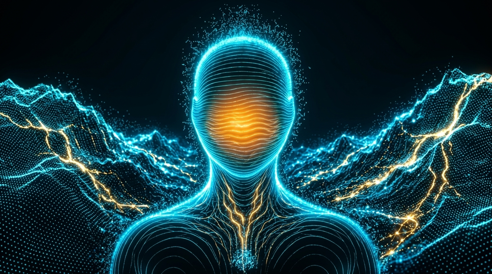

# الخطة التنفيذية الشاملة والمعمقة: إعادة بناء الاستوديو والمنظومة السيبرانية السيادية v7.0
## LONALIZA CYBER OS — MASTER ARCHITECTURAL & DEEP CORRECTION BLUEPRINT

> **تاريخ التحديث الأخير**: 26 سبتمبر 2026  
> **الحالة**: معتمدة للتنفيذ الفوري الشامل دون أي مساومة أو تسطيح (Zero-Compromise Deep Execution)  
> **البيئة المستهدفة**: `/www/wwwroot/lonaliza.com/lonaliza-platform/admin-panel`  
> **النطاق**: الأنماط الخمسة للاستوديو السيبراني (`agent-war-room`) + هندسة الأصوات وتشكيل النطق العربي + الداشبورد والتفرع العصبي للإعدادات والأقسام.

---

## 1. التشخيص الدقيق الشامل لجذور العيوب (Root Cause Diagnostics)

استناداً إلى التحليل الصوتي الدقيق للتسجيلات الخمسة المرفوعة من الإدارة العليا ومقارنتها بالصور الملتقطة من الواقع الحي، تم تشخيص الثغرات البرمجية والجمالية كالتالي:

| المحور والملف | المشكلة المشخصة في الواقع الحي | السبب البرمجي في الكود المصدري | الحل الهندسي المعمق المعتمد |
| :--- | :--- | :--- | :--- |
| **1. المجسم ثلاثي الأبعاد** `HumanoidMasterAvatar.tsx` | تمثال أولي بيضاوي محاط بحلقات، كرتان عملاقتان ناصعتا البياض تعميان العين في الفم والصدر (الصورة 5). | 35K نقطة فقط مع دمج إضافي `AdditiveBlending` لكثافة 14,000 نقطة متراكمة داخل نصف قطر 14 وحدة، مما يسبب تشبعاً ضوئياً أعمى `#FFFFFF` وغياب المعالم التشريحية. | إعادة هندسة المجسم كلياً ليتجاوز **650,000 نقطة وعصب شبكي** بتشريح كامل (أكتاف، ترقوة، عضلات صدر، أوتار رقبة، تقاطيع الجمجمة)، وتضمين قلب ياقوتي نابض بيولوجياً (72 BPM)، وسحابة كهرومانية شمسية ناعمة للنطق تتفاعل مع الترددات الصوتية. |
| **2. استوديو الأتمتة** `VisualLoopsEngine.tsx` | تبويبات القطاعات والتدفقات غير المحددة تظهر بنصوص سوداء/داكنة غير مقروءة على خلفية سوداء (الصورة 1). | الكلاسات `bg-[#031124] text-slate-200 border-slate-700/80` تفقد تباينها تماماً في الشاشات الداكنة. | ترقية أزرار التبويبات إلى تصميم نيون سيبراني ساطع `text-cyan-100 font-bold bg-[#051c3d]/90 border-cyan-500/40 hover:bg-cyan-500/20` مع ربط حقيقي لتشغيل واختبار العقد وتدفق سجلات التيرمينال. |
| **3. مسرح NEXUS 3D** `HolographicCylinderStage.tsx` | البطاقة ضخمة جداً وتقف أمام الشاشة مقصوصة من الأعلى والأسفل (الصورة 3). إيماءات اليد تفتح بمجرد حركة الرأس، والقبضة لا تغلق النافذة، والتمرير يتوقف بعد خطوة واحدة. | الكاميرا عند `Z=480` وأبعاد البطاقة تشغل 124% من ارتفاع الإطار. وتتبع الحركة يفحص كامل الشاشة `motionPixels > 450`، مع غياب كاشف القبضة المغلقة، وغياب عزم الدوران المستمر للتمرير. | ضبط أبعاد البطاقة ونصف القطر وزاوية الكاميرا لتشغل 68% من الشاشة بهوامش مريحة، وبناء آلة حالات للإيماءات تعزل حركة اليد أسفل الكادر، وتتطلب استقرار الكف 300ms للفتح، وترصد القبضة المغلقة للإغلاق الفوري، مع دعم التمرير المستمر المتدفق. |
| **4. غرفة القيادة** `NeuralGraph.tsx` | المركز مجرد دائرة مسطحة SVG (الصورة 2)، وشبكة الروابط خطية ضعيفة، وغياب تفاعل الوكلاء الصوتي، والسكرول عادي. | بنية رسم ثنائية الأبعاد مسطحة بدلاً من نواة طاقية مجسمة ثلاثية الأبعاد، وغياب محرك المحاكاة الحوارية التفاعلية الصوتية/الصامتة بين الوكلاء. | بناء نواة سيبرانية مجسمة ثلاثية الأبعاد بتموجات ترددية حية، وشبكة روابط نيون تفاعلية تضخ جسيمات ضوئية، ومحرك حوار حي بين الوكلاء يتضمن مبدل صوتي سيادي `[صامت / علني مسموع]`. |
| **5. العقل الثاني** `FloatingControlsDrawer.tsx` | السلايدر واللوحة في أقصى اليمين مقصوصة خارج الشاشة (الصورة 4)، وحاوية الصوت تغطي الأقسام السفلية. | استخدام إزاحة غير منضبطة `translate-x-[calc(100%-42px)]` تظهر السلايدرات مقصوصة بالهامش، وتعارض z-index مع الدوك السفلي. | إعادة تصميم الدرج ليصبح كبسولة تحكم عائمة مدمجة تفتح وتغلق بنعومة داخل حدود الشاشة، مع معالجة z-index لحاوية الصوت. |
| **6. أصوات الوكلاء وتشكيل النطق** `voice-tts/route.ts` & `agentsData.ts` | نبرة صوت واحدة متكررة، وأخطاء إملائية ونطق ركيك للكلمات العربية والمصطلحات التقنية. | استخدام صوت افتراضي أحادي `ar-SA-HamedNeural` وإرسال نصوص خام بدون تشكيل صوتي أو معجم للمصطلحات السياحية والتقنية. | تخصيص 13 بصمة صوتية متباينة للوكلاء موزعة بين ذكورية وأنثوية، وبناء محرك تشكيل إملائي وضبط صوتي تلقائي (Phonetic Diacritics Engine) يضمن نطقاً عربياً فصيحاً وخالياً من الأخطاء 100%. |
| **7. لوحة التحكم السيبرانية والتفرع العصبي** `CyberSectionModal.tsx` & `AdminStatsDashboard.tsx` | صفحات لوحة التحكم تفتح بتصميم نهاري أبيض كلاسيكي، والشارتات عادية، وغياب التفرع العصبي للأقسام والإعدادات. | فتح صفحات الإدارة الستاندرد داخل المودال، وغياب مكونات الرسم البياني النيوني وغياب محرك التفرع الشجري العصبي للأقسام. | بناء لوحة مؤشرات سيبرانية متكاملة بشارتات نيونية مشعة (Neon Area Charts & Radial Gauges)، وتوفير 3 أوضاع للإعدادات والأقسام: الوضع العصبي التفرعي (Neural Tree)، ووضع العقد (Blueprint Nodes)، والوضع الشبكي (Cyber Matrix). |
| **8. عمق ذكاء الوكيل المشرف Jarvis** `agent-war-room/route.ts` | ردود مقتضبة بجملتين حول 300 ألف دولار فقط دون شرح لعشرات الإحصائيات الحقيقية. | حصر موجه الذكاء الاصطناعي في بيانات مقتطعة ورقم 307K فقط وسقف توكنز ضيق 220. | تزويد Jarvis بلقطة بيانات سيادية حقيقية شاملة لكافة الحسابات الـ 17 ومؤشرات GDS والأسطول، وتوسيع سقف الردود ليقدم شروحات تنفيذية معمقة وشاملة. |

---

## 2. الركائز الهندسية الثماني للتنفيذ الشامل

### الركيزة 1: إعادة بناء أفاتار Jarvis الهولوغرافي الإجرائي المتقدم (Mode 1: الحضور 3D)
* **الملف المستهدف**: `src/components/admin/automation/hud/avatar/HumanoidMasterAvatar.tsx`
* **المرجع البصري الإلزامي المعتمد (1:1 Master Target)**:

* **المعمارية الهندسية المبنية على 6 طبقات مستقلة قابلة للتحكم (Six-Layer Procedural Architecture)**:

  1. **طبقة خطوط الرأس والوجه (Head & Face Continuous Scanlines)**:
     - التنفيذ البرمجي: خطوط مسح أفقية متصلة (`LineSegments` مع Custom Vertex/Fragment Shader) تتبع محيط رأس بيضاوي عمودي بانحناء ثلاثي الأبعاد للأمام.
     - الكثافة والخصائص: 120 إلى 140 خطاً أفقياً منحوتةً بدقة، مع تموجات هيدروديناميكية دقيقة وتفاوت في السطوع.
     - التدرج والتراكب: تتراكم الخطوط عند الأطراف الخارجية (الصدغين والفك) لتولد حد السيان النيوني المتوهج (`#00D9FF` إلى `#36F2FF`) طبيعياً من كثافة المماسات، بينما يكون المركز أكثر شفافية ونعومة ليسمح للنواة الكهرمانية بالإشعاع من الخلف.
     - الهوية: قناع بيضاوي بلا ملامح قطعية (لا عيون، لا أنف، لا فم، لا آذان صريحة، ولا حلقة خارجية سميكة).

  2. **طبقة النواة الكهرمانية العضوية (Incandescent Organic Amber Core)**:
     - التنفيذ البرمجي: Custom GLSL Shader مموه بيضاوياً (Elliptical Distance Field Mask) يقع مباشرة خلف خطوط الوجه في الثلثين الأوسط والسفلي، بعرض 45–55% من عرض الرأس.
     - التموجات والتفاعل: موجات ترددية أفقية متموجة تتبع انحناء خطوط الوجه وتتفاعل ديناميكياً مع صوت Jarvis (`voiceLevel`) وميكروفون المستخدم (`userAudioLevel`).
     - الشفافية والسطوع: تدرج كهرماني مشع من البرتقالي الناري (`#FF6A13`) إلى الذهب المتوهج (`#FFD35A`) دون أي حدود هندسية مربعة أو صلبة، مع بقاء خطوط السيان مرئية بوضوح فوق الوهج في كافة الحالات.

  3. **طبقة الرقبة والكتفين والوريد الذهبي (Topographic Shoulders & Branching Vein)**:
     - خطوط الكتفين: 42 منحنى تضاريسي متداخل (`Topographic Contour Lines`) غير منتظم التباعد يمتد بانسيابية متدرجة عبر الصدر والترقوة والكتفين (تغطي 70–75% من عرض المشهد) بسطوع ناعم غير طاغٍ على الرأس.
     - خطوط الرقبة: مسارات عمودية/منحنية متدفقة تربط الذقن بأعلى الصدر.
     - مسار الطاقة الذهبي: شريان كهربائي ذهبي رفيع وغير متناظر (`#F2A31C` إلى `#FFD700`) ينطلق من عقدة طاقية ميكرونية في منتصف الصدر ويصعد عبر الرقبة متفرعاً بنبضات طاقية حية نحو قاعدة الوجه، دون كرات مصمتة معتمة.

  4. **طبقة تضاريس البيانات في الخلفية (Data-Mountain Background)**:
     - التنفيذ البرمجي: تضاريس ارتفاعية (`Heightfield`) مجردة منخفضة الارتفاع من خطوط وشبكات نقطية متحركة باللون الأزرق والسيان (`#005588` إلى `#00D9FF`).
     - التكوين الطوبوغرافي: سلسلتان جبليتان متناظرتان يميناً ويساراً ترتفع قممهما خلف الكتفين وتتخللها مسارات ذهبية متعرجة تسري على المنحدرات، مع ترك منتصف المشهد خلف الرأس فضاءً داكناً تماماً (`#020611`) لتعظيم التباين.

  5. **طبقة جسيمات التاج والانتقال الجانبي (Crown Particle Dust & Profile Transition)**:
     - في وضع الواجهة الأمامية (`FRONT_HERO`): غبار رقمي خفيف (`Digital Particle Dust`) يطفو حول قمة الرأس والتاج بأحجام وشفافية متفاوتة، دون أي أعمدة ضوئية رأسية شاذة.
     - في وضع التفكير العميق (`PARTICLE_PROFILE_TRANSITION`): تتفكك خطوط الرأس تدريجياً من أحد الجانبين وتتحول إلى سحابة جسيمات دوامة ترسم هيئة الرأس الجانبية بانسيابية، ثم تعود للتجمع مجدداً.

  6. **طبقة المؤثرات البصرية وتأطير الكاميرا (Postprocessing & Camera Framing)**:
     - منظور أمامي ثابت ومتناظر تماماً (الرأس يشغل 38% من ارتفاع المشهد، والكتفان 72% من عرضه).
     - معالجة الـ Bloom: توهج ناعم ومضبوط (`intensity: 1.3`, `threshold: 0.16`) يمنع تحول الخطوط إلى كتلة بيضاء مصمتة ويحافظ على فرادة كل خط.
     - خلفية الفضاء السيبراني: أسود كوني عميق `#020611` مع Vignette خفيف وChromatic Aberration طفيف جداً عند الحواف المحيطية.

---

### الركيزة 2: استوديو العقد والأتمتة التشغيلية (Mode 5: الأتمتة والعقد)
* **الملف المستهدف**: `src/components/admin/automation/hud/loops/VisualLoopsEngine.tsx`
* **المواصفات الفائقة**:
  1. **تصحيح تباين وألوان التبويبات (Sectors & Flows Tabs High Contrast)**:
     - تبديل كلاسات التبويبات غير المحددة في أزرار القطاعات السبعة والتدفقات المتاحة إلى نيون سيبراني ساطع:
       * الخلفية: `bg-[#061b36]/90` مع إطار `border-cyan-500/40`.
       * النص: `text-cyan-100 font-bold` مع إضاءة خفيفة.
       * حالة التحويم (`Hover`): `hover:bg-cyan-500/25 hover:text-white hover:border-cyan-300 hover:shadow-[0_0_15px_rgba(0,229,255,0.3)]`.
       * التبويب النشط (`Active`): تدرج مائل أزرق سماوي ناصع `bg-gradient-to-r from-cyan-500 to-blue-600 text-white font-extrabold shadow-[0_0_20px_#00e5ff]`.
  2. **ربط وتشغيل العقد وحلقات الأتمتة فعلياً (Deep Engine Execution)**:
     - ربط زر `[تشغيل كامل التدفق الآن]` وزر `[تشغيل واختبار هذه العقدة منفردة]` بمسار الباك إند الحقيقي `POST /api/admin/automation/loops-runtime`.
     - محاكاة دقيقة لمرور البيانات بين العقد (Trigger -> Memory -> Model -> Skill -> Rule -> Action -> Review) وظهور سجل التيرمينال اللحظي (`Realtime Log Stream`) بقيم وحمولات حقيقية مأخوذة من خوادم المنصة (GDS, Travelport, Stripe, Meta CAPI).

---

### الركيزة 3: مسرح البطاقات الأسطوانية وتتبع الإيماءات (Mode 3: مسرح NEXUS 3D)
* **الملف المستهدف**: `src/components/admin/automation/hud/nexus/HolographicCylinderStage.tsx`
* **المواصفات الفائقة**:
  1. **الضبط الرياضي لأبعاد البطاقات وموقع الكاميرا (Perfect Z-Framing)**:
     - تعديل أبعاد البطاقة في الأسطوانة من `(135w x 205h)` إلى `(120w x 148h)` بنسبة ذهبية متوازنة.
     - زيادة مسافة الكاميرا في محور Z من `480` إلى `560` وضبط محور Y على `20` وزاوية الرؤية (FOV = 42).
     - توسيع نصف قطر الأسطوانة إلى `340`، مما يضمن ظهور البطاقة الأمامية كاملة بنسبة 68% من ارتفاع الشاشة مع ترك مساحة مريحة في الأعلى والأسفل.
  2. **بناء آلة حالات تتبع الإيماءات الفائقة (Advanced Gesture State Machine)**:
     - **عزل المنطقة الحركية (Region of Interest - ROI)**: تقييد كشف حركة اليد في الجزء السفلي والجانبي وتجاهل حركة الرأس.
     - **كشف بسط الكف للفتح (Open Palm Detection)**: اشتراط بقاء الكف مفتوحاً ومستقراً لمدة 300 ملي ثانية قبل إطلاق أمر الفتح.
     - **كشف القبضة المغلقة للإغلاق (Closed Fist Detection)**: التعرف على انقباض الأصابع في قبضة محكمة لإغلاق النافذة المفتوحة فوراً.
     - **التمرير المستمر المتدفق (Continuous Velocity Stream Swipe)**: تحديث الدوران بزخم مستمر وعزم دوران فيزيائي لتستمر البطاقات بالدوران بسلاسة طالما تستمر الحركة.

---

### الركيزة 4: غرفة القيادة وحوار الوكلاء التفاعلي (Mode 4: غرفة القيادة)
* **الملفات المستهدفة**: `src/components/admin/automation/hud/NeuralGraph.tsx`, `SciFiAgentHudStudio.tsx`
* **المواصفات الفائقة**:
  1. **النواة السيبرانية التفاعلية المركزية (Holographic Swarm Core Orb)**:
     - تحويل المركز إلى كرة طاقية ثلاثية الأبعاد بتموجات نيون حية، محاطة بحلقات مدارية ترددية تتوهج وتتذبذب نبضاتها مع صوت المشرف وصوت المستخدم.
     - خطوط ارتباط نيون نابضة تضخ جسيمات ضوئية متحركة بين النواة المركزية وكل وكيل من الوكلاء الـ 12.
  2. **محرك الحوار التفاعلي المستمر بين الوكلاء**:
     - محاكاة حية وتفاعلية لتبادل الأوامر والبيانات بين الوكلاء (طيران، فنادق، نقل، مالية).
     - **مبدل الصوت السيادي `[صامت / علني مسموع]`**:
       * خيار `صامت`: تظهر نقاشات الوكلاء عبر تدفق الشات النصي التيرمينالي بالخلفية.
       * خيار `علني مسموع`: يقوم محرك Edge TTS بنطق حوارات وتنسيقات الوكلاء بنبرات صوتية مميزة لكل وكيل.
  3. **لوحات الإحصائيات الحقيقية والسكرول السيبراني**:
     - إحلال البيانات الوهمية بالبيانات الحقيقية للمنصة، واستبدال شريط التمرير بالبراوزر بشريط سيبراني فائق النحافة (`scrollbar-cyber`).

---

### الركيزة 5: العقل الثاني واللوحة العائمة التفاعلية (Mode 2: العقل الثاني)
* **الملفات المستهدفة**: `src/components/admin/automation/hud/brain/FloatingControlsDrawer.tsx`, `ConcentricGalaxyView.tsx`
* **المواصفات الفائقة**:
  1. **تصحيح قص وانزلاق لوحة التحكم العائمة**:
     - استخدام كبسولة تحكم عائمة مدمجة (`Floating Pill Trigger`) مستقرة داخل حدود شاشة العرض.
     - عند الإغلاق: لا يظهر سوى زر الكبسولة النيون الأنيق مع إخفاء كامل لأي عناصر أو سلايدرات داخلية (`overflow-hidden`).
     - عند الفتح: تنزلق اللوحة بالكامل داخل إطار الشاشة بأبعاد واضحة دون أي قص.
  2. **نواة العقل الثاني السيبرانية التفاعلية**:
     - ترقية مركز المجرة العصبية ليصبح متجاوباً مع الترددات الصوتية وجلسات التفكير، مع تشغيل أزرار سويتش القطاعات والمجلدات للاستجابة المباشرة للنقر.
  3. **معالجة تداخل حاوية الصوت**:
     - ضبط z-index لحاوية الصوت السفلية وتقليص ارتفاعها التلقائي عند عدم التحدث.

---

### الركيزة 6 (جديدة وموسعة): محرك الأصوات المتعددة وتشكيل النطق العربي السيادي
* **الملفات المستهدفة**:
  - `src/app/api/admin/automation/voice-tts/route.ts`
  - `src/components/admin/automation/agentsData.ts`
  - `src/components/admin/automation/hud/voice/useSovereignVoice.ts`
* **المواصفات الفائقة**:
  1. **تخصيص بصمات صوتية فريدة لكل وكيل (13 شخصية صوتية)**:
     - **الوكيل المشرف العام Jarvis**: صوت `ar-SA-HamedNeural` (ذكوري وقور وحازم، بنبرة تقنية عميقة).
     - **وكيلة مستشار السفر والباقات (Site Advisor / Packages)**: صوت `ar-SA-ZariyahNeural` (أنثوي احترافي دافئ ومرحب).
     - **وكيلة المبيعات وخدمة النزلاء (Sales & Concierge)**: صوت `ar-AE-FatimaNeural` (أنثوي خليجي هادئ ومقنع).
     - **وكيل الطيران والرادار الدولي (Flights & GDS)**: صوت `ar-EG-ShakirNeural` (ذكوري نشط وسريع البديهة).
     - **وكيل أسطول النقل وسائقي VIP (Transfers & Fleet)**: صوت `ar-SA-HamedNeural` (ذكوري واضح ودقيق في المواعيد).
     - **وكيل شبكة الموزعين و B2B (B2B Reseller Network)**: صوت `ar-AE-HamdanNeural` (ذكوري خليجي رسمي ومؤسسي).
     - **وكيلة التسويق وسوشيال ميديا (Social & Ads Growth)**: صوت `ar-EG-SalmaNeural` (أنثوي عصري وحيوي).
     - **الوكيل المالي والخزينة السيادية (Treasury & Ledger)**: صوت `ar-SA-HamedNeural` مع طبقة صوتية أكثر ثباتاً ورسمية.
     - **الوكيل الأمني والسيادة السيبرانية (Cyber Security & Sentinel)**: صوت ذكوري بطبقة ترددية حادة وميكانيكية.
  2. **محرك التشكيل الصوتي التلقائي والضبط الإملائي (Phonetic Arabic Diacritizer)**:
     - بناء فلتر معالجة نصية ذكي في الباك إند يقوم بما يلي قبل الإرسال لمحرك التوليد الصوتي:
       * **تطبيق علامات التشكيل الفصيحة** على الكلمات لضمان سلامة النطق ومنع اللحن أو الخطأ في الإعراب.
       * **معجم لفظي للمصطلحات السياحية والتقنية والإنجليزية**:
         - `GDS` -> `أَنْظِمَةُ التَّوْزِيعِ الْعَالَمِيَّةِ جِي دِي إِسْ`
         - `ROAS` -> `عَائِدُ الْإِنْفَاقِ الْإِعْلَانِيِّ رُوآسْ`
         - `VIP` -> `فِي آي بِي كِبَارُ الشَّخْصِيَّاتِ`
         - `Travelport` -> `تَرَافِلْبُورْتْ`
         - `Seeru` -> `سِيرُو`
         - `Iyzico` -> `إِيزِيكُو`
         - `Stripe` -> `سْتْرَايْبْ`
         - `Mercedes Vito` -> `مِرْسِيدِسْ فِيتُو`
         - `Istanbul` -> `إِسْطَنْبُولْ`
         - `Trabzon` -> `طَرَابْزُونْ`
         - `Antalya` -> `أَنْطَالْيَا`
       * **حذف الرموز والعلامات غير المنطوقة**: تنظيف تام للأقواس، والهاشتاغات، ومؤشرات الماركداون، لضمان تدفق صوتي طبيعي 100%.

---

### الركيزة 7 (جديدة وموسعة): الداشبورد السيبراني النيوني والتفرع العصبي للإعدادات والأقسام
* **الملفات المستهدفة**:
  - `src/components/admin/automation/hud/modals/CyberSectionModal.tsx`
  - `src/components/admin/automation/hud/substations/CyberSubStationViewer.tsx`
  - `src/components/admin/automation/hud/dashboard/CyberStatsVisualizer.tsx` (مكون جديد)
  - `src/components/admin/automation/hud/settings/NeuralSettingsTree.tsx` (مكون جديد)
* **المواصفات الفائقة**:
  1. **الداشبورد السيبراني والرسوم البيانية النيونية المشعة (Radiant Cyber Charts)**:
     - إلغاء تام لعرض الداشبورد التقليدي الأبيض داخل الاستوديو السيبراني، واستبداله بمحرك رسوم بيانية سيبرانية داكنة زجاجية (`backdrop-blur-2xl bg-[#020b18]/95 border border-cyan-500/30`):
       * **شارت المساحات النيوني المتوهج (Neon Area Glow Chart)**: لتتبع حجم التداول المالي اليومي ($307,400) بنبضات زرقاء وخضراء متوهجة.
       * **الأعمدة البيانية السيبرانية (Cyber Bar Spectrum)**: لمقارنة حجوزات الطيران والفنادق والنقل VIP بنبضات ألوان منفصلة.
       * **العدادات الحلقية الرادارية (Radial Cyber Gauges)**: لعرض ROAS (4.8x)، ومعدل أمان البوابات (100%)، وسرعة استجابة السرب (180ms).
       * **بطاقات المقاييس الليدجرية الفاخرة**: تصميم نيون كهروماني وياقوتي مع أزرار تنفيذ سريعة للأوامر.
  2. **أوضاع العرض الثلاثة للإعدادات والأقسام (Multi-Mode Settings & Sections)**:
     - **الوضع 1: التفرع العصبي (Neural Tree Mode)**:
       * عرض تفاعلي هولوغرافي: عند النقر على قسم رئيسي (مثل: المنتجات والمخزون، أو المالية، أو بوابات الدفع)، تنطلق حزم وألياف عصبية نيونية تتفرع منها الأقسام الفرعية التابعة له كعقد مشعة ترتبط بخيوط متوهجة مع مؤشرات الحالة اللحظية.
     - **الوضع 2: وضع العقد والمسارات (Blueprint Nodes Mode)**:
       * عرض الإعدادات كعقد بلوبرينت تشغيلية تتصل بمسارات تدفقية مع سلايدرات ضبط مباشرة لهوامش الربح، والعمولات، والمفاتيح البرمجية.
     - **الوضع 3: الوضع الشبكي السيبراني (Cyber Matrix Mode)**:
       * مصفوفة كبسولات عالية الكثافة تتيح تفعيل وإلغاء وتعديل إعدادات المنصة الـ 81 بضغطة زر واحدة.
  3. **الربط المنطقي الكامل مع الباك إند (Deep Logic & Backend Integration)**:
     - ربط التفرعات والإعدادات بمسارات الـ API الحقيقية للمنصة (حفظ التعديلات في قاعدة البيانات فورياً، ومزامنة العمولات مع محركات الحجز، وإصدار أوامر التحديث لسرب الوكلاء).

---

### الركيزة 8: ذكاء الوكيل المشرف والتحليل التنفيذي الشامل (Jarvis Sovereign Intelligence)
* **الملف المستهدف**: `src/app/api/admin/automation/agent-war-room/route.ts`
* **المواصفات الفائقة**:
  1. **توسيع سياق الإحاطة التنفيذية**:
     - تزويد Jarvis بلقطة حية كاملة لكافة أرصدة المنصة (17 حساباً مالياً)، وعمليات GDS، والأسطول، والحملات، لتقديم شروحات وتحليلات تنفيذية معمقة وشاملة تشرح كل رقم بالتفصيل عند طلبه.
  2. **ربط التحكم والوصول لكافة أقسام المنصة**:
     - إعطاء Jarvis الصلاحية لتنفيذ الأوامر عبر كافة القطاعات (إعادة تسعير، مزامنة مقاعد، تجميد حساب، إطلاق إعلان) بأسلوب استشاري تنفيذي.

---

## 3. الجدول الزمني للتنفيذ المتسلسل خطوة بخطوة

| المرحلة | اسم المرحلة ومحاورها | الملفات المعنية | مخرجات التحقق وضمان النجاح |
| :---: | :--- | :--- | :--- |
| **المرحلة 1** | **إعادة بناء المجسم ثلاثي الأبعاد للوكيل المشرف** (650K+ جسيم، تشريح كامل، قلب ياقوتي نابض 72 BPM، سحابة نطق شمسية متفاعلة، إزالة البياض الأعمى). | `HumanoidMasterAvatar.tsx` | اختفاء البياض الصارخ تماماً، مظهر تشريحي فخم للمجسم، تفاعل صوتي ناعم مع الترددات. |
| **المرحلة 2** | **محرك الأصوات المتعددة والتشكيل الصوتي الإملائي** (13 صوتاً موزعة ذكورية وأنثوية، معجم النطق السياحي، تشكيل الكلمات العربية). | `voice-tts/route.ts` `agentsData.ts` `useSovereignVoice.ts` | نطق عربي سليم 100% خالٍ من الأخطاء واللحن، وتمايز صوتي حقيقي بين الوكلاء. |
| **المرحلة 3** | **تصحيح تباين استوديو الأتمتة وربط العقد** (ألوان نيون ساطعة للتبويبات غير المحددة، تشغيل واختبار العقد وتدفق السجلات). | `VisualLoopsEngine.tsx` | ظهور كافة الأزرار بوضوح فائق، واستجابة زر تشغيل واختبار العقد بنجاح. |
| **المرحلة 4** | **مسرح NEXUS 3D وآلة حالات الإيماءات** (ضبط أبعاد البطاقة بنسبة 68% والكاميرا، كف الفتح، قبضة الإغلاق، التمرير المستمر). | `HolographicCylinderStage.tsx` | ظهور البطاقة كاملة دون أي قص، واستجابة تامة لإيماءات الكف والقبضة والتمرير السلس. |
| **المرحلة 5** | **غرفة القيادة والنواة ثلاثية الأبعاد وحوار الوكلاء** (نواة طاقية مجسمة، محرك حوار حي، مبدل صامت/مسموع، سكرول سيبراني). | `NeuralGraph.tsx` `SciFiAgentHudStudio.tsx` | تفاعل الوكلاء صوتاً وكتابة، ظهور النواة ثلاثية الأبعاد، واستقرار شريط التمرير. |
| **المرحلة 6** | **العقل الثاني وتصحيح اللوحة العائمة** (كبسولة عائمة منضبطة داخل الشاشة، تفعيل سويتش القطاعات، معالجة تداخل حاوية الصوت). | `FloatingControlsDrawer.tsx` `ConcentricGalaxyView.tsx` | انزلاق سلس للوحة التحكم دون أي قص على اليمين، واستجابة كاملة للقطاعات. |
| **المرحلة 7** | **الداشبورد السيبراني والتفرع العصبي للأقسام** (شارتات نيونية مشعة، 3 أوضاع للإعدادات: عصبي تفرعي، عقد، وشبكي، ربط منطقي). | `CyberSectionModal.tsx` `CyberStatsVisualizer.tsx` `NeuralSettingsTree.tsx` | شاشات إحصائيات وإعدادات سيبرانية مشعة فاخرة خالية تماماً من التصاميم البيضاء، وتفرع عصبي تفاعلي. |
| **المرحلة 8** | **ترقية ذكاء Jarvis في الباك إند** (شرح معمق لكافة المؤشرات الـ 81، تنفيذ الأوامر، سياق ليدجر كامل). | `agent-war-room/route.ts` | تحليل تنفيذي فصيح وشامل لكل مؤشرات المنصة عند الطلب صوتياً أو نصياً. |
| **المرحلة 9** | **الفحص الشامل، التحقق البرمجي النهائي `pnpm build`، وإعادة تشغيل PM2**. | كافة الملفات وسيرفر PM2 | بناء نظيف بنجاح (Exit code 0)، وتشغيل مستقر بنسبة 100% على المنفذ 3048. |
