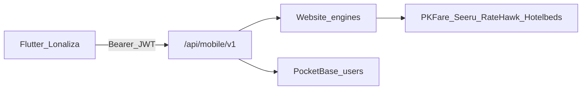

# إعادة بناء تطبيق لوناليزا: هوية، بيانات حية، ومنطق الموقع

## حكم التشخيص (من الصور + الكود)

التطبيق الحالي **ليس تطبيق لوناليزا**. هو قشرة LioTrip/Trip.com فوق بعض مسارات BFF. `MaterialApp` يستخدم [Lonalizamobilapp/lib/core/theme/lonaliza_theme.dart](Lonalizamobilapp/lib/core/theme/lonaliza_theme.dart) لكن معظم الشاشات تتجاوزه بألوان Trip.com (`#0068E0`, `#2563EB`, `#2F60F5`) ونصوص Trip Coins / TripGenie / About Trip.com.

ما تظهره الصور وما يقابله في الكود:

- سبلاش **LIOTRIP**: [Lonalizamobilapp/assets/logo/logo.png](Lonalizamobilapp/assets/logo/logo.png) + `flutter_native_splash`
- الرئيسية: بحث لندن، Trip.Planner، صفقات وهمية، زر أزرق — [home_search_bar.dart](Lonalizamobilapp/lib/presentation/features/home/widgets/home_search_bar.dart)، [home_gallery_section.dart](Lonalizamobilapp/lib/presentation/features/home/widgets/home_gallery_section.dart)
- حساب: Hi Trip.com Member، Moments، Travel Buddies، Creator center، About Trip.com — [account_page_header.dart](Lonalizamobilapp/lib/presentation/features/account/widgets/account_page_header.dart) و`account_my_posts_section.dart` / `account_about_section.dart`
- رحلاتي: فنادق وهمية (Al Wadi Al Gadid Desert) — [my_trips_page.dart](Lonalizamobilapp/lib/presentation/features/my_trips/views/my_trips_page.dart)
- فنادق: شريط نتائج ثابت الوجهة/التاريخ + كرت Trip.com أزرق رغم أن القائمة تسحب API حي — [hotels_search_app_bar.dart](Lonalizamobilapp/lib/presentation/features/hotels/widgets/search/hotels_search_app_bar.dart)
- تفاصيل فندق: بلاطات عارية بدون صور/سياسات/معرض — [live_hotel_details_page.dart](Lonalizamobilapp/lib/presentation/features/hotels/views/live_hotel_details_page.dart)
- سيارات/برامج/جولات: قائمة `ListTile` بلا صور — [live_catalog_page.dart](Lonalizamobilapp/lib/presentation/features/catalog/views/live_catalog_page.dart)
- ترانسفر فارغ: يرسل `istanbul-airport` كنص وليس `place_id` من Seeru، وبدون وجهة — [transfers_page.dart](Lonalizamobilapp/lib/presentation/features/transfers/views/transfers_page.dart)
- ذكاء/مجتمع/رليز: WebView معكوس RTL — **مرفوض**. يجب Flutter أصلي
- جوجل: `400 invalid_request` + اسم مطور **alrayyan** — `redirect_uri=lonaliza://auth/callback` غير مسجّل في مشروع Google، وشاشة الموافقة ما زالت Alrayyan — [auth/google/route.ts](src/app/api/mobile/v1/auth/google/route.ts)
- تسجيل بريد: 401 يُعرض كنص Dio خام. السيرفر يصادق `users` لا `customers`. الرسالة يجب أن تكون عربية مفهومة؛ والتسجيل يفشل إن كان الإيميل موجوداً أو كلمة السر أقل من 8
- حجز طيران: extras وهمية AirHelp / Trip Coins / `$619.30` — [flight_addons_bottom_bar.dart](Lonalizamobilapp/lib/presentation/features/flights/widgets/addons/flight_addons_bottom_bar.dart). تأكيد السعر يظهر `USD 0.0` لأن quote لا يعيد السعر المعتمد بشكل صحيح للـ UI
- شريط سفلي Trip.com: Home / Messages / Post / My Trips / Account

**قرار يُلغي القرار القديم KD2:** الذكاء والمجتمع والرليز **Flutter أصلي من الصفر**. WebView وحقن الكوكيز ممنوعان لهذه الأسطح. Visa/تأمين/عروض قانونية تبقى صفحات موقع أصلية فقط إذا لم يوجد مسار كتالوج أصلي؛ الحجز والكتالوج والحساب والمجتمع والذكاء أصلية.

---

## الهوية البصرية (مصدر واحد)

انسخ توكن الموقع من [src/app/globals.css](src/app/globals.css) إلى Flutter ولا تترك أي hex أزرق Trip.com:

- ملكي `#2E1065` للعناوين والهيدر
- بنفسجي `#7C3AED` للأزرار والروابط
- كهرمان `#F59E0B` للنقاط/الأفيلييت/التأكيد
- خلفية `#F7F4FC` وبطاقات بيضاء
- خط عربي: IBM Plex Sans Arabic (أو tajawal الموجود إن تعذر التضمين)
- الشعار: [public/logo.svg](public/logo.svg) يُصدَّر PNG/ويب ويُستبدل في `assets/logo/` ثم يُعاد توليد `flutter_native_splash`

حظر صريح في المراجعة: أي ظهور لـ Trip.com / LioTrip / Trip Coins / TripGenie / AirHelp / `#0068E0`.

---

## ما يُحذف فقط (قشرة وهمية)

يُحذف النص واللون والمسار الوهمي، لا اسم الميزة:

- AirHelp + Trip Coins + `$619.30` + «Book with confidence on Trip.com»
- `checkout_payment/` الوهمي (الدفع = iyzico فقط)
- `hotel_details_page.dart` اليتيم (London/IHG وهمية) — التفاصيل تُبنى من `buildHotelDetails`
- مسار السيارات/الباقات الوهمي القديم — يُستبدل بكتالوج حي بتصميم جديد
- كل `SiteWebViewPage` لـ AI/community/reels
- أي نسخة LioTrip/Trip.com من الشعار والنصوص

**لا تُحذف** شاشات Messages / Moments / Travel Buddies / Creator / Gift Cards / Upcoming / Recently viewed / My cards. تُفرَّغ من الداتا الموك وتُعاد بناؤها كمنتج لوناليزا على **الموقع + PocketBase + BFF + التطبيق**.

---

## ميزات الحساب الاجتماعية والتجارية (كانت موك — تصبح منتجاً حقيقياً)

المصدر الواحد: مجموعات PocketBase + مسارات موقع كوكي + أغلفة `/api/mobile/v1` بـ Bearer. التطبيق لا يخزّن منطقاً منفصلاً.

### الرسائل Inbox

صندوق وارد موحّد للعميل (دعم + حجز + رفيق سفر + نظام)، ليس صفحة ميتة ولا WebView.

- مجموعات: `inbox_threads`, `inbox_messages` (`type`: support | booking | buddy | system، `user`, `bookingId` اختياري، `unread`)
- موقع: تبويب `/account?tab=messages` + إشعار في الهيدر
- تطبيق: تبويب الشريط السفلي «رسائل» أصلي
- API: `GET/POST /api/account/inbox`, `GET/POST /api/account/inbox/[id]` ومرايا mobile v1
- الأدمن يرد من لوحة موجودة أو خيط support مربوط بالعميل

### اللحظات Moments

منشورات رحلة مصوّرة (`kind=moment`) فوق متجر المجتمع الحالي، لا فيد وهمي.

- تمديد [community-feed-store](src/lib/server/community-feed-store.ts) بحقل `kind` و`bookingId` للتحقق من الرحلة
- موقع: `/community?tab=moments` + `/account?tab=moments` (منشوراتي)
- تطبيق: تبويب Moments داخل المجتمع/الحساب
- نفس `publish/feed/reward` مع فلتر `kind=moment`

### رفقاء السفر Travel Buddies

ميزة جديدة بالكامل (لا توجد اليوم في الموقع).

- مجموعات: `buddy_profiles` (وجهات، تواريخ، لغة، نبذة)، `buddy_requests` (pending/accepted/declined)
- موقع: `/community/buddies` + تبويب حساب
- تطبيق: قائمة مطابقة + طلب + قبول
- API: `GET/POST /api/community/buddies`, `POST /api/community/buddies/requests`
- عند القبول يُفتح خيط inbox من نوع `buddy`

### مركز الصنّاع Creator

لوحة إحصاءات حقيقية لمن ينشر رليز/لحظات، لا «Creator center» شكلي.

- تجميع من المتجر: مشاهدات، إعجابات، تعليقات، نقاط، عدد الرليز
- موقع: `/account?tab=creator`
- تطبيق: نفس اللوحة الأصلية
- API: `GET /api/community/creator/stats` + لائحة منشورات المستخدم

### عن لوناليزا About

`/about` الموجود يُعرَض في التطبيق كصفحة أصلية من محتوى الهوية (`getBranding` + نصوص about)، لا About Trip.com.

### بطاقات الهدايا Gift Cards

تجارة جديدة (شراء/إهداء/استرداد).

- مجموعة `gift_cards`: مبلغ، عملة، مشتري، مهدي إليه، كود، حالة، `iyzico` ref
- موقع: `/gift-cards` + `/account?tab=gifts`
- تطبيق: شراء (iyzico) + إدخال كود للاسترداد في المحفظة/الولاء
- API: `GET/POST /api/gift-cards`, `POST /api/gift-cards/redeem` + mobile v1
- أدمن: إصدار يدوي وإبطال في `/admin` (صفحة صغيرة)

### القادمة Upcoming

ليست مجموعة جديدة: فلتر حجوزات حية `startDate >= today` من الفنادق + الاستفسارات + جلسات الطيران.

- موقع: بطاقة في overview + تبويب أو قسم `/account?tab=upcoming`
- تطبيق: تعيد استخدام هيكل `my_trips` بعد ربطه بهذا الفلتر (لا فنادق وهمية)

### شوهد مؤخراً Recently viewed

- مجموعة `recently_viewed`: `user`, `kind` (hotel|flight|tour|package|car), `refId`, `title`, `image`, `price`, `viewedAt`
- `POST` عند فتح التفاصيل من الموقع والتطبيق
- `GET` آخر 20
- موقع: قسم في الحساب + شريط في نتائج الفنادق
- تطبيق: صفحة الحساب الحالية بعد ربطها

### بطاقاتي My cards

ممنوع تخزين PAN/CVV. يُحفظ فقط رمز iyzico (`cardUserKey` / card token) + آخر 4 أرقام + العلامة.

- مجموعة `saved_cards` أو حقل في `customers`
- إضافة البطاقة عبر نفس checkout iyzico (حفظ بطاقة)
- موقع: `/account?tab=cards`
- تطبيق: قائمة أصلية + تعيين افتراضي + حذف
- إن لم يدعم إعداد iyzico الحالي حفظ البطاقة: أظهر «أضف بطاقة عبر الدفع» ولا تبنِ نموذج رقم بطاقة في فلاتر

---

## هيكل التنقل الجديد

شريط سفلي:

1. الرئيسية
2. حجوزاتي / القادمة (بيانات حية)
3. مجتمع (فيد + لحظات + رليز + رفقاء)
4. رسائل (inbox حقيقي)
5. حسابي

الذكاء يبقى أصلياً من الرئيسية + تبويب `chats` / `programs` في الحساب.

تبويبات الحساب بعد التوسيع (موقع + تطبيق معاً)، تُضاف إلى [AccountShell.tsx](src/components/account/AccountShell.tsx):

`overview`, `profile`, `whatsapp`, `bookings`, `upcoming`, `payments`, `cards`, `wallet`, `gifts`, `affiliate`, `tiers`, `moments`, `buddies`, `creator`, `social`, `messages`, `chats`, `programs`, `about`

كل تبويب جديد له صفحة موقع أولاً ثم شاشة فلاتر تقرأ نفس الـ API.

---

## سبلاش تسويقي (أصلي)

بعد الشعار، 4–5 شرائح مرة واحدة (تُحفظ في SharedPreferences):

1. بحث وحجز حي من مورّدي الموقع
2. الذكاء والمستشار وبرامج محفوظة
3. مجتمع ورليز ولحظات ورفقاء السفر
4. أفيلييت ونقاط وبطاقات هدايا
5. حساب واحد: حجوزات، رسائل، بطاقات محفوظة، موقع + تطبيق

الهوية: بنفسجي/كهرمان، شعار لوناليزا، بدون LioTrip.

---

## BFF: الموجود مقابل ما يُنشأ

الموجود ويعمل كغلاف لمحركات الموقع (يُبقى ويُوسَّع للـ UI الغني):

- أماكن / طيران بحث-حجز-تسعير / فنادق بحث-تفاصيل-quote-حجز
- كتالوج سيارات-برامج-جولات-ترانسفير + enquire
- محفظة / كوبون / أفيلييت مختصر / حجوزات / iyzico
- تسجيل دخول/تسجيل/جوجل

**يُنشأ** تحت `/api/mobile/v1` كغلاف Bearer لنفس دوال الموقع (لا محرك ثانٍ):

مجتمع/رليز (مرايا [src/app/api/community/](src/app/api/community/)):

- `GET feed`, `GET config`, `POST publish`, `GET/POST comments`, `POST comments/like`, `POST reward`, `POST translate`, `POST ai-assist`
- `POST media` بروكسي رفع بدل Blossom/Nostr في المتصفح

ذكاء (مرايا [sales-chat](src/app/api/gemini/sales-chat/route.ts) و [search-agent](src/app/api/gemini/search-agent/route.ts)):

- `POST/GET ai/sales-chat`
- `POST ai/search-agent` لشريط الرئيسية
- `GET account/conversations` + `GET account/programs`

حساب ناقص:

- `PATCH profile`, `POST avatar`, `POST password`
- أفيلييت كامل + `POST withdraw`
- `POST loyalty/convert` + كوبونات عامة
- الحجوزات يجب أن تضم جلسات الطيران لا الفنادق/الاستفسارات فقط — اليوم [account/bookings/route.ts](src/app/api/mobile/v1/account/bookings/route.ts) ناقص

حجز طيران extras حقيقية (ليست AirHelp):

- `GET flights/extras` ← [src/app/api/flights/extras/route.ts](src/app/api/flights/extras/route.ts) (`listActiveAgencyExtras`)
- `POST flights/ancillary` ← [src/app/api/flights/ancillary/route.ts](src/app/api/flights/ancillary/route.ts) (حقائب PKFare)
- تفاصيل أوفر كاملة للنتائج/الباقات (صور شركة، أمتعة المورّد، سياسة إلغاء)

فنادق غنية:

- `GET hotels/filters`, `offers`, `reviews`, `photos` كأغلفة لـ [src/app/api/hotels/](src/app/api/hotels/)

ترانسفير:

- فرض `fromPlaceId` + `toPlaceId` من الاقتراح لا النص
- مسار book الموقع إن وُجد وإلا enquire بسعر حي بعد اختيار عرض Seeru

ميزات الحساب الجديدة (موقع أولاً ثم mobile v1):

- `GET/POST /api/account/inbox` و`/inbox/[id]`
- `GET/POST /api/community/buddies` و`/buddies/requests`
- `GET /api/community/creator/stats`
- `GET/POST /api/gift-cards` و`POST /api/gift-cards/redeem`
- `GET/POST /api/account/recently-viewed`
- `GET/DELETE /api/account/cards` (رموز iyzico فقط)
- `GET /api/account/bookings?filter=upcoming`
- فلتر `kind=moment` على `community/feed` و`publish`

---

## إعادة بناء الصفحات (تصميم الموقع على الهاتف)

### الرئيسية

أعد بناء [home_page.dart](Lonalizamobilapp/lib/presentation/features/home/views/home_page.dart) على قالب الموقع [HomepageView.tsx](src/components/home/template/HomepageView.tsx): هيرو بنفسجي، تبويبات خدمات من bootstrap، بحث ذكي يستدعي `search-agent` ثم يفتح المسار الأصلي، ريلز أفقية من `community/feed?reels=1`، باقات/فنادق مميزة من الكتالوج الحي. احذف لندن/بكين/TripGenie/الصفقات الوهمية.

### طيران

- نتائج: بطاقة تشبه الموقع (شعار شركة، مدة، توقف، سعر `price.client`، شارة المورّد SEERU/PKFare) لا الكرت الأزرق القديم
- باقات الأسعار: من `fareFamilies` الحقيقية + أمتعة المورّد لا النصوص الاحتياطية الإنجليزية الوهمية
- مراحل الحجز تبقى خطوات واضحة لكن بالهوية الجديدة: مسافرون → extras الوكالة/الحقائب الحية → iyzico. السعر في الشريط السفلي = سعر السيرفر لا `$619.30`
- تأكيد السعر: اعرض `verifiedTotal` من `/flights/quote`؛ إن كان 0 اعتبره فشلاً وأعد البحث لا حوار نجاح كاذب

### فنادق

نتائج احترافية: صورة، نجوم، تقييم، إلغاء/إفطار، إجمالي الإقامة، الوجهة والتاريخ من المسودة لا «Al Wadi… Apr 22».

تفاصيل كاملة من `buildHotelDetails`: معرض، وصف، مرافق، خريطة/عنوان، سياسات، كل الغرف وكل الـ rate plans (board / إلغاء / دفع في الفندق / `supplierToken`) ثم quote→book→iyzico.

### سيارات / برامج / جولات

بطاقات صور + سعر + مدة/فئة من المتاجر الحية (`listActiveInternalCars`, `listMergedPackages`, `listMergedTours`) ثم صفحة تفاصيل ثم enquire/دفع بنفس سعر الكتالوج.

### ترانسفر

حقلان من/إلى مع اقتراح Seeru، تاريخ/وقت/ركاب، ثم عروض مركبات حية. لا تبحث قبل اختيار `place_id`.

### مجتمع + رليز + ذكاء (أصلي)

- فيد عمودي: صورة/نص/تصنيف/وجهة/إعجاب/تعليق/نقاط من `community/feed`
- رليز: صفحة كاملة رأسية فيديو (نفس `isReel` / `videoUrl`)
- ناشر منشور مربوط بحجز موثّق إن وُجد
- ذكاء: فقاعات + بطاقات برامج/عروض من `sales-chat`؛ زر «احجز» يفتح المسار الأصلي لا WebView
- بحث رئيسي: `search-agent` يعيد روابط تُترجم إلى routes فلاتر

### الحساب

شاشة متعددة التبويبات تطابق الموقع بعد التوسيع أعلاه. «رحلاتي/القادمة» = حجوزات حية. Moments وBuddies وCreator وGift Cards وRecently viewed وCards وMessages تُبنى أصلية وتُعرض أيضاً على الموقع حتى لا تبقى ميزات تطبيق يتيم.

---

## إصلاح المصادقة (إلزامي قبل أي APK جديد)

**بريد:** في [email_auth_sheet](Lonalizamobilapp/lib/presentation/features/auth) ترجم 401/400 إلى: بيانات خاطئة / الإيميل مستخدم / كلمة السر أقصر من 8. لا تعرض DioException. سجّل `users` ثم اربط `customers` كما في [register/route.ts](src/app/api/mobile/v1/auth/register/route.ts). إن فشل إنشاء `customers` بسبب غياب admin PB أظهر خطأ صريح لا 401 لاحقاً على صفحات الحساب.

**جوجل (كود + كونسول):**

- أبقِ Chrome Custom Tab / `flutter_web_auth_2` (ممنوع WebView)
- سجّل في Google Cloud للمشروع الصحيح (ليس alrayyan القديم إن أمكن نقل شاشة الموافقة إلى Lonaliza):
  - Authorized redirect: `lonaliza://auth/callback`
  - Android client: `com.lonaliza.app` + SHA-1 للتوقيع الحالي (debug الآن)
- أضف `CFBundleURLTypes` = `lonaliza` في iOS
- إن بقي `invalid_request` فالمشكلة في الكونسول لا في فلاتر

---

## مراحل التنفيذ (حرفية)

1. **هوية + تنظيف:** شعار، سبلاش تسويقي، ثيم إلزامي، شريط سفلي جديد، صفر أزرق Trip.com — مع الإبقاء على هياكل Messages/Moments/Buddies/Creator/Gifts/Upcoming/Recent/Cards لإعادة بنائها
2. **مصادقة:** رسائل بريد + جوجل كونسول + اختبار جهاز
3. **BFF السفر الناقص:** مجتمع، ذكاء، extras/ancillary، حجوزات طيران في الحساب، بروفايل/أفيلييت كامل، ترانسفر from+to
4. **باك اند الميزات الجديدة على الموقع أولاً** ثم أغلفة mobile v1: inbox، buddies، creator stats، gift cards، recently viewed، saved cards، upcoming
5. **إعادة بناء الرئيسية + الحساب + الحجوزات + الرسائل** ببيانات حية
6. **طيران:** نتائج + باقات + extras حقيقية + دفع
7. **فنادق:** نتائج + تفاصيل غنية + حجز
8. **سيارات/برامج/جولات/ترانسفير:** بطاقات وتفاصيل كالموقع
9. **مجتمع + لحظات + رليز + رفقاء + صنّاع + ذكاء أصلي**
10. **APK arm64 محسّن** بعد التحقق على جهاز: تسجيل، بحث، extras، دفع، منشور لحظة، رسالة inbox، استرداد هدية

كل مرحلة تُغلق باختبار تعاقدي على الـ BFF + اختبار فلاتر يمنع رجوع `Trip.com` / `USD619.30` / `192.168.1.7` / `SiteWebViewPage` للذكاء والمجتمع.

---

## حدود خارج الكود

- موافقة Google OAuth وتغيير اسم المطوّر من alrayyan يحتاج دخول Google Cloud
- ترانسفر بلا توكن Seeru يبقى فارغاً حتى لو صلح الـ UX
- أول رفع متجر ما زال يدوياً وبمفتاح توقيع حقيقي لا debug
- حفظ البطاقات يعتمد على تفعيل iyzico card storage في لوحة المدفوعات؛ إن كان مغلقاً تبقى القائمة فارغة مع مسار «أضف عبر الدفع» بدون إدخال رقم البطاقة في التطبيق

